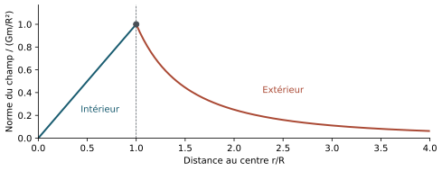
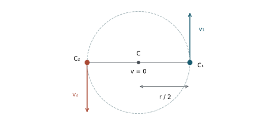
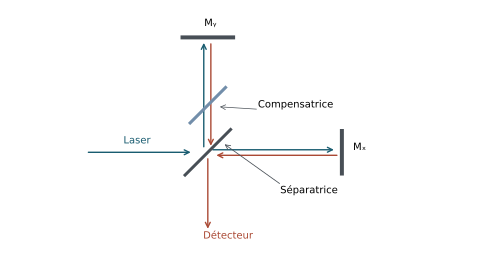
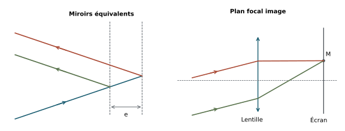
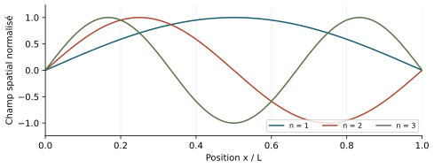
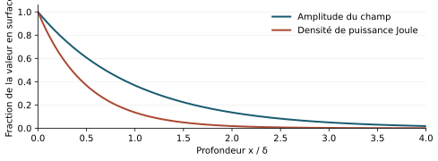

# Banque PT — Physique A 2020 · Corrigé brut

*Corrigé rédigé par IA, non officiel. Signalez toute erreur.*

**Rédaction** · GPT-6.2 Astra Ultra · vitesse non renseignée · 26 novembre 2026

**Révision** · GPT-6.2 Astra Ultra · vitesse non renseignée · 26 novembre 2026

Épreuve de quatre heures sans calculatrice. Le fascicule attribue 30 % à la dynamique du système binaire, 45 % à l’interféromètre et 25 % à l’absorption dans le miroir. Les numéros recommencent à chaque partie. Les quelques décimales intermédiaires servent à vérifier les arrondis demandés à un chiffre significatif.

[Sujet et données officiels](https://www.banquept.fr/documents/2020/ph_a_2020_pt.pdf) · [Rapport du jury](https://www.banquept.fr/documents/ecrit/rapport/2020/rapport_phys_a_ecrit_2020.pdf)

Le sujet illustre l’étude par Virgo et ses bras de 3 km près de Pise. La première observation directe citée, GW150914, a été enregistrée le 14 septembre 2015 à Livingston et Hanford par les deux détecteurs LIGO. Le signal venait de la fusion de deux trous noirs. L’annonce date du 11 février 2016. L’onde de 1 kHz dans la partie II est le signal hypothétique d’une supernova de l’amas de la Vierge.

[Communiqué officiel de LIGO sur GW150914](https://www.ligo.caltech.edu/page/press-release-gw150914)

## I.A — Champ gravitationnel

### I.1 — Force de Coulomb

Posons $r_{12}=\|\overrightarrow{P_1P_2}\|$ et $\vec u_{12}=\overrightarrow{P_1P_2}/r_{12}$, dirigé de la source vers la charge test. Dans le vide, deux charges ponctuelles immobiles vérifient
$$
\vec F_{1\to2}=\frac{1}{4\pi\varepsilon_0}\frac{q_1q_2}{r_{12}^2}\vec u_{12}.
$$
Le signe du produit des charges détermine attraction ou répulsion.

### I.2 — Théorème de Gauss électrique

Pour une surface fermée $\Sigma$ orientée par sa normale sortante, le flux du champ électrique total vaut
$$
\oiint_\Sigma \vec E\cdot\mathrm d\vec S=\frac{Q_{\rm int}}{\varepsilon_0}.
$$
$Q_{\rm int}$ est la charge algébrique enfermée. Les charges extérieures peuvent modifier le champ local tout en apportant un flux net nul à travers cette surface.

### I.3 — Force gravitationnelle

Avec la même orientation de $\vec u_{12}$, la masse $m_2$ est attirée vers $P_1$. La force de Newton vaut $\vec F_{1\to2}=-Gm_1m_2\vec u_{12}/r_{12}^2$. Le signe négatif traduit le sens de l'attraction pour des masses positives.

### I.4 — Correspondance et flux gravitationnel

L'écriture $\vec F=q_2\vec E$ devient $\vec F=m_2\vec g$. À la charge source correspond la masse, à la densité de charge la masse volumique et au coefficient $1/(4\pi\varepsilon_0)$ le coefficient $-G$. Ainsi,
$$
\oiint_\Sigma\vec g\cdot\mathrm d\vec S=-4\pi G M_{\rm int}.
$$
Le signe indique qu'une masse positive est une source de flux entrant. La forme locale correspondante est $\operatorname{div}\vec g=-4\pi G\rho$.

### I.5 — Champ extérieur de la sphère

Soit $r=OM>R$. Tout plan passant par $OM$ est un plan de symétrie de la répartition. Le champ en M appartient à chacun de ces plans, donc à leur intersection, la droite $OM$. L'invariance par rotation autour de O rend sa composante $g_r(r)$ identique sur toute la sphère de rayon $r$. Le flux sortant vaut donc $4\pi r^2g_r(r)$. Toute la masse $m$ est enfermée, d'où
$$
\vec g(M)=-\frac{Gm}{r^2}\vec u_r=-\frac{Gm}{r^3}\overrightarrow{OM}.
$$
À l'extérieur, l'astre sphérique produit le même champ qu'une masse ponctuelle $m$ placée au centre.

### I.6 — Champ intérieur

Pour $0<r<R$, la même symétrie s'applique, mais seule la masse de la boule de rayon $r$ est enfermée. La densité étant uniforme, $m_{\rm int}=m(r/R)^3$. En divisant le flux gravitationnel par $4\pi r^2$, on obtient $\vec g(M)=-(Gm/R^3)\overrightarrow{OM}$. Au centre, le champ est nul par symétrie. Les deux expressions coïncident en $r=R$.

### I.7 — Graphe de la norme du champ

La norme croît linéairement de zéro à $Gm/R^2$ pour $r$ de zéro à $R$. Elle décroît ensuite comme $Gm/r^2$ et tend vers zéro à l'infini. Le maximum se situe à la surface. La norme y est continue et sa pente change brusquement dans ce modèle de sphère homogène à bord net.

## I.B — Orbite des deux corps

### I.8 — Positions relatives

Les masses étant égales, $m\vec R_1+m\vec R_2=\vec0$, soit $\vec R_2=-\vec R_1$. Par définition, $\vec r=\overrightarrow{C_1C_2}=\vec R_2-\vec R_1$ ; il vient $\vec R_1=-\vec r/2$ et $\vec R_2=\vec r/2$. La distance de chaque corps à C vaut donc $r/2$.

### I.9 — Plan de l'orbite

La force exercée sur $C_1$ est dirigée selon $C_1C_2$, droite qui passe constamment par C. Son moment par rapport à C est nul. Dans le référentiel galiléen barycentrique, $\mathrm d\vec L_C/\mathrm dt=\vec0$ avec $\vec L_C=\vec R_1\times m\vec v_1$. Pour un moment initial non nul, $\vec R_1$ reste perpendiculaire au vecteur fixe $\vec L_C$, donc dans un plan fixe. Le cas dégénéré d'un moment nul est radial et reste également plan.

### I.10 — Uniformité lorsque la séparation est constante

Ici $R_1=r/2$ est constant. En coordonnées polaires dans le plan orbital, $L_C=mR_1^2\dot\theta$ est constant. Ainsi $\dot\theta$ et $v_1=R_1|\dot\theta|$ sont constants. L'accélération centripète demeure non nulle.

### I.11 — Géométrie et vitesses

Les deux corps décrivent le même cercle centré en C et restent diamétralement opposés. Ils tournent avec la même vitesse angulaire. En dérivant $\vec R_2=-\vec R_1$ on trouve $\vec v_2=-\vec v_1$. Les deux vitesses sont tangentes et ont même norme. Dans le référentiel employé, $\vec v_C=\vec0$.

### I.12 — Fréquence orbitale

L'attraction sur $C_1$ a pour norme $Gm^2/r^2$. L'accélération circulaire vaut $\omega^2r/2$ car le rayon de l'orbite est la moitié de la distance entre masses. La projection radiale de la dynamique donne
$$
m\omega^2\frac r2=\frac{Gm^2}{r^2},\qquad
f=\frac{\omega}{2\pi}=\sqrt{\frac{Gm}{2\pi^2r^3}}.
$$
$f$ désigne dans cette partie la fréquence du mouvement orbital.

### I.13 — Énergie potentielle

Pour la séparation $r$, la force relative radiale attractive s'écrit $-\mathrm dE_{\rm pot}/\mathrm dr=-Gm^2/r^2$. L'intégration avec $E_{\rm pot}(\infty)=0$ donne $E_{\rm pot}(r)=-Gm^2/r$. Cette énergie appartient à la paire et entre une seule fois dans son bilan.

### I.14 — Énergie cinétique d'un corps

Avec $v_1=\omega r/2$ et $\omega^2=2Gm/r^3$, on trouve $v_1^2=Gm/(2r)$. Par conséquent, $E_{c1}=mv_1^2/2=Gm^2/(4r)$. L'autre corps possède la même énergie cinétique.

### I.15 — Énergie mécanique du système

La somme des deux termes cinétiques et du terme d'interaction vaut $E_m=2E_{c1}+E_{\rm pot}=-Gm^2/(2r)$. Elle est négative pour l'orbite liée. Dans le modèle newtonien isolé, l'interaction intérieure dérive d'un potentiel indépendant du temps et il n'y a aucune puissance extérieure, donc $E_m$ se conserve.

### I.16 — Énergie et fréquence

De I.12 on tire $r^{-1}=(2\pi^2/Gm)^{1/3}f^{2/3}$. En reportant dans I.15,
$$
E_m=-\alpha f^{2/3},\qquad
\alpha=\left(\frac{\pi G}{2}\right)^{2/3}m^{5/3}.
$$
Avec $[G]=L^3M^{-1}T^{-2}$, on a $[\alpha]=ML^2T^{-4/3}$. Le facteur $[f^{2/3}]=T^{-2/3}$ rend au produit la dimension $ML^2T^{-2}$ d'une énergie.

## I.C — Émission gravitationnelle

### I.17 — Évolution sous l'effet du rayonnement

L'émission emporte une puissance positive $P$. Ainsi $\dot E_m=-P<0$ : l'énergie déjà négative devient plus négative. Puisque $E_m=-Gm^2/(2r)$ sur la suite d'orbites presque circulaires, la séparation diminue. La loi $f\propto r^{-3/2}$ implique alors une fréquence croissante.

### I.18 — Équation différentielle de la fréquence

La loi fournie donne $P\propto r^{-5}\propto f^{10/3}$, avec un coefficient positif constant. Par ailleurs,
$$
-P=\dot E_m=-\frac{2\alpha}{3} f^{-1/3}\dot f .
$$
Il faut multiplier la puissance par $f^{1/3}$ pour isoler $\dot f$. Il vient $\dot f=Kf^{11/3}$, $K>0$, soit $\beta=11/3$. La fréquence et son taux d'augmentation croissent tous deux. La puissance radiative employée ici est la correction admise par le feuillet ; la mécanique newtonienne de la partie précédente ne la produit pas à elle seule.

### I.19 — Intégration

Pour $f(0)=f_0>0$, séparer les variables puis intégrer :
$$
\int_{f_0}^{f(t)}u^{-11/3}\,\mathrm du=Kt,\qquad
f(t)^{-8/3}=f_0^{-8/3}-\frac{8K}{3}t .
$$
Ainsi $f(t)=f_0(1-t/\tau)^{-3/8}$ avec $\tau=3/(8Kf_0^{8/3})$. Le domaine de cette expression est $0\leq t<\tau$.

### I.20 — Interprétation du temps caractéristique

À $t=\tau$, la loi extrapolée donne $f\to\infty$ et $r\to0$. Ce temps mesure le délai de coalescence prédit à partir de la fréquence initiale. Avant la singularité mathématique, l'approximation newtonienne d'orbites quasi circulaires et de pertes faibles par tour cesse de décrire la fusion réelle.

## II.A — Michelson en lame d’air

### II.1 — Réglage en lame d'air

Après repliement d'un bras par la séparatrice, l'image d'un miroir et l'autre miroir sont **parallèles**, distants de $e=|L_y-L_x|$ dans l'air. Les deux ondes émergentes correspondant à un même rayon incident sont parallèles. Avec une source étendue, les franges d'égale inclinaison sont localisées à l'infini. Une lentille convergente les ramène dans son plan focal image. Un écran déplacé hors de ce plan mélange les contributions de directions voisines et la visibilité des anneaux diminue, jusqu'au brouillage.

### II.2 — Rôle et placement de la compensatrice

Avec une séparatrice d'épaisseur réelle, les deux faisceaux qui atteignent le détecteur traversent des épaisseurs de verre différentes. Une lame de même verre, de même épaisseur et parallèle à la séparatrice est placée dans le bras dont le faisceau traverse le moins de verre. Son aller-retour fournit les deux traversées manquantes, équilibrant chemin optique et dispersion. Sur le schéma, la couche réfléchissante est du côté d'entrée du faisceau incident et la compensatrice se trouve dans le bras $y$. Le repliement des miroirs forme, lui, la lame d'air.

### II.3 — Marche des rayons et forme des franges

Dans la représentation repliée, deux rayons qui illuminent un point M de l'écran quittent les miroirs avec la même inclinaison $i$. Entre les plans des miroirs, le trajet aller-retour supplémentaire vaut $2e/\cos i$. Pour arrêter les parcours sur un même front d'onde, on en retranche la projection du décalage transversal, $(2e\tan i)\sin i$. Il reste
$$
\delta_{\rm géom}=2e\cos i .
$$
À la sortie étudiée, les réflexions sur les deux faces de la séparatrice ajoutent une différence de phase constante $\pi$, équivalente à $\lambda/2$ de marche modulo $\lambda$. Dans le schéma, le plan normal au premier miroir sert de référence. L’angle $i$ est mesuré entre le rayon incident et la normale au miroir. Les deux miroirs terminaux apportent chacun la même phase. Dans le plan focal, $\rho=f'\tan i$. Les directions de même $i$ donnent le même éclairement, donc des cercles concentriques accessibles pour $i\leq\alpha$.

### II.4 — Rayon du premier anneau brillant

Ici $2e/\lambda=10\,000$. Pour la sortie dont les contributions ont le déphasage supplémentaire $\pi$, le centre est sombre. Le premier maximum non central vérifie $2e\cos i_1=(10\,000-1/2)\lambda$. D'où $1-\cos i_1=\lambda/(4e)$ et, aux petits angles,
$$
i_1\simeq\sqrt{\lambda/(2e)}=1{,}0\times10^{-2}\,\mathrm{rad},\qquad
\rho_1=f'\tan i_1\simeq1\,\mathrm{mm}.
$$
Si l'on observe la sortie complémentaire, le centre est brillant et le premier anneau **hors du centre** vérifie $2e\cos i=(10\,000-1)\lambda$. Son rayon avant arrondi vaut $1{,}41\,\mathrm{mm}$. Cette distinction précise le rôle de la convention de réflexion.

## II.B — Passage de l’onde

### II.5 — Éclairement d'un seul bras

Un rayon destiné au détecteur subit une transmission et une réflexion à la séparatrice, chacune de facteur $1/2$ sur l'éclairement, ainsi qu'une réflexion parfaite sur le miroir terminal. L'éclairement d'un seul bras ouvert vaut donc $E_0/4$. Son amplitude a pour module $|S_0|/2$.

### II.6 — Différence de phase à la sortie

Les chemins optiques aller-retour sont $2n_xL_x$ et $2n_yL_y$. Pour retrouver le signe de la formule de II.10, notons $\varphi_i$ le **retard de propagation** positif et écrivons le facteur complexe $\exp(-j\varphi_i)$. Alors
$$
\varphi=\varphi_y-\varphi_x=\frac{4\pi}{\lambda}(n_yL_y-n_xL_x).
$$
La différence de phase des amplitudes complètes inclut en outre l'opposition de signe des réflexions sur les faces de la séparatrice. On garde cette opposition explicitement en II.7 ; si on l'incorpore dans la phase, elle ajoute $\pi$ modulo $2\pi$.

### II.7 — Somme cohérente des amplitudes

À une phase commune près, écrivons $S_x=(S_0/2)e^{-j\varphi_x}$ et $S_y=-(S_0/2)e^{-j\varphi_y}$. Le signe relatif vient de la séparatrice. L'éclairement proportionnel au module au carré du champ total est
$$
E_y=|S_x+S_y|^2=\frac{E_0}{2}(1-\cos\varphi)
=E_0\sin^2(\varphi/2).
$$
À chemins égaux, la sortie vers $-\vec u_y$ est sombre. Occulter un bras restitue bien $E_0/4$.

### II.8 — Uniformité sur la hauteur du miroir

La longueur d'onde gravitationnelle à $f_0=1\,\mathrm{kHz}$ est $\Lambda=c/f_0=3\times10^5\,\mathrm m$. Pour la hauteur $D\leq1\,\mathrm m$, le déphasage vertical maximal $2\pi D/\Lambda\leq2\times10^{-5}\,\mathrm{rad}$ est négligeable. On peut donc prendre $\tau(z,t)\simeq\tau(t)$ à l'échelle verticale du détecteur.

### II.9 — Temps d'intégration

La période optique est $\lambda/c\simeq2\times10^{-15}\,\mathrm s$. Le temps $T=10^{-4}\,\mathrm s$ moyenne de très nombreuses oscillations optiques, tout en restant égal au dixième de la période gravitationnelle de $10^{-3}\,\mathrm s$. Une moyenne centrée sur $T$ multiplie exactement une modulation sinusoïdale par $\sin(\pi f_0T)/(\pi f_0T)\simeq0{,}984$. L'éclairement instantané en II.7 constitue donc une approximation quasi statique à environ deux pour cent sur son amplitude modulée.

### II.10 — Éclairement au premier ordre

Avec $n_y=1+\tau$ et $n_x=1-\tau$, la phase devient $\varphi=\varphi_0+\eta$, où $\varphi_0=4\pi(L_y-L_x)/\lambda$ et $\eta=4\pi(L_x+L_y)\tau(t)/\lambda$. Comme $|\eta|\ll1$, développer $\cos(\varphi_0+\eta)$ à l'ordre un donne
$$
\frac{E_y}{E_0}\simeq\frac{1-\cos\varphi_0}{2}
+\frac{2\pi(L_x+L_y)}{\lambda}\tau(t)\sin\varphi_0 .
$$
La partie variable dépend de la somme des bras, car la perturbation accroît l'un des indices et réduit l'autre.

### II.11 — Réglage optimal et variation de puissance

La pente en valeur absolue est maximale pour $|\sin\varphi_0|=1$, donc $\varphi_0=\pi/2+k\pi$. Le fond vaut alors $P_0/2$. Pour $P_0=10\,\mathrm W$, $L_x+L_y=6000\,\mathrm m$ et $\tau_M=10^{-21}$, l'amplitude crête de la variation vaut
$$
|\Delta P_y|_{\max}=P_0\frac{2\pi(L_x+L_y)}{\lambda}\tau_M
\simeq 6\times10^{-10}\,\mathrm W.
$$
La variation entre minimum et maximum sur une période entière vaut le double.

## II.C — Seuil de détection

### II.12 — Nombre moyen de photons

Pendant $T$, la photodiode reçoit l'énergie $\langle P_y\rangle T$. Chaque photon a l'énergie $hc/\lambda$. Ainsi $\langle N\rangle=\lambda\langle P_y\rangle T/(hc)$. Avec $\langle P_y\rangle=5\,\mathrm W$ au repos, la détection réunit environ $1{,}5\times10^{15}$ photons pendant $10^{-4}\,\mathrm s$.

### II.13 — Bruit de puissance

À fenêtre fixée, un photon de plus augmente la puissance mesurée de $hc/(\lambda T)$. Une fluctuation de comptage $\sqrt{\langle N\rangle}$ donne l'écart type
$$
\sigma_P=\frac{hc}{\lambda T}\sqrt{\langle N\rangle}
=\sqrt{\frac{hc\langle P_y\rangle}{\lambda T}}
\simeq1{,}3\times10^{-7}\,\mathrm W.
$$
La puissance de fond détermine ce bruit de comptage.

### II.14 — Seuil absolu et facteur deux

En appliquant la formule **imprimée** avec $L_\Sigma=L_x+L_y$ et $\langle P_y\rangle=P_0/2=5\,\mathrm W$, on trouve
$$
\tau_{M,\rm imprimé}=\frac{1}{2\pi L_\Sigma}
\sqrt{\frac{hc\lambda}{\langle P_y\rangle T}}
=4{,}09\times10^{-19}\simeq4\times10^{-19}.
$$
Suivons aussi les définitions de II.10–II.13. Au réglage $\pi/2$, le signal de crête est $P_0(2\pi L_\Sigma/\lambda)\tau_M$. L'égalité entre ce signal et $\sigma_P$ donne
$$
\tau_{M,\rm déduit}=\frac{1}{4\pi L_\Sigma}
\sqrt{\frac{hc\lambda}{\langle P_y\rangle T}}
\simeq2\times10^{-19}.
$$
La formule proposée est deux fois cette valeur. Employer $\langle P_y\rangle$ à la place de $P_0$ dans la pente de II.10 produit précisément cet écart. Les deux seuils dépassent de plus de deux ordres de grandeur l'anisotropie $10^{-21}$. Le Michelson simple est insuffisant.

## II.D — Cavité résonante

### II.15 — Propagation dans le vide de la cavité

Dans le vide sans charge ni courant, $\nabla\cdot\vec E=0$, $\nabla\times\vec E=-\partial_t\vec B$ et $\nabla\times\vec B=c^{-2}\partial_t\vec E$. Prendre le rotationnel de Faraday et employer $\nabla\times(\nabla\times\vec E)=\nabla(\nabla\cdot\vec E)-\Delta\vec E$ donne
$$
\partial_x^2\vec E-c^{-2}\partial_t^2\vec E=\vec0
$$
pour la cavité unidimensionnelle.

### II.16 — Nature du champ séparé

Le produit $g(x)\cos(2\pi ft)\vec u_y$ décrit une onde stationnaire harmonique polarisée rectilignement. Tous les points oscillent en phase ou en opposition, avec une amplitude qui dépend de $x$. Aux nœuds, $g=0$ pour tout instant. Une telle onde peut se former par superposition de deux ondes progressives de même amplitude et de sens opposés.

### II.17 — Conducteur parfait

Dans le volume d'un conducteur parfait, le champ électrique est nul. En prenant la limite de conductivité infinie dans $\vec j=\gamma\vec E$ pour une densité de courant volumique finie, il faut $\vec E=\vec0$. Une éventuelle charge de surface peut toutefois produire une composante normale du champ dans le vide.

### II.18 — Conditions aux limites

Le champ de l'onde est parallèle aux surfaces des conducteurs situées à $x=0$ et $x=L$. La continuité de cette composante avec le champ intérieur nul impose $E_y(0,t)=E_y(L,t)=0$ pour tout $t$. Donc $g(0)=g(L)=0$.

### II.19 — Fonction spatiale

Insérer le champ séparé dans l'équation de propagation donne $g''+k^2g=0$, où $k=2\pi f/c$. Pour $f>0$, $g=A\cos(kx)+B\sin(kx)$. La première frontière impose $A=0$. La seconde donne $B\sin(kL)=0$.

### II.20 — Modes propres

Un champ non nul exige $kL=n\pi$ avec l'entier $n\geq1$. Les modes ont pour fréquences $f_n=nc/(2L)$ et pour longueurs d'onde $\lambda_n=2L/n$. Il entre exactement $n$ demi-longueurs d'onde entre les deux nœuds imposés aux miroirs.

## II.E — Bras munis de cavités

### II.21 — Déphasage d'un tour de cavité

Deux contributions successives ont un aller-retour de différence dans le matériau d'indice $n_x$, soit $2n_x\ell_x$ de chemin optique. Avec le retard positif déjà adopté, $\psi=4\pi n_x\ell_x/\lambda$ modulo $2\pi$. Les phases fixes d'une paire de réflexions sont prises modulo $2\pi$ suivant la convention de résonance du sujet.

### II.22 — Condition de résonance

Sans onde gravitationnelle, $n_x=1$. Des contributions successives en phase exigent $\psi=2\pi n$, soit $\ell_x=n\lambda/2$. La longueur de résonance est ainsi celle qui admet un mode de la cavité de II.20 à la fréquence du laser.

### II.23 — Amplitude émergente du bras y

La perturbation d'indice a un signe opposé dans ce bras. Dans la formule admise pour $x$, il faut remplacer $\tau$ par $-\tau$, $\ell_x$ par $\ell_y$ et $S_1$ par $S_2$. Avec $F=(1+r)/(1-r)$, on obtient
$$
S'_y=-S_2\exp\!\left(-j\,\frac{4\pi F\ell_y}{\lambda}\tau(t)\right).
$$
Le signe commun de réflexion subsiste dans les deux bras.

### II.24 — Éclairement muni des cavités

Les deux phases supplémentaires portent maintenant le facteur $F$. Pour $\ell_x\simeq L_x$ et $\ell_y\simeq L_y$, la partie variable de la phase de II.10 est multipliée par $F$. À réglage statique $\varphi_0$ fixé,
$$
\frac{E_y}{E_0}\simeq\frac{1-\cos\varphi_0}{2}
+F\,\frac{2\pi(L_x+L_y)}{\lambda}\tau(t)\sin\varphi_0.
$$
Le terme de fond reste celui de l'interféromètre réglé en l'absence de perturbation.

### II.25 — Gain et faisabilité de la mesure

À $\varphi_0=\pi/2$, le gain sur la pente est $F=1{,}995/0{,}005=399\simeq4\times10^2$. Le bruit étant supposé inchangé, chaque seuil de II.14 est divisé par 399. Le coefficient intervient sur la réponse de phase, donc sur le signal à la photodiode. Le seuil imprimé devient $1{,}03\times10^{-21}$, du même ordre que le signal et légèrement supérieur avant arrondi. Le seuil déduit de la pente devient $5{,}1\times10^{-22}$. Avec cette pente, le signal de crête est $2{,}5\times10^{-7}\,\mathrm W$ pour un bruit de $1{,}3\times10^{-7}\,\mathrm W$, soit un rapport voisin de 2. Les cavités rendent la détection de cette amplitude envisageable dans le modèle idéal, au voisinage du seuil.

## III — Onde et pénétration dans le miroir

### III.1 — Onde incidente sur le miroir

Le champ $\underline{\vec E}=E_0\exp[j(\omega t-kx)]\vec u_z$ est la représentation complexe d'une onde électromagnétique plane progressive harmonique, monochromatique, transverse, polarisée rectilignement suivant $Oz$. Les plans de phase constante sont orthogonaux à $Ox$ et avancent vers les $x$ croissants. Le champ physique est la partie réelle.

### III.2 — Fréquence optique

Dans le vide, $f=c/\lambda=3{,}0\times10^8/(6{,}0\times10^{-7})=5\times10^{14}\,\mathrm{Hz}$. La pulsation correspondante vaut $\omega=2\pi f\simeq3\times10^{15}\,\mathrm{rad\,s^{-1}}$.

### III.3 — Champ magnétique et flux d'énergie

La relation de structure dans le vide est $\underline{\vec B}=\vec u_x\times\underline{\vec E}/c$. Comme $\vec u_x\times\vec u_z=-\vec u_y$,
$$
\underline{\vec B}=-\frac{E_0}{c}\,e^{j(\omega t-kx)}\vec u_y.
$$
Avec les champs réels, $\vec\Pi=\vec E\times\vec B/\mu_0$ est dirigé vers $+Ox$ et proportionnel à $\cos^2(\omega t-kx)$. Sa moyenne vaut $\langle\vec\Pi\rangle=E_0^2\vec u_x/(2\mu_0c)$ pour une amplitude $E_0$ réelle positive.

### III.4 — Puissance et amplitude électrique

Pour un faisceau uniforme de section $S=\pi(0{,}050)^2\simeq7{,}85\times10^{-3}\,\mathrm{m^2}$ perpendiculaire à $Ox$,
$$
P=\frac{S E_0^2}{2\mu_0c},\qquad
E_0=\sqrt{\frac{2\mu_0cP}{S}}\simeq2\times10^3\,\mathrm{V\,m^{-1}}.
$$
On utilise ici les $40\,\mathrm W$ du faisceau de la partie III. L'éclairement moyen incident est d'environ $5\times10^3\,\mathrm{W\,m^{-2}}$.

### III.5 — Maxwell–Ampère dans le métal

Pour le milieu ohmique modélisé avec $\mu_0$ et $\varepsilon_0$,
$$
\nabla\times\vec B=\mu_0\left(\gamma\vec E+\varepsilon_0\partial_t\vec E\right).
$$
En régime sinusoïdal, le rapport des amplitudes de courant de conduction et de courant de déplacement est $\gamma/(\varepsilon_0\omega)\simeq3{,}6\times10^2\gg1$. Le terme de déplacement ne représente qu'environ $0{,}3\,\%$ du terme de conduction avec les données du modèle.

### III.6 — Équation de propagation approchée

Le champ transverse $E_z(x,t)$ a une divergence nulle dans le volume homogène. Prendre le rotationnel de Faraday puis remplacer $\nabla\times\vec B$ par $\mu_0\gamma\vec E$ donne
$$
\partial_x^2 E_z=\mu_0\gamma\,\partial_t E_z.
$$
Il s'agit ici de l'équation de diffusion électromagnétique du bon conducteur. La dérivée seconde en temps du terme de déplacement a été négligée en III.5.

### III.7 — Relation de dispersion

En cherchant $\underline E_z\propto e^{j(\omega t-\underline kx)}$, on obtient $-\underline k^2=j\mu_0\gamma\omega$. En introduisant $\delta=\sqrt{2/(\mu_0\gamma\omega)}$, les deux racines sont $\underline k=\pm(1-j)/\delta$. Dans le métal occupant $x>0$, conserver $(1-j)/\delta$ conduit à une amplitude décroissante et à une phase qui avance vers les $x$ croissants.

### III.8a — Champ dans le conducteur semi-infini

La solution qui reste bornée quand $x\to+\infty$ vaut
$$
\underline{\vec E}(x,t)=\underline E_{0t}\,e^{-x/\delta}
 e^{j(\omega t-x/\delta)}\vec u_z .
$$
L'amplitude complexe $\underline E_{0t}$ fixe la valeur et la phase du champ transmis à la face d'entrée. L'autre racine donnerait une croissance exponentielle vers l'intérieur.

### III.8b — Épaisseur de peau

$\delta$ est la profondeur à laquelle **l'amplitude du champ** tombe à $1/e$ de sa valeur à la surface. Le carré de l'amplitude tombe à $1/e$ dès $x=\delta/2$. Numériquement,
$$
\delta=\sqrt{\frac{2}{(4\pi\times10^{-7})(10^7)(2\pi\times5\times10^{14})}}
\simeq7\times10^{-9}\,\mathrm m .
$$

### III.8c — Vitesse de phase

À phase constante, $\omega t-x/\delta$ reste constant. La vitesse correspondante est $v_\varphi=\omega\delta=\sqrt{2\omega/(\mu_0\gamma)}\simeq2\times10^7\,\mathrm{m\,s^{-1}}$. Elle se rapporte à la phase de l'onde amortie dans le modèle ohmique.

### III.8d — Dissipation moyenne par unité de volume

La puissance Joule instantanée est $\vec j\cdot\vec E=\gamma E_{\rm réel}^2$. En moyennant sur une période et en posant $|\underline E_{0t}|=|t|E_0$, on trouve
$$
\langle p_J(x)\rangle=\frac{\gamma|t|^2 E_0^2}{2}e^{-2x/\delta}.
$$
Pour $|t|=10^{-4}$, la valeur à la surface approche $2\times10^5\,\mathrm{W\,m^{-3}}$. Le passage de l'amplitude à la puissance explique à la fois le carré de $|t|$ et le facteur 2 dans l'exposant.

## III — Échauffement et dilatation

### III.9 — Validité de l'approximation semi-infinie

La face arrière peut être négligée si $L\gg\delta$, de sorte que l'onde qui l'atteint est déjà très atténuée et qu'un retour après réflexion l'est encore davantage. Ici $L/\delta\simeq1{,}4\times10^5$. Un facteur de champ $e^{-L/\delta}$ est donc négligeable à la précision du modèle.

### III.10 — Puissance totale absorbée

Intégrer la puissance volumique sur l'épaisseur réelle $L$ et la surface éclairée $S$ :
$$
P_J=S\int_0^L\langle p_J(x)\rangle\,\mathrm dx
=\frac{\gamma S |t|^2E_0^2\delta}{4}(1-e^{-2L/\delta})
\simeq\frac{10^{-8}\gamma S E_0^2\delta}{4}.
$$
On trouve $P_J\simeq5\times10^{-6}\,\mathrm W$. Cette puissance est une petite fraction, environ $1{,}3\times10^{-7}$, des $40\,\mathrm W$ incidents.

### III.11 — Vitesse d'échauffement sans évacuation

Dans un volume de section $S$ et d'épaisseur chauffée $d$, le bilan moyen initial est $\rho c_m S d\,\mathrm dT/\mathrm dt=P_J$. La question parle du volume précédent. En moyenne sur le **miroir éclairé entier**, prendre $d=L=10^{-3}\,\mathrm m$ donne $\dot T_{L}\simeq2\times10^{-7}\,\mathrm{K\,s^{-1}}$.
 
Si, avant diffusion, on concentre la chaleur dans la **couche de peau** comme demandé en III.12b, prendre $d\simeq\delta$ donne
$$
\dot T_\delta\simeq\frac{P_J}{\rho c_m S\delta}
=\frac{\gamma |t|^2 E_0^2}{4\rho c_m}\simeq3\times10^{-2}\,\mathrm{K\,s^{-1}}.
$$
Ce second chiffre est une estimation moyenne sur la zone de dépôt. Les deux vitesses se rapportent à des masses différentes.

### III.12a — Pourquoi contraindre la dilatation ?

Si la face réfléchissante du miroir se déplace d'une épaisseur $\Delta L$, la marche aller-retour de ce bras varie de $2\Delta L$ et la phase de $4\pi\Delta L/\lambda$ en valeur absolue. Le détecteur mesure précisément de très faibles variations de marche. Une déformation thermique parasite pourrait produire ce même type de variation ou masquer le signal. La tolérance imprimée est une **longueur** $10^{-15}\lambda=6\times10^{-22}\,\mathrm m$.

### III.12b — Durée maximale d'éclairement dans le modèle local

Pour la seule zone chauffée, $\Delta L\simeq\lambda_d\delta\,\Delta T$. Sans évacuation, $\Delta T\simeq\dot T_\delta t$. La limite fixée impose
$$
t_{\max}\simeq\frac{10^{-15}\lambda}{\lambda_d\delta\dot T_\delta}
=\frac{10^{-15}\lambda\,\rho c_m S}{\lambda_dP_J}
\simeq3\times10^{-7}\,\mathrm s.
$$
Avec $\lambda_d=10^{-5}\,\mathrm{K^{-1}}$, l'échauffement maximal correspondant est voisin de $8\times10^{-9}\,\mathrm K$. Cette durée dépend des hypothèses adiabatique et unidimensionnelle du calcul.

### III.13 — Diffusion thermique à travers le métal

Avec une conductivité thermique $\kappa=400\,\mathrm{W\,m^{-1}\,K^{-1}}$, la diffusivité est $D_{\rm th}=\kappa/(\rho c_m)\simeq1{,}25\times10^{-4}\,\mathrm{m^2\,s^{-1}}$. L'équation $\partial_t T=D_{\rm th}\partial_x^2T$ donne le temps de diffusion, à un facteur géométrique près,
$$
t_{\rm diff}(L)\sim\frac{L^2}{D_{\rm th}}
=\frac{(10^{-3})^2(8\times10^3)(400)}{400}
\simeq8\times10^{-3}\,\mathrm s .
$$
Répartir la chaleur dans toute l'épaisseur demande des millisecondes, bien davantage que la durée de III.12b. La diffusion commence toutefois près de la surface bien avant d'atteindre la face arrière. À l’échelle de la peau, le même modèle donne $\delta^2/D_{\rm th}\sim4\times10^{-13}\,\mathrm s$ ; le dépôt ne reste donc pas durablement confiné à cette épaisseur. La durée de III.12b est donc celle du modèle local imposé.
