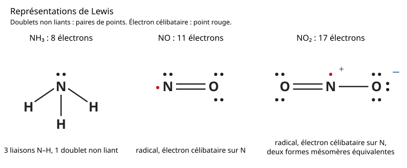
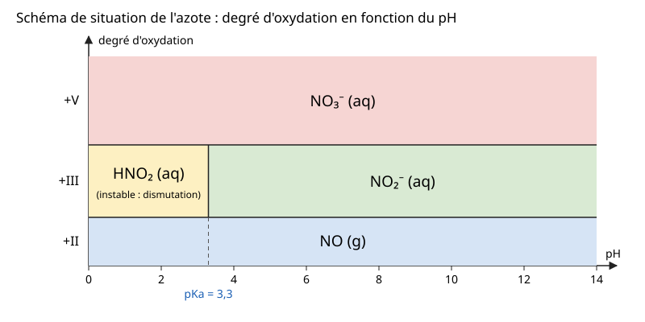
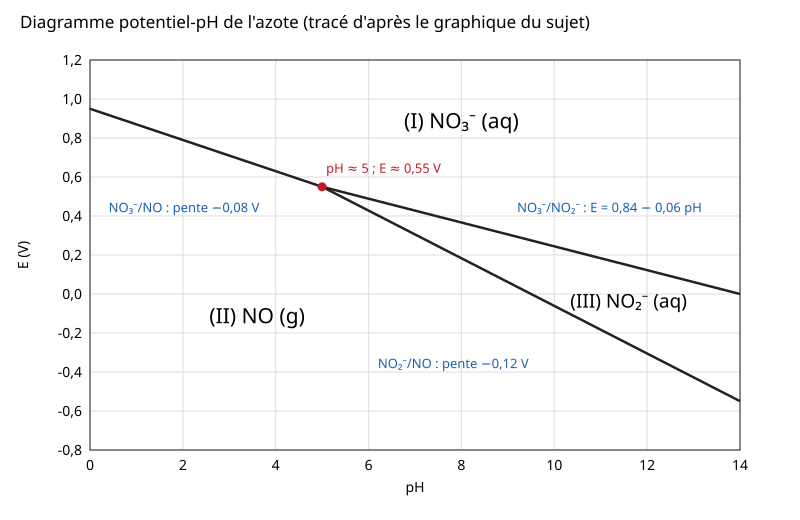
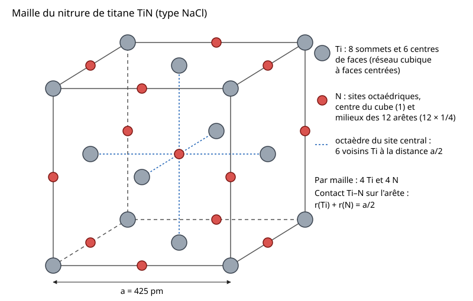

# Banque PT PT — Physique B - Chimie 2020 · Corrigé brut

*Corrigé rédigé par IA, non officiel. Signalez toute erreur.*

**Rédaction** · modèle exact non renseigné (famille Claude) · effort non renseigné · vitesse non renseignée

**Révision (tour 2)** · modèle exact non renseigné (famille Claude) · effort non renseigné · vitesse non renseignée · 28 novembre 2026

Épreuve de 2 heures, sans calculatrice, sur la chimie de l'azote et quelques-unes de ses applications industrielles : 41 questions en cinq parties indépendantes de même poids (20 % chacune). Les 41 questions sont traitées. Les valeurs lues sur le diagramme potentiel-pH et sur la courbe de titrage du sujet sont signalées à l'endroit où elles servent. Les applications numériques emploient les données de l'énoncé.

[Sujet officiel](https://www.banquept.fr/documents/2020/ph_b_ch_2020_pt.pdf) · [Rapport du jury](https://www.banquept.fr/documents/ecrit/rapport/2020/rapport_phys_b_ecrit_2020.pdf)

## Partie 1 — Synthèse de l'ammoniac

### Question 1 — Équation de la réaction (1)

Pour une mole de diazote :

$$\boxed{\mathrm{N_{2(g)}} + 3\,\mathrm{H_{2(g)}} = 2\,\mathrm{NH_{3(g)}} \qquad (1)}$$

### Question 2 — Enthalpies standard de formation du diazote et du dihydrogène

L'enthalpie standard de formation d'une espèce est l'enthalpie standard de la réaction qui la forme à partir des corps simples, pris dans leur état standard de référence. Or, à 298 K, $\mathrm{N_{2(g)}}$ et $\mathrm{H_{2(g)}}$ sont précisément les états standard de référence des éléments azote et hydrogène : leur réaction de formation s'écrit $\mathrm{N_{2(g)}} = \mathrm{N_{2(g)}}$, sans transformation.

$$\boxed{\Delta_f H^\circ(\mathrm{N_{2(g)}}) = \Delta_f H^\circ(\mathrm{H_{2(g)}}) = 0}$$

### Question 3 — Enthalpie standard de réaction

Loi de Hess appliquée à (1) :

$$\Delta_r H^\circ = 2\,\Delta_f H^\circ(\mathrm{NH_3}) - \Delta_f H^\circ(\mathrm{N_2}) - 3\,\Delta_f H^\circ(\mathrm{H_2})$$

$$\Delta_r H^\circ = 2\times(-46) - 0 - 0$$

$$\boxed{\Delta_r H^\circ = -92\ \mathrm{kJ\cdot mol^{-1}}}$$

$\Delta_r H^\circ < 0$ : la réaction est **exothermique** dans le sens direct. Menée à pression et température constantes, elle cède de l'énergie thermique au milieu extérieur ; il faut donc refroidir le réacteur pour le maintenir à température constante.

### Question 4 — Entropie standard de réaction

$$\Delta_r S^\circ = 2\,S_m^\circ(\mathrm{NH_3}) - S_m^\circ(\mathrm{N_2}) - 3\,S_m^\circ(\mathrm{H_2})$$

$$\Delta_r S^\circ = 2\times 192 - 190 - 3\times 130 = 384 - 580$$

$$\boxed{\Delta_r S^\circ = -196\ \mathrm{J\cdot K^{-1}\cdot mol^{-1}}}$$

Le signe était prévisible : la réaction fait passer de 4 moles de gaz à 2 moles de gaz ($\sum_i \nu_{i,\mathrm{gaz}} = -2 < 0$). Le désordre du système diminue, donc $\Delta_r S^\circ < 0$.

### Question 5 — Constante d'équilibre à 300 K

Par définition de l'enthalpie libre standard de réaction et de la constante d'équilibre :

$$\Delta_r G^\circ(T) = \Delta_r H^\circ - T\,\Delta_r S^\circ$$

$$\Delta_r G^\circ(T) = -RT\ln K^\circ(T)$$

Les grandeurs $\Delta_r H^\circ$ et $\Delta_r S^\circ$ ont été calculées à 298 K ; on les suppose indépendantes de la température (approximation d'Ellingham), ce qui est sans conséquence entre 298 K et 300 K. D'où

$$\boxed{K^\circ(T) = \exp\!\left(-\frac{\Delta_r H^\circ - T\,\Delta_r S^\circ}{RT}\right) = \exp\!\left(-\frac{\Delta_r H^\circ}{RT} + \frac{\Delta_r S^\circ}{R}\right)}$$

Contrôle numérique à $T = 300$ K, en unités cohérentes (joules) :

$$\Delta_r G^\circ = -92\cdot 10^{3} + 300\times 196 = -33{,}2\cdot 10^{3}\ \mathrm{J\cdot mol^{-1}}$$

$$\ln K^\circ = \frac{33{,}2\cdot 10^{3}}{8{,}3\times 300} \approx 13{,}3$$

soit $K^\circ \approx 6\cdot 10^{5}$, en accord avec la valeur $6{,}03\cdot 10^{5}$ fournie. La réaction est très favorable thermodynamiquement à température ambiante.

### Question 6 — Influence d'une augmentation isotherme de pression

On part d'un état d'équilibre, où $Q_r = K^\circ(T)$. Pour des gaz parfaits, avec $P_i = x_i P$ :

$$Q_r = \frac{P_{\mathrm{NH_3}}^{2}\,{P^\circ}^{2}}{P_{\mathrm{N_2}}\,P_{\mathrm{H_2}}^{3}}$$

$$Q_r = \frac{x_{\mathrm{NH_3}}^{2}}{x_{\mathrm{N_2}}\,x_{\mathrm{H_2}}^{3}}\left(\frac{P^\circ}{P}\right)^{2}$$

On augmente la pression à température constante : $K^\circ(T)$ ne change pas. Juste après la perturbation, la composition (les $x_i$) n'a pas encore varié, donc $Q_r$, proportionnel à $1/P^{2}$, **diminue** :

$$Q_r < K^\circ$$

Le système évolue alors dans le sens qui fait croître $Q_r$, c'est-à-dire le sens direct.

$$\boxed{\text{Une augmentation de pression déplace l'équilibre dans le sens direct (formation de } \mathrm{NH_3}\text{).}}$$

C'est le sens de la diminution de la quantité de gaz ($4 \to 2$ moles), conformément à la loi de modération de Le Chatelier. Industriellement, on travaille donc sous forte pression (quelques centaines de bars).

### Question 7 — Influence d'une augmentation isobare de température

Loi de Van't Hoff :

$$\frac{\mathrm d \ln K^\circ}{\mathrm dT} = \frac{\Delta_r H^\circ}{RT^{2}}$$

Ici $\Delta_r H^\circ = -92\ \mathrm{kJ\cdot mol^{-1}} < 0$ : $K^\circ$ est une fonction **décroissante** de la température.

On part d'un état d'équilibre ($Q_r = K^\circ(T_1)$) et l'on élève la température à pression constante. Juste après la perturbation, ni la pression ni la composition n'ont changé, donc $Q_r$ garde sa valeur, tandis que la constante a diminué :

$$Q_r = K^\circ(T_1) > K^\circ(T_2)$$

Le système évolue dans le sens qui fait décroître $Q_r$ : le sens indirect.

$$\boxed{\text{Une augmentation de température déplace l'équilibre dans le sens indirect (dissociation de } \mathrm{NH_3}\text{).}}$$

C'est le sens endothermique, conformément à la loi de modération. Du seul point de vue thermodynamique, la synthèse est favorisée à basse température.

### Question 8 — Catalyseur

**Définition.** Un catalyseur est une espèce qui augmente la vitesse d'une réaction sans figurer dans son équation-bilan : il est consommé puis régénéré au cours du mécanisme. Il ne modifie ni la constante d'équilibre ni la composition à l'équilibre ; il permet seulement d'atteindre plus vite l'état final, en ouvrant un chemin réactionnel d'énergie d'activation plus faible.

**Intérêt ici.** D'après la question 7, un bon taux de conversion demande une température basse. Mais à basse température la réaction est extrêmement lente : il faut rompre la triple liaison très stable du diazote, ce qui correspond à une forte énergie d'activation. On ne peut pas compenser en chauffant fortement, puisque cela ferait chuter $K^\circ$. Le catalyseur (du fer, en catalyse hétérogène dans le procédé Haber) rend la vitesse acceptable à une température modérée, de l'ordre de 450 °C : c'est un compromis entre cinétique et thermodynamique, complété par une pression élevée (question 6).

### Question 9 — Représentations de Lewis de l'ammoniac, du monoxyde et du dioxyde d'azote

Décompte des électrons de valence (N : 5, O : 6, H : 1).

- $\mathrm{NH_3}$ : $5 + 3\times 1 = 8$ électrons, soit 4 doublets. L'azote, central, forme trois liaisons simples N–H et porte un doublet non liant ; il vérifie la règle de l'octet.
- $\mathrm{NO}$ : $5 + 6 = 11$ électrons, nombre impair. On écrit une liaison double N=O ; l'oxygène porte deux doublets non liants, l'azote un doublet non liant et **un électron célibataire**. Aucune charge formelle.
- $\mathrm{NO_2}$ : $5 + 2\times 6 = 17$ électrons, nombre impair. L'azote est central (pas de liaison O–O) : une liaison double N=O vers un oxygène (deux doublets non liants), une liaison simple N–O vers l'autre (trois doublets non liants, charge formelle $-$), et un **électron célibataire** sur l'azote, qui porte la charge formelle $+$. Les deux formes mésomères obtenues en échangeant le rôle des deux oxygènes rendent les deux liaisons équivalentes.

Vérification pour $\mathrm{NO_2}$ : 3 doublets liants (6 électrons), 5 doublets non liants sur les oxygènes (10 électrons) et 1 électron célibataire, soit 17 électrons ; les charges formelles ($+1$ sur N, $-1$ sur O) se compensent.

### Question 10 — Propriété particulière et dimérisation

$\mathrm{NO}$ et $\mathrm{NO_2}$ possèdent un nombre impair d'électrons, donc un électron célibataire : ce sont des **radicaux** (espèces paramagnétiques, très réactives).

Deux radicaux peuvent mettre en commun leurs électrons célibataires pour former une liaison covalente. L'électron célibataire étant porté par l'azote, la liaison créée est une liaison N–N :

$$2\,\mathrm{NO} = \mathrm{N_2O_2} \qquad (\mathrm{O{=}N{-}N{=}O})$$

$$2\,\mathrm{NO_2} = \mathrm{N_2O_4} \qquad (\mathrm{O_2N{-}NO_2})$$

Dans le dimère, tous les électrons sont appariés et chaque atome d'azote complète son octet, ce qui justifie la possibilité de dimérisation (sans création de liaison O–O).

## Partie 2 — Diagramme potentiel-pH de l'azote

### Question 11 — Absence de l'acide nitrique dans le diagramme

Le couple $\mathrm{HNO_3/NO_3^-}$ a un p$K_a$ de $-1{,}37$, négatif : l'acide nitrique est un **acide fort** dans l'eau (plus fort que $\mathrm{H_3O^+}$, de p$K_a$ nul). Son domaine de prédominance, $\mathrm{pH} < \mathrm pK_a = -1{,}37$, est extérieur à l'intervalle $[0\ ;\ 14]$ du diagramme : à tout pH accessible en solution aqueuse, l'azote au degré $+\mathrm V$ est sous forme d'ion nitrate. $\mathrm{HNO_3}$ n'apparaît donc pas.

Sa mise en solution est une réaction totale :

$$\boxed{\mathrm{HNO_3} + \mathrm{H_2O} \longrightarrow \mathrm{NO_3^-}_{(aq)} + \mathrm{H_3O^+}_{(aq)}}$$

### Question 12 — Demi-équations des deux couples

Couple $\mathrm{NO_3^-/HNO_2}$ (azote de $+\mathrm V$ à $+\mathrm{III}$, deux électrons) :

$$\boxed{\mathrm{NO_3^-} + 3\,\mathrm{H^+} + 2\,\mathrm e^- = \mathrm{HNO_2} + \mathrm{H_2O}}$$

Couple $\mathrm{HNO_2/NO}$ (azote de $+\mathrm{III}$ à $+\mathrm{II}$, un électron) :

$$\boxed{\mathrm{HNO_2} + \mathrm{H^+} + \mathrm e^- = \mathrm{NO_{(g)}} + \mathrm{H_2O}}$$

### Question 13 — Stabilité de l'acide nitreux

$\mathrm{HNO_2}$ est à la fois l'oxydant du couple $\mathrm{HNO_2/NO}$ ($E^\circ = 0{,}99$ V) et le réducteur du couple $\mathrm{NO_3^-/HNO_2}$ ($E^\circ = 0{,}94$ V). Comme

$$E^\circ(\mathrm{HNO_2/NO}) > E^\circ(\mathrm{NO_3^-/HNO_2})$$

l'oxydant $\mathrm{HNO_2}$ et le réducteur $\mathrm{HNO_2}$ ont des domaines disjoints : l'acide nitreux réagit sur lui-même. Il est **instable** et subit une **dismutation**. En combinant deux fois la seconde demi-équation avec l'inverse de la première :

$$\boxed{3\,\mathrm{HNO_2} = \mathrm{NO_3^-} + 2\,\mathrm{NO_{(g)}} + \mathrm{H^+} + \mathrm{H_2O}}$$

(ou encore $3\,\mathrm{HNO_2} = \mathrm{NO_3^-} + 2\,\mathrm{NO} + \mathrm{H_3O^+}$). Deux électrons sont échangés, d'où

$$\log K^\circ = \frac{2\,(0{,}99 - 0{,}94)}{0{,}06} \approx 1{,}7$$

soit $K^\circ \approx 50 > 1$ : la dismutation est favorable. Conséquence : $\mathrm{HNO_2}$ n'a pas de domaine dans le diagramme, et en milieu acide la frontière à considérer est celle du couple $\mathrm{NO_3^-/NO}$.

### Question 14 — Degrés d'oxydation et schéma de situation

Avec $\mathrm{n.o.(O)} = -\mathrm{II}$ et $\mathrm{n.o.(H)} = +\mathrm I$ :

- $\mathrm{NO_3^-}$ : $x + 3\times(-2) = -1$, soit $x = +\mathrm V$ ;
- $\mathrm{HNO_2}$ : $1 + x + 2\times(-2) = 0$, soit $x = +\mathrm{III}$ ;
- $\mathrm{NO_2^-}$ : $x + 2\times(-2) = -1$, soit $x = +\mathrm{III}$ ;
- $\mathrm{NO}$ : $x - 2 = 0$, soit $x = +\mathrm{II}$.

$\mathrm{HNO_2}$ et $\mathrm{NO_2^-}$, de même degré d'oxydation, forment un couple acide-base de p$K_a = 3{,}3$ : $\mathrm{HNO_2}$ prédomine pour $\mathrm{pH} < 3{,}3$, $\mathrm{NO_2^-}$ pour $\mathrm{pH} > 3{,}3$. Dans un diagramme potentiel-pH, les espèces se placent de bas en haut par degré d'oxydation croissant, d'où le schéma de situation :

Ce schéma est un diagramme primitif : d'après la question 13, $\mathrm{HNO_2}$ se dismute et disparaît du diagramme définitif.

### Question 15 — Attribution des zones du diagramme

À pH fixé, le degré d'oxydation de l'espèce stable croît avec le potentiel.

- La zone **(I)**, située au-dessus de toutes les frontières, est celle de l'espèce la plus oxydée : $\mathrm{NO_3^-}$ (degré $+\mathrm V$).
- La zone **(II)**, située sous toutes les frontières, est celle de l'espèce la plus réduite : $\mathrm{NO_{(g)}}$ (degré $+\mathrm{II}$).
- La zone **(III)**, comprise entre les deux, correspond au degré intermédiaire $+\mathrm{III}$ ; elle n'existe qu'en milieu peu acide ou basique, où ce degré est représenté par la base $\mathrm{NO_2^-}$.

$$\boxed{\text{(I)} : \mathrm{NO_3^-}_{(aq)} \qquad \text{(II)} : \mathrm{NO_{(g)}} \qquad \text{(III)} : \mathrm{NO_2^-}_{(aq)}}$$

Le domaine (III) se referme en coin : à gauche du point de concours des trois frontières, lu vers $\mathrm{pH} \approx 5$ et $E \approx 0{,}55$ V sur le graphique du sujet, le degré $+\mathrm{III}$ se dismute (question 13) et la frontière unique est celle du couple $\mathrm{NO_3^-/NO}$. (Avec les potentiels arrondis des données, $0{,}96 - 0{,}08\,\mathrm{pH} = 0{,}84 - 0{,}06\,\mathrm{pH}$ donnerait $\mathrm{pH} \approx 6$ et $E \approx 0{,}48$ V : on s'en tient à la lecture du graphique fourni.)

Contrôle par les pentes, avec $0{,}06$ V par unité de pH : $-0{,}08$ V pour $\mathrm{NO_3^-/NO}$ (4 protons, 3 électrons), $-0{,}06$ V pour $\mathrm{NO_3^-/NO_2^-}$ (2 protons, 2 électrons), $-0{,}12$ V pour $\mathrm{NO_2^-/NO}$ (2 protons, 1 électron). Sur le graphique, la frontière de gauche descend de $0{,}95$ V à $0{,}55$ V en 5 unités de pH ($-0{,}08$), la frontière supérieure de $0{,}55$ V à $0$ V en 9 unités ($-0{,}06$), la frontière inférieure de $0{,}55$ V à $-0{,}55$ V en 9 unités ($-0{,}12$) : l'attribution est cohérente.

### Question 16 — Frontière entre les zones I et III

Les zones I et III sont celles de $\mathrm{NO_3^-}$ et de $\mathrm{NO_2^-}$ : il faut considérer le couple $\mathrm{NO_3^-/NO_2^-}$.

$$\mathrm{NO_3^-} + 2\,\mathrm{H^+} + 2\,\mathrm e^- = \mathrm{NO_2^-} + \mathrm{H_2O}$$

Relation de Nernst à 25 °C :

$$E = E^\circ(\mathrm{NO_3^-/NO_2^-}) + \frac{0{,}06}{2}\log\frac{[\mathrm{NO_3^-}]\,[\mathrm{H^+}]^{2}}{[\mathrm{NO_2^-}]}$$

Sur la frontière, $[\mathrm{NO_3^-}] = [\mathrm{NO_2^-}] = 1\ \mathrm{mol\cdot L^{-1}}$, donc

$$\boxed{E = E^\circ(\mathrm{NO_3^-/NO_2^-}) - 0{,}06\,\mathrm{pH}}$$

Le potentiel standard de ce couple se déduit des données. Pour le couple $\mathrm{NO_3^-/HNO_2}$, avec $[\mathrm{HNO_2}] = [\mathrm{NO_2^-}]\,[\mathrm{H^+}]/K_a$ :

$$E = 0{,}94 + 0{,}03\log\frac{[\mathrm{NO_3^-}]\,[\mathrm{H^+}]^{3}}{[\mathrm{HNO_2}]}$$

$$E = 0{,}94 - 0{,}03\,\mathrm pK_a + 0{,}03\log\frac{[\mathrm{NO_3^-}]\,[\mathrm{H^+}]^{2}}{[\mathrm{NO_2^-}]}$$

Par identification :

$$E^\circ(\mathrm{NO_3^-/NO_2^-}) = E^\circ(\mathrm{NO_3^-/HNO_2}) - 0{,}03\,\mathrm pK_a = 0{,}94 - 0{,}03\times 3{,}3 \approx 0{,}84\ \mathrm V$$

soit $E \approx 0{,}84 - 0{,}06\,\mathrm{pH}$ (en volts). Vérification sur le diagramme : à $\mathrm{pH} = 14$, $E \approx 0{,}84 - 0{,}84 = 0$ V, ce qui est bien l'ordonnée lue à l'extrémité droite de la frontière supérieure.

### Question 17 — Cuivre dans l'acide nitrique : réaction, quantités initiales, réactif limitant

**Prévision.** La solution contient $\mathrm{H^+}$ et $\mathrm{NO_3^-}$ (acide fort, question 11), à pH voisin de 0. L'ion $\mathrm{H^+}$ ($E^\circ(\mathrm{H^+/H_2}) = 0$ V $< 0{,}34$ V) ne peut pas oxyder le cuivre. En revanche, en milieu acide le couple à considérer pour l'ion nitrate est $\mathrm{NO_3^-/NO}$ (diagramme, zone gauche), et

$$E^\circ(\mathrm{NO_3^-/NO}) = 0{,}96\ \mathrm V > E^\circ(\mathrm{Cu^{2+}/Cu}) = 0{,}34\ \mathrm V$$

Les domaines de $\mathrm{NO_3^-}$ et de $\mathrm{Cu}$ sont disjoints : le cuivre est oxydé en $\mathrm{Cu^{2+}}$ (la solution bleuit) et l'ion nitrate réduit en monoxyde d'azote gazeux.

$$\mathrm{Cu} = \mathrm{Cu^{2+}} + 2\,\mathrm e^- \qquad (\times 3)$$

$$\mathrm{NO_3^-} + 4\,\mathrm{H^+} + 3\,\mathrm e^- = \mathrm{NO} + 2\,\mathrm{H_2O} \qquad (\times 2)$$

$$\boxed{3\,\mathrm{Cu_{(s)}} + 2\,\mathrm{NO_3^-}_{(aq)} + 8\,\mathrm{H^+}_{(aq)} = 3\,\mathrm{Cu^{2+}}_{(aq)} + 2\,\mathrm{NO_{(g)}} + 4\,\mathrm{H_2O}}$$

Six électrons sont échangés : $\log K^\circ = 6\,(0{,}96 - 0{,}34)/0{,}06 = 62$. La réaction est totale.

**Quantités initiales.**

$$n_0(\mathrm{Cu}) = \frac{m}{M_{\mathrm{Cu}}} = \frac{12{,}7}{63{,}5} = 0{,}200\ \mathrm{mol}$$

$$n_0(\mathrm{NO_3^-}) = n_0(\mathrm{H^+}) = c\,V = 2{,}00\times 0{,}300 = 0{,}600\ \mathrm{mol}$$

**Réactif limitant.** On compare les avancements maximaux permis par chaque réactif :

$$\frac{n_0(\mathrm{Cu})}{3} = 0{,}0667\ \mathrm{mol}$$

$$\frac{n_0(\mathrm{H^+})}{8} = 0{,}0750\ \mathrm{mol}$$

$$\frac{n_0(\mathrm{NO_3^-})}{2} = 0{,}300\ \mathrm{mol}$$

Le plus petit rapport est celui du cuivre.

$$\boxed{\text{Le cuivre est le réactif limitant : la lame est entièrement dissoute.}}$$

### Question 18 — Avancement et composition finale

La réaction étant totale et le cuivre limitant :

$$\xi_f = \frac{n_0(\mathrm{Cu})}{3} = \frac{0{,}200}{3}$$

$$\boxed{\xi_f \approx 6{,}67\cdot 10^{-2}\ \mathrm{mol}}$$

Bilan de matière à l'état final :

$$n(\mathrm{Cu}) = 0$$

$$n(\mathrm{Cu^{2+}}) = 3\,\xi_f = 0{,}200\ \mathrm{mol}$$

$$n(\mathrm{NO}) = 2\,\xi_f \approx 0{,}133\ \mathrm{mol}$$

$$n(\mathrm{NO_3^-}) = 0{,}600 - 2\,\xi_f \approx 0{,}467\ \mathrm{mol}$$

$$n(\mathrm{H^+}) = 0{,}600 - 8\,\xi_f \approx 0{,}067\ \mathrm{mol}$$

Il se forme aussi $4\,\xi_f \approx 0{,}27$ mol d'eau, qui se confond avec le solvant.

$$\boxed{n(\mathrm{Cu^{2+}}) = 0{,}200\ \mathrm{mol} \quad n(\mathrm{NO}) = 0{,}133\ \mathrm{mol} \quad n(\mathrm{NO_3^-}) = 0{,}467\ \mathrm{mol} \quad n(\mathrm{H^+}) = 0{,}067\ \mathrm{mol}}$$

Contrôle par l'électroneutralité de la solution : $2\times 0{,}200 + 0{,}067 = 0{,}467$ mol de charges positives, pour $0{,}467$ mol d'ions nitrate.

### Question 19 — Gaz formé et volume

Le gaz formé est le **monoxyde d'azote**, de formule $\mathrm{NO}$ (incolore ; il s'oxyde à l'air en dioxyde d'azote $\mathrm{NO_2}$, roux, ce qui explique les vapeurs rousses observées en pratique).

La quantité de gaz et son volume sont reliés par le volume molaire :

$$\boxed{n(\mathrm{NO}) = \frac{V_{\mathrm{gaz}}}{V_m}}$$

Application numérique, avec $V_m = 22{,}4\ \mathrm{L\cdot mol^{-1}}$ :

$$V_{\mathrm{gaz}} = 2\,\xi_f\,V_m = 0{,}133\times 22{,}4 \approx 3{,}0\ \mathrm L$$

### Question 20 — Charge transférée

L'équation de la question 17 met en jeu 6 électrons par mole d'avancement ; de façon équivalente, chaque atome de cuivre oxydé cède 2 électrons :

$$n(\mathrm e^-) = 6\,\xi_f = 2\,n_0(\mathrm{Cu}) = 0{,}400\ \mathrm{mol}$$

$$Q = n(\mathrm e^-)\,\mathcal F = 0{,}400\times 9{,}65\cdot 10^{4}$$

$$\boxed{Q \approx 3{,}86\cdot 10^{4}\ \mathrm C}$$

## Partie 3 — Le nitrure de titane

### Question 21 — Maille du réseau métallique et sites octaédriques

Les atomes de titane occupent les nœuds d'un réseau cubique à faces centrées : les 8 sommets du cube d'arête $a$ et les centres de ses 6 faces.

**Sites octaédriques.** Un site octaédrique est une cavité située au centre d'un octaèdre dont les six sommets sont des atomes de titane. La maille en compte de deux sortes :

- le **centre du cube**, entouré par les six atomes des centres des faces, à la distance $a/2$ ; ce site appartient en propre à la maille ;
- les **milieux des 12 arêtes**, chacun entouré par les deux sommets de l'arête et quatre centres de faces (dont deux appartiennent aux mailles voisines), toujours à la distance $a/2$ ; chaque arête est partagée entre 4 mailles.

$$N_{\mathrm{octa}} = 1 + 12\times\frac14$$

$$\boxed{N_{\mathrm{octa}} = 4 \text{ sites octaédriques par maille}}$$

### Question 22 — Motifs par maille et coordinences

Population de la maille :

$$N(\mathrm{Ti}) = 8\times\frac18 + 6\times\frac12 = 4$$

$$N(\mathrm N) = 1 + 12\times\frac14 = 4$$

puisque tous les sites octaédriques sont occupés. Le composé a pour formule $\mathrm{TiN}$ et

$$\boxed{\text{la maille contient 4 motifs } \mathrm{TiN}}$$

**Coordinences.** Un atome d'azote, placé dans un site octaédrique, a pour plus proches voisins 6 atomes de titane à la distance $a/2$. Réciproquement, un atome de titane (par exemple celui d'un sommet) a pour plus proches voisins les 6 atomes d'azote situés aux milieux des arêtes qui se rejoignent en ce sommet, à la distance $a/2$.

$$\boxed{\text{coordinence Ti/N} = 6 \qquad \text{coordinence N/Ti} = 6}$$

La structure est du type chlorure de sodium.

### Question 23 — Ordre de grandeur de la masse volumique

La maille, de volume $a^{3}$, contient 4 motifs $\mathrm{TiN}$ :

$$\boxed{\rho = \frac{4\,(M_{\mathrm{Ti}} + M_{\mathrm N})}{N_a\,a^{3}}}$$

Application numérique : $M_{\mathrm{Ti}} + M_{\mathrm N} = 62{,}0\ \mathrm{g\cdot mol^{-1}}$ et $a = 425\ \mathrm{pm} = 4{,}25\cdot 10^{-8}\ \mathrm{cm}$.

$$a^{3} = (4{,}25)^{3}\cdot 10^{-24} \approx 77\cdot 10^{-24}\ \mathrm{cm^{3}}$$

$$\rho \approx \frac{4\times 62{,}0}{6{,}0\cdot 10^{23}\times 77\cdot 10^{-24}} = \frac{248}{46}$$

$$\boxed{\rho \approx 5{,}4\ \mathrm{g\cdot cm^{-3}} = 5{,}4\cdot 10^{3}\ \mathrm{kg\cdot m^{-3}}}$$

L'ordre de grandeur, quelques tonnes par mètre cube, est celui d'un solide métallique ou céramique dense (le titane pur est à $4{,}5\cdot 10^{3}\ \mathrm{kg\cdot m^{-3}}$) : le résultat est plausible.

### Question 24 — Tangence entre le métal et l'azote

Le long d'une arête se succèdent un atome de titane (sommet), un atome d'azote (milieu de l'arête) et un atome de titane (sommet suivant). Le contact entre le titane et l'azote se fait donc sur l'arête :

$$a = 2\,r_{\mathrm{Ti}} + 2\,r_{\mathrm N}$$

$$\boxed{r_{\mathrm{Ti}} + r_{\mathrm N} = \frac a2}$$

### Question 25 — Condition de non-tangence des atomes de titane

Deux atomes de titane premiers voisins sont un sommet et le centre d'une face adjacente, distants de la demi-diagonale d'une face, $a\sqrt2/2$. Ils ne se touchent pas si cette distance dépasse $2\,r_{\mathrm{Ti}}$ :

$$2\,r_{\mathrm{Ti}} < \frac{a\sqrt2}{2}$$

$$\boxed{r_{\mathrm{Ti}} < \frac{a\sqrt2}{4}}$$

Application numérique : $a\sqrt2/4 = 425\times 1{,}414/4 \approx 150$ pm. Avec $r_{\mathrm{Ti}} = 145$ pm, l'inégalité est vérifiée : les atomes de titane ne sont pas tangents dans le nitrure.

### Question 26 — Taille du site octaédrique dans le titane cubique à faces centrées pur

Dans une maille cubique à faces centrées de titane pur, les atomes sont tangents le long de la diagonale d'une face :

$$4\,r_{\mathrm{Ti}} = a\sqrt2$$

Le site octaédrique (milieu d'une arête, ou centre du cube) peut accueillir sans déformation une sphère de rayon $r_O$ telle que, le long de l'arête,

$$2\,r_{\mathrm{Ti}} + 2\,r_O = a$$

$$r_O = \frac a2 - r_{\mathrm{Ti}} = \frac{2\,r_{\mathrm{Ti}}}{\sqrt2} - r_{\mathrm{Ti}}$$

$$\boxed{r_O = \left(\sqrt2 - 1\right) r_{\mathrm{Ti}} = 0{,}414\,r_{\mathrm{Ti}}}$$

Application numérique : $r_O = 0{,}414\times 145 \approx 60$ pm.

### Question 27 — Conclusion sur l'insertion de l'azote

Le rayon de l'atome d'azote, $r_{\mathrm N} = 65$ pm, est supérieur à la taille du site octaédrique du réseau compact de titane, $r_O \approx 60$ pm :

$$r_{\mathrm N} > 0{,}414\,r_{\mathrm{Ti}}$$

L'azote ne peut donc pas se loger dans les sites octaédriques sans **écarter les atomes de titane** : le réseau métallique se dilate et n'est plus compact. C'est cohérent avec les questions précédentes :

- le paramètre de maille du nitrure, 425 pm, est supérieur à celui d'un titane cubique à faces centrées compact, $4\,r_{\mathrm{Ti}}/\sqrt2 \approx 410$ pm ;
- les atomes de titane ne sont plus tangents entre eux (question 25 : $145\ \mathrm{pm} < 150\ \mathrm{pm}$) ;
- le contact se fait entre le titane et l'azote (question 24) : $r_{\mathrm{Ti}} + r_{\mathrm N} = 145 + 65 = 210$ pm, très proche de $a/2 = 212{,}5$ pm (écart d'environ 1 %).

$$\boxed{\text{L'azote occupe les sites octaédriques en dilatant légèrement le réseau du titane, qui cesse d'être compact.}}$$

Le modèle des sphères dures tangentes entre titane et azote rend donc bien compte du paramètre de maille mesuré.

## Partie 4 — Teneur en élément azote d'un engrais

### Question 28 — Dissolution du nitrate d'ammonium

Le nitrate d'ammonium est un solide ionique ; sa dissolution, totale, libère les ions ammonium et nitrate :

$$\boxed{\mathrm{NH_4NO_{3(s)}} \longrightarrow \mathrm{NH_4^+}_{(aq)} + \mathrm{NO_3^-}_{(aq)}}$$

### Question 29 — Caractère acido-basique de l'ion ammonium

Selon Brönsted, un acide est une espèce capable de céder un proton $\mathrm{H^+}$. L'ion ammonium peut céder un proton pour donner l'ammoniac :

$$\mathrm{NH_4^+} = \mathrm{NH_3} + \mathrm{H^+}$$

C'est donc un **acide**, l'acide du couple $\mathrm{NH_4^+/NH_3}$ donné par l'énoncé (p$K_a = 9{,}2$). Comme $0 < \mathrm pK_a < 14$, c'est un acide faible. Il ne peut pas être une base : l'azote n'y porte plus de doublet non liant pour fixer un proton.

### Question 30 — Équation de la réaction de titrage

L'espèce titrée est l'acide $\mathrm{NH_4^+}$, l'espèce titrante la base forte $\mathrm{HO^-}$ apportée par la soude ; $\mathrm{Na^+}$ et $\mathrm{NO_3^-}$ sont spectateurs.

$$\boxed{\mathrm{NH_4^+}_{(aq)} + \mathrm{HO^-}_{(aq)} \longrightarrow \mathrm{NH_3}_{(aq)} + \mathrm{H_2O}}$$

Sa constante vaut

$$K^\circ = \frac{K_a}{K_e} = 10^{14 - 9{,}2} = 10^{4{,}8}$$

La réaction est quantitative (et rapide), comme l'exige un titrage.

### Question 31 — Repérage graphique de l'équivalence

**Méthode des tangentes parallèles.** On trace deux tangentes à la courbe, parallèles entre elles, de part et d'autre du saut de pH (l'une avant, l'autre après). On trace ensuite la droite parallèle à ces deux tangentes et équidistante d'elles : elle coupe la courbe au point d'équivalence E. (Autre méthode : tracer la courbe dérivée $\mathrm d\,\mathrm{pH}/\mathrm dV$ ; l'équivalence correspond à son maximum, c'est-à-dire au point d'inflexion du saut.)

**Lecture.** Sur la courbe du sujet, le saut s'étend d'environ 13 mL à 16 mL et son point d'inflexion se situe à $V = 14$ mL, en accord avec la valeur $V_E = 14{,}0$ mL de l'énoncé. Le point de la courbe à cette abscisse se lit juste au-dessus de la graduation 11.

$$\boxed{\mathrm E\ :\ V_E = 14{,}0\ \mathrm{mL} \qquad \mathrm{pH_E} \approx 11{,}1}$$

Contrôle : à l'équivalence la solution est une solution d'ammoniac de concentration $c\,V_E/(V_1 + V_E) = 2{,}8\cdot 10^{-3}/24\cdot 10^{-3} \approx 0{,}12\ \mathrm{mol\cdot L^{-1}}$, dont le pH vaut $7 + \mathrm pK_a/2 + \tfrac12\log(0{,}12) \approx 11{,}1$. La lecture est cohérente.

### Question 32 — Espèces présentes à l'équivalence et pH basique

À l'équivalence, $\mathrm{NH_4^+}$ et $\mathrm{HO^-}$ ont été apportés en proportions stœchiométriques et ont été consommés. Le mélange contient :

- le solvant $\mathrm{H_2O}$ ;
- l'ammoniac $\mathrm{NH_{3(aq)}}$, produit du titrage ;
- les ions spectateurs $\mathrm{Na^+}$ (apportés par la soude) et $\mathrm{NO_3^-}$ (apportés par l'engrais) ;
- à l'état de traces, $\mathrm{NH_4^+}$, $\mathrm{HO^-}$ et $\mathrm{H_3O^+}$.

La seule espèce majoritaire ayant des propriétés acido-basiques est l'ammoniac, qui est une **base faible** ; les ions $\mathrm{Na^+}$ et $\mathrm{NO_3^-}$ sont indifférents. L'ammoniac réagit partiellement avec l'eau :

$$\mathrm{NH_3} + \mathrm{H_2O} = \mathrm{NH_4^+} + \mathrm{HO^-}$$

Cette réaction produit des ions hydroxyde : la solution à l'équivalence est basique ($\mathrm{pH_E} \approx 11 > 7$).

### Question 33 — Quantité d'ions ammonium dans la fiole

À l'équivalence, la quantité d'ions hydroxyde versée est égale à la quantité d'ions ammonium contenue dans la prise d'essai de volume $V_1$ :

$$n_{\mathrm{prise}}(\mathrm{NH_4^+}) = c\,V_E$$

La fiole de volume $V_0$ contient la même solution, donc $V_0/V_1$ fois plus d'ions ammonium :

$$\boxed{n_0(\mathrm{NH_4^+}) = c\,V_E\,\frac{V_0}{V_1}}$$

Application numérique :

$$n_0(\mathrm{NH_4^+}) = 0{,}200\times 14{,}0\cdot 10^{-3}\times\frac{250}{10{,}0} = 7{,}00\cdot 10^{-2}\ \mathrm{mol}$$

On retrouve la valeur de l'énoncé. D'après l'équation de dissolution (question 28), une mole de nitrate d'ammonium libère une mole d'ions ammonium :

$$\boxed{n(\mathrm{NH_4NO_3}) = n_0(\mathrm{NH_4^+}) = 7{,}00\cdot 10^{-2}\ \mathrm{mol}}$$

### Question 34 — Masse d'azote et indication du fabricant

Chaque entité $\mathrm{NH_4NO_3}$ contient **deux** atomes d'azote (un dans l'ion ammonium, un dans l'ion nitrate) :

$$n(\mathrm N) = 2\,n(\mathrm{NH_4NO_3}) = 0{,}140\ \mathrm{mol}$$

$$m(\mathrm N) = n(\mathrm N)\,M_{\mathrm N} = 0{,}140\times 14{,}0 = 1{,}96\ \mathrm g$$

$$\boxed{m(\mathrm N) \approx 2\ \mathrm g}$$

**Comparaison.** D'après le fabricant, les $6{,}00$ g d'engrais dissous devraient contenir

$$m_{\mathrm{fab}}(\mathrm N) = 0{,}344\times 6{,}00 = 2{,}06\ \mathrm g \approx 2\ \mathrm g$$

Au gramme près, les deux masses coïncident : l'indication du fabricant est correcte à la précision demandée. Plus finement, le titrage donne un pourcentage massique

$$\frac{m(\mathrm N)}{m_{\mathrm{engrais}}} = \frac{1{,}96}{6{,}00} \approx 32{,}7\ \%$$

soit un écart relatif d'environ 5 % avec les 34,4 % annoncés, par défaut. Pour retrouver 34,4 %, il faudrait un volume équivalent $V_E = \dfrac{2{,}064}{2\times 14{,}0}\times\dfrac{10{,}0}{250}\times\dfrac{1}{0{,}200} \approx 14{,}7$ mL, soit 0,7 mL de plus que la valeur mesurée. Cet écart dépasse un peu ce qu'explique la seule lecture graphique du volume équivalent sur un saut peu marqué (0,5 mL sur 14 mL représente 3,6 %). On conclut que l'indication est **vérifiée au gramme près, comme le demande l'énoncé**, la teneur mesurée (32,7 %) restant légèrement inférieure à la teneur annoncée.

## Partie 5 — Pollution par les nitrates : dosage indirect

### Question 35 — Demi-équations des couples de l'ion nitrate et du fer

Couple $\mathrm{NO_3^-/NO}$ (trois électrons) :

$$\boxed{\mathrm{NO_3^-} + 4\,\mathrm{H^+} + 3\,\mathrm e^- = \mathrm{NO_{(g)}} + 2\,\mathrm{H_2O}}$$

Couple $\mathrm{Fe^{3+}/Fe^{2+}}$ (un électron) :

$$\boxed{\mathrm{Fe^{3+}} + \mathrm e^- = \mathrm{Fe^{2+}}}$$

### Question 36 — Réaction dans l'erlenmeyer avant le dosage

Les ions nitrate de l'eau (oxydant) réagissent avec les ions fer(II) du sel de Mohr (réducteur), en milieu acide. Il faut trois ions $\mathrm{Fe^{2+}}$ pour fournir les trois électrons :

$$\boxed{\mathrm{NO_3^-} + 3\,\mathrm{Fe^{2+}} + 4\,\mathrm{H^+} = \mathrm{NO_{(g)}} + 3\,\mathrm{Fe^{3+}} + 2\,\mathrm{H_2O}}$$

**Caractère quasi total.** $E^\circ(\mathrm{NO_3^-/NO}) = 0{,}96$ V est supérieur à $E^\circ(\mathrm{Fe^{3+}/Fe^{2+}}) = 0{,}77$ V, et trois électrons sont échangés :

$$\log K^\circ = \frac{3\,(0{,}96 - 0{,}77)}{0{,}06} = 9{,}5$$

$$K^\circ \approx 3\cdot 10^{9} \gg 1$$

La réaction est donc thermodynamiquement très favorable. Les conditions opératoires la rendent en outre complète : ions $\mathrm{H^+}$ en très large excès (10 mL d'acide sulfurique à $5\ \mathrm{mol\cdot L^{-1}}$, soit de l'ordre de $0{,}1$ mol de protons pour environ $1\cdot 10^{-4}$ mol consommée), ions $\mathrm{Fe^{2+}}$ en excès modéré ($1{,}00\cdot 10^{-4}$ mol introduite dont le titrage de la question 39 retrouve $5\,c_2 V = 1{,}65\cdot 10^{-5}$ mol : il n'en reste que 16,5 %, le reste, $8{,}35\cdot 10^{-5}$ mol, ayant été consommé), et dégagement du monoxyde d'azote gazeux. Le chauffage de 45 minutes au bain-marie sert à l'accélérer, car elle est lente à température ambiante.

### Question 37 — Quantité d'ions fer(II) restants

Les ions $\mathrm{Fe^{2+}}$ sont en excès et la réaction est totale : tous les ions nitrate, en quantité $n_0(\mathrm{NO_3^-})$, sont consommés, chacun consommant trois ions $\mathrm{Fe^{2+}}$.

$$\boxed{n_{\mathrm{restant}}(\mathrm{Fe^{2+}}) = n_0(\mathrm{Fe^{2+}}) - 3\,n_0(\mathrm{NO_3^-}) = c_1 V_1 - 3\,n_0(\mathrm{NO_3^-})}$$

### Question 38 — Réaction de dosage par le permanganate

Demi-équations :

$$\mathrm{MnO_4^-} + 8\,\mathrm{H^+} + 5\,\mathrm e^- = \mathrm{Mn^{2+}} + 4\,\mathrm{H_2O}$$

$$\mathrm{Fe^{2+}} = \mathrm{Fe^{3+}} + \mathrm e^- \qquad (\times 5)$$

$$\boxed{\mathrm{MnO_4^-} + 5\,\mathrm{Fe^{2+}} + 8\,\mathrm{H^+} \longrightarrow \mathrm{Mn^{2+}} + 5\,\mathrm{Fe^{3+}} + 4\,\mathrm{H_2O}}$$

Avec $E^\circ(\mathrm{MnO_4^-/Mn^{2+}}) = 1{,}5$ V et $E^\circ(\mathrm{Fe^{3+}/Fe^{2+}}) = 0{,}77$ V, $\log K^\circ = 5\times 0{,}73/0{,}06 \approx 61$ : la réaction est totale. L'ion permanganate, violet, est le seul réactif coloré : l'équivalence se repère à la persistance d'une teinte rose dans l'erlenmeyer.

### Question 39 — Quantité d'ions nitrate dans l'échantillon

À l'équivalence du dosage, d'après la question 38 :

$$n_{\mathrm{restant}}(\mathrm{Fe^{2+}}) = 5\,c_2 V$$

En reportant dans la relation de la question 37 :

$$c_1 V_1 - 3\,n_0(\mathrm{NO_3^-}) = 5\,c_2 V$$

$$\boxed{n_0(\mathrm{NO_3^-}) = \frac{c_1 V_1 - 5\,c_2 V}{3}}$$

Application numérique :

$$c_1 V_1 = 1{,}00\cdot 10^{-3}\times 0{,}1000 = 1{,}00\cdot 10^{-4}\ \mathrm{mol}$$

$$5\,c_2 V = 5\times 3{,}00\cdot 10^{-4}\times 11{,}0\cdot 10^{-3} = 1{,}65\cdot 10^{-5}\ \mathrm{mol}$$

$$n_0(\mathrm{NO_3^-}) = \frac{(10{,}0 - 1{,}65)\cdot 10^{-5}}{3} = 2{,}78\cdot 10^{-5}\ \mathrm{mol}$$

On retrouve la valeur de l'énoncé.

### Question 40 — Potabilité de l'eau

Les $2{,}78\cdot 10^{-5}$ mol d'ions nitrate proviennent du volume $V_0 = 50{,}0$ mL d'eau. Concentration massique :

$$C_m = \frac{n_0(\mathrm{NO_3^-})\,M(\mathrm{NO_3^-})}{V_0}$$

$$C_m = \frac{2{,}78\cdot 10^{-5}\times 62{,}0}{50{,}0\cdot 10^{-3}} = 3{,}45\cdot 10^{-2}\ \mathrm{g\cdot L^{-1}}$$

$$\boxed{C_m \approx 34{,}5\ \mathrm{mg\cdot L^{-1}} < 50\ \mathrm{mg\cdot L^{-1}}}$$

La teneur en ions nitrate est inférieure à la limite réglementaire : du point de vue des nitrates, cette eau peut être considérée comme **potable**.

### Question 41 — Volume d'eau consommable par un enfant de 35 kg

Masse maximale d'ions nitrate par jour pour un enfant de masse $m_e = 35$ kg, avec le seuil $s = 3{,}65\ \mathrm{mg\cdot kg^{-1}}$ par jour :

$$m_{\max} = s\,m_e = 3{,}65\times 35 \approx 128\ \mathrm{mg}$$

Volume d'eau correspondant :

$$V_{\max} = \frac{m_{\max}}{C_m} = \frac{128}{34{,}5}$$

$$\boxed{V_{\max} \approx 3{,}7\ \mathrm{L\ par\ jour}}$$

Ce volume dépasse largement la consommation quotidienne d'un enfant (de l'ordre de 1 à 1,5 L) : boire cette eau ne présente pas de risque lié aux nitrates, à condition que les autres apports alimentaires en nitrates restent modérés.
