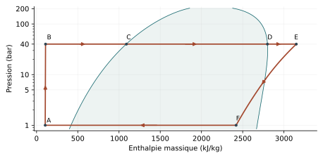
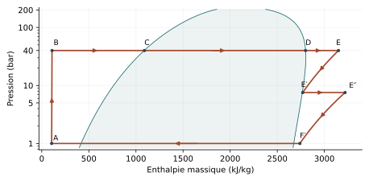
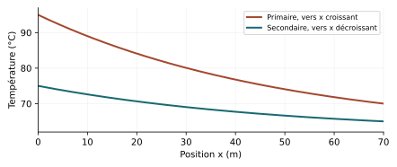

# Banque PT 2020 — Physique B · Thermodynamique · Corrigé brut

*Corrigé rédigé par IA, non officiel. Signalez toute erreur.*

**Rédaction** · GPT-6.2 Astra Ultra · vitesse non renseignée

**Révision (tour 1)** · GPT-6.2 Astra Ultra · vitesse non renseignée

[Sujet et document réponse](https://www.banquept.fr/documents/2020/ph_b_th_2020_pt.zip) · [Rapport du jury](https://www.banquept.fr/documents/ecrit/rapport/2020/rapport_phys_b_ecrit_2020.pdf) · [Coefficients de la session](https://www.banquept.fr/documents/2020/Coefficients.pdf#page=1)

**Production de vapeur et réseau urbain de chaleur.** Les puissances et transferts sont orientés explicitement dans les bilans. Les valeurs relevées graphiquement sont arrondies à la précision des diagrammes du sujet.

## I · Cycle à vapeur du réseau urbain

### Question 1 · Compression isentropique d’une phase incompressible

L’identité massique est $\mathrm du=T\,\mathrm ds-p\,\mathrm dv$. Pour le liquide idéalement incompressible et indilatable, $v$ est constant et $\mathrm du=c\,\mathrm dT$. D’où $T\,\mathrm ds=c\,\mathrm dT$. À température absolue positive et capacité thermique non nulle, une isentrope est alors une isotherme. Une hausse de pression reste possible à température constante.

### Question 2 · États du cycle vapeur surchauffé

Le tableau reprend les cases de la page 1 du document réponse. Les enthalpies arrondies ont été lues sur le diagramme en page 2. Le faible écart entre les enthalpies de A et B est précisé par la compression incompressible.

| Point | Pression (bar) | Température (°C) | Enthalpie (kJ/kg), env. | État |
|---|---:|---:|---:|---|
| A | 1,0 | 25 | 105 | Liquide |
| B | 40 | ≈ 25 | 109 | Liquide comprimé |
| C | 40 | ≈ 250 | 1 090 | Liquide saturé |
| D | 40 | ≈ 250 | 2 800 | Vapeur saturée |
| E | 40 | 375 | 3 150 | Vapeur surchauffée |
| F | 1,0 | ≈ 100 | 2 420 | Mélange liquide-vapeur |

AB est presque verticale sur ce diagramme $(h,\log P)$. BC, CD et DE suivent l’isobare de 40 bar. EF descend vers la gauche le long d’une isentrope et FA revient à basse pression par condensation et refroidissement du liquide.

### Question 3 · Travail de compression du liquide

L’identité $\mathrm dh=T\,\mathrm ds+v\,\mathrm dp$ donne, pour une compression isentropique à $v=1/\rho$, $h_B-h_A=(P_B-P_A)/\rho$. L’organe est adiabatique et les variations cinétique et potentielle sont négligeables. Le premier principe industriel donne donc $w_{AB}=(40-1)10^5/10^3=3{,}9\times10^3$ J/kg, soit **+3,9 kJ/kg**. Cet écart est difficile à résoudre par lecture graphique.

### Question 4 · Chaleur totale reçue dans la chaudière

L’économiseur, le ballon et le surchauffeur n’échangent pas de travail utile avec le fluide. Par addition de leurs bilans, $q_{\rm ch}=(h_C-h_B)+(h_D-h_C)+(h_E-h_D)=h_E-h_B$. Cela représente environ $3{,}05\times10^3$ kJ/kg, soit **3,0 à 3,1 MJ/kg** selon la lecture. Le changement de phase dans le ballon interdit de calculer toute cette énergie par un seul $c\Delta T$.

### Question 5 · Rendement mécanique du cycle simple

La turbine fournit $h_E-h_F\simeq730$ kJ/kg tandis que la pompe demande environ 3,9 kJ/kg. Le petit travail reçu par la pompe diminue le numérateur du bilan moteur. Le rendement mécanique est $\eta_m=[(h_E-h_F)-(h_B-h_A)]/(h_E-h_B)\simeq0{,}24$. Le travail de compression est inférieur à 1 % du travail fourni par la turbine, le négliger change peu le résultat. Le rendement est inférieur à $1-298/648\simeq0{,}54$, limite de Carnot entre les températures extrêmes.

### Question 6 · Rendement de production électrique

Avec une conversion mécanique-électrique de 90 %, la production électrique brute rapportée à la chaleur est $0{,}90(h_E-h_F)/(h_E-h_B)$. Pour un bilan net où la pompe serait alimentée sans pertes supplémentaires, on retranche $(h_B-h_A)/(h_E-h_B)$. Dans les deux cas, à la précision de la lecture, on trouve **environ 0,22**, soit 22 %.

### Question 7 · Titre de vapeur à l’entrée du condenseur

F se situe près de l’isotitre **$x_F\simeq0{,}89$**, voisin de 0,9. La règle des moments s’écrit $h_F=(1-x_F)h_\ell+x_Fh_v$, soit $x_F=(h_F-h_\ell)/(h_v-h_\ell)$. Les valeurs à reporter, sans évaluer ce dernier quotient, sont approximativement $h_F=2420$, $h_\ell=420$ et $h_v=2680$ kJ/kg sur le palier 1 bar. Les proportions sont massiques.

### Question 8 · Entropie créée en un cycle

Les deux transformations de machine sont isentropiques et adiabatiques. Sur le cycle, $\Delta s_{\rm cycle}=0=q_{\rm chaud}/T_{\rm chaud}+q_{\rm froid}/T_{\rm froid}+s_{\rm créée}$. Avec les hypothèses imposées, $s_{\rm créée}=-(h_E-h_B)/T_{\rm chaud}-(h_A-h_F)/T_{\rm froid}$. Pour l’application demandée sans calcul, prendre $T_{\rm chaud}\simeq648$ K, $T_{\rm froid}\simeq298$ K, ainsi que $h_E\simeq3150$, $h_B\simeq109$, $h_A\simeq105$ et $h_F\simeq2420$ kJ/kg. Le résultat s’exprime en kJ/(kg·K).

## II · Améliorations du cycle

### Question 9 · États du cycle avec réchauffe

Le point E′ est l’intersection de l’isentrope issue de E et de la courbe de vapeur saturée. De E′ à E″, la réchauffe se fait à pression constante jusqu’à 375 °C. De E″ à F′, une seconde détente isentropique mène à 1 bar, cette fois dans le domaine surchauffé. Voici les trois lignes supplémentaires du document réponse.

| État | Pression (bar) | Température (°C) | Enthalpie (kJ/kg), env. |
|---|---:|---:|---:|
| E′ | 7,5 à 8 | ≈ 170 | 2 770 |
| E″ | 7,5 à 8 | 375 | 3 220 |
| F′ | 1,0 | ≈ 130 | 2 740 |

L’incertitude de lecture du premier point se transmet aux deux suivants. Les transformations de la partie haute remplacent la détente EF du cycle initial.

### Question 10 · Rendement du cycle réchauffé

Le nouveau rendement mécanique est $\eta'_m=[h_E-h_{E'}+h_{E''}-h_{F'}-(h_B-h_A)]/[h_E-h_B+h_{E''}-h_{E'}]$. Les lectures donnent environ 0,85 MJ/kg de travail net pour 3,5 MJ/kg de chaleur, soit **environ 0,24 à 0,25**. Le gain de rendement est faible à la précision graphique. La réchauffe change surtout la qualité de la vapeur lors de la détente.

### Question 11 · Intérêt de la réchauffe pour la turbine

La détente simple atteint le domaine liquide-vapeur. Les gouttelettes liquides entraînées peuvent éroder les aubages. Avec la réchauffe, l’étage haute pression s’arrête au bord de la cloche et l’étage basse pression finit en vapeur surchauffée, ce qui limite cette usure.

### Question 12 · Puissance thermique transportée par la vapeur

Les deux chaudières donnent ensemble $\dot m=34\,000/3600\simeq9{,}4$ kg/s. Le refroidissement complet jusqu’à 25 °C rend disponible $\dot Q=\dot m(h_E-h_A)\simeq9{,}4\times3{,}05$ MW, soit **environ 29 MW**. Cette estimation dépasse les 20 MW annoncés pour les deux chaudières. Le calcul suppose que le débit nominal des deux unités est présent simultanément et que tout l’écart d’enthalpie est récupéré. Les données ne suffisent pas à identifier la cause précise de l’écart.

## III · Besoins énergétiques et biomasse

### Question 13 · Chaleur annuelle livrée par habitant

La vente de chaleur est 96 GWh/an pour 20 000 équivalents habitants. Le quotient donne **4 800 kWh par habitant et par an**, chauffage et eau chaude compris. En comptant la production en amont, 117 GWh donneraient près de 5 900 kWh par habitant. Un logement occupé par trois personnes correspondrait à environ 14 400 kWh de chaleur livrée, comparable aux 15 000 kWh du logement cité. Le nombre d’occupants, la surface et l’eau chaude empêchent de conclure à partir du seul chiffre par habitant.

### Question 14 · Substitution de chaleur fossile par le bois

Pour 54 GWh/an de chaleur produite par le bois, la quantité fossile évitée au facteur donné vaut $54\times10^6\times0{,}25$ kg, soit **13 500 tonnes de CO₂/an**. On retrouve l’ordre de grandeur de 20 000 tonnes. Atteindre exactement cette valeur demanderait environ 80 GWh substitués au même facteur. La combustion du bois émet aussi du CO₂. L’avantage climatique dépend du renouvellement du stock forestier, de la gestion du prélèvement de 25 000 à 30 000 tonnes/an, ainsi que du transport, du séchage et de l’alternative énergétique réelle.

## IV · Échangeur de sous-station

### Question 15 · Puissance apportée au lycée

Le débit est $15/3600=4{,}17\times10^{-3}$ m³/s, soit environ 4,2 kg/s d’eau. La puissance perdue par le primaire vaut $D_Cc_{\rm eau}(95-70)\simeq4{,}2\times4000\times25=4{,}2\times10^5$ W. Le bilan porte ici sur la puissance d’hiver, pour les températures de calcul du texte. Le débit annoncé convient aux **420 kW** demandés, à la précision du débit. Le relevé photographique du document 6 correspond à d’autres conditions de marche.

### Question 16 · Identification des courbes de l’échangeur

La courbe 1 donne $T_C(x)$, température du primaire qui se refroidit de 95 °C à 70 °C en allant de 0 à $D$. La courbe 2 donne $T_F(x)$, température du secondaire qui entre à $x=D$ à 65 °C et sort à $x=0$ à 75 °C. Elle descend sur le graphique lorsque $x$ croît, alors que le fluide secondaire se réchauffe dans le sens de son écoulement.

### Question 17 · Choix du contre-courant

Le secondaire sort à 75 °C, température supérieure à la sortie du primaire à 70 °C. Avec les deux entrées du même côté et une seule surface passive, les deux températures se rapprocheraient dans le sens commun sans se croiser. En contre-courant, 75 °C fait face à 95 °C et 65 °C à 70 °C. Les écarts locaux restent positifs, de 20 K au premier bout et 5 K au second. La chaleur se transmet partout du primaire au secondaire.

### Question 18 · Bilans locaux à contre-courant

La puissance élémentaire transférée vaut $\mathrm dP=hL(T_C-T_F)\,\mathrm dx>0$. Pour le chaud qui va vers $+x$, $D_Cc_{\rm eau}\,\mathrm dT_C=-\mathrm dP$. Le froid va vers $-x$ et reçoit $\mathrm dP=D_Fc_{\rm eau}[T_F(x)-T_F(x+\mathrm dx)]=-D_Fc_{\rm eau}\,\mathrm dT_F$. En soustrayant, avec $\Delta=T_C-T_F$, on obtient $\mathrm d\Delta/\Delta=-[hL/c_{\rm eau}](1/D_C-1/D_F)\,\mathrm dx=-\alpha\,\mathrm dx$. Le coefficient $\alpha$ s’exprime en mètre inverse.

### Question 19 · Bilans des deux fluides sur toute la longueur

Les deux bilans donnent $P=D_C c_{\rm eau}[T_C(0)-T_C(D)]$ et $P=D_F c_{\rm eau}[T_F(0)-T_F(D)]$. En remplaçant les inverses des débits dans $\alpha$ puis en regroupant par extrémités, $\alpha=(hL/P)[\Delta(0)-\Delta(D)]$ avec $\Delta(x)=T_C(x)-T_F(x)$.

### Question 20 · Signe de la différence des températures et débits

Comme $hL/c_{\rm eau}>0$, $\alpha>0$ si $D_F>D_C$, nul pour des débits égaux et négatif si $D_F<D_C$. Dans ces trois cas, $\Delta'=-\alpha\Delta$ indique respectivement un écart décroissant, constant ou croissant avec $x$. Ici $\Delta(0)=20$ K et $\Delta(D)=5$ K, donc $\alpha>0$. Le secondaire a un débit supérieur au primaire. Quantitativement, $D_F=P/[c_{\rm eau}(75-65)]\simeq10{,}5$ kg/s, soit environ **38 m³/h**.

### Question 21 · Coefficient d’échange et écart logarithmique

L’intégration de $\mathrm d\Delta/\Delta=-\alpha\,\mathrm dx$ donne $\ln[\Delta(0)/\Delta(D)]=\alpha D$. Avec la question 19, on obtient $h=P\ln[\Delta(0)/\Delta(D)]/\{LD[\Delta(0)-\Delta(D)]\}$. On peut écrire $P=hLD\Delta T_{\rm lm}$ avec $\Delta T_{\rm lm}=[\Delta(0)-\Delta(D)]/\ln[\Delta(0)/\Delta(D)]$.

### Question 22 · Valeur du transfert surfacique

Avec $LD=0{,}20\times70=14$ m² et $P=420\,000$ W, $h=(420\,000/14)\ln(4)/(20-5)\simeq2{,}8\times10^3$ W/(m²·K). La différence de température logarithmique vaut environ 11 K, entre les écarts terminaux de 5 et 20 K. Dans ce modèle, le coefficient obtenu témoigne d’un transfert local intense. Il dépasse d’environ 40 % le haut de la plage indicative de 100 à 2 000 W/(m²·K) donnée pour un échange liquide-liquide. La surface équivalente et les conditions d’écoulement influent sur cette comparaison.
