# Banque PT — Sciences industrielles A 2020 · Corrigé guidé

*Corrigé rédigé par IA, non officiel. Signalez toute erreur.*

**Rédaction** · GPT-6.2 Astra Ultra · vitesse non renseignée · 26 novembre 2026

**Révision** · GPT-6.2 Astra Ultra · vitesse non renseignée · 26 novembre 2026

La cellule de la cave coopérative de Lugny transfère des bouteilles et compose des caisses. L’épreuve de cinq heures demande 44 réponses. Les repères A et B renvoient au texte et aux annexes du ZIP officiel. Ca à Cg désignent les sept feuillets de réponses. Les extraits annotés reproduisent les cadres utiles de la Banque PT.

[Sujet, annexes et cahier de réponse](https://www.banquept.fr/documents/2020/si_a_2020_pt.zip) · [Rapport du jury](https://www.banquept.fr/documents/ecrit/rapport/2020/rapport_si_a_ecrit_2020.pdf)

## A — Fonctionnement et dépose

### Q1 — Chronogramme de la cellule

*Feuillets A7, B4, Ca1.*

> [!INDICATION]
> Numéroter les intervalles du gabarit depuis l’axe vertical. Suivre séparément les deux régions simultanées de l’état composite.

Avec une graduation par trait vertical et l’origine à l’axe, la fin d’initialisation arrive en 2, la marche en 5, l’arrêt d’urgence en 10 et l’acquittement en 15. La libération de l’arrêt en 12 et le réarmement en 13 ne suffisent pas à reprendre le transfert. Sur Ca1, les quatre sorties à tracer valent un sur les intervalles suivants.
 
| Sortie | Intervalles hauts |
|---|---|
| Attente | $[2,5[$ puis à partir de 23 |
| Transfert | $[5,10[$ puis $[15,21[$ |
| Arrêt d’urgence | $[10,15[$ |
| Pompe à vide en marche | $[5,23[$ |

Le mode AUTO et la fonction transfert sont sélectionnés. L’historique rétablit le transfert en 15. Le niveau « TSR 504 constitué » est maintenu depuis 19. Avec la lecture en niveaux du chronogramme, la demande d’arrêt en 21 termine le transfert et déclenche le repli. L’arrivée en PR en 23 arrête la pompe et ramène en attente. L’arrêt d’urgence touche la région du mouvement, la pompe possède sa propre condition de sortie.

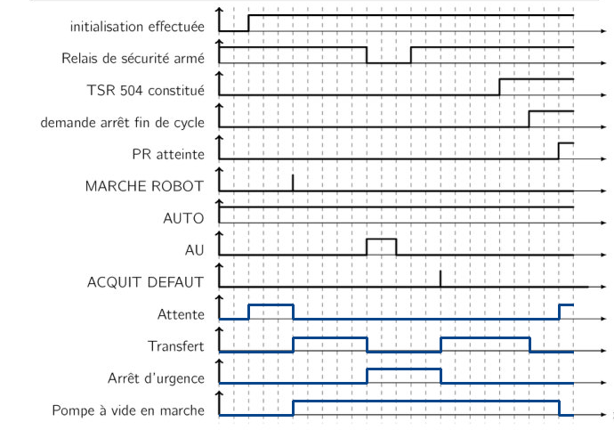

### Q2 — Ordre des douze demi-couches

*Feuillets A7, B5–7, Ca2.*

> [!INDICATION]
> À chaque dépose, noter la colonne courante, puis suivre la garde associée à dix ou onze bouteilles.

Le numéro de dépose est pris dans l’ordre chronologique. En lisant du fond vers le haut, la colonne PSD1 reçoit $1,2,5,6,9,10$ et la colonne PSD2 reçoit $3,4,7,8,11,12$. Les deux premières demi-couches sont donc superposées en PSD1 avant la première dépose en PSD2. La figure de la question suivante remplit le plan Ca2.

**Lecture des deux diagrammes.** Le graphe directeur p. 6 de B initialise $C=1$, teste $C=1$ après la première dépose et incrémente sur les trajets de reprise. Le détail « Dépose 1 » p. 7 imprime aussi une incrémentation en entrée. Les cumuler bloquerait le graphe dès la première sortie. On compte une seule fois chaque dépose, conformément aux gardes du graphe directeur et au repère 1 déjà placé sur Ca2.

### Q3 — Origine des demi-couches

*Feuillets A7, B5–7, Ca2.*

> [!INDICATION]
> PTT1 stocke un double rang de dix. PTT2 et PTT3 regroupent deux rangs simples, de dix et de onze bouteilles respectivement.

Voici le plan à reporter sur Ca2. Chaque cellule indique le numéro de dépose, puis le lieu de la prise immédiatement précédente.

| Niveau depuis le fond | Colonne PSD1 | Colonne PSD2 | Bouteilles par rang |
|---|---|---|---:|
| 6 | 10 · PTT1 | 12 · PTT2 | 10 |
| 5 | 9 · PSP2R | 11 · PTT3 | 11 |
| 4 | 6 · PTT2 | 8 · PTT1 | 10 |
| 3 | 5 · PTT3 | 7 · PSP2R | 11 |
| 2 | 2 · PTT1 | 4 · PTT1 | 10 |
| 1 | 1 · PSP2R | 3 · PSP2R | 11 |

Le premier double rang de dix prélevé en caisse est stocké en PTT1. Une prise simple de dix alimente PTT21 avant la première dépose directe d’un double rang de onze. PTT1 fournit ensuite la dépose 2. Les prises simples de onze s’accumulent en PTT31 et PTT32 pour fournir les déposes 5 et 11. Les prises simples de dix groupées en PTT2 fournissent les déposes 6 et 12.

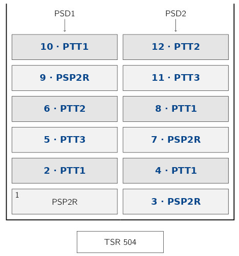

### Q4 — Nature des flux

*Feuillets A7, Ca3.*

> [!INDICATION]
> Suivre chaque liaison jusqu’à ses deux extrémités. Distinguer le capteur de vide de sa sortie électrique.

Sur Ca3, la sortie du vacuostat vers l’automate et les six liaisons de commande vers les organes de l’outil portent **E**. L’arrivée de vide au vacuostat, puis à l’électrovanne de coupure, porte **V**. L’arrivée d’air comprimé à l’électrovanne de contre-soufflage et aux distributeurs d’escamotage porte **P**, tout comme la conduite de contre-soufflage vers la coupure et les liaisons des distributeurs aux vérins. En aval de la sélection du fluide, la liaison vers la rampe fixe, les vannes d’isolation et les rampes escamotables porte **V/P**, suivant que l’outil aspire ou souffle. Les sorties de tige des deux types de vérin vers leur rampe portent **M**. La figure place ces lettres dans les cases libres de Ca3.

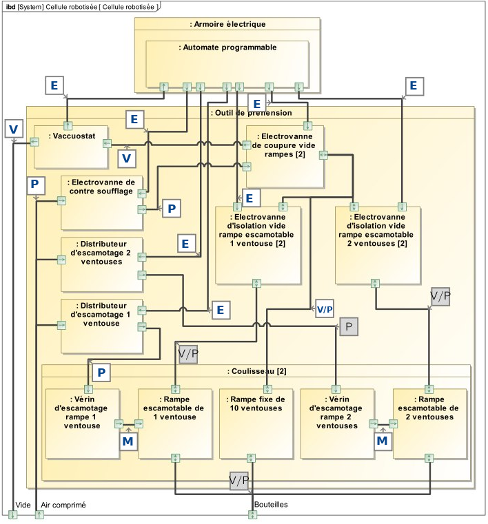

### Q5 — Fonctions de la chaîne de positionnement

*Feuillets A7, Ca4.*

> [!INDICATION]
> Partir de la consigne de l’automate, parcourir la chaîne de puissance, puis revenir du capteur vers la commande.

L’automate **traite** les consignes et informations de séquence. La partie commande du variateur **traite et compare** les signaux pour régler l’entraînement. Le résolver **acquiert** la position angulaire. La partie puissance du variateur **distribue et module** l’énergie électrique fournie au moteur. Le moteur brushless **convertit** l’énergie électrique en énergie mécanique de rotation. Le réducteur **transmet et adapte** vitesse et couple. Les poulies et leur courroie **transmettent** la rotation. Le pignon et les crémaillères **transmettent en transformant** la rotation en translations opposées. Les coulisseaux porte-ventouses **agissent** sur les rangées en les déplaçant.

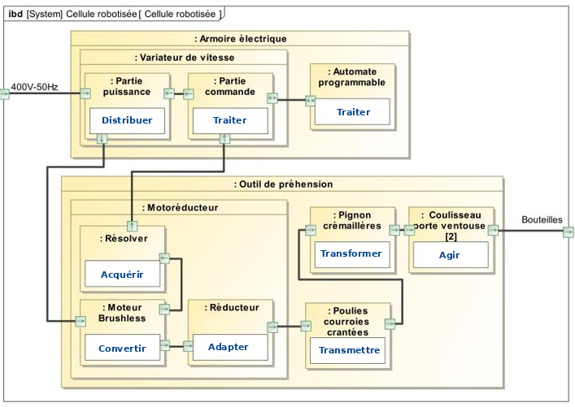

### Q6 — Distributeurs à représenter

*Feuillets A5, A7, Cb1.*

> [!INDICATION]
> Relever le nombre d’orifices, le nombre de positions et le mode de rappel indiqués dans la description de l’outil.

Dans la case de gauche du feuillet Cb1, le distributeur **3/2 monostable** a une commande électrique et un rappel par ressort. Son orifice commun dessert la rampe. Une position la met en communication avec le vide et obture l’air de soufflage. L’autre la met en communication avec l’air de soufflage et obture le vide. Le dessin retient l’aspiration dans la case de rappel, convention explicitée car le sujet ne nomme pas la position de repos.

À droite, le vérin double effet est associé à un **5/2 bistable à deux commandes électropneumatiques**. En notant $P$ l’arrivée, $A,B$ les deux chambres et $R,S$ les échappements, les connexions successives sont $P\to A,\ B\to S$ puis $P\to B,\ A\to R$. La figure représente les deux positions des organes demandés à côté des liaisons correspondantes.

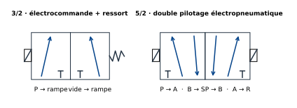

## B — Déformation du socle

### Q7 — Efforts de cohésion d’un montant

*Feuillets A8, Cb2.*

> [!INDICATION]
> Isoler la partie au-dessus de la coupure. Le bras de levier de l’effort transversal est $L_p-z$.

Avec la convention « action du tronçon supérieur sur le tronçon inférieur », la résultante de cohésion est $X_i\vec x_0+Z_i\vec z_0$ et le moment en $G$ est $X_i(L_p-z)\vec y_0$. En effet $\overrightarrow{GM_i}=(L_p-z)\vec z_0$ et $\vec z_0\times\vec x_0=\vec y_0$. Les trois autres composantes sont nulles. Sur le tronçon supérieur isolé, l’action de la coupure est l’opposée.

### Q8 — Déformations axiales

*Feuillets A9, Cb2–3.*

> [!INDICATION]
> Intégrer la déformation axiale uniforme $Z_i/(ES)$ de l’encastrement à l’extrémité libre.

Avec $L_p=720\,\mathrm{mm}$, $S=4500\,\mathrm{mm^2}$ et $E=2\,10^5\,\mathrm{N\,mm^{-2}}$, $\Delta z_i=Z_iL_p/(ES)$. On obtient $\Delta z_1=+0{,}0404\,\mathrm{mm}$ pour $50\,500\,\mathrm N$ en traction et $\Delta z_2=-0{,}0564\,\mathrm{mm}$ pour $-70\,500\,\mathrm N$ en compression.

### Q9 — Équation de la flèche

*Feuillets A9, Cb3.*

> [!INDICATION]
> Intégrer deux fois le moment fléchissant variable et imposer la flèche et la pente nulles au pied.

La loi d’Euler–Bernoulli donne $EI_y v''(z)=X_i(L_p-z)$. Avec $v(0)=v'(0)=0$, on trouve $v'(z)=X_i(L_p z-z^2/2)/(EI_y)$, puis $v(z)=X_i z^2(3L_p-z)/(6EI_y)$. La pente est positive jusqu’en tête, donc $v_{\max i}=X_iL_p^3/(3EI_y)$ en $M_i$.

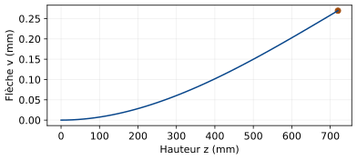

### Q10 — Vérification du socle

*Feuillets A9, Cb3.*

> [!INDICATION]
> Employer un système d’unités cohérent. En millimètres le module d’Young est déjà compatible avec le moment quadratique imprimé.

Les deux poutres ont $X_i=6500\,\mathrm N$ et $I_y=15\,10^6\,\mathrm{mm^4}$. D’où $v_{\max 1}=v_{\max 2}\simeq0{,}270\,\mathrm{mm}$. Dans le modèle du feuillet, le déplacement de $M_0$ est celui des têtes en translation. Il reste environ 74 fois inférieur à la limite de $20\,\mathrm{mm}$. Le socle satisfait ce critère pour le chargement étudié.

## C — Dynamique des bras

### Q11 — Moment du compensateur en A

*Feuillets A9, B9, Cb4.*

> [!INDICATION]
> Utiliser le point d’application H et les deux vecteurs orientés donnés par l’annexe D.2.

$\overrightarrow{AH}=-R\vec x_2$ et $\vec F_{8\to2}=-F_{\rm res}\vec x_7$. Leur produit vectoriel projeté sur $\vec y_0$ donne $C_{\rm res}=R F_{\rm res}\sin(\theta_7-\theta_2)$, avec $F_{\rm res}=k_r(\lambda-\lambda_0)$. Sur la configuration dessinée le couple du ressort est négatif.

### Q12 — Fermeture du triangle du compensateur

*Feuillets A10, B9, Cb4–Cc1.*

> [!INDICATION]
> Projeter $\overrightarrow{KH}=\overrightarrow{KA}+\overrightarrow{AH}$ sur les axes fixes. Employer un angle à deux arguments pour conserver le quadrant.

On a $\lambda\vec x_7=c\vec x_1-R\vec x_2$. Comme $\vec x_j=\cos\theta_j\,\vec x_1-\sin\theta_j\,\vec z_1$ pour $j=2,7$, $\lambda\cos\theta_7=c-R\cos\theta_2$ et $\lambda\sin\theta_7=-R\sin\theta_2$. Ainsi $\lambda=\sqrt{c^2+R^2-2cR\cos\theta_2}$ et $\theta_7=\operatorname{atan2}(-R\sin\theta_2,c-R\cos\theta_2)$.

### Q13 — Moment de pesanteur des trois masses

*Feuillets A10, B9, Cc1–2.*

> [!INDICATION]
> Le moment d’un poids projeté sur $\vec y_0$ est $mg$ multiplié par l’abscisse du centre de masse à partir de A.

Posons $\phi=\theta_2+\theta_3$. Les abscisses de $G_2,G_3,E$ valent respectivement $a_2\sin\theta_2$, $L_2\sin\theta_2+a_3\sin\phi-b_3\cos\phi$ et $L_2\sin\theta_2+L_3\sin\phi$. D’où
$$
C_{\rm pes}=g\{[m_2a_2+(m_3+m_E)L_2]\sin\theta_2+(m_3a_3+m_E L_3)\sin\phi-m_3b_3\cos\phi\}.
$$

### Q14 — Contrainte de trajectoire

*Feuillets A10, B9, Cc2.*

> [!INDICATION]
> Projeter $\overrightarrow{AB}+\overrightarrow{BE}$ sur l’horizontale et conserver la configuration du dessin dans le choix de l’angle.

$\overrightarrow{AE}\cdot\vec x_1=L_2\sin\theta_2+L_3\sin(\theta_2+\theta_3)=L$. Ainsi $\sin(\theta_2+\theta_3)=(L-L_2\sin\theta_2)/L_3$. Sur la branche où $\vec z_3$ pointe vers le bas, $\theta_3=\pi-\arcsin[(L-L_2\sin\theta_2)/L_3]-\theta_2$, angles en radians.

### Q15 — Surcompensation et sens de puissance

*Feuillets A10, Cc2.*

> [!INDICATION]
> Comparer le couple de pesanteur positif à l’opposé du couple de ressort, puis tenir compte du sens de déplacement.

Sur la figure 9, à environ $50^\circ$ les deux modules valent $4000\,\mathrm{N\,m}$. Au-delà et jusqu’à $80^\circ$, $-C_{\rm res}>C_{\rm pes}$, soit une compensation strictement supérieure à 100 %. Le couple nécessaire du moteur vaut alors $C_{m2}=-(C_{\rm res}+C_{\rm pes})>0$. Pendant la descente de dépose, $\theta_2$ augmente sur la branche étudiée et $C_{m2}\dot\theta_2>0$ : l’entraînement fournit de la puissance. Sur le trajet inverse il freine.

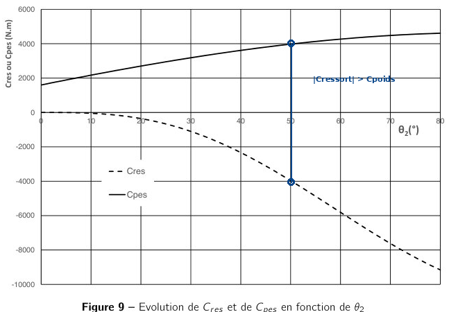

### Q16 — Inertie du bras chargé

*Feuillets A11, B9, Cc2.*

> [!INDICATION]
> Calculer l’inertie d’une masse ponctuelle située sur l’axe $\vec z_3$ à distance $L_3$ de B.

Dans la base 3, $\overrightarrow{BE}=(0,0,L_3)$. L’apport de $m_E$ à la matrice en B est $\operatorname{diag}(m_E L_3^2,m_E L_3^2,0)$. Ainsi $A_4=A_3+m_E L_3^2$, $B_4=B_3+m_E L_3^2$, $C_4=C_3$ et $E_4=E_3$. Les matrices de l’annexe sont déjà données en B.

### Q17 — Barycentre de l’ensemble 4

*Feuillets A11, B9, Cc3.*

> [!INDICATION]
> Additionner les moments statiques en B en conservant le signe du terme en $\vec x_3$.

Par $m_4\overrightarrow{BG_4}=m_3(a_3\vec z_3-b_3\vec x_3)+m_E L_3\vec z_3$ et $m_4=m_3+m_E$, on a $a_4=(m_3a_3+m_E L_3)/m_4$ et $b_4=m_3b_3/m_4$.

### Q18 — Vitesses de B et du centre de masse

*Feuillets A11, Cc3.*

> [!INDICATION]
> B suit le bras 2 tandis que l’ensemble 4 tourne à la vitesse absolue $\dot\phi=\dot\theta_2+\dot\theta_3$.

Comme A est fixe, $\vec V_B=L_2\dot\theta_2\vec x_2$. Par transport des vitesses, $\vec V_{G_4}=\vec V_B+\dot\phi\,\vec y_0\times(a_4\vec z_3-b_4\vec x_3)=L_2\dot\theta_2\vec x_2+\dot\phi(a_4\vec x_3+b_4\vec z_3)$.

### Q19 — Moment cinétique au point mobile B

*Feuillets A11, Cc4.*

> [!INDICATION]
> L’inertie en B multiplie la rotation absolue. Ajouter le terme lié à la translation de B.

Posons $D=a_4\cos\theta_3+b_4\sin\theta_3$ et $H=a_4\sin\theta_3-b_4\cos\theta_3$. Ce sont les composantes de $\overrightarrow{BG_4}$ suivant $\vec z_2$ et $\vec x_2$. On obtient
$$
\vec\sigma_B=I(B,4)\dot\phi\vec y_0+\overrightarrow{BG_4}\times m_4\vec V_B
=[B_4\dot\phi+m_4L_2\dot\theta_2D]\vec y_0 .
$$

### Q20 — Moment dynamique en B

*Feuillets A11, Cc4.*

> [!INDICATION]
> Le point de calcul se déplace. Corriger la dérivée dans le référentiel 0 par $\vec V_B\times m_4\vec V_{G_4}$.

On a $\dot D=-H\dot\theta_3$. La projection sur $\vec y_0$ du terme de transport est $m_4L_2\dot\theta_2\dot\phi H$. Ainsi
$$
\vec\delta_B\cdot\vec y_0=B_4\ddot\phi+m_4 L_2[D\ddot\theta_2+H\dot\theta_2^2].
$$
Ce résultat peut aussi s’obtenir à partir de $\vec\delta_B=I(B,4)\ddot\phi\vec y_0+\overrightarrow{BG_4}\times m_4\vec a_B$, avec $\vec a_B=L_2(\ddot\theta_2\vec x_2-\dot\theta_2^2\vec z_2)$.

### Q21 — Couple exercé par l’axe J3

*Feuillets A11, Cd1.*

> [!INDICATION]
> Isoler 4. Le poids agit en son barycentre et la résultante de la liaison en B n’a pas de moment en B.

Le moment du poids en B vaut $m_4g(a_4\sin\phi-b_4\cos\phi)$ suivant $\vec y_0$. Le théorème du moment dynamique donne $C_{m3}+m_4g(a_4\sin\phi-b_4\cos\phi)=\vec\delta_B\cdot\vec y_0$, donc
$$
C_{m3}=B_4(\ddot\theta_2+\ddot\theta_3)+m_4L_2(D\ddot\theta_2+H\dot\theta_2^2)-m_4g(a_4\sin\phi-b_4\cos\phi).
$$

### Q22 — Moment dynamique du bras 2

*Feuillets A11, Cd2.*

> [!INDICATION]
> Choisir le point fixe A et vérifier que $\vec y_0$ est un axe principal en A.

Le moment cinétique en A est $B_2\dot\theta_2\vec y_0$. Puisque A et $\vec y_0$ sont fixes dans le référentiel 0, $\vec\delta_{A,2/0}=B_2\ddot\theta_2\vec y_0$.

### Q23 — Isolement pour calculer le couple J2

*Feuillets A11, Cd2.*

> [!INDICATION]
> Éliminer le couple interne de J3 en choisissant une frontière qui englobe les deux bras.

Isoler $2\cup4$, transporter en A les moments dynamiques et les additionner. Pour 4, $\vec\delta_{A,4}=\vec\delta_{B,4}+\overrightarrow{AB}\times m_4\vec a_{G_4}$. Appliquer le théorème du moment dynamique en A suivant $\vec y_0$. Les actions mutuelles en B disparaissent du bilan. Les moments extérieurs restants sont $C_{m2}$, $C_{\rm res}$ et $C_{\rm pes}$. Leur somme est $\vec y_0\cdot(\vec\delta_{A,2}+\vec\delta_{A,4})$, ce qui détermine $C_{m2}$.

### Q24 — Coefficients des quatre blocs

*Feuillets A12, Cd3.*

> [!INDICATION]
> Regrouper dans chaque équation les termes de la coordonnée de sortie. Les termes croisés attaquent les entrées négatives.

Avec conditions initiales de perturbation nulles, $(G_0+G_2p^2)\Delta\Theta_2=\Delta C_{m2}+\Delta C_{\rm res}-(G_1+G_3p^2)\Delta\Theta_3$. De même $(G_4+G_6p^2)\Delta\Theta_3=\Delta C_{m3}-(G_4+G_5p^2)\Delta\Theta_2$. On identifie alors les paramètres du schéma 10 :

| Axe $i$ | $K_{ni}$ | $n_i^2$ | $K_{ri}$ | $r_i^2$ |
|---|---:|---:|---:|---:|
| 2 | $1/G_0$ | $G_2/G_0$ | $G_1$ | $G_3/G_1$ |
| 3 | $1/G_4$ | $G_6/G_4$ | $G_4$ | $G_5/G_4$ |

La notation du sujet $n_i^2,r_i^2$ désigne ici des coefficients algébriques de $p^2$.

## D — Correction des axes

### Q25 — Fonction propre de l’axe J2

*Feuillets A13–14, Cd4.*

> [!INDICATION]
> Pour la réponse à la seule consigne J2, annuler la consigne indépendante de J3. Le ressort revient au sommateur avec un signe positif.

Posons $F=r^2 K_{\theta I2}K_pK_m$. La boucle impose $\Delta\Theta_2=N_2[F(\Delta\Theta_{2C}-\Delta\Theta_2)+K_{\rm res}\Delta\Theta_2-R_2\Delta\Theta_{3C}]$. Pour $\Delta\Theta_{3C}=0$,
$$
H_C=\frac{F K_{n2}}{1+(F-K_{\rm res})K_{n2}+n_2^2p^2}.
$$
Avec $d=1+(F-K_{\rm res})K_{n2}\ne0$, on lit $K_C=FK_{n2}/d$ et $b_1^2=n_2^2/d$. $K_{r2}$ et $r_2^2$ sont dans le chemin de perturbation de J3 et ne contribuent pas au numérateur de cette fonction propre.

### Q26 — Pôles et stabilité

*Feuillets A14, Cd4.*

> [!INDICATION]
> Revenir à la forme non normalisée au cas $1-4K_p=0$.

Le polynôme caractéristique est $1-4K_p-0{,}135p^2$. Si $K_p<1/4$, ses racines sont $\pm\sqrt{(1-4K_p)/0{,}135}$, dont une positive. À $K_p=1/4$, il y a un pôle double nul. Si $K_p>1/4$, les racines sont $\pm j\sqrt{(4K_p-1)/0{,}135}$. Aucun réglage ne donne deux modes à partie réelle strictement négative. À $K_p=0$ la consigne est découplée, mais le mode instable subsiste dans la dynamique interne.

### Q27 — Boucle de vitesse ouverte

*Feuillets A15, Ce1.*

> [!INDICATION]
> La sortie vitesse est obtenue en multipliant la position par $p$. Ce facteur simplifie l’intégration du PI.

Notons $\omega_b=\omega_{b20}$, $T_i=T_{i\Omega}$ et $K_i=K_{i\Omega}$. La lecture de la figure 13 donne
$$
W_{\rm BO}=p\,C_{\omega2}H_{b2}
=-\frac{K_{b2}K_i}{T_i}\,
\frac{1+T_i p}{(1-p/\omega_b)(1+p/\omega_b)}.
$$

### Q28 — Compensation du pôle stable

*Feuillets A15, Ce2.*

> [!INDICATION]
> Le temps d’intégration positif place le zéro du PI dans le demi-plan gauche.

On choisit $T_i=1/\omega_b=1/\sqrt{10}\simeq0{,}316\,\mathrm s$. Le zéro annule le facteur $1+p/\omega_b$. Ainsi $W_{\rm BO}=K_{\rm BO\Omega}/(1-T_{\rm BO}p)$ avec $T_{\rm BO}=1/\omega_b$ et $K_{\rm BO\Omega}=-K_{b2}K_i/T_i$.

### Q29 — Réglage de la boucle interne

*Feuillets A15, Ce3.*

> [!INDICATION]
> Fermer la boucle à retour unitaire avant de discuter le signe de la constante de temps.

Posons $a=K_{b2}K_i/T_i$. On trouve $W_{\rm BF}=W_{\rm BO}/(1+W_{\rm BO})=a/(a-1+p/\omega_b)$. Pour $a>1$, le gain statique vaut $a/(a-1)$ et la constante de temps $\tau=1/[\omega_b(a-1)]$. Comme $t_{5\%}=\ln(20)\,\tau$, il faut
$$
K_i\ \geq\ \frac{T_i}{K_{b2}}\left(1+\frac{\ln20}{0{,}01\,\omega_b}\right).
$$
Avec $K_{b2}=0{,}04$ et $\omega_b=\sqrt{10}$, on trouve environ $7{,}57\,10^2\,\mathrm{A\,s\,rad^{-1}}$ ($7{,}58\,10^2$ en prenant $\ln20\simeq3$). La valeur $K_{2\Omega}=1{,}1$ donnée ensuite est adoptée pour la boucle de position.

### Q30 — Boucle de position

*Feuillets A15, Ce4.*

> [!INDICATION]
> La boucle interne instantanée se réduit à son gain. Le dernier intégrateur transforme la vitesse en position.

Avec $k=rK_{\theta\Omega}K_{p\theta}K_{2\Omega}=121K_{p\theta}\,\mathrm{s^{-1}}$, la boucle ouverte vaut $k/p$. La boucle fermée vaut $H_C=k/(p+k)=1/(1+p/k)$. Le gain statique vaut un et la constante de temps $1/k$ pour $k>0$.

### Q31 — Vérification des exigences de suivi

*Feuillets A15, Ce4.*

> [!INDICATION]
> Employer la réponse exponentielle et les marges de la boucle ouverte. Distinguer la borne du réglage à choisir si l’inégalité est stricte.

La condition $t_{5\%}=\ln20/(121K_{p\theta})<0{,}1\,\mathrm s$ impose $K_{p\theta}>\ln20/12{,}1\simeq0{,}248$. Par exemple $0{,}25$ convient et donne environ $0{,}099\,\mathrm s$. La réponse du premier ordre est monotone, son erreur finale à un échelon est nulle. La boucle ouverte a une phase de $-90^\circ$, donc une marge de phase de $90^\circ$ et une marge de gain infinie dans ce modèle. Les seuils de $45^\circ$ et $20\,\mathrm{dB}$ sont satisfaits.

## E — Entraînement des rampes

### Q32 — Aire du profil de vitesse

*Feuillets A16, Cf1.*

> [!INDICATION]
> Additionner les deux triangles et le rectangle central. Les durées de montée et de descente sont égales.

La pente de la première rampe donne $a_{\max}=V_{\max}/t_a$. L’aire sous le trapèze vaut $V_{\max}t_a/2+V_{\max}(t_d-t_a)+V_{\max}t_a/2$, d’où $d_{\max}=V_{\max}t_d$, avec $t_{\max}=t_a+t_d$.

### Q33 — Vitesse maximale d’une rampe

*Feuillets A16, Cf1.*

> [!INDICATION]
> Passer des tours par minute aux radians par seconde, diviser par le rapport 16 et multiplier par le rayon primitif.

Les poulies ont le même diamètre. Pour chaque rampe, $V_{\max}=(2\pi N_{\max}/60)(d_{\rm pig}/2)/r_{\rm ed}=(2\pi\times4500/60)\times0{,}025/16\simeq0{,}736\,\mathrm{m\,s^{-1}}$. Les deux rampes se déplacent en sens opposés.

### Q34 — Profil triangulaire

*Feuillets A16, Cf2.*

> [!INDICATION]
> Lorsque le plateau disparaît, l’instant de vitesse maximale est à la moitié du temps total.

Ici $t_a=t_d=0{,}5\,\mathrm s$. L’aire du triangle impose $V_{\rm pic}=2d_{\max}/t_{\max}=0{,}50\,\mathrm{m\,s^{-1}}$. L’accélération vaut alors $a_{\min}=4d_{\max}/t_{\max}^2=1{,}0\,\mathrm{m\,s^{-2}}$, et la vitesse de pointe reste inférieure à celle de Q33.

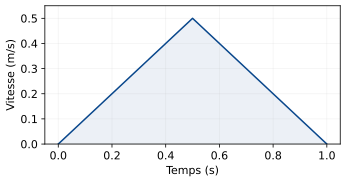

### Q35 — Inertie ramenée au moteur

*Feuillets A17, Cf2.*

> [!INDICATION]
> Additionner toutes les énergies cinétiques en fonction de la même vitesse $\omega_m$. Pendant le rapprochement les deux rampes portent chacune douze bouteilles.

La vitesse angulaire de la sortie et du pignon vaut $\omega_m/r_{\rm ed}$ et chaque rampe se déplace à $(d_{\rm pig}/2)\omega_m/r_{\rm ed}$. En identifiant $2E_c=J_{\rm eq}\omega_m^2$,
$$
J_{\rm eq}=J_{\rm mot}+J_{\rm red}
+\frac{2J_{\rm pou}+J_{\rm pig}+J_a+2(m_r+12m_b)(d_{\rm pig}/2)^2}{r_{\rm ed}^2}.
$$
$J_{\rm red}$ est déjà ramenée à l’arbre moteur. Avec $m_r=30\,\mathrm{kg}$, $m_b=1{,}5\,\mathrm{kg}$ et les unités converties, on obtient environ $2{,}88\,\mathrm{kg\,cm^2}$, cohérent avec les $3\,\mathrm{kg\,cm^2}$ imposés à la question suivante.

### Q36 — Accélération disponible

*Feuillets A17, Cf3.*

> [!INDICATION]
> La figure 16 distingue le couple maximal du couple continu. Ramener l’accélération angulaire maximale à la translation d’une rampe.

Le moteur CMP50S peut fournir en pointe $M_{\max}=5{,}2\,\mathrm{N\,m}$. Avec $J_{\rm eq}=3\,10^{-4}\,\mathrm{kg\,m^2}$, on trouve $\dot\omega_{m,\max}=M_{\max}/J_{\rm eq}\simeq1{,}73\,10^4\,\mathrm{rad\,s^{-2}}$ dans le modèle sans frottement. Ainsi $a_{\rm att}=d_{\rm pig}\dot\omega_{m,\max}/(2r_{\rm ed})\simeq27\,\mathrm{m\,s^{-2}}$. L’exigence du mouvement triangulaire est satisfaite avec une marge importante et sa vitesse de pointe est accessible.

### Q37 — États des six diodes et tension redressée

*Feuillets A18, Cf4.*

> [!INDICATION]
> Le courant de charge est positif. Chercher à chaque instant la phase la plus haute et la phase la plus basse.

En notant $\theta=2\pi50t$, le pont idéal impose $v_p=\max(v_1,v_2,v_3)$ et $v_m=\min(v_1,v_2,v_3)$. La diode supérieure de la phase au maximum et la diode inférieure de la phase au minimum conduisent. Sur une période $T=20\,\mathrm{ms}$, les six signaux à reporter sur Cf4 prennent la valeur un dans les intervalles suivants, modulo $360^\circ$ :

| Diode | Intervalle de conduction | Diode | Intervalle de conduction |
|---|---|---|---|
| $D_1$ | $30^\circ$ à $150^\circ$ | $D'_1$ | $210^\circ$ à $330^\circ$ |
| $D_2$ | $150^\circ$ à $270^\circ$ | $D'_2$ | $330^\circ$ à $90^\circ$ |
| $D_3$ | $270^\circ$ à $30^\circ$ | $D'_3$ | $90^\circ$ à $210^\circ$ |

Ainsi, au début de période, $u_g=v_3-v_2$. Après $30^\circ$, on passe à $v_1-v_2$, puis à $v_1-v_3$, $v_2-v_3$, $v_2-v_1$, $v_3-v_1$, puis au premier couple. La tension est l’enveloppe supérieure des six tensions composées.

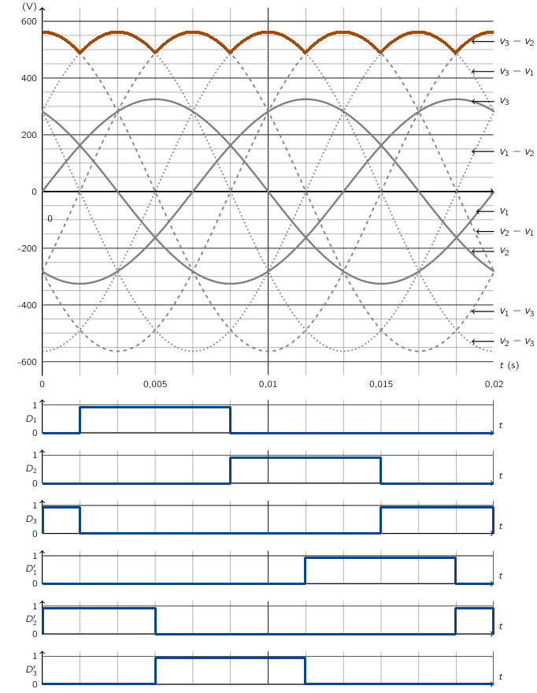

### Q38 — Ondulation du pont

*Feuillets A18, Cg1.*

> [!INDICATION]
> Chaque sommet est celui d’une sinusoïde composée. Un creux est à $30^\circ$ du sommet le plus proche.

Avec $V=230\,\mathrm V$ valeur efficace d’une phase, $U_{g,\max}=\sqrt6\,V\simeq563\,\mathrm V$ et $U_{g,\min}=\sqrt6\,V\cos30^\circ\simeq488\,\mathrm V$. On trouve $\Delta U_g=\sqrt6\,V(1-\sqrt3/2)\simeq75{,}5\,\mathrm V$ crête à creux, avec six ondulations par période.

### Q39 — Complémentarité des interrupteurs

*Feuillets A19, Cg1.*

> [!INDICATION]
> Dans le modèle idéal d’un bras, quelles situations relieraient directement les deux rails ou laisseraient le courant inductif sans trajet ?

Les commandes idéales sont complémentaires, $f'_i=1-f_i$. Deux interrupteurs passants court-circuiteraient le bus continu, et un état où les deux chemins seraient ouverts n’assurerait pas la continuité d’un courant de phase inductif. Dans le schéma idéalisé chaque état rattache la phase à un seul des deux potentiels.

### Q40 — Valeur moyenne de la tension modulée

*Feuillets A19, B11, Cg2.*

> [!INDICATION]
> Sur une période de porteuse, tenir la référence sinusoïdale constante et calculer la fraction du temps où le triangle est sous cette référence.

Le triangle parcourt linéairement $[-V_{t\max},+V_{t\max}]$. Ainsi le rapport cyclique est $\alpha_d=(1+v_{si}/V_{t\max})/2$. Relativement au milieu O du bus, la phase commute entre $+U_0/2$ et $-U_0/2$. Sa valeur moyenne sur une période de porteuse vaut
$$
\overline u_{iO}=\alpha_d\frac{U_0}{2}-(1-\alpha_d)\frac{U_0}{2}=\frac{U_0\,v_{si}}{2V_{t\max}}.
$$

### Q41 — Synchronisme et quadrature

*Feuillets A20, Cg2.*

> [!INDICATION]
> Comparer la phase électrique du rotor à celle du courant. Un angle relatif constant impose une dérivée nulle.

L’angle électrique du rotor avance à $p\omega_m$. La condition de synchronisme est $\omega_s=p\omega_m$, soit ici $\omega_s=2\omega_m$. La phase initiale doit en outre donner $\alpha=\pi/2$. Ces deux conditions maintiennent la quadrature sur toute la durée.

### Q42 — Construction de Fresnel

*Feuillets A20, Cg2–3.*

> [!INDICATION]
> Le cadre du document place le flux rotorique à droite et le flux statorique en haut. Se placer dans ce repère avant d’additionner les tensions.

Le courant $\underline I_u$ et la f.é.m. $\underline E_u$ ont tous deux une avance de $\pi/2$ sur le flux rotorique pour le fonctionnement demandé. Ils pointent vers le haut sur Cg3. Le terme $R_u\underline I_u$ pointe aussi vers le haut. La multiplication par $j$ tourne de $90^\circ$ dans le sens direct, donc $jX_u\underline I_u$ pointe à gauche. Leur somme $\underline V_u=\underline E_u+R_u\underline I_u+jX_u\underline I_u$ est orientée vers le haut et la gauche.

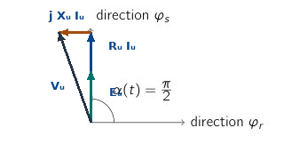

### Q43 — Courant au point de fonctionnement

*Feuillets A17, A20, Cg3.*

> [!INDICATION]
> À vitesse constante le couple moteur équilibre le frottement. Lire ensuite le graphe normalisé avec la ligne CMP50S du tableau.

À $\omega_m=80\,\mathrm{rad\,s^{-1}}$, $M=f_v\omega_m=0{,}04\times80=3{,}2\,\mathrm{N\,m}$. Avec $M_0=1{,}3\,\mathrm{N\,m}$, l’ordonnée normalisée vaut $2{,}46$. Sur la courbe [1], on lit $I/I_0\simeq2{,}6$ à $2{,}7$. Comme $I_0=1{,}32\,\mathrm A$, $I_u$ est voisin de $3{,}5\,\mathrm A$ efficaces.

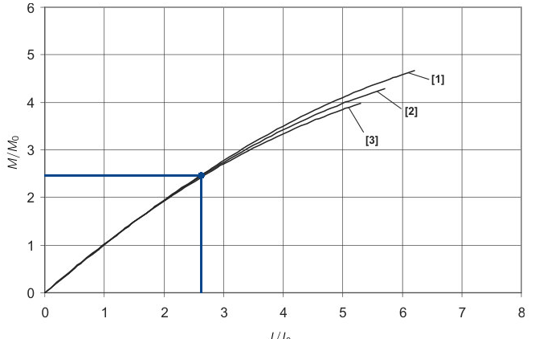

### Q44 — Compatibilité de la tension de phase

*Feuillets A17, A20, Cg4.*

> [!INDICATION]
> La chute résistive est en phase avec la f.é.m., la chute inductive en quadrature. Ramener l’indication à vide de la figure 16 à la vitesse de travail.

Pour $\omega_m=80\,\mathrm{rad\,s^{-1}}$, $N_m=60\omega_m/(2\pi)\simeq764\,\mathrm{tr\,min^{-1}}$ et $X_u=L_u p\omega_m=0{,}037\times160=5{,}92\,\Omega$. Dans la lecture directe des valeurs de la figure 16 pour le modèle monophasé de l’énoncé, $E_u=62\,N_m/1000\simeq47{,}4\,\mathrm V$, $R_u=11{,}6\,\Omega$ et $I_u\simeq3{,}5\,\mathrm A$. Alors
$$
V_u=\sqrt{(E_u+R_u I_u)^2+(X_u I_u)^2}\simeq90\,\mathrm V.
$$
Le variateur admet $250\,\mathrm V$ efficaces de phase. Le point étudié est donc accessible. Le feuillet appelle les $62\,\mathrm V$ « tension interne du moteur à vide » sans préciser phase ou ligne. Si cette valeur est composée en étoile, $E_u$ doit être divisé par $\sqrt3$ et l’on trouve environ $71\,\mathrm V$ en gardant les mêmes $R_u,L_u$. La conclusion de compatibilité est identique.
