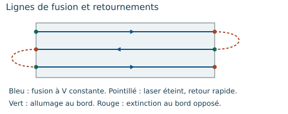
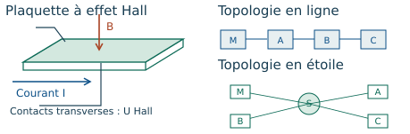
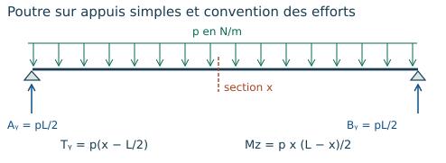
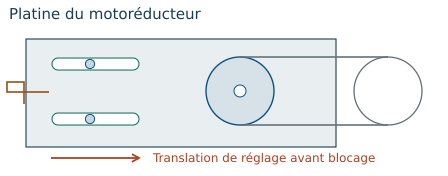
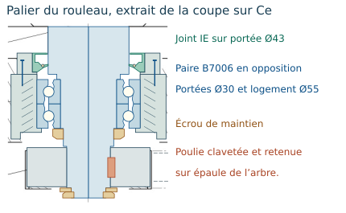

# Banque PT 2020 — Sciences industrielles C · Corrigé brut

*Corrigé rédigé par IA, non officiel. Signalez toute erreur.*

**Rédaction** · GPT-6.2 Astra Ultra · vitesse non renseignée · 26 novembre 2026

**Révision (tour 1)** · GPT-6.2 Astra Ultra · vitesse non renseignée · 26 novembre 2026

**FormUp 350, fabrication additive sur lit de poudre.** Épreuve de six heures. Les 39 questions couvrent le positionnement du spot, la translation du plateau et le rouleau de mise en couche. Le jury attribue aux trois parties 20 %, 35 % et 45 % de la note. Les points individuels ne sont pas publiés.

[Sujet et planches](https://www.banquept.fr/documents/2020/si_c_2020_pt.zip) · [Rapport du jury](https://www.banquept.fr/documents/ecrit/rapport/2020/rapport_si_c_ecrit_2020.pdf)

## I. Positionnement du spot dans le plan

### I.1 · Énergie apportée par unité de volume

Pendant $dt$, le laser fournit $Pdt$ et parcourt $Vdt$. En remplissage régulier, le volume de couche associé vaut $Vdt\,de$. D’où $E_{vd}=P/(Vde)$. En millimètres, $V=1000\,\mathrm{mm/s}$, $e=0,040\,\mathrm{mm}$ et $d=0,070\,\mathrm{mm}$. Le débit géométrique est 2,8 mm³/s et **$E_{vd}=100\,\mathrm{J/mm^3}$**. Il s’agit de l’énergie incidente rapportée au volume balayé. L’absorption effective du métal demanderait un coefficient supplémentaire.

### I.2 · Vitesse maximale suivant un axe et en diagonale

La ressource III relie ±10° à ±175 mm. La pente de conversion vaut $k=0,175/(10\pi/180)=1,003\,\mathrm{m/rad}$. À $25\,\mathrm{rad/s}$, le spot atteint donc **25,1 m/s** suivant X ou Y. Avec les deux galvanomètres au maximum sur des axes orthogonaux, $V_{max}=25,1\sqrt2=35,5\,\mathrm{m/s}$. La calibration fournie inclut déjà la déviation optique par la tête.

### I.3 · Changer de ligne à vitesse programmée

Parcourir le premier segment actif à 1 m/s et éteindre au bord exact du contour. Prolonger le mouvement pendant la décélération, déplacer le spot d’un pas de ligne et effectuer le demi-tour hors de la matière à fondre. Utiliser une transition lisse, au régime rapide autorisé par l’accélération et la course disponibles. Réaccélérer en sens opposé jusqu’à 1 m/s **avant** la rentrée dans le contour puis rallumer au bord. Un court raccord en U ou en boucle évite un arrêt d’angle suivi d’un long repositionnement. Une vitesse instantanée de 25 m/s n’est pas réalisable sur un retournement très court.

### I.4 · Résolution angulaire

La plage complète vaut $20°=\pi/9\,\mathrm{rad}$. Un mot de 24 bits distingue $2^{24}$ niveaux. Le pas de quantification vaut $\Delta\theta\simeq20°/2^{24}=1,19\times10^{-6}\,°=2,08\times10^{-8}\,\mathrm{rad}$. Un codage qui inclut exactement les deux extrémités remplace le dénominateur par $2^{24}-1$, sans effet sur ces chiffres.

### I.5 · Résolution dans le plan de travail

$\Delta x=k\Delta\theta=350/2^{24}\,\mathrm{mm}$. Avec $2^{10}\simeq10^3$, cela donne environ $2,2\times10^{-5}\,\mathrm{mm}$, soit 0,022 µm. Un interligne de 70 µm correspond à plus de 3 000 pas numériques. Le codage suffit largement. L’exactitude réelle dépend aussi de la mécanique, de l’optique et de la calibration.

### I.6 · Mesurer un champ par effet Hall

Dans une plaquette parcourue par un courant suivant x, un champ normal suivant z dévie les porteurs par la force de Lorentz. Un champ transverse suivant y s’établit au bord et une tension apparaît entre les deux contacts latéraux. Son signe change avec le champ ou le courant. Pour une plaquette d’épaisseur t, $U_H=R_H I B_z/t$ en convention signée. En solidarisant un aimant avec l’axe et en calibrant la variation du champ, on obtient une information d’angle.

### I.7 · Topologies du réseau

**Ligne.** Relier le contrôleur au premier nœud, puis chaque nœud à son voisin. La faible longueur de câblage et l’extension en bout conviennent à des organes alignés. Une coupure simple en amont isole les équipements en aval, sauf chemin de secours. **Étoile.** Relier chaque nœud au répartiteur central. Une branche défectueuse peut être isolée en conservant les autres. Le diagnostic et le raccordement de nouveaux équipements sont aisés. Le répartiteur concentre en revanche les liaisons et constitue un point de défaillance commun.

### I.8 · Série, synchrone et full-duplex

Sur une voie série, les bits d’une information se succèdent dans le temps. Un échange synchrone fait reposer l’échantillonnage et le traitement cyclique sur une référence temporelle partagée ou récupérée, ce qui permet ici d’actualiser les consignes de façon coordonnée. Une liaison full-duplex comporte deux sens de circulation simultanés. Le contrôleur et le nœud peuvent donc émettre et recevoir au même instant.

### I.9 · Occupation de la trame pour un variateur

La consigne contient $24/8=3$ octets utiles. Le sujet définit une taille minimale de 84 octets sur le support, intervalle intertrame inclus. Le rendement selon cette définition est **$3/84=3,57\,\%$**. Le remplissage du champ de données jusqu’à 46 octets n’ajoute aucune information de commande.

### I.10 · Tenir compte du temps de réaction

En 10 µs à 100 Mbit/s, $100\times10^6\times10^{-5}=1000$ bits, soit 125 octets, auraient pu être transmis. La durée d’immobilisation rapportée à un message utile de 3 octets équivaut donc à $84+125=209$ octets. La fraction utile devient **$3/209=1,44\,\%$** avec la même convention que I.9.

### I.11 · Mutualiser les six consignes

Les deux têtes ont chacune trois variateurs. Une même trame contient $6\times3=18$ octets de consigne. Ce total reste inférieur à la capacité utile minimale de 46 octets, donc la trame reste de 84. En négligeant le traitement local comme le demande le sujet, le rendement devient **$18/84=21,4\,\%$**.

## II. Translation verticale du plateau

### II.1 · Décrire les pivots de vis

Chaque vis est portée par un roulement axial à billes à contact oblique à double rangée opposée **INA ZKLF2068-2RS-PE**. Les deux rangées reprennent la poussée dans les deux sens et les efforts radiaux. La bague intérieure est maintenue sur la vis entre un épaulement et l’écrou à encoches ZM20. Le corps extérieur du roulement prend appui par une face sur le support, fixé par quatre vis CHC M6×35. L’ensemble laisse libre la rotation autour de z.

### II.2 · Calculer le degré d’hyperstatisme

Prendre pour solides mobiles les deux vis et le châssis Z. Les deux écrous appartiennent au châssis et les transmissions par courroie prescrivent les mouvements d’entrée. La ressource VI représente **quatre liaisons linéaires annulaires** de guidage, deux pivots vis/bâti et deux hélicoïdales vis/châssis. Le total des contraintes est $4\times2+2\times5+2\times5=28$. Le mécanisme a une mobilité utile, les rotations des vis étant liées à la même translation, sans mobilité interne dans ce modèle. On trouve $h=28-6\times3+1=\mathbf{11}$. Remplacer chaque patin représenté par une glissière parfaite changerait le modèle et le résultat.

### II.3 · Intérêt de la redondance des appuis

Les deux entraînements et les quatre patins écartés répartissent les sollicitations, raidissent le châssis et limitent son basculement lorsqu’il porte de la poudre. Cet avantage exige la maîtrise géométrique des axes et de leurs positions relatives. Un défaut de montage peut créer des contraintes parasites avant même le chargement.

### II.4 · Modifier la liaison d’une vis au bâti

Conserver sur la vis la seule contrainte indispensable, sa position axiale, par une **liaison ponctuelle de normale z** au sens du modèle bilatéralisé. Le guidage transversal de cette vis est assuré par son écrou sur le châssis déjà guidé. La contrainte axiale lie encore rotation de la vis et translation du châssis. Quatre contraintes sont retirées par rapport au pivot, donc $h=7$ pour une seule substitution, à mobilité inchangée. Une pivot glissant de même axe libérerait la direction axiale précisément nécessaire pour transmettre la poussée. Si les deux sens de poussée sont requis en réalité, la butée doit être doublée ou préchargée pour conserver cette action.

### II.5 · Mettre les pivots en position au montage

Le roulement est présenté contre une **face plane** du support. Le plan impose l’orientation de son axe et sa position axiale. L’absence de centrage par une longue portée cylindrique autorise un faible ajustement de position dans le plan avant serrage, grâce au jeu des trous des quatre vis. Aligner les vis de commande et les écrous sur leurs guides puis bloquer les flasques. Cela limite les efforts dus aux petites erreurs d’entraxe.

### II.6 · Choisir la résolution du codeur moteur

Une rotation du moteur entraîne la vis dans le rapport $24/48=1/2$ de la transmission crantée. La poulie intermédiaire de 22 dents ne modifie pas ce rapport. Avec un pas hélicoïdal de 5 mm, un tour du moteur donne 2,5 mm de translation. Une résolution axiale au plus égale à 2,5 µm exige donc au moins **1 000 comptages par tour moteur**. Un choix possible est 1 024 périodes par tour, soit 4 096 comptages en quadrature, donnant 0,61 µm par comptage. Les deux commandes doivent rester synchrones.

### II.7 · Justifier l’hypothèse de charge d’une vis

La répartition entre les deux entraînements est hyperstatique. L’excentricité de la charge, le réglage des axes et les raideurs peuvent fortement déséquilibrer les réactions. Appliquer tout le poids sur une seule vis est une hypothèse majorante pour sa traction gravitaire en l’absence de précontrainte parasite. Un partage égal serait plus favorable et exigerait des hypothèses de symétrie et de rigidité explicites.

### II.8 · Allongement pour 200 kg de poudre

La section utile vaut $S=\pi30^2/4=707\,\mathrm{mm^2}$. Avec $E=200000\,\mathrm{N/mm^2}$ et $g\simeq10\,\mathrm{m/s^2}$, la loi de traction est $\Delta L=FL/(ES)$. En position haute, 100 kg agissent sur 100 mm, d’où 0,71 µm. En position basse, 300 kg agissent sur 500 mm, d’où **10,6 µm**. L’allongement change de **9,9 µm** pendant la course. Ces chiffres diminuent de 2 % en prenant 9,81 m/s².

### II.9 · Allongement pour 500 kg de poudre

À la position basse, le poids mobile total est celui de 600 kg. À longueur identique de 500 mm, la traction et l’allongement doublent par rapport à II.8. L’allongement final est **21,2 µm**, pour une variation d’environ **20,5 µm** depuis l’état initial à 0,71 µm.

### II.10 · Conclusion sur la mesure moteur

La mesure angulaire convertie par le pas ne détecte pas l’allongement de la vis entre le palier et l’écrou. Sa variation de 10 à 21 µm selon la charge est plusieurs fois supérieure aux 2,5 µm recherchés en position. Un simple décalage de zéro ne compense pas une variation dépendant à la fois de la position et de la matière. La différence entre deux couches voisines peut être plus petite que l’erreur cumulée. Une règle de position sur la partie mobile, comme celles visibles en IV, mesure directement le déplacement. Deux mesures écartées peuvent en outre détecter le basculement.

### II.11 · Autres sources d’écart

La quantification et l’erreur d’index du codeur, la résolution du comptage, le défaut de pas de la vis, les jeux en inversion et l’élasticité de la courroie sous effort interviennent. S’y ajoutent la torsion des arbres, les déformations des paliers et du châssis, les dilatations thermiques et un éventuel désaccord des deux moteurs. Chacune modifie la relation entre l’angle mesuré et la hauteur réelle du plateau.

## III. Étalement du lit de poudre

### III.1 · Lire les trois spécifications du rouleau

**Rectitude 0,005.** Chaque génératrice extraite de la surface cylindrique doit tenir, dans son plan longitudinal, entre deux droites parallèles distantes de 0,005 mm, libres en orientation et position. **Circularité 0,005.** Chaque profil extrait en section droite doit tenir entre deux cercles concentriques dont les rayons diffèrent de 0,005 mm. Les centres peuvent varier d’une section à l’autre. Ces deux spécifications de forme se contrôlent sans référence.

**Coaxialité Ø0,01 | A–B.** La ligne médiane extraite de la surface centrale doit rester dans un cylindre idéal de diamètre 0,01 mm d’axe A–B. A et B sont les surfaces cylindriques des deux portées de bout. On associe simultanément à ces deux surfaces deux cylindres idéaux contraints à avoir un axe commun. Ce dernier est la droite de référence, sans priorité de A sur B. Le défaut de l’axe n’est pas le battement du diamètre extérieur.

### III.2 · Calculer les réactions aux deux extrémités

La poutre de longueur $L=0,500\,\mathrm m$ porte la charge uniforme $-p y$, avec $p=1000\,\mathrm{N/m}$. Sa résultante $pL$ agit au milieu. L’équilibre des moments en A donne $B_y=pL/2$, et celui des forces donne $A_y=pL/2$. Chaque appui exerce donc **250 N vers le haut**. La composante horizontale en A est nulle, et les appuis simples ne fournissent aucun moment de flexion.

### III.3 · Torseur de cohésion

On coupe à $0<x<L$ et l’on exprime l’action de la partie droite sur la partie gauche au centre de la section, base $(x,y,z)$. Le seul effort non nul est $T_y=px-pL/2$, obtenu en équilibrant $A_y$ et $-px$. Le seul moment non nul est $M_z=p x(L-x)/2$. Les efforts normal, de torsion et les autres composantes sont nuls. Le moment s’annule aux appuis et est maximal au milieu.

### III.4 · Équation de la déformée

Prendre y positif vers le haut et $I=\pi D^4/64$. En flexion d’Euler–Bernoulli, $EIy''=M_z=px(L-x)/2$. Une double intégration et les conditions $y(0)=y(L)=0$ donnent

$$y(x)=\frac{p}{24EI}\left(2Lx^3-x^4-L^3x\right).$$

Les extrémités étant simplement appuyées, leur pente est libre. Le plan médian est un plan de symétrie et $y'(L/2)=0$.

### III.5 · Flèche maximale

La flèche vers le bas est maximale au milieu. Par substitution, $y(L/2)=-5pL^4/(384EI)$. Son amplitude est **$\delta=5pL^4/(384EI)$**. Le signe disparaît seulement lorsqu’on donne la valeur maximale en norme.

### III.6 · Choisir le diamètre

Imposer $\delta\leq10^{-6}\,\mathrm m$ conduit à $D\geq[5pL^4/(6\pi E\delta)]^{1/4}$. Avec $E=200\,\mathrm{GPa}$, le diamètre minimal est **95,4 mm**. La cote finale de 100 mm donnée par la ressource X est au-dessus de cette limite et donnerait environ 0,83 µm de flèche dans ce modèle.

### III.7 · Séparer matériau, géométrie et chargement

Au diamètre minimal, $m=\rho\pi D^2L/4$. En y introduisant III.6, on obtient $m=(\rho/\sqrt E)\,L^3\,[\sqrt{5\pi/6}\sqrt{p/\delta}/4]$. Une répartition naturelle est donc $F_1=\rho/\sqrt E$, $F_2=L^3$, $F_3=\sqrt{5\pi/6}\sqrt{p/\delta}/4$. Minimiser la masse revient à maximiser $I_p=\sqrt E/\rho$.

### III.8 · Sélection de familles de matériaux

Dans le diagramme $\log E$ en fonction de $\log\rho$, les lignes d’indice constant satisfont $E=I_p^2\rho^2$ et ont une pente 2. Déplacer une telle ligne vers le haut et la gauche jusqu’aux familles atteintes en dernier. Les **céramiques techniques** et les **composites renforcés orientés** figurent parmi les meilleures, avec les bois chargés parallèlement aux fibres également relevés par le jury. Le choix industriel ajoute l’aptitude au tournage de précision et à la trempe superficielle, la dureté et la résistance à l’usure, ainsi que le coût et la ténacité. L’acier faiblement allié satisfait ces critères même si son indice de masse est moins favorable.

### III.9 · Trempe superficielle par induction

Un inducteur excite des courants de Foucault dans la surface du rouleau. L’échauffement rapide porte la couche superficielle de l’acier à la température d’austénitisation. Un refroidissement rapide la transforme en martensite dure, tandis que le cœur plus froid conserve sa ténacité. La fréquence et la durée de chauffage déterminent la profondeur affectée. L’énoncé demande ici une couche traitée voisine de 2 mm et au moins 53 HRC. Les déformations induites motivent une reprise de finition.

### III.10 · Comparer les trois ordonnancements

Le rayon diminue de $(110-100)/2=5\,\mathrm{mm}$. L’ébauche permet 2 à 8 mm et sa plaquette accepte au plus 38 HRC. La finition au nitrure de bore cubique accepte jusqu’à 60 HRC et 0,07 à 0,8 mm par passe.

**1. Trempe, ébauche, finition.** L’ébauche attaquerait 53 HRC avec un outil limité à 38. L’enlèvement total de 5 mm supprimerait en outre la couche durcie de 2 mm. **2. Ébauche, trempe, finition.** C’est l’ordre à retenir. Par exemple, l’ébauche enlève 4,8 mm au rayon dans l’acier à 15 HRC, puis 0,2 mm de finition corrigent les déformations après traitement à 53 HRC. Il subsiste alors environ 1,8 mm de couche durcie si la profondeur traitée initiale est exactement 2 mm. Si 2 mm sont impératifs **sur pièce finie**, traiter au moins 2,2 mm ou requalifier la profondeur avant la finition. **3. Ébauche, finition, trempe.** Les deux usinages sont possibles avant traitement et la couche durcie subsiste, mais la déformation de trempe intervient après la dernière correction de forme. Les tolérances de quelques micromètres ne sont donc pas garanties.

### III.11 · Transport du petit déplacement

Le torseur ne contient aucune petite rotation. Le transport donne $\vec D(M_{th,i})=\vec D(O_i)+\vec\Omega\times\overrightarrow{O_iM_{th,i}}=u x+v y$. La translation du cercle est identique en chaque point, mais sa projection sur la normale locale varie avec l’angle.

### III.12 · Écart radial résiduel

La normale sortante de la section est $n_i=\cos\theta_i\,x+\sin\theta_i\,y$. Il faut retrancher à l’écart radial initial la projection du déplacement du cercle sur cette normale. On obtient **$e_i=\xi_i-u\cos\theta_i-v\sin\theta_i$**. Un point mesuré situé vers la droite voit ainsi son écart initial diminuer lorsque le centre associé est déplacé vers la droite.

### III.13 · Résoudre les équations normales

Pour les quatre directions cardinales, $\sum\cos^2\theta_i=\sum\sin^2\theta_i=2$ et $\sum\sin\theta_i\cos\theta_i=0$. Le système est donc diagonal, $u=(\xi_1-\xi_3)/2$ et $v=(\xi_2-\xi_4)/2$. La translation supprime la composante de premier harmonique du profil mesuré.

### III.14 · Calculer le déplacement du centre

Pour les mesures $10,8,-4,2\,\text{µm}$, $u=[10-(-4)]/2=7\,\text{µm}$ et $v=(8-2)/2=3\,\text{µm}$. Le centre associé se déplace de 7 µm dans la direction du premier point et de 3 µm dans celle du deuxième.

### III.15 · Défaut de circularité dans la section

Les quatre résidus valent $10-7=3$, $8-3=5$, $-4+7=3$ et $2+3=5\,\text{µm}$. L’écart entre les rayons enveloppant ces points vaut $5-3=\mathbf{2\,\text{µm}}$. Il est inférieur à la tolérance de 5 µm. Les quatre points de cette section sont donc conformes au contrôle demandé. La qualification de tout le rouleau nécessite plusieurs sections et un échantillonnage angulaire adapté.

### III.16 · Régler la tension au niveau du moteur

Le document VII montre la platine tendeur sous le motoréducteur. Deux lumières parallèles orientées suivant la ligne des centres permettent sa translation. Desserrer les vis, déplacer la platine jusqu’à l’entraxe requis grâce à une vis de poussée, vérifier l’alignement des deux poulies puis serrer les fixations. La vis de réglage assure le déplacement fin et les fixations serrées maintiennent la position en service.

### III.17 · Réaliser le palier, l’étanchéité et la transmission

Sur le dessin Ce, le côté droit comporte une paire de **B7006, Ø30 × Ø55 × 13 mm, angle de contact 15°**. Assembler les deux roulements en opposition rapprochée, face à face, et prévoir les contacts et le réglage spécifié par le fabricant. Les deux arrêts des bagues intérieures sont une épaule d’arbre et un dispositif axial démontable, ceux des bagues extérieures une épaule de boîtier et un couvercle vissé. La paire rapprochée modélise un appui quasi ponctuel capable de transmettre une poussée dans les deux sens. L’articulation de type rotule est le modèle du sujet. Les roulements de broche réels imposent une bonne coaxialité.

Les bagues intérieures tournent sous une charge de direction fixe dans le chariot. Une portée d’arbre typiquement k5/k6 et un logement H7 permettent respectivement serrage et montage démontable. Le joint IE **Ø43 × Ø60 × 10 mm** porte sur une piste lisse Ø43 sans rainure de clavette, sa lèvre tournée vers la graisse. Le joint se loge dans un lamage de couvercle. Les poulies menante et menée sont chacune clavetées, appuyées sur une épaule et retenues par rondelle et vis axiale ou écrou. Les dentures et la courroie sont dans un même plan. Après dépose du carter, détendre la courroie, retirer la poulie menée et les arrêts extérieurs puis libérer le palier démontable. Le rouleau peut alors sortir vers la gauche sans que la poulie ou un épaulement extérieur ne bloque son passage.

