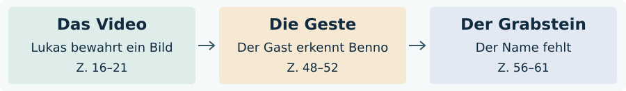

# BEL A/L — Allemand, commentaire et traduction 2020 · Corrigé guidé

*Corrigé rédigé par IA, non officiel. Signalez toute erreur.*

**Rédaction** · GPT-6.2 Astra Ultra · vitesse non renseignée · 27 novembre 2026

**Révision** · GPT-6.2 Astra Ultra · vitesse non renseignée · 27 novembre 2026

Uwe Timm, *Der Freund und der Fremde. Eine Erzählung*, 2005. Le commentaire porte sur les lignes 1–61 (p. 2–3). La version porte sur les lignes 8–23 (p. 2), de « Er hat Tee gemacht… » à « … Brauchbaren und Unbrauchbaren. ». Durée de l’épreuve : six heures. Dictionnaire unilingue autorisé.

[Sujet officiel, p. 2–3](https://www.ens-lyon.fr/sites/default/files/2020-09/2020%20Commentaire%20d%27un%20texte%20en%20LVE%20et%20traduction.pdf#page=2) · [Rapport du jury, écrit commun, p. 1–11](https://www.ens-lyon.fr/sites/default/files/2020-10/ALLEMAND_2020%20internet.pdf#page=1)

## Attribuer les voix

> [!INDICATION]
> À la ligne 19, repérez ensemble le sujet de *stand* et celui de *sagt*. À la ligne 20, demandez-vous qui reprend le récit en disant *er*.

Le « je » qui attend derrière le store est Lukas. L’incise reste à la troisième personne dans la bouche du visiteur. Celui-ci raconte ensuite comment Lukas a filmé le ramassage. Cette alternance rapproche le lecteur du fils et rappelle que les paroles nous parviennent à travers l’ami du père. Le même principe aide à commenter les questions sur la mort de la mère. La première personne surgit au milieu du récit du visiteur. Décrire ce rapprochement est plus précis que d’attribuer à la mère un propos dont aucun témoin ne garantit la lettre.

## Choisir les mots du passage français

Le trophée est une tête en peluche, accrochée à l’armoire. La première question n’affirme aucune origine et la réponse corrige justement l’hypothèse d’un souvenir d’enfance. Dans la réflexion du narrateur, « mon ami, son père » identifie le même homme sous deux rapports différents. Le conditionnel passé préserve le caractère imaginaire de cet achat par Benno.

Deux formes de conservation se répondent. Lukas recueille d’abord des objets que d’autres ont jetés. Lorsqu’il décide de les jeter à son tour, il conserve une trace de leur départ. Traduire *aufgehoben* par « conservé » permet de retrouver sur la bande l’acte initial d’*aufheben*. Le verbe ne signifie pas ici que le ramassage a été annulé. À la dernière ligne prescrite, garder la paire *Brauchbaren und Unbrauchbaren*. La nouvelle phrase qui compare le contenu du débarras à l’histoire familiale, à la fin de la ligne 23, relève du commentaire.

## Commentaire en allemand

Wer einen Freund verloren hat und dessen Sohn besucht, möchte vielleicht im einen etwas vom anderen wiederfinden. Für den Sohn kann dieselbe Suche bedeuten, dass sich wieder jemand vor allem für den Vater interessiert. In Uwe Timms *Der Freund und der Fremde* spricht der Besucher diesen möglichen Einwand selbst aus: Nun ist er es, der wegen Benno gekommen ist (Z. 6–7). Die Bekanntschaft mit Lukas wird so auch zur Prüfung der eigenen Art, sich zu erinnern. An Dingen, Gesten und schließlich an einem fehlenden Stein erkundet der Text, was von einem Menschen weitergegeben werden kann und welche Ansprüche die Überlebenden damit aneinander stellen.

Schon im ersten Satz kommen zu den Dingen, die Lukas aufhebt, immer weitere Verluste hinzu. Der Sohn hat den Vater nie kennengelernt, die Mutter und deren Eltern haben ihre Heimat in Schlesien verloren. Die Wiederholung des Verbs „verloren“ schafft einen Zusammenhang zwischen verschiedenen Erfahrungen, ohne sie gleichzusetzen. Kann man einen Menschen verlieren, dem man nie begegnet ist? Die abgebrochene Wendung über den Vater, den der Sohn nie gesehen hat, lässt die grammatische Lücke spürbar werden. Der Tee dagegen wird mit ruhigen, gezielten Griffen gemacht. Hier sieht der Besucher jemanden handeln, bevor er deutet. Als er den Plüschkopf für ein Stück Kindheit hält, erhält er eine nüchterne Auskunft über einen Einkauf. Schon im nächsten Augenblick aber meint er in dem Witz des Käufers seinen Freund zu erkennen. Wir sehen zugleich Lukas und das Bedürfnis des Betrachters nach Ähnlichkeit.

Die kurze Episode vom Sperrmüll verschiebt die Verhältnisse. Zunächst gibt der Besucher die Sätze des Sohnes in indirekter Rede wieder. Dann taucht neben dem eingeschobenen „sagt er“ unvermittelt ein „ich“ auf (Z. 19). Für einen Augenblick steht der Leser mit Lukas hinter der Jalousie. Aufgeregt wartet der sonst so ruhige Mann darauf, dass etwas verschwindet. Mit der Kamera lässt er wenigstens den Vorgang des Verschwindens bei sich bleiben. Der Besucher sammelt seinerseits Einzelheiten und bewahrt sie in seiner Erzählung auf. Er gerät dabei in einen ähnlichen Widerspruch, sobald er die Kammer ausräumen will, wenigstens in Gedanken. Das zugespitzte Wort „auszumisten“ nimmt er ausdrücklich zurück. Mit dem geänderten Wort ändert sich auch, wie viel Achtung einem Staubsauger oder einer Wäschestange gebührt.

Am Beispiel der Mutter zeigt sich eine Grenze jedes vorschnellen Erklärens. Als Lehrerin hatte sie für ihren Schlaf nach dem Unterricht sogar ein Ende des nachmittäglichen Glockenläutens durchgesetzt. Am Krankenbett lässt sie sich Bilder von Bosch bringen. Das Erzählen rückt von der biographischen Auskunft über die Fragen nach der Hölle bis zu der Frage vor, was „mich“ danach erwarte. Wessen Stimme spricht hier? Die Nähe zum Bewusstsein der Kranken kommt ohne eine sichere Antwort aus. Auch die Erinnerung des Sohnes endet mit einem kleinen Lachen und einer erschreckenden Ähnlichkeit zwischen einem gemalten Gesicht und dem der Sterbenden. Im Lachen und in einer Fingerhaltung des Sohnes erkennt der Gast wiederum den Vater. Seine Gewissheit gilt der Geste. Über die Beziehung, die Vater und Sohn hätten haben können, weiß er darum noch nichts.

Am Tisch sitzt so auch ein „unkorrigierbares Gespenst“ (Z. 53). Gegen einen lebenden Vater hätte man Einwände erheben und über einen Fehler lachen können. Die wiederholte Anrufung „Benno“ hält den Hochbegabten fest und macht ihn dem Sohn zugleich unerreichbar. Am Ende gibt Lukas gerade einen Gegenstand fort, der den Namen für alle sichtbar tragen sollte. Er ließ den Grabstein entfernen, um auch die Mutter auf ihm zu nennen, und hat ihn noch nicht wieder aufstellen lassen. Freunde und Verwandte sehen das verwilderte Grab, der Erzähler erwägt eine Flucht vor dem geerbten Namen. Er lässt die Deutung als Frage stehen. Das ist der kleine Abstand, den das Erinnern des Freundes dem noch lebenden Sohn zugestehen kann.

## Version française

Il a fait du thé, lentement, mais avec des gestes précis et calmes. On ne décèle chez lui aucune agitation. Je lui dis que j’aime bien sa tête d’ours blanc en peluche, accrochée à l’armoire comme un trophée, tant elle parodie avec malice les trophées de chasse. Une peluche de son enfance ?

Non, dit-il, il l’a trouvée dans une boutique, l’a achetée et l’a ensuite accrochée là.

C’est bien, me dis-je, ce qu’il aurait pu faire lui aussi, mon ami, son père.

Dans la pièce se dresse une fontaine d’intérieur, bleue. Plutôt affreuse.

Oui. Mais drôle.

Une fois, pourtant, il a réussi, me dit-il, à jeter quelque chose, quelques objets qu’il avait récupérés des années plus tôt parmi les encombrants. Ça lui a demandé un énorme effort. Après s’être longtemps et durement débattu, il est arrivé à sortir ces quelques objets et à les déposer dans la rue. Et après, dit-il, je suis resté là, derrière le store, à attendre, en nage tant j’étais nerveux et tendu, que passe le service des encombrants. Il a filmé le ramassage en vidéo. Même l’enlèvement, il fallait encore le conserver, ne serait-ce que sur la bande vidéo.

Il en sait long sur lui-même, trop sans doute. Au moment où nous nous disons au revoir, il me montre le débarras, un débarras rempli de toutes sortes de choses, utilisables ou inutilisables.
