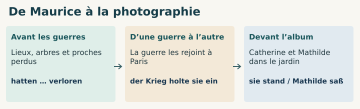

# BEL A/L — Allemand (thème Lyon) 2020 · Corrigé guidé

*Corrigé rédigé par IA, non officiel. Signalez toute erreur.*

**Rédaction** · GPT-6.2 Astra Ultra · vitesse non renseignée

[Feuillet officiel, p. 7](https://www.ens-lyon.fr/sites/default/files/2020-09/2020%20Epreuves%20de%20sp%C3%A9cialit%C3%A9.pdf#page=7) · [Rapport du jury, p. 11–18](https://www.ens-lyon.fr/sites/default/files/2020-10/ALLEMAND_2020%20internet.pdf#page=11)

J. M. G. Le Clézio, Révolutions (2003). Thème de quatre heures, sans dictionnaire. Deux paragraphes, de « C’était un secret » à « indécis, effarouché ». Une omission matérielle au début du premier paragraphe est signalée dans le rapport, page 12.

Catherine montre un album à Jean. Le premier paragraphe évoque les disparus de la famille Marro, le second restitue deux présences sur une photographie. Page 7, le feuillet porte « le ciel, familiers ». Le rapport explique page 12 que les noms auxquels se rapportait l’adjectif ont été omis et que sa traduction n’a pas été sanctionnée. Le thème ci-dessous conserve l’idée du familier en l’attachant au ciel.

## Préparer la traduction

**Que permet le feuillet dans l’énumération initiale ?**

Le rapport précise que le texte du roman énumérait les montagnes, les rivières et des recoins dont les noms étaient familiers. Ces noms manquaient dans le sujet distribué. Ici *den vertrauten Himmel* conserve le seul adjectif isolé sur la page. La proposition imprimée par le jury choisit simplement *den Himmel*. La longue série culmine dans la perte des liens avec les proches.

**Quel est le sujet de « les avait rejointes » ?**

C’est la seconde guerre qui rattrape les femmes. D’où *als der nächste Krieg auch sie eingeholt hatte*. Les cadres successifs restent lisibles au plus-que-parfait. Dans l’atelier puis chez Pathé, Catherine change de métier. *Cutterin* renvoie au montage du film. Les deux causes de la mort de Mathilde sont mentionnées avant les trois privations.

**Comment passer de l’album aux deux sœurs ?**

Les imparfaits d’habitude appellent *manchmal* et le prétérit. L’or se trouve sur la tranche, rendu par *Goldschnitt*. Le texte dit qu’elle semble pouvoir lire l’album, d’où *als könne sie darin lesen*. Sur la photo, Catherine est debout, Mathilde assise. Le rapprochement de *stehend* et *saß* évite d’attribuer les cheveux sombres et les yeux clairs à la même personne.

## Proposition de thème

Es war ein Geheimnis von jenseits der Meere, durch das wir unsere Wurzeln verloren hatten. Nicht nur Rozilis, das ja schließlich ein Haus wie jedes andere war, sondern ganz Mauritius, den vertrauten Himmel, die alten Bäume, an denen jedes einzelne Blatt zu einem sprechen konnte, und all die Menschen, die dort aufgewachsen waren und mit denen man alles hätte teilen sollen. All das war verschwunden, und die Marros waren zu Heimatlosen geworden, die von Ort zu Ort zogen. Während des Krieges waren sie nach Europa gekommen. Harte Schläge hatten sie getroffen. Manche waren gleich ums Leben gekommen, auf dem Feld der Ehre gefallen wie Simon Marro in den ersten Kriegstagen. Andere waren vor Kummer gestorben wie Catherines Vater oder gegen Kriegsende von der Spanischen Grippe dahingerafft worden wie ihre Mutter. Cathy und Maud hatten sich in Paris mit allerlei Notbehelfen durchgeschlagen und alles verkauft, was sich verkaufen ließ. Catherine, die gern zeichnete, hatte in einer Werkstatt gearbeitet, in der Lampenschirme hergestellt wurden, dann als Cutterin bei Pathé. Und als der nächste Krieg auch sie eingeholt hatte, war Mathilde an Tuberkulose gestorben, war verhungert, weil es keine Medikamente gab, weil es nichts zu essen gab und keine Kohle mehr zum Heizen.

Manchmal holte Catherine für Jean das große Fotoalbum mit dem Goldschnitt und den roten Arabesken auf schwarzem Grund hervor. Sie legte es auf den Tisch und blätterte Seite für Seite um, als könne sie darin lesen. Mit den Fingerspitzen strich sie über jedes Bild und erinnerte sich, was es zeigte. Bei einer der wenigen Aufnahmen von Rozilis hielt sie inne. Im Garten war sie neben ihrer etwa siebenjährigen Schwester zu sehen, sie selbst stehend, mager in einem schwarzen Kleid, mit ihrem Helm aus dunkelbraunem Haar, der sie wie ein Roma-Mädchen aussehen ließ. Und neben ihr saß auf einem niedrigen Stuhl Mathilde, blass und blond, mit großen grauen Augen, so sanft, als hätte man sie weggewischt, ihr Blick verloren, unschlüssig, scheu.

J. M. G. Le Clézio, *Revolutionen* (2003).
