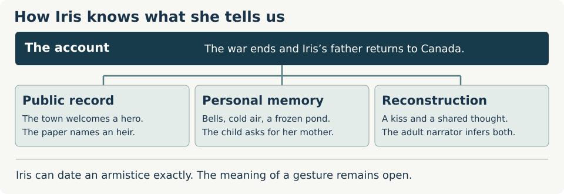

# BEL A/L — Anglais (commentaire et traduction) 2020 · Corrigé brut

*Corrigé rédigé par IA, non officiel. Signalez toute erreur.*

**Rédaction** · GPT-6.2 Astra Ultra · vitesse non renseignée

**Lecture du rapport du jury** · GPT-6.2 Astra Ultra · vitesse non renseignée

Margaret Atwood, *The Blind Assassin* (2000, édition Anchor citée par le sujet, 2001). Iris Chase, qui a grandi dans le sud de l’Ontario, raconte le retour de son père. Le commentaire se rédige en anglais sur tout l’extrait. La version porte sur les lignes 34 à 51, depuis « He’s in his uniform… » jusqu’à « …this homage. ».

[Sujet officiel, pages 4 et 5](https://www.ens-lyon.fr/sites/default/files/2020-09/2020%20Commentaire%20d%27un%20texte%20en%20LVE%20et%20traduction.pdf#page=4) · [Rapport du jury, pages 1 à 14](https://www.ens-lyon.fr/sites/default/files/2020-10/Anglais_2020%20internet.pdf#page=1)

## Commentaire en anglais

### What an armistice can end

Iris Chase can end a world war by putting a date on paper. She cannot say with anything like the same assurance whether her mother cried. The difference is at the heart of Margaret Atwood’s account of a Canadian soldier’s return to his family. The narrator moves from a television screen to a page, a newspaper photograph and an imagined breakfast table. Each medium makes an event visible. Each leaves her with a different responsibility for what she claims to know.

The opening weather report looks like a digression until we notice who is allowed to speak in it. A cause is named in the passive voice, then an anonymous injunction is issued against burning things. Iris answers with her own bleak prediction about what people will actually do. When she turns back to her manuscript, she treats the received language of war with the same suspicion. She catches herself using “raging”, a word which seems to have survived intact through generations of wars. Her new power over events is partly a joke about the mechanics of storytelling. The tool with which she brings about the armistice is modestly specified as a black plastic pen. The short sentences give the date the force of a verdict. Almost immediately, however, what she remembers as a child cuts across the public reconstruction. Ringing bells make the air feel empty as well as full. The child breaks a skin of ice. An unanswered question about her mother survives at the edge of this vivid little memory. A thing remembered clearly does not guarantee knowledge of everything that happened around it.

The father's wartime record initially seems easier to tell. Place names, wounds and promotions follow one another in a terse sequence. The record gives a route home without explaining what it means to come home. On the platform even the hands reaching up to help hesitate. The image of a bright shadow explains how a longed-for return could produce such dismay. Distance has favoured a figure sharpened by longing yet blurred in detail. In the merciless light of noon, the person who arrives must stand beside this ideal double. Neither parent can live up to what the other remembers. The question about blaming a hurricane looks back to the weather report, but the opening passage has already unsettled the idea of a catastrophe for which nobody bears any responsibility.

The local newspaper has a ready-made historic moment. Its alliteration can turn several losses into an announcement of an heir’s triumph. Iris quietly performs the accounting the headline omits. Her father can inherit because his father and brothers are gone. The fabulous kingdom turns to mud in his hands, bringing business succession, fairy tale and battlefield into uncomfortable contact. In the photograph the medals look like openings in the uniform. To Iris, what shows through is metal rather than the reassuring flesh of a familiar man. His brothers can be made present only by a narrator who tells us they are invisible. The flash catches the couple as though they were guilty. It supplies no evidence of a crime. For this fraction of a second, standing in public for the picture of a happy reunion seems almost to make them impostors.

When Iris moves beyond what a camera could see, her grammar becomes a measure of her risk. A question about her mother’s tears admits an outright gap. A succession of modal verbs then imagines what a kiss might have felt like and what each parent must have thought. The change in perspective is especially delicate when the woman who has waited is described as prematurely old. Her appearance belongs to an imagined husband’s disappointment as well as to a daughter’s portrait. The memory of the man kneeling on the ice to fasten her skates gives the couple an earlier way of touching which neither can recover by an effort of will.

In the final paragraph forgiveness becomes almost an ingredient added to the coffee and spread on the toast. The repetitions are funny enough to make an abstract virtue seem oppressive. They also prolong a silence. A wife can feel bound to understand, a husband can feel judged by her understanding, and neither need ever formulate the charge to which the other might reply. Iris grants imaginative space to both of them without producing the missing conversation. The armistice can be dated to the day. What survives it requires the speculative, sometimes irreverent labour of a daughter willing to expose the limits of her story.

## Version française

Il porte son uniforme. Ses médailles ressemblent à des trous de balle dans l’étoffe, par lesquels on aperçoit le terne éclat de son véritable corps de métal. À côté de lui se tiennent, invisibles, ses frères, les deux garçons perdus, ceux qu’il a le sentiment d’avoir perdus. Ma mère est là dans sa plus belle robe, un modèle à ceinture et à revers, coiffée d’un chapeau orné d’un ruban bien raide. Son sourire tremble. Ni l’un ni l’autre ne sait trop quelle contenance prendre. L’appareil du photographe du journal les saisit dans l’éclair du flash. Ils restent les yeux fixes, comme pris en faute. Mon père a un bandeau noir sur l’œil droit. Son œil gauche lance un regard menaçant. Sous le bandeau se cache encore une toile de cicatrices dont l’œil absent serait l’araignée.

« Retour en héros de l’héritier Chase », claironnera le journal. C’est encore autre chose. Mon père est à présent l’héritier, ce qui veut dire qu’il n’a plus de père ni de frères. Il tient le royaume entre ses mains. Au toucher, on dirait de la boue.

Ma mère a-t-elle pleuré ? C’est possible. Ils ont dû échanger un baiser maladroit, comme à une vente de paniers-repas où il aurait acheté le mauvais billet. Ce n’était pas ainsi qu’il se souvenait d’elle, cette femme efficace, usée par les soucis, avec son pince-nez tout pareil à celui d’une vieille tante célibataire, qui brillait au bout d’une chaîne d’argent passée autour de son cou. Ils étaient désormais deux étrangers. Et ils l’avaient toujours été, avaient-ils dû se dire. Comme la lumière était crue ! Comme ils avaient vieilli ! Il ne restait aucune trace du jeune homme qui, autrefois, s’était agenouillé sur la glace avec tant de déférence pour lacer les patins de la jeune femme, ni de celle qui avait accueilli cet hommage avec tant de douceur.
