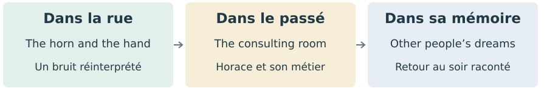

# BEL A/L — Thème anglais 2020 · Corrigé guidé

*Corrigé rédigé par IA, non officiel. Signalez toute erreur.*

**Rédaction** · GPT-6.2 Astra Ultra · vitesse non renseignée

**Révision** · GPT-6.2 Astra Ultra · vitesse non renseignée

Pierre Péju, *L’œil de la nuit* (2019). Épreuve de spécialité de l’ENS de Lyon et de l’ENS Paris-Saclay pour l’anglais. Traduire en anglais l’intégralité du passage, de « Le cri d’une bête qu’on égorge… » à « …décalqués de ses propres rêves. ». Durée de quatre heures. Tout dictionnaire est interdit.

[Sujet officiel, p. 8](https://www.ens-lyon.fr/sites/default/files/2020-09/2020%20Epreuves%20de%20sp%C3%A9cialit%C3%A9.pdf#page=8) · [Rapport du jury, thème, p. 14–23](https://www.ens-lyon.fr/sites/default/files/2020-10/Anglais_2020%20internet.pdf#page=14)

## Préparer le thème

**Partir de l’erreur de perception.** Le cri semble d’abord celui d’une bête égorgée. La phrase suivante identifie le klaxon et retarde l’apparition de la voiture. Conserver cet ordre donne leur portée au reflet et aux deux phrases nominales. Une main est à peine entrevue : ajouter un passager identifiable ferait disparaître l’incertitude d’Horace.

**Retrouver la soirée parmi les habitudes.** Certaines promenades se répètent au printemps 1915, d’où *would go down and wander*. *That evening he was walking fast* ramène au soir raconté. L’antériorité de *had become* situe l’ascension du médecin en amont de ce déplacement. Frink enseigne la neurologie à Cornell et pratique la psychanalyse depuis peu. La lecture et l’écriture se déroulent dans son cabinet personnel.

**Interpréter le dernier possessif.** Un patient a prononcé les phrases qui reviennent à Horace. Les rêves, eux, sont ceux d’autres personnes, mais ils paraissent avoir été calqués sur les siens. *To have been traced from his own* conserve le sens de la copie et l’antériorité qu’implique le résultat. *Images haunted him* et le fragment final ménagent une pause avant cette révélation.

## Traduction en anglais

The scream of an animal having its throat cut made him jump. What had torn Horace from his reverie was not the squeal of a dying pig but the horn of a motor car slowly threading its way between hackney cabs, barouches, carts piled high and passers-by who loomed like ghosts in the headlights. Wisps of steam rose from the ground. He stepped aside to let the imposing vehicle pass, its unfamiliar din making the horses whinny and rear. There was no telling whether there were any passengers behind the driver, but for a few seconds he thought he glimpsed a long, pale hand wiping the mist from the other side of the window in which he could see his own face reflected. The hand, almost skeletal, seemed to be bidding him farewell. Nobody’s hand. A farewell to the void.

And so, on certain evenings that strange spring of 1915, after a morning on his hospital ward and an afternoon listening to the neurotics lying on his couch, Horace W. Frink would go down and wander the streets of New York for an hour or two, with no particular end in view, before going back to read and write feverishly in the silence and solitude of his consulting room. After painful years of uncertainty, it must be said, Dr Frink had become a man of some distinction. At thirty-two, he was a psychiatrist at the hospital and a professor of neurology at Cornell. He had only recently become a psychoanalyst, yet his private practice was never short of patients. He no longer had to rely on Abraham Brill to refer patients to him or to send him difficult cases of nervous disorders, for Americans were beginning to take a keen interest in Dr Freud’s method.

For all his newfound fame, Horace remained an anxious, troubled man. An old anxiety gnawed at him. Often he could not sleep a wink all night. That evening he was walking fast, leaping over the muddy puddles with youthful vigour, his hands in the pockets of his thick overcoat, his collar turned up, for as soon as evening fell the draughts would catch you unawares at every street corner. His steps took him all the way to Mac Sorley’s, a distant pub whose rough atmosphere he relished. As he roamed Manhattan, snatches of cryptic remarks one of his patients had made a few hours earlier came back to him. Images haunted him. Dreams other people had dreamt, yet which seemed, in some mysterious way, to have been traced from his own.
