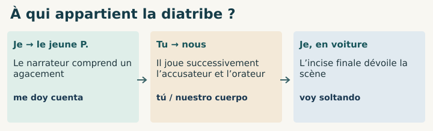

# BEL A/L — Espagnol (thème Lyon) 2020 · Corrigé brut

*Corrigé rédigé par IA, non officiel. Signalez toute erreur.*

**Rédaction** · GPT-6.2 Astra Ultra · vitesse non renseignée

[Feuillet officiel, p. 10](https://www.ens-lyon.fr/sites/default/files/2020-09/2020%20Epreuves%20de%20sp%C3%A9cialit%C3%A9.pdf#page=10) · [Rapport du jury, p. 8–10](https://www.ens-lyon.fr/sites/default/files/2020-11/ESPAGNOL_2020%20internet.pdf#page=8)

Daniel Pennac, Journal d’un corps (2012). Thème de quatre heures, sans dictionnaire. Feuillet entier, de « Je vois bien » à « ma jeunesse retrouvée ». Coupure imprimée après la phrase sur le surmoi.

Un narrateur, au retour d’un trajet en voiture, imite un discours qui reproche aux malades leur maladie. L’explication de la scène arrive dans la toute dernière phrase.

## Proposition de thème

Entiendo muy bien lo irritante que puede resultar para la generación del joven P. la doctrina de que todo es psicosomático. Él denuncia la misma mojigatería contra la que yo me rebelaba a su edad. En mis años mozos el cuerpo sencillamente no existía como tema de conversación. No se le daba asiento a la mesa. ¡Hoy se le tolera en ella con tal de que hable únicamente de su alma! En la doctrina de que todo es psicosomático se trasluce aquella vieja cantinela de los males del cuerpo como expresión de los defectos del carácter. La vesícula hecha polvo del colérico, las coronarias a punto de estallar del que no sabe moderarse, el alzhéimer que le espera sin remedio al misántropo… ¡Encima de enfermos, culpables de estarlo! ¿De qué te mueres, buen hombre? ¡Del daño que te has hecho, de tus pequeños pactos con lo nocivo, del provecho pasajero que sacaste de prácticas poco sanas, en suma, de ese carácter tuyo tan poco disciplinado, tan poco respetuoso contigo mismo! Es tu superyó el que te mata. […] ¡Te mueres, culpable de haber contaminado el planeta, de haber comido cualquier cosa, de haber soportado tu época sin cambiarla, de haber cerrado los ojos ante la cuestión de la salud de todos hasta el punto de descuidar la tuya! Todo ese sistema que tu pereza encubrió con tanta indolencia se ha ensañado con tu cuerpo inocente y lo está matando.

Porque, si la doctrina de que todo es psicosomático señala al culpable, es para ensalzar mejor al inocente. Nuestro cuerpo es inocente, señores y señoras, nuestro cuerpo es la inocencia en persona, ¡eso es lo que proclama la doctrina de que todo es psicosomático! ¡Si tan solo fuéramos *buenos*, si nos portáramos *bien*, si lleváramos una vida *sana* en un entorno *controlado*, no sería solo nuestra alma la que alcanzaría la inmortalidad, sino nuestro propio cuerpo!

Larga diatriba que voy soltando en el coche, camino de vuelta, con el ardor de mi recobrada juventud.

Daniel Pennac, *Diario de un cuerpo* (2012).

