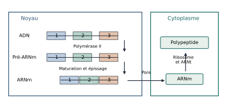
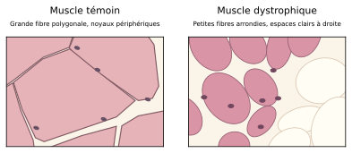
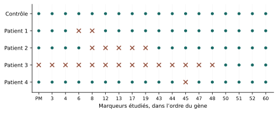
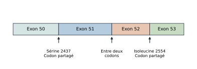
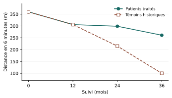
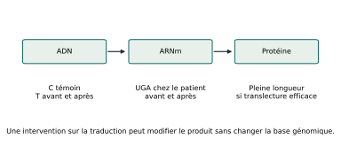
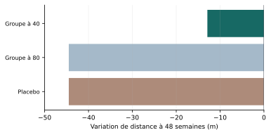

# ENS de Lyon — Second concours, Biologie-biochimie 2020 · Corrigé partiel brut

*Corrigé rédigé par IA, non officiel.*

**Rédaction** · GPT-6.2 Astra Ultra · vitesse non renseignée

**Couverture.** Les questions 1 à 10, 15 à 20 et 23 à 29 sont intégralement traitées, soit 23 sur 29. Les questions 11 à 14 et 21 à 22, qui caractérisent expérimentalement des interventions à vecteurs viraux, sont exclues. Les comparaisons thérapeutiques distinguent les niveaux de preuve du dossier de 2020 et ses suites.

## Dystrophine et myopathie de Duchenne

### Question 1 — Un caractère lié à l’X

Dans cet arbre, des parents phénotypiquement sains ont des fils atteints. La transmission se poursuit par des femmes non atteintes de la lignée maternelle. Aucune transmission directe du père au fils n’apparaît. Avec la très forte prédominance masculine indiquée et le locus DMD, cela correspond à une transmission **récessive liée au chromosome X**. Un garçon est hémizygote pour ce gène. Son X lui vient de sa mère. La femme **III-5**, sœur de III-6 et III-7 atteints et mère de deux garçons atteints, est une **conductrice obligée** dans le modèle familial, en l’absence de mutations indépendantes. Sa mère II-4 l’est également. Le numéro 5 sans indication de génération est ambigu. Le carré **II-5** est un homme phénotypiquement sain qui transmet son Y à ses fils.

### Question 2 — D’un gène à trois exons à sa protéine

Dans le noyau, l’ARN polymérase II, recrutée au promoteur avec les facteurs de transcription, lit le brin matrice d’ADN et synthétise le pré-ARNm de 5′ vers 3′. Celui-ci contient dans l’ordre les trois exons et les deux introns. Une coiffe est ajoutée en 5′, le spliceosome élimine les introns et suture les exons, et l’extrémité 3′ est clivée puis polyadénylée. Une partie de ces événements peut se dérouler pendant la transcription. L’ARNm mature passe par un pore de l’enveloppe nucléaire vers le cytoplasme. Le ribosome traduit sa séquence codante, du codon d’initiation au codon stop, avec des ARNt chargés en acides aminés. La chaîne polypeptidique est libérée puis acquiert sa conformation fonctionnelle. Les portions 5′ et 3′ non traduites de l’ARNm ne deviennent pas des acides aminés.

### Question 3 — Coupe transversale d’un muscle sain et d’un muscle dystrophique

À largeur de champ égale (environ 75 µm), le cadre sain contient une grande fibre polygonale et une partie des fibres voisines. Le cytoplasme occupe presque tout l’espace, les intervalles conjonctifs sont minces et les rares noyaux visibles sont proches du bord. Dans le cadre dystrophique, on observe plusieurs fibres plus petites, plus rondes et de tailles inégales, quelques noyaux plus centraux, un compartiment interstitiel élargi et, à droite du cadre, des espaces optiquement clairs. Ceux-ci sont compatibles avec des adipocytes dont les lipides ont été extraits pendant la préparation. Les profils à noyau central peuvent correspondre à une régénération.

Une perte répétée de fibres fonctionnelles, accompagnée d’une régénération partielle et d’une occupation accrue du tissu par des éléments non contractiles, réduit la section de muscle susceptible de développer une force. La coloration seule ne mesure ni cette force ni la cause moléculaire de la dégénérescence.

### Question 4 — Localisation de la dystrophine

Dans le muscle témoin, l’immunofluorescence dessine des limites nettes et quasi continues autour des fibres. La dystrophine est localisée à la périphérie, du côté cytoplasmique du **sarcolemme**, ce qui concorde avec son rôle de liaison du cytosquelette au complexe membranaire. Chez le patient DMD, ce liseré spécifique est presque absent malgré un fond rouge diffus. La dystrophine périphérique est très fortement réduite ou sous le seuil de détection.

### Question 5 — Source d’ADN pour le diagnostic

Une biopsie musculaire n’est pas nécessaire pour rechercher une anomalie constitutionnelle du gène DMD. L’ADN de cellules nucléées accessibles, par exemple des leucocytes d’un prélèvement sanguin, porte en principe le même variant que le muscle. En revanche, un prélèvement musculaire peut être informatif si la question porte sur la localisation de la protéine musculaire ou sur l’histologie.

### Question 6 — Principe de la PCR diagnostique

Il faut l’ADN matrice du patient, deux amorces orientées l’une vers l’autre, les quatre désoxyribonucléotides, une ADN polymérase thermostable et un milieu tampon avec les ions nécessaires, dont le magnésium. Les brins de l’ADN sont séparés, les amorces s’hybrident sur les séquences complémentaires des deux brins et la polymérase allonge chaque amorce à partir de son extrémité 3′. La répétition de cette succession amplifie la région comprise entre les amorces. Le témoin sain montre les produits attendus et un témoin sans matrice révèle une éventuelle contamination.

### Question 7 — Carte des délétions sur les exons interrogés

La carte ci-dessous ne représente que le promoteur musculaire PM et les 17 exons effectivement interrogés. Les bandes manquantes sont les suivantes.

| Patient | Marqueurs sans bande | Marques positives utiles pour borner l’absence |
|---|---|---|
| 1 | 6 et 8 | 4 et 12 sont détectés. |
| 2 | 8, 12, 13, 17 et 19 | 6 et 43 sont détectés. |
| 3 | PM, 3, 4, 6, 8, 12, 13, 17, 19, 43, 44, 45, 47 et 48 | 50, 51, 52 et 60 restent détectés. |
| 4 | 45 | 44 et 47 sont détectés. |

Les résultats sont compatibles avec un intervalle délété dans chacun des cas. Ils n’en donnent pas les deux points de cassure exacts. Ainsi, l’exon 46 n’étant pas interrogé, sa présence chez le patient 4 reste indéterminée. Dans la piste 3, les bandes conservées sont nécessaires pour distinguer une longue délétion d’un échec général d’amplification.

### Question 8 — Phases aux jonctions d’exons

Les formes emboîtées indiquent où la jonction se situe **dans le cadre de lecture**. À la jonction 50–51, le codon de sérine à la position 2437 est partagé entre les deux exons. L’exon 50 donne le premier nucléotide et l’exon 51 complète le triplet. Entre 51 et 52, la séparation tombe entre deux codons, après la lysine 2514 et avant l’alanine 2515. Entre 52 et 53, le codon d’isoleucine 2554 est de nouveau partagé. Les côtés droits et emboîtés du dessin résument donc deux types de phases. Ils ne décrivent pas des extrémités physiques dentelées dans l’ADN.

### Question 9 — Pourquoi deux délétions peuvent-elles être de gravité différente ?

L’exon 51 commence à l’intérieur d’un codon et se termine entre deux codons. Sa longueur codante n’est pas un multiple de trois. Dans ce contexte, raccorder directement 50 à 52 **décale le cadre de lecture**, change les acides aminés en aval et conduit généralement à un arrêt prématuré et à peu ou pas de dystrophine fonctionnelle. Pour l’exon 48 pris en exemple, les phases sont compatibles. Sa perte raccourcit la protéine dans la région centrale, mais maintient le cadre de lecture en aval. Une dystrophine plus courte peut garder une activité partielle. L’emplacement des domaines retirés participe aussi à la gravité.

### Question 10 — Dystrophine et sarcoglycanes dans les deux myopathies

Les témoins ont une bande de dystrophine haute et des bandes nettes d’α- et γ-sarcoglycane. La myosine est présente dans toutes les pistes, parfois avec une intensité différente. La piste 6 contient donc bien du matériel musculaire malgré l’absence des autres bandes. Chez le premier patient Becker (piste 1), la dystrophine est présente et migre plus loin, ce qui correspond à une protéine plus courte. Chez le deuxième (piste 2), la bande est beaucoup plus faible et proche de la hauteur du témoin. Les deux sarcoglycanes restent détectables dans les deux pistes.

Chez les patients Duchenne, on n’observe pas de bande nette de dystrophine. L’α- et le γ-sarcoglycane sont encore faiblement détectables en piste 4 et ne sont pas discernables en piste 6. Le déficit en dystrophine s’accompagne donc, à des degrés variables, d’une baisse de protéines du complexe associé. La présence d’un contrôle de charge évite de confondre ce déficit avec une absence de prélèvement.

## Remplacement de la protéine

### Question 15 — Apport et limites du remplacement d’une protéine

Fournir une forme plus courte de dystrophine vise à restituer une partie de son rôle mécanique et peut en principe concerner plusieurs mutations différentes du gène. La qualification « micro » rappelle qu’il manque des domaines de la protéine naturelle. Il faut démontrer que l’expression de cette forme est suffisante, durable, bien tolérée et qu’elle améliore une fonction musculaire utile. Des observations chez le chien constituent une preuve préclinique. Elles ne suffisent pas à établir le bénéfice clinique et la sécurité chez l’être humain. Une réponse immunitaire et une expression inégale dans les tissus sont des limites générales de l’approche.

## Saut d’exon par l’eteplirsen

### Question 16 — Structure d’un morpholino

Le ribose de l’ARN est un sucre à cinq chaînons avec un hydroxyle 2′. Le motif représenté possède à la place un **cycle morpholine à six chaînons** contenant un oxygène et un azote. Les bases restent portées par les unités. La liaison phosphodiester anionique du squelette de l’ARN est remplacée par une **liaison phosphorodiamidate** avec des liaisons P–N. Le squelette de cet analogue est globalement neutre dans les conditions usuelles, à la différence du squelette phosphodiester de l’ARN.

### Question 17 — Deux produits d’ARN après traitement

Les deux pistes avant traitement montrent le produit du patient, plus mobile que le produit du témoin sain. Les deux pistes après traitement gardent ce produit et présentent en plus une bande nettement plus basse. La piste sans matrice n’a pas de bande correspondante. La RT-PCR met donc en évidence une **nouvelle forme plus courte de l’ARNm**, compatible avec l’exclusion de l’exon étudié d’une fraction des transcrits. L’isoforme initiale reste abondante. Il n’est pas possible de déduire un pourcentage exact des intensités de cette amplification en point final. La question et le titre de la figure indiquent 48 semaines ; une ligne de légende indique 48 jours. La comparaison avant/après ne dépend pas de cette discordance.

### Question 18 — Rechercher le produit au niveau protéique

Chez le patient 6, la bande de dystrophine est absente ou très faible avant traitement et devient visible après 48 semaines. La GAPDH est présente dans les deux pistes du patient. Le témoin sain donne un marquage dystrophine bien plus soutenu malgré un signal GAPDH plus faible. Le résultat indique une **restauration partielle de la production protéique**. L’image ne donne ni pourcentage précis d’expression par rapport au sain, ni preuve directe que la force du muscle est revenue à la normale.

### Question 19 — Trajectoires de marche et témoin historique

Au départ, les deux groupes parcourent environ 360 m. À 12 mois, ils sont proches de 305 m. À 24 mois, les patients traités sont proches de 300 m contre 215 m environ pour les témoins historiques. À 36 mois, on lit environ 260 m contre 100 m, soit un écart voisin de 160 m. Le groupe traité décline lui aussi. La comparaison est compatible avec un ralentissement du déclin.

Les témoins ont été suivis antérieurement, sans affectation contemporaine aléatoire. L’âge, l’état initial, les soins de soutien, les conditions de mesure et les sorties d’étude peuvent différer. Les effectifs sont faibles (12 traités et initialement 13 témoins, 11 témoins à la fin). Un bénéfice causal de 160 m ne peut donc pas être attribué au seul traitement à partir de cette courbe. L’unité « 6 mois » de la légende est une coquille : le test et l’axe indiquent **six minutes**.

### Question 20 — Intérêt et limites du saut d’exon

Le traitement vise à rétablir un cadre de lecture compatible avec une dystrophine raccourcie dans les cellules dont la mutation s’y prête. Il agit sur la maturation de l’ARN et laisse intacte la séquence de l’ADN du patient. Les données montrent un effet sur une fraction des transcrits et un signal protéique restauré. L’approche ne convient qu’aux configurations de mutation compatibles avec le saut considéré. La protéine reste partielle, l’effet doit être entretenu à mesure que les ARN se renouvellent et l’essai présenté implique des administrations répétées. Le faible effectif, l’absence de contrôle contemporain pour le suivi prolongé et la différence entre critère moléculaire et critère de marche limitent la conclusion clinique.

## Comparaison des interventions sur l’ADN et l’ARN

### Question 23 — Comparer une intervention sur l’ADN au saut d’exon

Une correction somatique de l’ADN peut être durable dans les cellules concernées et continuer à bénéficier à leurs futurs transcrits. Un modificateur d’épissage agit sur des molécules d’ARN successives et son effet peut diminuer après l’arrêt. En contrepartie, une modification permanente est difficile à annuler en cas d’effet indésirable. Des cellules peuvent rester non corrigées, et il faut examiner la qualité de la protéine obtenue, la fonction musculaire et les effets indésirables sur le long terme. Le saut d’exon dépend lui aussi de la mutation et peut conduire à une protéine raccourcie. Dans le dossier de 2020, l’expérience de modification de l’ADN est animale et l’étude d’épissage fournit déjà des observations humaines. Cette différence de niveau de preuve pèse dans la comparaison.

## Translecture du stop prématuré

### Question 24 — Effet du changement c.433C>T

Le triplet codant est **CGA**, codon d’arginine. Le changement de C en T sur le brin codant donne **TGA**, soit **UGA** dans l’ARNm. C’est une mutation non-sens, $\mathrm{p.Arg145Ter}$. La traduction s’arrête prématurément, ce qui peut produire une protéine très tronquée et favoriser la dégradation de l’ARNm porteur du stop. La suite imprimée utilise T bien que le texte la nomme ARNm ; le code génétique se lit avec U.

### Question 25 — Lecture d’un codon stop prématuré

L’hypothèse étudiée est une **translecture du stop prématuré**. Le ribosome peut, dans une partie des événements de traduction, incorporer un acide aminé au lieu de s’arrêter sur UGA et poursuivre jusqu’au stop normal. Cela permet d’obtenir une dystrophine de longueur attendue. L’identité de l’acide aminé inséré et la quantité de protéine fonctionnelle ne sont pas garanties par ce mécanisme. L’ADN n’est pas modifié.

### Question 26 — Prédictions sur l’ADN, l’ARN et la protéine

Comparer un sujet sain, un patient porteur du variant non traité et un patient de même génotype traité, idéalement avec un prélèvement avant/après. Au niveau de l’**ADN**, le séquençage de la région doit lire C chez le sujet sain et T chez le patient, avant comme après. Au niveau de l’**ARN**, la RT-PCR suivie de séquençage montre le codon UGA toujours présent chez le patient, avec un produit de longueur attendue pour une substitution ponctuelle. Employer un contrôle sans transcriptase, un contrôle sans matrice et un transcrit de référence pour toute comparaison d’abondance. Une variation de la stabilité de l’ARN est possible.

Au niveau de la **protéine**, un immunoblot avec un anticorps reconnaissant une région en aval du stop devrait montrer une bande de pleine longueur chez le témoin, peu ou pas de bande chez le patient non traité et une réapparition partielle si la translecture est efficace. La myosine ou la GAPDH sert de témoin de charge. Une bande de taille normale ne prouve pas à elle seule que la protéine a retrouvé toute son activité.

### Question 27 — Distance parcourue en six minutes sous ataluren

Les trois groupes partent d’une variation nulle. À la semaine 48, la courbe à triangles pleins, groupe totalisant **40 mg/kg par jour** dans la figure, est à **−12,9 m**. Le placebo et la courbe à triangles ouverts, groupe à **80 mg/kg par jour**, se situent tous deux vers **−44 à −45 m**. La différence favorable à la première courbe est de l’ordre de **31 m** par rapport au placebo. Ce groupe conserve mieux sa distance initiale mais ne progresse pas au terme des 48 semaines. L’autre groupe traité ne montre pas ici d’avantage apparent sur le placebo. L’effet n’est donc pas monotone avec la dose dans cette figure.

Les additions et les totaux des doses sont contradictoires entre le texte et la légende. Les valeurs ci-dessus suivent les symboles et les totaux effectivement représentés. L’axe du graphique indique également moyenne ± SEM, tandis que le texte parle d’écarts-types. Aucun test global de significativité n’est fourni sur cette figure. Les groupes comportent 57, 60 et 57 patients.

### Question 28 — Portée de la translecture

Le mécanisme envisagé peut permettre la production d’une protéine presque entière chez un patient dont la maladie résulte d’un **stop prématuré**. Il n’exige pas de modifier le génome et est potentiellement réversible. Il ne répare pas une grande délétion qui décale le cadre de lecture. La lecture à travers le stop n’est ni complète ni nécessairement identique selon le codon et le contexte. Une administration répétée est nécessaire. La figure montre au mieux une différence de déclin entre groupes sur un an, avec une forte variabilité, et ne démontre ni guérison ni bénéfice durable. La spécificité et la tolérance exigent elles aussi une évaluation.

## Discussion finale

### Question 29 — Arbitrer dans le cas hypothétique de l’épreuve

**Dans le raisonnement demandé par le sujet de 2020**, si l’on accepte qu’un même patient soit hypothétiquement éligible aux quatre approches, je privilégierais l’étude clinique de la translecture par l’ataluren pour un porteur de mutation non-sens. Le document présente un groupe placebo contemporain et une mesure fonctionnelle humaine, avec un déclin moindre dans l’un des groupes. Le groupe à dose supérieure n’a cependant pas d’avantage apparent, et l’incertitude sur l’effet interdit de présenter ce choix comme acquis. L’étude humaine d’eteplirsen montre un effet moléculaire, mais la comparaison de marche prolongée repose sur un petit groupe historique. Les deux interventions au niveau du gène présentées dans le dossier étaient évaluées chez des animaux. Ces quatre données ne constituent pas un essai comparatif direct. Le jury précise qu’il a évalué l’argumentation.

**Suites postérieures au concours.** L’efficacité clinique de l’ataluren n’a pas été confirmée. Le 28 mars 2025, la Commission européenne a décidé de ne pas renouveler l’autorisation conditionnelle de Translarna. Ce changement importe pour distinguer l’exercice historique d’une décision médicale actuelle. [Évaluation européenne de Translarna](https://www.ema.europa.eu/fr/medicines/human/EPAR/translarna)
