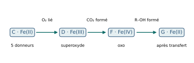
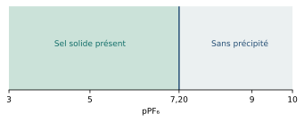
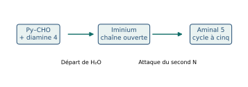
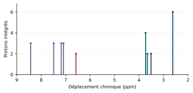
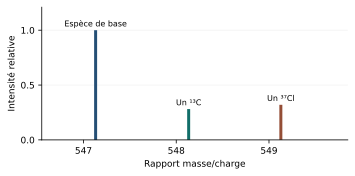
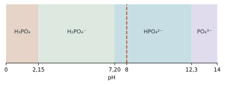
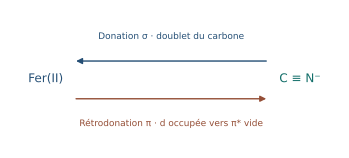
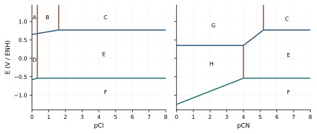
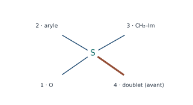

# ENS de Lyon — Second concours, Chimie 2020 · Corrigé partiel guidé

*Corrigé rédigé par IA, non officiel.*

**Rédaction** · GPT-6.2 Astra Ultra · vitesse non renseignée

**Couverture.** Les questions 1 à 69 et 71 à 73 sont traitées, soit 72 questions sur 73. La question 70, qui détaille la formation d’un réactif en dégageant du monoxyde de carbone, est exclue.

## I.1. Cycle catalytique du fer

### Question 1 — Fer neutre

> [!INDICATION]
> Partir du cœur argon puis compter jusqu’à 26.

#### Solution

Le fer porte 26 électrons. Sa configuration fondamentale est $[\mathrm{Ar}]\,3d^6 4s^2$. Les cinq orbitales $3d$ reçoivent chacune un électron avant l’appariement du sixième. L’atome libre compte ainsi quatre électrons célibataires.

### Question 2 — Métal de transition

> [!INDICATION]
> La définition porte sur une sous-couche d incomplète dans l’atome ou l’un de ses cations usuels.

#### Solution

La sous-couche $3d$, de capacité dix, contient six électrons dans l’atome. Elle reste incomplète dans $\mathrm{Fe}^{2+}$ ($3d^6$) et $\mathrm{Fe}^{3+}$ ($3d^5$). Le fer satisfait donc à la définition d’un élément de transition.

### Question 3 — Degrés d’oxydation usuels

> [!INDICATION]
> Pour ioniser Fe, retirer les électrons 4s avant les électrons 3d.

#### Solution

La perte des deux électrons $4s$ conduit à Fe(II), $d^6$. La perte supplémentaire d’un électron $3d$ conduit à Fe(III), $d^5$, dont la sous-couche demi-remplie favorise la stabilité dans de nombreux environnements. Les degrés usuels sont donc $+\mathrm{II}$ et $+\mathrm{III}$. Leur stabilité relative dépend notamment du ligand, du pH et du potentiel.

### Question 4 — Catalyse homogène et hétérogène

> [!INDICATION]
> Suivre le catalyseur dans le mécanisme puis dans le bilan.

#### Solution

Un catalyseur accélère une transformation en offrant un chemin de plus faible barrière d’activation. Il participe aux étapes du mécanisme et est régénéré au bilan. La constante thermodynamique de l’équilibre à température fixée reste la même. Un solide de nickel catalyse l’hydrogénation d’un alcène à sa surface. En solution, l’ion oxonium catalyse l’estérification réversible d’un acide carboxylique par un alcool.

### Question 5 — États du fer dans le cycle

> [!INDICATION]
> Repérer le superoxyde dans D et l’oxo terminal dans F.

#### Solution

C contient Fe(II). Le transfert d’un électron du métal au dioxygène donne dans D le couple formel Fe(III)–superoxyde, $\mathrm{O_2^{\bullet-}}$. La décarboxylation oxydante du cosubstrat et la coupure O–O conduisent en F à la forme ferryle Fe(IV)=O. Après hydroxylation de la taurine, G a retrouvé Fe(II). Les lettres renvoient au cycle imprimé page 3, légendé figure 1.

### Question 6 — Passage de F à G

> [!INDICATION]
> Comparer le nombre d’oxydation du fer avant et après le transfert de l’oxygène.

#### Solution

Le passage global Fe(IV) → Fe(II) avec départ du produit hydroxylé correspond formellement à une **élimination réductrice** dans le comptage demandé. Le nombre d’électrons $d$ du métal passe de quatre à six. La baisse de deux électrons du *compte de valence du complexe*, indiquée par le sujet, porte sur un autre décompte. La flèche globale du dessin résume le transfert d’oxygène au substrat. Elle ne démontre pas que la coupure C–H et la formation C–O se produisent en un seul acte.

### Question 7 — Bilan de l’hydroxylation

> [!INDICATION]
> Comptabiliser le devenir des deux atomes du dioxygène et les cinq carbones du cosubstrat.

#### Solution

À protonation cohérente, le bilan est **taurine + dioxygène + 2-oxoglutarate → 1-hydroxytaurine + succinate + dioxyde de carbone**. Cinq carbones du 2-oxoglutarate donnent quatre carbones de succinate et celui de $\mathrm{CO_2}$. Un atome O du dioxygène hydroxyle le carbone de la taurine qui porte le sulfonate. L’autre participe à l’oxydation du cosubstrat. Le fer est régénéré. Le produit demandé est l’intermédiaire hydroxylé que dessine le cycle.

## I.2. Complexes bioinspirés

### Question 8 — Denticité des ligands

> [!INDICATION]
> Distinguer les cycles pyridyle et phényle de la figure 3.

#### Solution

TPEN est hexadente, avec quatre azotes pyridiniques et deux azotes d’amines tertiaires. L est pentadente, avec trois azotes pyridiniques et deux azotes aliphatiques. Bn-TPEN porte également trois pyridyles et deux amines, soit cinq donneurs (le phényle du benzyle ne possède pas d’azote). N4Py est pentadente, avec quatre azotes pyridiniques et un azote d’amine tertiaire. Chacun offre un doublet libre au métal.

### Question 9 — Sphère de coordination

> [!INDICATION]
> Distinguer le chlorure lié au métal et le contre-ion extérieur.

#### Solution

L’espèce cationique est $[\mathrm{LFe^{II}Cl}]^+$. Les cinq atomes donneurs de L et le chlorure fournissent six directions de coordination. Le modèle géométrique $AX_6$ donne un octaèdre, en pratique déformé par les angles de chélation. L’hexafluorophosphate assure l’électroneutralité du solide.

### Question 10 — Formation globale du cation

> [!INDICATION]
> Écrire la définition avec les activités des espèces libres.

#### Solution

L’équation est $\mathrm{Fe}^{2+}+\mathrm L+\mathrm{Cl}^-\rightleftharpoons[\mathrm{LFeCl}]^+$. La constante globale vaut $\beta=a([\mathrm{LFeCl}]^+)/[a(\mathrm{Fe}^{2+})a(\mathrm L)a(\mathrm{Cl}^-)]$. Dans l’approximation idéale on remplace chaque activité par le rapport de concentration à la concentration standard.

### Question 11 — Enthalpie libre et équilibre

> [!INDICATION]
> Écrire le potentiel thermodynamique de réaction à l’équilibre.

#### Solution

La relation $\Delta_rG=\Delta_rG^\circ+RT\ln Q$ devient, à l’équilibre, $0=\Delta_rG^\circ+RT\ln\beta$. Par conséquent $\Delta_rG^\circ=-RT\ln\beta$.

### Question 12 — Valeur de la constante

> [!INDICATION]
> Convertir les kilojoules en joules avant de prendre l’exponentielle.

#### Solution

À 298 K, $\ln\beta=14300/(8{,}314\times298)=5{,}77$, d’où $\beta\simeq3{,}2\times10^2$. La constante est sans dimension avec les états standards de la question 10. Sa valeur favorise le complexe dans les conditions standards et ne suffit pas, seule, à prédire un rendement de synthèse.

### Question 13 — Entropie de complexation

> [!INDICATION]
> Retrouver le signe avec la relation entre les trois grandeurs standards.

#### Solution

$\Delta_rS^\circ=(\Delta_rH^\circ-\Delta_rG^\circ)/T=(-25{,}4+14{,}3)10^3/298=-37{,}2\ \mathrm{J\,mol^{-1}\,K^{-1}}$. En associant plusieurs solutés indépendants en un seul complexe, on réduit notamment leur liberté de translation et les conformations du ligand. Le résultat mesuré tient également compte de la réorganisation du solvant.

### Question 14 — Effet de la température

> [!INDICATION]
> Appliquer la loi de van ’t Hoff en conservant le signe de l’enthalpie.

#### Solution

$\mathrm d\ln\beta/\mathrm dT=\Delta_rH^\circ/(RT^2)<0$. Un abaissement de température favorise thermodynamiquement la complexation exothermique dans le domaine où l’enthalpie varie peu. La vitesse d’établissement de l’équilibre peut diminuer.

### Question 15 — Seuil de précipitation

> [!INDICATION]
> Avant précipitation, le volume annoncé fixe la concentration maximale en cation complexe.

#### Solution

Le millimole de complexe dissous dans 10 mL correspond à $0{,}100\ \mathrm{mol\,L^{-1}}$ dans l’approximation de volume constant. Au premier cristal, $[\mathrm{LFeCl}^+][\mathrm{PF_6}^-]=K_s$ avec la convention numérique usuelle en mol/L. Donc $[\mathrm{PF_6}^-]_\mathrm{seuil}=6{,}3\times10^{-8}\ \mathrm{mol\,L^{-1}}$ et $p\mathrm{PF}_6=7{,}20$. Sur un axe de $p\mathrm{PF}_6$ croissant, le domaine d’existence du solide se situe à gauche du seuil, le domaine sans solide à droite. Au seuil, la solution est juste saturée.

### Question 16 — Rôle du contre-ion

> [!INDICATION]
> Comparer le produit ionique au produit de solubilité.

#### Solution

L’ajout du sel de sodium apporte l’anion $\mathrm{PF_6^-}$. Sa concentration croît et $p\mathrm{PF}_6$ diminue. Dès que le produit ionique dépasse $K_s$, le sel de complexe précipite. La consommation du cation dissous peut aussi déplacer l’équilibre de complexation vers les produits.

### Question 17 — Rendement de la préparation

> [!INDICATION]
> Séparer conversion en cation, précipitation et récupération physique.

#### Solution

Une complexation incomplète, la solubilité résiduelle, les transferts et les lavages peuvent chacun diminuer le rendement isolé. Un refroidissement avant filtration, si la solubilité diminue à froid, et des rinçages limités avec un solvant où le produit est peu soluble améliorent la récupération. Pour identifier la perte réelle, on peut doser le fer restant dans les eaux mères et comparer au fer initial. Le seul rendement global de 50 % ne désigne pas une étape unique.

## II.1. Synthèse du ligand

### Question 18 — Formation de la bis-imine

> [!INDICATION]
> Faire réagir successivement chaque amine primaire avec une molécule d’aldéhyde.

#### Solution

Notons Py le pyridin-2-yle. Le doublet de l’azote amine attaque le carbone de $\mathrm{PyCHO}$, les électrons $\pi$ de C=O passent sur O. Des transferts de protons conduisent au carbinolamine $\mathrm{PyCH(OH)NHR}$. L’activation de OH en groupe partant et le rabattement du doublet N expulsent l’eau. La déprotonation de l’iminium donne $\mathrm{PyCH=NR}$. À l’autre extrémité de l’éthylènediamine, la même suite donne $\mathrm{PyCH=N{-}CH_2CH_2{-}N=CHPy}$ et, au total, deux eaux.

### Question 19 — Atmosphère de réaction

> [!INDICATION]
> Distinguer l’effet d’un gaz inerte de celui d’un catalyseur.

#### Solution

Un flux d’argon maintient une atmosphère inerte, écartant notamment le dioxygène susceptible de favoriser des réactions parasites. Un gaz sec limite aussi l’apport extérieur d’humidité dans une condensation réversible. Il ne consomme pas par lui-même l’eau produite.

### Question 20 — Réduction des imines

> [!INDICATION]
> Suivre la multiplicité C–N et le nombre d’hydrogènes.

#### Solution

Le tétraborohydrure est un donneur d’hydrure. Chaque fonction imine reçoit formellement H sur le carbone, puis un proton sur l’azote. Les liaisons C=N deviennent $\mathrm{CH_2{-}NH}$. Le composé 4 est la diamine secondaire $\mathrm{PyCH_2NH{-}CH_2CH_2{-}NHCH_2Py}$.

### Question 21 — Solubilisation

> [!INDICATION]
> Repérer les donneurs et les accepteurs de liaison hydrogène.

#### Solution

Les OH du méthanol donnent des liaisons hydrogène aux doublets des azotes pyridiniques et aminés. Les NH de 4 donnent à leur tour des liaisons hydrogène à l’oxygène du solvant. S’ajoutent des interactions dipôle–dipôle et de dispersion. Les liaisons hydrogène expliquent l’intérêt du cosolvant protique pour cette polyamine.

### Question 22 — Fermeture de l’aminal

> [!INDICATION]
> Le nouveau carbone du cycle porte un pyridin-2-yle et un H.

#### Solution

Il faut du pyridine-2-carbaldéhyde, $\mathrm{PyCHO}$. Une amine secondaire de 4 attaque le carbonyle. Après transferts de protons et élimination d’eau, on obtient un iminium $\mathrm{PyCH=NR_2^+}$. Le second azote du même 4 attaque ce carbone, ferme un cycle à cinq chaînons et porte momentanément une charge positive. Sa déprotonation donne 5, dont le carbone aminal est lié aux deux azotes, à Py et à H.

### Question 23 — Entropie de cyclisation

> [!INDICATION]
> Écrire la réaction avec l’eau libérée avant d’invoquer un décompte de molécules.

#### Solution

La cyclisation immobilise des conformations et associe la diamine à l’aldéhyde. Cela suggère une contribution organique négative, donc un $\Delta_rS^\circ$ attendu plutôt négatif dans une estimation simple. L’eau libérée et les effets de solvatation importent toutefois. Le bilan condensé $4+\mathrm{PyCHO}\rightleftharpoons5+\mathrm{H_2O}$ compte deux espèces de chaque côté. Une valeur ou un signe rigoureusement garanti nécessite des données thermodynamiques.

### Question 24 — Polarité et acidité

> [!INDICATION]
> Comparer la stabilisation inductive de deux anions carboxylates.

#### Solution

Le fluor, plus électronégatif que le carbone, polarise chaque liaison $\mathrm{C^{\delta+}{-}F^{\delta-}}$. Le groupe $\mathrm{CF_3}$ exerce une forte attraction inductive qui stabilise le trifluoroacétate. Le groupe méthyle attire moins les électrons et présente un effet inductif donneur relativement à H. L’acide trifluoroacétique est donc plus acide que l’acide acétique et son $pK_a$ est inférieur.

### Question 25 — Ouverture réductrice de l’aminal

> [!INDICATION]
> Comparer le carbone lié aux deux azotes dans 5 au méthylène pyridylé dans 6.

#### Solution

La protonation d’un azote rend possible la rupture de l’une des deux liaisons C–N du carbone aminal. Le doublet de l’autre azote forme en même temps une liaison $\mathrm{C=N^+}$, ce qui ouvre le cycle. Le carbone électrophile de l’iminium reçoit ensuite un hydrure. La liaison C=N redevient simple et le carbone du cycle devient $\mathrm{PyCH_2}$ dans 6. Une extrémité amine demeure secondaire, l’autre est tertiaire. Ce suivi électronique suffit sans mode opératoire.

### Question 26 — Assistance par l’iodure

> [!INDICATION]
> Relier stabilité de l’anion et aptitude au départ.

#### Solution

Un nucléofuge quitte le substrat avec le doublet de la liaison rompue. L’iodure, plus gros et polarisable et base plus faible, est en général meilleur groupe partant que le bromure sur ce dérivé alkylique. Il peut substituer le bromure primaire, donnant le dérivé iodé plus réactif vis-à-vis de l’amine. Son départ lors de la substitution suivante le régénère.

### Question 27 — Alkylation de l’amine secondaire

> [!INDICATION]
> Comparer la basicité du carbonate à celle qu’exigerait la déprotonation de l’amine neutre.

#### Solution

Notons $N_\mathrm{Pht}$ l’azote du phtalimide et $R_2NH$ l’amine secondaire de 6. Le doublet de $R_2NH$ attaque par l’arrière le carbone primaire de $\mathrm{XCH_2CH_2N_{Pht}}$. Le départ de X donne $[\mathrm{R_2N(H)CH_2CH_2N_{Pht}}]^+$. Le carbonate accepte ensuite le proton et 7 est $\mathrm{R_2NCH_2CH_2N_{Pht}}$ avec les trois bras pyridylméthyle de 6 conservés. Le $pK_a$ voisin de 36 exclut une concentration notable d’amidure par action du carbonate. En revanche, les $pK_a$ proches de 10–11 pour l’ammonium et 10,3 pour l’hydrogénocarbonate rendent plausible le dernier transfert.

### Question 28 — Libération de l’amine primaire

> [!INDICATION]
> Suivre deux substitutions sur les deux carbonyles du phtalimide.

#### Solution

Écrivons 7 sous la forme $\mathrm{PhtN{-}R}$ où R est la chaîne attachée au ligand. La première attaque d’un azote de l’hydrazine sur un carbonyle donne un intermédiaire tétraédrique portant O négatif et un premier N positif. Transferts de protons, reformation de C=O et rupture d’une liaison acyle–N de l’imide ouvrent son cycle, avec protonation du groupe azoté sortant. L’azote terminal du fragment hydrazide attaque ensuite le second carbonyle intramoléculairement, donnant un nouveau N positif tétraédrique. Le transfert d’un proton vers l’azote portant R forme le troisième type de centre ammonium, $\mathrm{{-}NH_2^+R}$ avant départ de $\mathrm{RNH_2}$. La reformation du carbonyle ferme le cycle du phtalhydrazide $\mathrm{C_8H_6N_2O_2}$. Le groupe terminal de 8 est donc $\mathrm{{-}CH_2CH_2NH_2}$, protonable dans le milieu acide final.

### Question 29 — Attribution infrarouge

> [!INDICATION]
> Utiliser à la fois les fréquences et les fonctions réellement présentes dans 8.

#### Solution

Les bandes à 3422 et 3225 $\mathrm{cm}^{-1}$ correspondent principalement aux deux étirements N–H de l’amine primaire. À 3031, on trouve C–H aromatique, et à 2905 les C–H aliphatiques. À 1621 peuvent contribuer la déformation dans le plan de $\mathrm{NH_2}$ et l’élongation C=N pyridinique. À 1533 on attend les vibrations du squelette aromatique. À 1024 l’élongation C–N est compatible. À 742 peuvent contribuer la déformation de $\mathrm{NH_2}$ et celle, hors du plan, des C–H des pyridines. Plusieurs vibrations partagent ainsi une même fenêtre.

### Question 30 — Ions du tosylate de pyridinium

> [!INDICATION]
> Placer la charge de chaque ion et chercher les formes mésomères.

#### Solution

Le cation est le cycle pyridinium $\mathrm{C_5H_5NH^+}$ avec trois doubles liaisons alternées, une liaison N–H et la charge formelle positive sur N. L’anion est $p\text{-}\mathrm{CH_3C_6H_4{-}S(=O)_2{-}O^-}$. Dans cette représentation, chaque O doublement lié possède deux doublets, l’O simplement lié en possède trois. Trois formes limites répartissent la charge sur les trois oxygènes. Le soufre a quatre voisins et une somme des ordres de liaison de six (valence VI conventionnelle). On peut également dessiner une forme à octet avec séparations de charges accrues. Le sel fournit une catalyse acide.

### Question 31 — Cyclisation en maléimide

> [!INDICATION]
> Identifier le stade où de l’eau est formée.

#### Solution

Le doublet de l’amine primaire 8 attaque l’un des carbonyles de l’anhydride maléique. Après passage tétraédrique, l’ouverture de l’anhydride puis les transferts de protons donnent l’acide maléamique $\mathrm{RNHCO{-}CH=CH{-}COOH}$. L’activation acide du carboxyle rend possible l’attaque intramoléculaire de l’azote amidique. Des transferts de protons puis le départ d’eau et la déprotonation forment l’imide à cinq chaînons L′. Le séparateur de Dean–Stark extrait l’eau entraînée avec le solvant condensé et déplace l’équilibre de cyclodéshydratation vers L′.

### Question 32 — Lecture des intégrales RMN

> [!INDICATION]
> Commencer par les groupes équivalents et contrôler la somme des intégrations.

#### Solution

Les trois pyridines portent ensemble douze H aromatiques, répartis en quatre groupes de trois à 7,09, 7,18, 7,49 et 8,43 ppm. Le singulet à 6,58 ppm (2 H) est celui des deux H vinyliques équivalents du maléimide. Les singulets à 3,73 ppm (4 H) et 3,66 ppm (2 H) sont respectivement les deux bras pyridylméthyle équivalents sur une même amine et l’unique bras sur l’autre. Le triplet à 3,51 ppm (2 H) correspond au $\mathrm{CH_2}$ adjacent au N de l’imide, couplé au $\mathrm{CH_2}$ voisin. Le multiplet 2,55–2,70 ppm (6 H) rassemble les quatre H du pont éthylènediamine et les deux H du dernier méthylène attenant à l’amine tertiaire. La somme vaut 28 H.

## II.2. Structure solide et spectrométrie de masse

### Question 33 — Cohésion du cristal

> [!INDICATION]
> Identifier ses entités électriquement chargées.

#### Solution

Les cations complexes et les anions hexafluorophosphate constituent un réseau de cohésion principalement électrostatique. Les contacts de dispersion et les interactions entre dipôles locaux contribuent à l’empilement. Les liaisons de coordination Fe–N et Fe–Cl assurent la cohésion interne du cation.

### Question 34 — Motifs par maille

> [!INDICATION]
> Suivre un atome marqueur présent une fois par ion complexe.

#### Solution

Sur la projection suivant $b$, on compte huit centres Fe, organisés en deux groupes de quatre positions, et huit contre-ions associés. Les autres projections confirment qu’on suit le même empilement selon des axes différents. On compte donc $Z=8$ unités $[\mathrm{L'FeCl}](\mathrm{PF_6})$ par maille, sans additionner les trois vues.

### Question 35 — Masse volumique et unités imprimées

> [!INDICATION]
> Cubant une longueur, un facteur dix sur chaque paramètre devient un facteur mille sur le volume.

#### Solution

$M=456{,}54+55{,}5+35{,}5+(168-23)=692{,}54\ \mathrm{g\,mol^{-1}}$. En prenant littéralement les paramètres imprimés, $V=(257\times82\times272)10^{-36}=5{,}73\times10^{-30}\ \mathrm{m^3}$. Il vient $\rho=ZM/(N_A V)=1{,}60\times10^6\ \mathrm{kg\,m^{-3}}$. Cette valeur ainsi que la dimension de 82 pm sont incompatibles avec la taille de huit complexes organométalliques. **Si** les longueurs effectives étaient dix fois celles imprimées, on trouverait $1{,}60\times10^3\ \mathrm{kg\,m^{-3}}$, ordre de grandeur plausible. Le rapport ne fournit pas de paramètres corrigés.

### Question 36 — Définition des isotopes

> [!INDICATION]
> Distinguer numéro atomique et nombre de masse.

#### Solution

Deux isotopes ont le même nombre de protons $Z$, donc appartiennent au même élément, et des nombres de neutrons différents. Leurs nombres de masse $A=Z+N$ et leurs masses diffèrent.

### Question 37 — Noyau du fer-56

> [!INDICATION]
> Soustraire le numéro atomique au nombre de masse.

#### Solution

Le noyau $^{56}_{26}\mathrm{Fe}$ contient 26 protons et $56-26=30$ neutrons. Le nombre d’électrons dépend de l’ionisation et n’entre pas dans la composition du noyau.

### Question 38 — Massif isotopique

> [!INDICATION]
> Diviser les rapports d’abondance par l’abondance du même élément et tenir compte des 26 carbones.

#### Solution

Le pic 547,1307 correspond à $^{12}\mathrm C_{26}{}^{1}\mathrm H_{28}{}^{35}\mathrm{Cl}\,{}^{56}\mathrm{Fe}\,{}^{14}\mathrm N_6{}^{16}\mathrm O_2^+$, d’après la formule du cation monovalent. La masse calculée, corrigée de la masse électronique perdue, est voisine de 547,1306 u. Le pic à 548,1339 est dominé par **un** carbone 13 remplaçant un carbone 12. Son intensité relative prévue pour cette seule contribution est $26(1{,}07/98{,}93)\simeq0{,}28$. D’autres isotopes minoritaires contribuent à l’enveloppe de masse nominale voisine. Le pic à 549,1279 est dominé par le remplacement de $^{35}\mathrm{Cl}$ par $^{37}\mathrm{Cl}$, soit environ $24{,}24/75{,}76=0{,}32$ du premier pic. L’annexe imprime 35,9683070 u pour le chlore 37. L’écart mesuré de 1,9972 u et le nombre de masse impliquent **36,9659 u environ** pour cet isotope.

## III.1. Addition conjuguée

### Question 39 — Accepteur de Michael

> [!INDICATION]
> Couper la liaison entre le carbone du malonate et le carbone du succinate substitué.

#### Solution

Le partenaire I est le but-2-ènedioate de diéthyle $\mathrm{EtO_2C{-}CH=CH{-}CO_2Et}$. La figure 13 ne spécifie aucune géométrie permettant de départager maléate ($Z$) et fumarate ($E$). Le nucléophile H est le malonate de diéthyle.

### Question 40 — Addition conjuguée du malonate

> [!INDICATION]
> Identifier le proton entre les deux carbonyles et suivre le déplacement du système π.

#### Solution

Une base prélève un H sur le méthylène central de H. L’énolate stabilisé attaque, par son carbone, un carbone vinylique de I. Le déplacement des électrons de C=C vers l’autre carbone et son carbonyle donne un nouvel énolate. Sa protonation, éventuellement suivie de tautomérie, donne $\mathrm{(EtO_2C)_2CH{-}CH(CO_2Et){-}CH_2CO_2Et}$, soit J. L’addition 1,4 conserve les fonctions ester.

### Question 41 — Addition du thiol au maléimide

> [!INDICATION]
> Repérer la double liaison électrophile symétrique.

#### Solution

La base établit une fraction de thiolate heptylique $\mathrm{RS^-}$. Son soufre attaque l’un des carbones de la double liaison du maléimide. Le système $\pi$ se déplace vers un carbonyle et forme un énolate stabilisé. La protonation donne un succinimide portant $\mathrm{{-}S{-}(CH_2)_6CH_3}$ sur l’ancien carbone vinylique. Les deux carbones de l’alcène initial sont équivalents. Le gain d’une liaison C–S en position β et la conservation des carbonyles caractérisent l’addition conjuguée.

## III.2. Tampon phosphate

### Question 42 — Solution tampon

> [!INDICATION]
> Considérer une petite perturbation acide puis basique.

#### Solution

Un tampon limite la variation de pH lors d’un petit apport d’acide ou de base. La base conjuguée capte une partie des protons ajoutés et l’acide faible neutralise les hydroxydes. La dilution modérée affecte peu le rapport acide/base, mais réduit la capacité tampon.

### Question 43 — Domaines des phosphates

> [!INDICATION]
> Parcourir l’axe du pH en retirant successivement un proton.

#### Solution

Pour $\mathrm{pH}<2{,}15$, $\mathrm{H_3PO_4}$ prédomine. Entre 2,15 et 7,20 prédomine $\mathrm{H_2PO_4^-}$, entre 7,20 et 12,3 $\mathrm{HPO_4^{2-}}$, puis au-delà de 12,3 $\mathrm{PO_4^{3-}}$. À chaque frontière, les deux espèces conjuguées voisines ont des activités égales.

### Question 44 — Seconde acidité

> [!INDICATION]
> Conserver la charge et le nombre d’atomes en écrivant l’échange avec l’eau.

#### Solution

$\mathrm{H_2PO_4^-+H_2O\rightleftharpoons HPO_4^{2-}+H_3O^+}$, avec $K_{a2}=a(\mathrm{HPO_4^{2-}})a(\mathrm{H_3O^+})/a(\mathrm{H_2PO_4^-})$, l’activité de l’eau étant prise égale à un.

### Question 45 — pH du mélange

> [!INDICATION]
> Mettre la concentration de la base au numérateur.

#### Solution

En assimilant rapports d’activités et de concentrations, $\mathrm{pH}=7{,}20+\log_{10}(10{,}0/1{,}58)=8{,}00$. La forme hydrogénophosphate est donc environ 6,3 fois plus concentrée que le dihydrogénophosphate, en accord avec le diagramme.

## III.2.1. Orbitales du ligand

### Question 46 — Orbitales de valence

> [!INDICATION]
> Dénombrer dix électrons et doubler la capacité de chaque niveau π dégénéré.

#### Solution

Avec la numérotation de la figure 16, OM1 est $\sigma_1$ (liante à dominante $2s$), OM2 est $\sigma_2$ (combinaison essentiellement $2s$ antiliante), les deux OM3 forment $\pi_1$ (liantes), OM4 est $\sigma_3$ (combinaison principalement axiale, liante dans le comptage élémentaire, très polarisée vers C), les deux OM5 forment $\pi_2$ (antiliantes), et OM6 est $\sigma_4$ (antiliante). Le mélange des orbitales de même symétrie nuance le caractère liant local des $\sigma$, surtout pour la donneuse OM4 dont le grand lobe pointe hors de la liaison. Le carbone, l’azote et la charge apportent $4+5+1=10$ électrons. La configuration de valence est $\sigma_1^2\sigma_2^2\pi_1^4\sigma_3^2$, avec les niveaux supérieurs vacants.

### Question 47 — Lewis et orbitales moléculaires

> [!INDICATION]
> Relier ordre de liaison, charges formelles et répartition des orbitales.

#### Solution

La formule de Lewis $[{:}\mathrm C\equiv\mathrm N{:}]^-$ donne un doublet sur chaque extrémité et une charge formelle négative sur C. L’ordre de liaison formel est trois et tous les électrons sont appariés. L’image élémentaire des OM conduit également à un ordre trois et à un état diamagnétique. Elle explique en outre la polarisation des orbitales et la possibilité d’accepter de la densité dans des orbitales $\pi^*$ vides. Une charge formelle de Lewis diffère d’une densité de charge réelle.

### Question 48 — Orbitales frontalières

> [!INDICATION]
> Chercher le lobe accessible de la plus haute orbitale occupée.

#### Solution

La HO est OM4, de symétrie $\sigma$, avec un grand lobe extérieur du côté carbone. Les BV sont les deux OM5, de symétrie $\pi^*$. Sous contrôle de l’interaction HO du ligand–orbitale vacante du métal, l’extrémité carbone donne le meilleur recouvrement axial. On attend donc le mode Fe–C≡N représenté.

## III.2.2. Coordination et spectroscopie

### Question 49 — Levée de dégénérescence

> [!INDICATION]
> Comparer des orbitales orientées vers le ligand et d’autres dont le plan nodal contient l’axe d’approche.

#### Solution

Les cinq orbitales d ont la même énergie dans un potentiel central idéal. Un ligand situé sur $y$ diminue la symétrie, et les orbitales n’interagissent plus également. Le recouvrement dépend de l’orientation et de la symétrie des lobes, de la distance métal–ligand et de l’écart d’énergie entre orbitales de même symétrie. À l’échelle d’un complexe, la géométrie, la nature des ligands et le degré d’oxydation modifient donc l’écart énergétique.

### Question 50 — Symétries sur l’axe y

> [!INDICATION]
> Prendre y comme axe local métal–ligand avant de nommer les orbitales d.

#### Solution

La HO $\sigma$ du ligand peut recouvrir la combinaison $d_{3y^2-r^2}$ pointant sur $y$. Dans le repère usuel à axe de quantification $z$, c’est une combinaison de $d_{z^2}$ et $d_{x^2-y^2}$. Les deux BV $\pi^*$ perpendiculaires entre elles recouvrent latéralement $d_{xy}$ et $d_{yz}$. La composante $d_{xz}$ est de mauvaise symétrie pour ces interactions.

### Question 51 — Rétrodonation

> [!INDICATION]
> Pour chaque recouvrement, nommer le partenaire occupé et le partenaire vacant.

#### Solution

De la densité d’une orbitale $d_\pi$ occupée du fer passe dans une orbitale $\pi^*$ vacante du ligand. Les deux plans métal–ligand possibles donnent deux recouvrements latéraux. Cette rétrodonation stabilise les combinaisons métalliques concernées, renforce la liaison métal–carbone et peut affaiblir la liaison interne C–N par occupation partielle de ses orbitales antiliantes.

### Question 52 — Nature du ligand

> [!INDICATION]
> La direction du transfert électronique est opposée dans les deux interactions.

#### Solution

Le cyanure est $\sigma$-donneur par sa HO remplie, dirigée du ligand vers le métal. Il est aussi $\pi$-accepteur par ses deux BV $\pi^*$ vacantes, qui reçoivent de la densité du métal. Ces termes décrivent deux symétries différentes et peuvent s’appliquer simultanément.

### Question 53 — Schéma du ligand π-accepteur

> [!INDICATION]
> Observer si les orbitales π du ligand sont vides et au-dessus des orbitales d.

#### Solution

Le **schéma 2** de la page 13 convient. L’interaction $\sigma$ élève les orbitales métalliques de type $e_g$ à caractère antiliant. La rétrodonation aux $\pi^*$ vacantes stabilise les orbitales de type $t_{2g}$ et accroît $\Delta_o$ dans le modèle octaédrique.

### Question 54 — Schéma du chlorure

> [!INDICATION]
> Repérer cette fois les orbitales π occupées du ligand.

#### Solution

Le **schéma 3** convient au chlorure. Ses orbitales p remplies permettent la donation $\pi$ vers le métal en plus de l’interaction $\sigma$. Les combinaisons à dominante métallique de type $t_{2g}$ sont déstabilisées et l’écart $\Delta_o$ est plus faible que pour le ligand $\pi$-accepteur.

### Question 55 — Énergies de transition

> [!INDICATION]
> Lire les maxima de plus grande longueur d’onde, puis utiliser l’inverse de la longueur d’onde.

#### Solution

Sur la figure 17, la large bande (a) culmine vers 410 nm et la faible bande (b) vers 370 nm, à quelques nanomètres près. Avec $\Delta E=hc/\lambda\simeq1240/\lambda_{\mathrm{nm}}$ en eV, on obtient environ 3,02 eV pour (a) et 3,35 eV pour (b). Les pics plus intenses de l’ultraviolet profond ne sont pas ceux comparés pour $\Delta_o$.

### Question 56 — Attribution des deux spectres

> [!INDICATION]
> Associer champ le plus fort et absorption de plus courte longueur d’onde.

#### Solution

Dans le modèle du sujet, le chlorure donne le plus petit écart, soit (a), et le cyanure le plus grand, soit (b). Pour $l=1{,}00\ \mathrm{cm}$ et $c=2{,}0\times10^{-4}\ \mathrm{mol\,L^{-1}}$, $\varepsilon=A/(lc)$. Avec $A_a\simeq1{,}45$ et $A_b\simeq0{,}30$, on trouve environ $7{,}2\times10^3$ et $1{,}5\times10^3\ \mathrm{L\,mol^{-1}\,cm^{-1}}$ respectivement. Une lecture de 0,31 pour la courbe basse donne $1{,}55\times10^3$.

### Question 57 — Concentration du biohybride

> [!INDICATION]
> Utiliser le coefficient du complexe portant le ligand qui donne la bande mesurée.

#### Solution

Pour le maximum de la bande du complexe cyanuré dans le tampon et le trajet de 1 cm utilisés dans la comparaison, $c=0{,}14/(1\times1{,}5\times10^3)\simeq9{,}3\times10^{-5}\ \mathrm{mol\,L^{-1}}$, soit environ $0{,}09\ \mathrm{mmol\,L^{-1}}$. La précision est limitée par la lecture de la petite bande et par l’hypothèse de même coefficient dans le biohybride.

## III.2.3. Diagrammes potentiel–ligand

### Question 58 — Attribution des domaines E–pL

> [!INDICATION]
> Le potentiel croît vers les formes oxydées. À gauche, le ligand libre est plus abondant.

#### Solution

Sur les deux diagrammes F correspond au fer solide, E à $\mathrm{Fe^{2+}}$ libre et C à $\mathrm{Fe^{3+}}$ libre. Sur le diagramme chlorure, D est $[\mathrm{Fe^{II}Cl}]^+$, B est $[\mathrm{Fe^{III}Cl}]^{2+}$ et A est $[\mathrm{Fe^{III}Cl_2}]^+$. Sur le diagramme cyanure, H correspond à $[\mathrm{Fe^{II}(CN)_6}]^{4-}$ et G à $[\mathrm{Fe^{III}(CN)_6}]^{3-}$. F est un domaine d’existence du solide. Pour les espèces dissoutes, il s’agit de domaines de prédominance à la concentration de tracé.

### Question 59 — Potentiels standard

> [!INDICATION]
> Le tracé de la frontière entre fer solide et Fe(II) utilise une concentration millimolaire.

#### Solution

La frontière C/E est voisine de $0{,}77\ \mathrm V$ par rapport à l’électrode normale à hydrogène. Les activités de Fe(III) et Fe(II) y sont égales, donc $E^\circ(\mathrm{Fe^{3+}/Fe^{2+}})\simeq0{,}77\ \mathrm V$. La frontière E/F est proche de $-0{,}53$ à $-0{,}55\ \mathrm V$. La loi de Nernst donne $E=E^\circ+(0{,}0592/2)\log(10^{-3})=E^\circ-0{,}0888$. On lit ainsi $E^\circ(\mathrm{Fe^{2+}/Fe})\simeq-0{,}44$ à $-0{,}46\ \mathrm V$.

### Question 60 — Constante de formation du complexe ferreux

> [!INDICATION]
> À une frontière verticale de prédominance, égaler les concentrations de deux formes du fer au même degré d’oxydation.

#### Solution

La séparation H/E se situe à $p\mathrm{CN}\simeq4{,}0$. À la frontière $a([\mathrm{Fe(CN)_6}]^{4-})\simeq a(\mathrm{Fe^{2+}})$. De $\beta_{\mathrm{II}}=a([\mathrm{Fe(CN)_6}]^{4-})/[a(\mathrm{Fe^{2+}})a(\mathrm{CN^-})^6]$, on tire $\log\beta_{\mathrm{II}}\simeq6\times4{,}0=24$, soit $\beta_{\mathrm{II}}\simeq10^{24}$ à la précision graphique.

### Question 61 — Droite entre fer(II) libre et complexe ferrique

> [!INDICATION]
> Exprimer la concentration de Fe(III) libre au moyen de la constante du complexe.

#### Solution

La demi-équation est $[\mathrm{Fe(CN)_6}]^{3-}+e^-\rightleftharpoons\mathrm{Fe^{2+}}+6\mathrm{CN^-}$. La loi de Nernst du couple libre, avec $a(\mathrm{Fe^{3+}})=a([\mathrm{Fe(CN)_6}]^{3-})/[\beta_{\mathrm{III}}a(\mathrm{CN^-})^6]$, donne à la frontière $E=E^\circ_{\mathrm{III/II}}-0{,}0592\log\beta_{\mathrm{III}}+6\times0{,}0592\,p\mathrm{CN}$ en volts à 298 K. Ici les activités des deux formes de fer qui se partagent le domaine sont égales. La pente est $+0{,}355\ \mathrm V$ par unité de $p\mathrm{CN}$. D’après le tracé on peut écrire approximativement $E\simeq0{,}35+0{,}355(p\mathrm{CN}-4)$ entre les deux extrémités de la droite oblique.

### Question 62 — Affinité et labilité

> [!INDICATION]
> Une frontière thermodynamique et une vitesse d’échange sont deux mesures différentes.

#### Solution

Les domaines complexés s’étendent à des $p\mathrm{CN}$ nettement plus élevés que les domaines chlorés à leurs $p\mathrm{Cl}$. À concentration de ligand libre comparable, le fer est ainsi davantage stabilisé sous forme de cyanocomplexe, ce qui explique le sens thermodynamique favorable de la substitution dans le modèle. Les diagrammes E–pL donnent des équilibres. Pour conclure sur la labilité au sens cinétique strict, il faudrait mesurer les vitesses d’échange.

## IV. Synthèse et résolution du sulfoxyde

### Question 63 — Formation du thioéther

> [!INDICATION]
> Retrouver le carbone lié au soufre qui peut porter initialement un groupe partant.

#### Solution

Le thiol du 4-aminothiophénol peut être converti en thiolate par une base adaptée, par exemple un carbonate. On lui présente un dérivé primaire $\mathrm{XCH_2{-}Im}$, X halogène et Im le groupe 1-propylimidazolyle dessiné. En solvant aprotique polaire, l’attaque par S sur $\mathrm{CH_2}$ avec départ de X par substitution bimoléculaire donne $p\text{-}\mathrm{H_2NC_6H_4{-}S{-}CH_2{-}Im}$. La formation préférentielle du thiolate aide à diriger l’alkylation vers S.

### Question 64 — Mélange racémique

> [!INDICATION]
> L’oxydation rend le soufre pyramidal et stéréogène.

#### Solution

Les deux formes de 14 sont énantiomères, de configurations opposées au soufre. En quantités égales, leurs pouvoirs rotatoires de même amplitude et de signes contraires se compensent. Le racémique a donc une rotation optique nulle.

### Question 65 — Configuration absolue au soufre

> [!INDICATION]
> Classer les deux carbones en comparant la couche d’atomes suivante.

#### Solution

L’ordre de priorité est O, carbone ipso du phényle, $\mathrm{CH_2{-}Im}$, doublet libre. Le carbone aromatique est comparé à la liste C,C,C, le méthylène à C,H,H. Sur le **dessin du haut** de la figure 21, le parcours O → aryle → méthylène est horaire sur la feuille, et le doublet (coin plein) pointe vers l’observateur. On inverse le sens lu, ce qui donne **S**. L’espèce du bas est R.

### Question 66 — Séparation des énantiomères

> [!INDICATION]
> Un agent chiral transforme une différence de configuration en différence de solubilité.

#### Solution

Il s’agit d’un dédoublement par formation de sels diastéréoisomères. L’acide D-PTTA, de configuration fixée, protonne un site basique du substrat. Ses sels avec R-14 et S-14 ont des propriétés physiques différentes. La cristallisation sélective puis la recristallisation enrichissent le sel avec S-14. La dissociation du sel rend le composé résolu. Les nombres de la figure portent sur deux étapes distinctes, 41 % pour l’isolement du sel et 90 % pour la libération du composé enrichi, avec un excès énantiomérique supérieur à 99 % annoncé à la fin.

### Question 67 — Éther et organomagnésien

> [!INDICATION]
> Examiner successivement le pouvoir donneur du solvant et la présence de protons acides.

#### Solution

Le tétrahydrofurane est un éther aprotique. Ses doublets sur O coordonnent le magnésium, facilitant la solvatation et la stabilisation de l’organomagnésien. L’absence d’eau et d’autres protons acides évite la protonation de la liaison carbone–magnésium en arène.

### Question 68 — Addition au bore

> [!INDICATION]
> Distinguer le composé formé immédiatement après insertion de Mg et le partenaire boré du couplage.

#### Solution

Écrivons $\mathrm{Ar}=p\text{-}\mathrm{(BuOCH_2CH_2O)C_6H_4}$. Le remplacement formel de Br dans 20 par MgBr donne l’intermédiaire précoce $\mathrm{ArMgBr}$. Le carbone nucléophile transfère Ar au bore trigonal électrophile de $\mathrm{B(OMe)_3}$. On forme le borate tétraédrique $[\mathrm{ArB(OMe)_3}]^-$ associé au cation magnésien. Une redistribution des méthoxydes peut fournir $\mathrm{ArB(OMe)_2}$, partenaire organoboré du cycle ultérieur. La lettre « a » est réutilisée sous la figure 24 du côté du partenaire boré, alors que la question 68 vise l’espèce **avant** l’ajout du borate.

### Question 69 — Espèce catalytique du Suzuki

> [!INDICATION]
> Chercher l’espèce régénérée après formation de la liaison entre les deux cycles.

#### Solution

L’espèce active représentée est $\mathrm{Pd^0(PPh_3)_2}$. L’acétate de palladium(II) est un précurseur du catalyseur. Le Pd(0) entre dans l’addition oxydante de l’halogénure d’aryle. Après transmétallation, l’élimination réductrice forme la liaison C–C de 21 et régénère le Pd(0).

### Question 71 — Équation de l’activation de l’acide

> [!INDICATION]
> Vérifier que le cation b est accompagné d’un anion chlorure.

#### Solution

Avec $\mathrm{RCO_2H}$ pour 21 et le sel de l’iminium déjà donné dans la figure, le bilan algébrique est $\mathrm{RCO_2H}+[\mathrm{ClCH=NMe_2}]^+\mathrm{Cl^-}\longrightarrow\mathrm{RCOCl}+\mathrm{HCONMe_2}+\mathrm{HCl}$. Le squelette R conserve sa connectivité. Le groupe hydroxyle du carboxyle est remplacé par le chlore.

### Question 72 — Formation de l’amide S-22

> [!INDICATION]
> Repérer l’azote anilinique de S-14 et le carbone électrophile de 21 activé.

#### Solution

Le doublet de l’amine aromatique de S-14 attaque le carbone du chlorure d’acyle de 21. Le tétraèdre intermédiaire porte O négatif et N positif. La reformation de C=O expulse le chlorure, et la base tertiaire prélève le proton excédentaire, fournissant $\mathrm{RCONH{-}Ar'}$. La diisopropyléthylamine capte l’acidité sous forme de sel. Le centre sulfoxyde demeure S puisque cette substitution porte sur le carbonyle et l’azote.

### Question 73 — Place de l’oxydation asymétrique

> [!INDICATION]
> Identifier à quel stade apparaît le centre stéréogène au soufre.

#### Solution

Une sulfoxydation énantiosélective de **13 en S-14** pourrait remplacer l’oxydation achirale de 13 en rac-14 puis le dédoublement par le sel tartrique. La préparation de 13 et l’assemblage final de l’amide restent nécessaires. Le dossier décrit un excès énantiomérique pour le thioanisole. Pour envisager de supprimer le dédoublement de 14, il faudrait vérifier le sens de l’induction, l’excès obtenu et la compatibilité du substrat 13.
