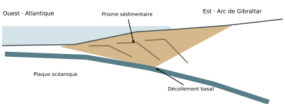
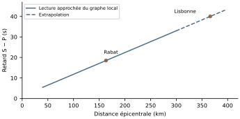

# ENS de Lyon, second concours 2020 — Géosciences · Corrigé brut

*Corrigé rédigé par IA, non officiel. Signalez toute erreur.*

**Rédaction** · GPT-6.2 Astra Ultra · vitesse non renseignée

## 1 — Les Champs Phlégréens

### Question 1.1.1 — Composition du magma campanien

Les échantillons de la figure 2a se groupent vers 58–62 % de $\mathrm{SiO_2}$ et 12–14 % de $\mathrm{Na_2O+K_2O}$ en masse. Ils sont nettement dans la série alcaline, près des limites trachyte–phonolite–téphriphonolite. Le magma est différencié, compatible avec un liquide résiduel fortement enrichi en alcalins après cristallisation de minéraux précoces. L’alcalinité est plus informative ici qu’une simple qualification de « lave acide ». Les dépôts pyroclastiques et l’extension des ignimbrites signalent une éruption explosive.

### Question 1.1.2 — Ordre d’émission et zonation

Les niveaux profonds de la carotte ont été déposés les premiers. Leur CaO est bas, autour de 2 %, et leur rapport $^{87}\mathrm{Sr}/^{86}\mathrm{Sr}$ est plus haut, autour de 0,7074–0,70746. En remontant vers les derniers dépôts, CaO atteint plus de 4 % et le rapport isotopique descend vers 0,7073. La partie supérieure du réservoir, plus légère et plus différenciée, aurait donc été vidangée en premier. Le magma moins différencié sous-jacent est sorti ensuite et recouvre ses produits. La variation isotopique invite à envisager aussi l’assimilation crustale, une recharge ou le mélange de liquides de signatures distinctes, car la seule cristallisation fractionnée change peu le rapport isotopique initial du Sr.

### Question 1.2.1 — Isotopes de la glace et variabilité glaciaire

**a.** Mesurer le rapport stable $R={}^{18}\mathrm O/{}^{16}\mathrm O$ de la glace à différentes profondeurs et dater les couches. On trace $\delta^{18}\mathrm O=1000(R/R_{\rm std}-1)$ en pour mille par rapport à une eau de référence. La condensation privilégie les isotopes lourds. Les masses d’air progressivement refroidies et appauvries donnent des neiges polaires plus pauvres en $^{18}\mathrm O$ lorsqu’il fait froid. À site donné, les excursions négatives du signal GRIP indiquent généralement un refroidissement local. L’origine des précipitations et leur saisonnalité nuancent la calibration.
**b.** Pendant la dernière glaciation, des oscillations de Dansgaard–Oeschger alternent réchauffement rapide et refroidissement plus progressif au Groenland. Les événements de Heinrich, dont H4 vers 39–40 ka sur la figure, sont associés à des débâcles d’icebergs et à des dépôts de débris sur l’Atlantique Nord. L’apport d’eau douce réduit la salinité et la convection profonde, ce qui peut ralentir la circulation méridienne de retournement et le transport de chaleur vers le nord. Une réorganisation de cette circulation permet un réchauffement abrupt. Ces événements millénaires se superposent au fond glaciaire.

### Question 1.2.2 — Forçage volcanique du climat

Les cendres interceptent le rayonnement solaire, avec un effet surtout régional de quelques jours à quelques mois selon leur taille et leur altitude. Le $\mathrm{SO_2}$ injecté dans la stratosphère peut former des aérosols sulfatés qui diffusent le rayonnement solaire, augmentent l’albédo et refroidissent la surface pendant quelques années sur une aire beaucoup plus vaste. Le $\mathrm{CO_2}$ émis exerce au contraire un effet de serre plus durable, généralement faible pour un événement isolé. La présence du panache à grande altitude rend plausible une influence à distance.
Les datations de l’ignimbrite recouvrent la phase froide de Heinrich 4 dans la figure 3. Un refroidissement additionnel ou une prolongation du froid sont envisageables. L’incertitude des âges, la résolution de l’archive et la durée bien plus longue de l’oscillation océanique empêchent d’en déduire que l’éruption a déclenché H4.

## 2 — Le détroit de Messine

### Question 2.1.1 — Ouverture du détroit de Messine

La figure 4 mesure les déplacements par rapport à une même référence européenne. Les flèches siciliennes et calabraises ont une composante nord commune, mais des directions différentes. Après soustraction, une composante de divergence écarte les deux rives. L’extension, accommodée notamment par des failles normales et l’affaissement du compartiment déprimé, fournit un contexte pour l’existence du détroit envahi par la mer.

### Question 2.1.2 — Vitesse relative Sicile–Calabre

On construit $\mathbf v_{\rm Cal/Sic}=\mathbf v_{\rm Cal/Eur}-\mathbf v_{\rm Sic/Eur}$, ou graphiquement on place les vecteurs à même origine puis on joint leurs extrémités. Près du détroit, les vecteurs de Sicile sont plutôt nord à nord-nord-ouest et ceux de Calabre plus orientés vers le nord-est. Une partie de la translation nord commune s’élimine. La Calabre s’éloigne globalement vers l’est, avec une composante nord-est selon les stations, et la Sicile en sens inverse. L’ordre de grandeur relatif est de quelques mm/an, en prenant pour échelle la flèche de 10 mm/an.

### Question 2.2.1 — Courant de marée

Les deux oscillations de la figure 5 sont proches de l’opposition de phase. À pleine mer ionienne, la surface au sud est plus haute que celle du bassin tyrrhénien. La charge hydrostatique entraîne un courant du sud au nord. Une demi-période plus tard, le gradient s’inverse et le courant va du nord au sud. L’interface des masses d’eau oscille avec ces échanges.

### Question 2.2.2 — Pression et vitesse dans le passage

**a.** Si $z_A,z_B$ sont les profondeurs positives sous les surfaces locales $A_0,B_0$, $p_A=p_{\rm atm}+\rho gz_A$ et $p_B=p_{\rm atm}+\rho gz_B$ dans l’approximation hydrostatique verticale.
**b.** La grande section du bassin en A autorise $v_A\simeq0$ pour le débit qui traverse la petite section du détroit. Dans Bernoulli, le terme $p/\rho+g\,(\mathrm{altitude})$ vaut donc $p_{\rm atm}/\rho+g\,(\mathrm{altitude\ de\ la\ surface\ locale})$ de chaque côté.
**c.** La différence de niveaux $h$ devient énergie cinétique, $v_B^2/2=gh$. La figure 5 donne environ 10 cm contre −18 cm à pleine mer ionienne, donc $h\simeq0{,}28$ m et $v_B\simeq2{,}34$ m/s. Avec une lecture à 30 cm, on trouve 2,4 m/s.

### Question 2.2.3 — Débit à travers le détroit

La section triangulaire est $A=3000\times75/2=1{,}125\times10^5\ \mathrm{m^2}$. En assimilant la vitesse calculée à la vitesse moyenne sur la section, $D(h)=A\sqrt{2gh}$. À pleine mer, cela représente environ $2{,}6\times10^5\ \mathrm{m^3\,s^{-1}}$.

### Question 2.2.4 — Temps d’égalisation

**a.** Le parallèle est de rayon $R\cos\lambda$, donc un degré de longitude à 40° N vaut $110\cos40^\circ\simeq84$ km. Un degré de latitude conserve environ 110 km.
**b.** Le bassin représente $S_b\simeq(550\ \mathrm{km})(421\ \mathrm{km})=2{,}32\times10^{11}\ \mathrm{m^2}$. À niveau tyrrhénien fixe, $S_b\,\mathrm dh/\mathrm dt=-A\sqrt{2gh}$. L’intégration de $h_0$ à zéro donne $t=2S_b\sqrt{h_0}/(A\sqrt{2g})\simeq4{,}9\times10^5$ s, soit 5,7 jours. Le simple quotient du volume par le débit initial donne la moitié de cette durée car le débit diminue. Si les deux bassins ont des surfaces finies, remplacer $S_b$ par $(1/S_I+1/S_T)^{-1}$, ce qui donnerait 2,85 jours pour deux surfaces égales. Ces durées dépassent de loin les quelques heures séparant les extrêmes de marée. Le passage ne suffit donc pas à égaliser les deux marées.

## 3 — Gibraltar et le golfe de Cadix

### Question 3.1.1 — Répartition des séismes

**a.** Les plus grands séismes se produisent généralement sur les interfaces chevauchantes des subductions. Le Chili méridional a connu le 22 mai 1960 un séisme d’environ $M_w 9{,}5$. Le 11 mars 2011, celui du Tōhoku au Japon a atteint environ 9,0–9,1.
**b.** Les épicentres se concentrent le long des limites de plaques, ceintures de subduction, collision, failles transformantes et dorsales. Il existe également une sismicité intraplaque.
**c.** La très grande majorité des foyers est superficielle, dans les premières dizaines de kilomètres, en général à moins de 70 km. Les roches froides peuvent accumuler une contrainte élastique puis rompre. En profondeur, le fluage des roches chaudes relaxe les contraintes. Les panneaux froids plongeants constituent une exception, avec des séismes intermédiaires et profonds jusqu’à environ 700 km.

### Question 3.1.2 — Méthodes géophysiques

**a.** Des profils de sismique réfraction à grand angle mesurent le temps d’arrivée des ondes directes crustales et des réfractées critiques au Moho, plus rapides à grande distance. Les pentes des hodochrones donnent les vitesses et leur temps d’interception contraint la profondeur de l’interface. Des données de réflexion ou de conversion d’ondes peuvent compléter la carte.
**b.** L’anomalie de Bouguer est la différence entre une pesanteur mesurée, réduite à un niveau de référence avec corrections de latitude, altitude, masse topographique et relief, et une valeur normale. Elle met en évidence des excès ou déficits de masse en profondeur. Une anomalie positive peut correspondre à des roches denses proches de la surface.
**c.** La tomographie inverse les anomalies de temps de parcours de nombreuses ondes sismiques qui croisent le volume étudié, relativement à un modèle de référence. Une arrivée en avance signale un trajet en moyenne rapide. L’échantillonnage et la régularisation limitent la résolution. Température, composition et phases minérales influent sur les vitesses.

### Question 3.1.3 — Prisme de Cadix

**a.** La figure 7c montre un fond en éventail, accidenté par des rides et des escarpements. Dans SIS-16 (figure 8a), les réflecteurs stratifiés sont plissés, répétés et localement interrompus au-dessus d’un niveau de décollement. Des sédiments marins accumulés puis raccourcis forment cette couverture épaisse. Les rides du fond peuvent correspondre aux plis et chevauchements sous-jacents.
**b.** Dans les profils de 11a, le corps rapide en bleu sous Gibraltar plonge vers l’est et atteint plusieurs centaines de kilomètres. Une plaque océanique relativement froide qui s’enfonce sous l’arc concorde avec cette anomalie. Les sédiments raclés et empilés au-dessus d’un décollement frontal constituent un prisme d’accrétion qui s’épaissit vers l’arc. La coupe ci-dessous rassemble ces observations. La présence d’un panneau profond n’établit pas, à elle seule, la vitesse actuelle de subduction.

### Question 3.1.4 — Profil BS-22

À l’ouest-nord-ouest les réflecteurs sédimentaires sont peu déformés. En allant vers l’est-sud-est, le fond remonte brutalement et des horizons se courbent, changent de pendage ou se terminent près de discontinuités. Le relief sous-marin est compatible avec une structure compressive, un bloc soulevé sur faille inverse et des plis de couverture. La dépression à droite interrompt le sommet. La profondeur n’est pas directement portée sur l’axe. Le « temps double » est le temps aller-retour de l’onde entre source-récepteur et réflecteur. Avec une vitesse moyenne $v$, $z\simeq vt/2$ sous incidence quasi verticale. Il faut tenir compte des vitesses distinctes dans l’eau et les sédiments.

### Question 3.1.5 — Anisotropie sous l’arc

La polarisation d’une onde S se décompose en deux directions dont les vitesses diffèrent. Les axes rapides de la figure 11b s’incurvent, globalement parallèles à l’arc bético-rifain. Une déformation mantellique peut aligner les axes cristallographiques de l’olivine. Un écoulement asthénosphérique qui contourne latéralement le panneau plongeant pendant son retrait est compatible avec cette courbure. L’entraînement sous la plaque ou une fabrique lithosphérique héritée peuvent aussi contribuer. La carte des directions ne donne ni un sens unique d’écoulement ni une vitesse de retrait.

### Question 3.2.1 — Surface rompue et magnitude de 1755

**a.** Le moment $M_0=\mu S D$ croît avec la surface rompue et le glissement. Une interface de subduction faiblement inclinée peut rester verrouillée sur une largeur et une longueur très grandes. Un glissement de plusieurs mètres sur une telle surface libère un moment considérable.
**b.** Sur la figure 10 le cadre couvre approximativement 2,3° de longitude et 1,6–1,7° de latitude vers 35,5° N. Un degré de longitude vaut environ $110\cos35{,}5^\circ\simeq90$ km. On lit donc environ $205\times180\ \mathrm{km^2}$ en projection. La surface de faille $S\simeq(205\times180)\times10^6/\cos5^\circ\simeq3{,}7\times10^{10}\ \mathrm{m^2}$. Avec $\mu=3\times10^{10}$ Pa et $D\simeq10$ m, $M_0\simeq1{,}1\times10^{22}$ N m. La relation fournie donne $M_w=(2/3)\log_{10}M_0-6\simeq8{,}7$. Cette précision dépend avant tout de la surface et du glissement postulés.

### Question 3.2.2 — Propagation du tsunami

**a.** Un tsunami est une onde de gravité de grande longueur d’onde produite par le déplacement rapide d’une grande colonne d’eau, ici par le déplacement vertical du fond pendant le séisme. Il traverse un bassin océanique rapidement. En eau peu profonde il ralentit, sa longueur d’onde diminue et son amplitude peut croître. Plusieurs vagues successives, courants et franchissements du rivage peuvent inonder loin à l’intérieur des terres.
**b–c.** Pour chaque trajet, $v_{\rm app}=\ell/\Delta t$ puis $h_{\rm eff}=v_{\rm app}^2/g$ selon le modèle d’eau peu profonde. Avec les distances de 13c et les temps centraux de la table 1, on obtient les valeurs suivantes.

| Site | Distance (km) | Temps (min) | Vitesse (m/s) | Profondeur équivalente (m) |
|---|---:|---:|---:|---:|
| Saint-Vincent | 183 | 16 | 191 | 3 700 |
| Oeiras | 369 | 25 | 246 | 6 170 |
| Cadix | 207 | 78 | 44 | 200 |
| Safi | 367 | 31 | 197 | 3 970 |
| Madère | 861 | 90 | 159 | 2 590 |

Ces profondeurs sont des valeurs uniformes qui reproduiraient le temps du trajet direct. Pour un fond variable, le temps dépend de l’intégrale $\int \mathrm ds/\sqrt{g h(s)}$, avec une forte contribution des zones côtières peu profondes. Le trajet de Cadix traverse le plateau. Celui de Madère, plus long et principalement océanique, donne un ordre de grandeur abyssal. Les temps anciens, les trajectoires réelles et le choix de la source sont incertains. Par exemple $25\pm10$ min à Oeiras correspondent à environ 3–17 km de profondeur équivalente. La borne haute est peu réaliste et mesure surtout cette incertitude.

### Question 3.2.3 — Confronter la source de Cadix aux hauteurs historiques

La simulation en 13b envoie un train important vers l’ouest dans l’Atlantique et produit de fortes amplitudes près de la péninsule Ibérique et du Maroc. L’arrivée près de la source et sur des côtes éloignées est compatible avec le caractère transatlantique des récits. Toutefois le faisceau principal simulé se dirige vers les Açores et une partie de la côte est nord-américaine, tandis que les Petites Antilles figurent dans une zone de plus faible amplitude malgré plusieurs témoignages. Les hauteurs historiques à terre incluent des effets locaux de bathymétrie et de déferlement absents d’une lecture directe de la couleur au large. La confrontation ne valide donc pas à elle seule une rupture dans le golfe.

### Question 3.2.4 — Intensité et magnitude

L’intensité mesure en un lieu les effets ressentis et les dommages, selon une échelle macrosismique telle que Mercalli modifiée. Elle varie avec la distance, la géologie locale et la vulnérabilité des bâtiments. La magnitude de moment est une mesure de la taille de la source déterminée par le moment sismique. Un même événement de magnitude donnée produit une carte d’intensités différentes.

### Question 3.2.5 — Trois zones de rupture possibles

La reconstruction historique 12a concentre les intensités maximales près de Lisbonne et du sud-ouest portugais, avec une bande forte sur la côte sud puis une diminution vers l’intérieur espagnol. L’hypothèse Gorringe (12b) restitue la décroissance vers l’est et une zone de fortes intensités au Portugal. Le scénario Marquês de Pombal (12c) donne également un maximum portugais mais étend beaucoup les fortes intensités vers l’intérieur. La source de Cadix (12d) accentue davantage le sud-est ibérique et le nord du Maroc relativement à Lisbonne. On peut préférer qualitativement une source plus occidentale, notamment Gorringe pour ce calibrage. La géométrie et la directivité de rupture, les incertitudes des témoignages et les effets de site ne permettent pas d’identifier de façon univoque la faille.

### Question 3.3.1 — Arrivées P et S du 16 décembre 2013

Sur les deux stations, le premier pointé est celui des ondes P, de compression-dilatation, avec mouvement de particules parallèle à la direction du rayon. Le second est celui des ondes S de cisaillement, plus lentes, de polarisation transverse. P se propage dans les solides et les fluides, S dans les milieux qui soutiennent un cisaillement. Trois composantes permettent de distinguer le mouvement suivant le rayon des mouvements transverses, par exemple après rotation des composantes horizontales en radial et transverse. Pour une incidence proche de la verticale, l’arrivée P ressort souvent mieux sur Z et S sur les horizontales. L’incidence et la polarisation peuvent aussi donner une composante verticale aux ondes SV.

### Question 3.3.2 — Distances de Rabat et Lisbonne

La figure 14 donne $\Delta t=S-P=18{,}5$ s à Rabat et 40 s à Lisbonne. Sur 15a, on cherche la distance où l’écart vertical entre la courbe S, rouge, et la courbe P, verte, vaut le retard mesuré. Vers 160–175 km l’écart est voisin de 18,5 s. Vers 300 km il n’est encore que de 31–32 s. En prolongeant localement les deux segments au-delà de la limite de la figure, on trouve environ 370–390 km pour Lisbonne. La précision du deuxième résultat est moindre. Ces distances sont compatibles avec un séisme plus proche de Rabat et ne fixent pas à elles seules un épicentre unique.

[Sujet officiel](https://banques-ecoles.fr/cms/wp-content/uploads/2020/11/2c2020_geol.pdf) · [Rapport du jury](https://banques-ecoles.fr/cms/wp-content/uploads/2020/11/20_2CC_rap_eST.pdf)
