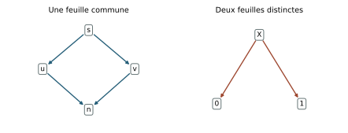
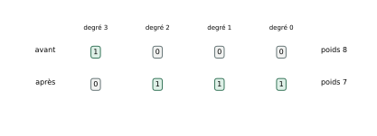
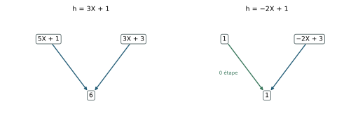

# ENS de Lyon · Second concours · Informatique 2020 · Corrigé guidé

*Corrigé rédigé par IA, non officiel. Signalez toute erreur.*

**Rédaction** · GPT-6.2 Astra Ultra · vitesse non renseignée · 24 novembre 2026

**Révision** · GPT-6.2 Astra Ultra · vitesse non renseignée · 26 novembre 2026

## Repères

Les listes sont rangées suivant les degrés décroissants et la liste vide représente le polynôme nul. Une réduction choisit un coefficient non nul. Une jonction utilise deux chemins orientés vers un descendant commun, tandis qu’une conversion autorise de parcourir un chemin en sens inverse. Dans les programmes, un générateur normalisé est supposé non nul et son coefficient dominant vaut un.

## 1 · Polynômes et idéaux

### Question 1 · Addition en représentation dense

**Indication.** Aligner les coefficients constants et ne retirer les zéros qu'en tête.

#### Solution

Le coefficient d'indice $i$ depuis la droite est celui de $X^i$. Complétons la liste la plus courte par des zéros virtuels. Après l'addition, une seule coupe élimine le préfixe nul. En particulier, une annulation complète renvoie la liste vide.

```python

def somme(f, g):
    taille = max(len(f), len(g))
    resultat = [0] * taille
    for i in range(1, taille + 1):
        a = f[-i] if i <= len(f) else 0
        b = g[-i] if i <= len(g) else 0
        resultat[-i] = a + b
    debut = 0
    while debut < taille and resultat[debut] == 0:
        debut += 1
    return resultat[debut:]

```

Les écritures, additions et copies prennent $O(\max(|f|,|g|))$ opérations, y compris lorsque plusieurs coefficients dominants s'annulent.

### Question 2 · Produit par un monôme

**Indication.** Compter aussi les coefficients nuls que la représentation de sortie oblige à écrire.

#### Solution

Si $b=0$ ou $f=0$, le produit est nul. Sinon, multiplier chaque coefficient par $b$ puis décaler les degrés de $m$ en ajoutant $m$ zéros à droite.

```python

def multmon(f, m, b):
    if not f or b == 0:
        return []
    return [b * coefficient for coefficient in f] + [0] * m

```

Il y a $n+1$ multiplications pour $\deg f=n$. La **construction de la liste dense** demande au total $\Theta(n+m+1)$ opérations puisque la sortie non nulle contient exactement $n+m+1$ coefficients. Pour $m$ fixé ou $m=O(n+1)$, c'est linéaire en la longueur de $f$. L'exigence $O(n)$ uniforme en $m$ est impossible pour cette sortie explicite, comme le montre $f=1$ et $m$ arbitrairement grand.

### Question 3 · Le zéro de l'idéal

**Indication.** Utiliser le fait que l'idéal est non vide avant sa stabilité par produit.

#### Solution

Choisissons $f\in J$. Le polynôme nul appartient à $K[X]$. La stabilité de $J$ par multiplication extérieure donne $0\cdot f=0\in J$.

### Question 4 · L'idéal engendré

**Indication.** Vérifier chacune des trois conditions dans l'ordre de la définition.

#### Solution

Pour $F=\{f_1,\ldots,f_k\}$ non vide, choisir tous les coefficients multiplicateurs nuls donne $0\in\langle F\rangle$. La somme de $\sum_i h_if_i$ et $\sum_i h'_if_i$ s'écrit $\sum_i(h_i+h'_i)f_i$. Le produit de la première par $q\in K[X]$ vaut $\sum_i(qh_i)f_i$. Dans le cas $F=\varnothing$, l'ensemble convenu $\{0\}$ est non vide et vérifie les deux stabilités.

### Question 5 · Normaliser les générateurs

**Indication.** Les multiples d'un générateur non nul ne changent pas si on le multiplie par un scalaire inversible.

#### Solution

Écarter $0$ de $F$. Pour chaque $f$ restant, de coefficient dominant $c_f\ne0$, placer $c_f^{-1}f$ dans $\widetilde F$. Cet ensemble est fini et ses éléments sont unitaires. Chacun est un multiple d'un générateur de $F$, réciproquement $f=c_f(c_f^{-1}f)$. En remplaçant chaque générateur dans les sommes de multiples, on obtient les deux inclusions d'idéaux. Si $F$ est vide ou ne contient que zéro, prendre $\widetilde F=\varnothing$. Les identités algébriques de l'épreuve supposent les opérations exactes d'un corps. Pour exécuter les exemples sans arrondi, on peut prendre des coefficients entiers ou rationnels exacts.

## 2 · Graphes dirigés

### Question 6 · De la jonction à la conversion

**Indication.** Utiliser le descendant commun comme sommet intermédiaire.

#### Solution

Si $s\downarrow_G t$, il existe $u$ tel que $s\to_G^*u$ et $t\to_G^*u$. La suite $s,u,t$ parcourt le second chemin en sens inverse, ce qu'autorise la conversion. Par conséquent $s\leftrightarrow_G^*t$.

### Question 7 · Unicité de la feuille convertible

**Indication.** Appliquer la confluence à deux feuilles supposées distinctes.

#### Solution

Si $u,v$ sont deux feuilles convertibles avec $s$, elles sont convertibles entre elles par symétrie et transitivité. Par confluence elles ont un descendant commun $w$. Chaque feuille n'a qu'un descendant, elle-même, par le chemin vide. Ainsi $u=w=v$.

### Question 8 · Existence d'une feuille accessible

**Indication.** Que se passe-t-il si aucun descendant de $s$ n'est une feuille ?

#### Solution

Supposons qu'aucune feuille ne soit accessible depuis $s$. Alors chaque sommet accessible possède un successeur, lui aussi accessible. Choisissons-en un à partir de $s$, puis à partir de celui obtenu, et continuons. Nous construisons un chemin infini, interdit par la bonne fondation. Il existe donc une feuille $t$ telle que $s\to_G^*t$. Ce raisonnement n'exige pas que l'ensemble global des sommets soit fini.

### Question 9 · Critère par forme normale

**Indication.** Combiner l'existence d'un chemin descendant et l'unicité de la feuille dans la classe.

#### Solution

Si $s\leftrightarrow_G^*t$, la feuille $\varphi(s)$ est convertible avec $t$ par transitivité. Q7 impose $\varphi(s)=\varphi(t)$. Dans l'autre sens, si les deux feuilles coïncident, Q8 et l'unicité fournissent les chemins $s\to_G^*\varphi(s)=\varphi(t)\leftarrow_G^*t$. Par Q6 les sommets sont convertibles.



### Question 10 · Atteindre la feuille

**Indication.** Dans un graphe confluent, tout choix de successeur mène à la même forme normale.

#### Solution

On fixe les deux opérations de la représentation du graphe une fois pour toutes. La construction suivante renvoie une fonction dont la signature d'utilisation est bien $\mathrm{feuille}(s)$.

```python

def construire_feuille(memb, succ):
    def feuille(s):
        if not memb(s):
            return None
        courant = s
        while True:
            voisins = succ(courant)
            if not voisins:
                return courant
            courant = voisins[0]
    return feuille

```

L'appel à la fonction des successeurs renvoie une liste finie. Une boucle infinie produirait un chemin infini, ce que la bonne fondation exclut. Le sommet terminal est une feuille accessible depuis $s$, donc la seule feuille convertible avec $s$.

### Question 11 · Décider la convertibilité

**Indication.** Tester l'appartenance avant d'effectuer la comparaison, y compris pour deux entrées invalides.

#### Solution


```python

def construire_conv(memb, feuille):
    def conv(s, t):
        return memb(s) and memb(t) and feuille(s) == feuille(t)
    return conv

```

On utilise $\mathrm{feuille}$ construite en Q10 pour le même graphe. Les tests initiaux rejettent tout couple comportant une valeur qui n'est pas un sommet. Pour deux sommets, le test final est exactement l'équivalence de Q9.

## 3 · Graphes induits et congruence

### Question 12 · Un entier qui diminue strictement

**Indication.** Isoler le bit de rang $m$ et majorer la contribution de tous les bits inférieurs.

#### Solution

Soit $d=\deg f$. L'étape efface le coefficient $a\ne0$ de $X^m$ dans $g$ en retranchant $aX^{m-d}f$, puisque $f$ est unitaire. Les degrés strictement supérieurs à $m$ ne changent pas. Au rang $m$, le poids perd $2^m$. Aux rangs inférieurs il peut gagner tout au plus $\sum_{i=0}^{m-1}2^i=2^m-1$, même si tous les bits initialement nuls y deviennent 1. En définitive $\pi(h)(2)\le\pi(g)(2)-1$. Pour $m=0$ la somme vide est nulle.



### Question 13 · Terminaison des réductions

**Indication.** Chercher dans quel ensemble ordonné prennent valeur les poids.

#### Solution

À chaque arête de $G(F)$, le poids $\pi(g)(2)$ est un entier naturel strictement décroissant par Q12. Un chemin issu de $g$ a donc au plus $\pi(g)(2)$ arêtes. Aucun chemin infini n'existe. Si $F$ est vide, il n'y a aucune arête.

### Question 14 · Conversion et congruence

**Indication.** Commencer par une seule arête, puis traiter les deux orientations.

#### Solution

Si $g\to_f h$, alors $g-h=aX^{m-\deg f}f$ appartient à $\langle F\rangle$. Dans le sens inverse, $h-g$ y appartient également car l'idéal est stable par multiplication par $-1$. Pour une conversion, on développe chacun des chemins en arêtes puis on additionne leurs différences avec les signes du parcours. La somme télescope en $g-h\in\langle F\rangle$.

### Question 15 · Réduire le générateur

**Indication.** Quel monôme d'un polynôme unitaire reproduit tout ce polynôme dans la soustraction ?

#### Solution

Si $n=\deg f$, son monôme dominant vaut $X^n$. L'étape correspondante retranche $1\cdot X^{n-n}f=f$ et donne $0$. Cela inclut le générateur constant $f=1$.

### Question 16 · Stabilité d'une étape par multiplication monomiale

**Indication.** Suivre séparément le degré du monôme supprimé et son coefficient.

#### Solution

Si $h=g-aX^{m-n}f$ et $a$ est le coefficient non nul de degré $m$ de $g$, celui de degré $m+c$ de $bX^cg$ vaut $ba\ne0$. L'étape associée soustrait $(ba)X^{m+c-n}f$ et donne exactement $bX^ch$. Le facteur $b\ne0$ garantit que l'étape existe.

### Question 17 · Joindre après addition

**Indication.** L'addition peut annuler le terme choisi. Autoriser alors un chemin de longueur zéro d'un côté.

#### Solution

Écrivons $g'=g-aR$ avec $R=X^{m-\deg f}f$, de coefficient $1$ en degré $m$. Notons $b$ le coefficient de $X^m$ dans $h$, éventuellement nul. Le coefficient de degré $m$ vaut $a+b$ dans $h+g$, et $b$ dans $h+g'$. Posons

$$
u=h+g-(a+b)R=h+g'-bR.
$$

Si $a+b\ne0$, une réduction de $h+g$ donne $u$. Si $a+b=0$, ce sommet est déjà $u$. De même, si $b\ne0$, une réduction de $h+g'$ donne $u$, sinon il est déjà égal à $u$. Dans tous les cas les deux sommets atteignent $u$ en zéro ou une étape. La propriété établie est la jonction, même quand aucune arête directe ne relie les deux sommes.

Prenons $f=X-1$, $g=X$, $g^{\prime}=1$ et $h=-X$. Alors $h+g=0$ est déjà une feuille, tandis que $h+g^{\prime}=1-X$ se réduit à zéro en utilisant le coefficient $-1$ du monôme de degré 1. Cet exemple réalise précisément le cas où l’un des deux chemins a longueur zéro.



### Question 18 · Ajouter un multiple monomial

**Indication.** Transformer d'abord ce multiple seul, puis appliquer la propriété précédente.

#### Solution

Q15 et Q16 impliquent $aX^m f\to_f0$. En ajoutant $g$ aux deux extrémités et en appliquant Q17, on obtient $(g+aX^mf)\downarrow_{G(F)}g$. La jonction étant symétrique, c'est la relation demandée.

### Question 19 · Ajouter plusieurs multiples

**Indication.** Des jonctions successives donnent des conversions que l'on peut composer.

#### Solution

Posons $g_0=g$, $g_j=g_{j-1}+a_jX^{m_j}f_j$ pour $1\le j\le k$. Q18 donne $g_{j-1}\downarrow g_j$ et Q6 donne $g_{j-1}\leftrightarrow^*g_j$. La transitivité de la conversion donne $g\leftrightarrow^*g_k$. Pour $k=0$, c'est la réflexivité. On n'a eu besoin d'aucune hypothèse de confluence sur $F$.

### Question 20 · De la congruence à la conversion

**Indication.** Décomposer les multiplicateurs polynomiaux en leurs monômes non nuls.

#### Solution

De $g\equiv_{\langle F\rangle}h$, on déduit $h-g\in\langle F\rangle$ par stabilité de l'idéal par opposé. Écrire $h-g=\sum_i q_if_i$, puis développer chaque $q_i$ en monômes non nuls. Ainsi $h=g+\sum_j a_jX^{m_j}f_{i_j}$ et Q19 donne $g\leftrightarrow^*h$. Pour $F=\varnothing$, l'hypothèse impose $g=h$. Avec Q14, la congruence et la conversion coïncident pour tout $F$ fini normalisé.

### Question 21 · Calculer une étape

**Indication.** Le décalage vaut le degré choisi moins celui du réducteur.

#### Solution


```python

def etape(g, f, m, a):
    degre_f = len(f) - 1
    return somme(g, multmon(f, m - degre_f, -a))

```

Sous les conditions de la question, $f$ est non nul et $m\ge\deg f$. La fonction calcule $g-aX^{m-\deg f}f$. Lorsque $a$ est le coefficient du monôme que l'on réduit, la monicité de $f$ annule bien ce coefficient. La fonction somme maintient la représentation canonique de zéro.

### Question 22 · Tous les successeurs pour un générateur

**Indication.** À l'indice de liste $i$, le degré est $|g|-1-i$.

#### Solution


```python

def succsimple(g, f):
    resultat = []
    degre_f = len(f) - 1
    for indice, a in enumerate(g):
        m = len(g) - 1 - indice
        if m < degre_f:
            break
        if a != 0:
            resultat.append(etape(g, f, m, a))
    return resultat

```

On rencontre une fois chaque monôme non nul d'exposant suffisant. La liste est vide si $g=0$ ou si tous ses degrés sont trop petits. Les coefficients nuls au milieu de la liste ne produisent pas de boucle de $g$ vers lui-même.

### Question 23 · Union des successeurs

**Indication.** Deux générateurs peuvent conduire au même polynôme.

#### Solution


```python

def succ(g, F):
    resultat = []
    vus = set()
    for f in F:
        for h in succsimple(g, f):
            cle = tuple(h)
            if cle not in vus:
                vus.add(cle)
                resultat.append(h)
    return resultat

```

La clé immuable représente exactement le même polynôme que la liste canonique. Toute sortie est une réduction par un $f\in F$ et toute réduction de ce type est explorée. La réunion est finie car $g$ ne contient qu'un nombre fini de monômes et $F$ un nombre fini de générateurs.

### Question 24 · Décider la congruence pour une base de Gröbner

**Indication.** Une réduction déterministe suffit si l'unicité des feuilles est acquise.

#### Solution


```python

def equivideal(g, h, F):
    def forme_normale(p):
        while True:
            voisins = succ(p, F)
            if not voisins:
                return p
            p = voisins[0]
    return forme_normale(g) == forme_normale(h)

```

La bonne fondation vient de Q13. L'hypothèse « base de Gröbner » garantit la confluence. Q9 identifie donc conversion et égalité des feuilles, et Q14–Q20 identifient conversion et congruence dans l'idéal. Si $F$ est vide, l'algorithme compare les listes canoniques d'entrée. Si $1\in F$, toute feuille est nulle. Par exemple, pour $F=\{X-1\}$, $X^2+1$ et $2$ ont tous deux pour feuille $2$.
