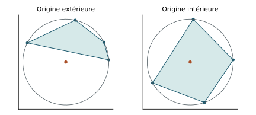

# ENS de Lyon · Second concours — Mathématiques 2020 · Corrigé guidé

*Corrigé rédigé par IA, non officiel. Signalez toute erreur.*

**Rédaction** · GPT-6.2 Astra Ultra · vitesse non renseignée

**Révision** · GPT-6.2 Astra Ultra · vitesse non renseignée · 26 novembre 2026

L’épreuve de trois heures porte sur le polynôme cyclotomique de rang pq, puis sur l’enveloppe convexe de points tirés au hasard sur un cercle. Le problème et l’exercice ont leur propre numérotation. [Sujet officiel](https://banques-ecoles.fr/cms/wp-content/uploads/2020/11/2c2020_math.pdf) · [Rapport du jury](https://banques-ecoles.fr/cms/wp-content/uploads/2020/11/20_2CC_rap_eMath.pdf)

## Problème. Semi-groupe numérique et polynôme cyclotomique

### Question P.1

> [!INDICATION]
> Choisir une représentation avec un coefficient dans un système complet de résidus.

#### Solution

Comme $p$ et $q$ sont premiers entre eux, les $nq$ pour $0\le n<p$ couvrent toutes les classes modulo $p$. Choisissons $n$ dans cette plage tel que $R-nq$ soit divisible par $p$. Pour $R\ge(p-1)(q-1)$, $R-nq\ge(p-1)(q-1)-(p-1)q=-(p-1)>-p$. Ce multiple de $p$ est donc positif ou nul, et $R=mp+nq$ avec $m,n\ge0$.

### Question P.2

> [!INDICATION]
> Réduire un éventuel début de représentation modulo p.

#### Solution

Posons $F=(p-1)(q-1)-1=pq-p-q$. Si $F=mp+nq$ avec $m,n\ge0$, on aurait $pq=(m+1)p+(n+1)q$. Modulo $p$, on déduit $p\mid n+1$, donc $(n+1)q\ge pq$, alors que $(m+1)p>0$. C’est impossible. Ainsi $F$ est le plus grand entier absent du semi-groupe.

### Question P.3

> [!INDICATION]
> Observer que tous les coefficients assez loin dans la série valent un.

#### Solution

Les coefficients de $S$ valent zéro ou un, d’où convergence absolue pour $|z|<1$. Pour $s\ge(p-1)(q-1)$, la question 1 donne un coefficient égal à un. Si $|z|\ge1$, le terme général ne tend pas vers zéro. Le rayon vaut donc un.

### Question P.4a

> [!INDICATION]
> Retrancher la série des exposants présents à la série géométrique.

#### Solution

Notons $A=\langle p,q\rangle$. Pour $|z|<1$, $H(z)=1/(1-z)-S(z)$, d’où $K(z)=(1-z)S(z)$. Par 1 et 2, $H$ est un polynôme unitaire de degré $F=pq-p-q$, et donc $d=\deg K=F+1=(p-1)(q-1)$.

### Question P.4b

> [!INDICATION]
> Lister les entiers absents avant le seuil du semi-groupe.

#### Solution

Pour $p=3,q=5$, le seuil est huit. Entre zéro et sept, les entiers absents sont $1,2,4,7$. Donc $H=X+X^2+X^4+X^7$ et
$$K=1-X+X^3-X^4+X^5-X^7+X^8.$$

### Question P.5

> [!INDICATION]
> Lire le coefficient comme une différence de deux indicatrices.

#### Solution

Notons $c_j=\mathbf1_{j\in A}$ et $c_{-1}=0$. Comme $K=(1-X)S$, $a_j=c_j-c_{j-1}$ pour $j\ge0$. Cela vaut $-1$ lors d’une sortie de $A$, $1$ lors d’une entrée et zéro sinon. En particulier $a_0=1$ puisque zéro appartient à $A$ et $-1$ n’y appartient pas.

### Question P.6

> [!INDICATION]
> Suivre les changements d’état d’une suite à deux valeurs.

#### Solution

Après une transition $0\to1$ de la suite des $c_j$, le changement suivant ne peut être que $1\to0$. Après une transition $1\to0$, le suivant ne peut être que $0\to1$. Ainsi les $a_j$ non nuls alternent et commencent par $+1$. Le dernier vaut aussi $+1$ car $d-1$ est absent et $d$ présent.

### Question P.7a

> [!INDICATION]
> Donner à chaque entier du semi-groupe une représentation unique de forme normalisée.

#### Solution

Dans toute représentation $mp+nq$, écrivons $n=lp+j$ avec $0\le j<p$. Alors $mp+nq=(m+lq)p+jq$ garde des coefficients positifs ou nuls. La représentation $ip+jq$, $i\ge0$, $0\le j<p$, est unique : modulo $p$, on retrouve $j$, puis $i$. La sommation absolument convergente donne
$$S(z)=\left(\sum_{i\ge0}z^{ip}\right)\left(\sum_{j=0}^{p-1}z^{jq}\right)
=\frac{1-z^{pq}}{(1-z^p)(1-z^q)}.$$
En multipliant, on obtient l’identité demandée.

### Question P.7b

> [!INDICATION]
> Étendre l’égalité issue des séries à une identité de polynômes.

#### Solution

Par 4a et 7a, $(1-z^p)(1-z^q)K(z)=(1-z^{pq})(1-z)$ pour $|z|<1$. Les deux membres sont polynomiaux et coïncident sur un ensemble infini. Ils sont donc égaux dans $\mathbb C[X]$.

### Question P.8

> [!INDICATION]
> Comparer les ordres d’annulation dans l’identité polynomiale.

#### Solution

Les racines $pq$-ièmes de l’unité sont simples dans $1-X^{pq}$. Au point $1$, le membre droit de 7b a une racine double, déjà expliquée par les deux facteurs du membre gauche. Aux racines non triviales d’ordre $p$ ou $q$, la racine simple de droite est déjà celle d’un seul facteur à gauche. Pour chaque autre racine $pq$-ième, l’ordre est $pq$ et les deux facteurs gauches sont non nuls : c’est une racine simple de $K$. Aucune autre racine n’est possible. Ainsi $K$ a pour racines exactement les $(p-1)(q-1)$ racines primitives d’ordre $pq$, toutes simples.

### Question P.9a

> [!INDICATION]
> Réduire modulo les deux premiers pour exclure les valeurs extrêmes.

#### Solution

Dans $\alpha p+\beta q=pq+1$, $\alpha$ ne peut être nul car $q$ ne divise pas $pq+1$. De même $\beta\ge1$. Dès lors $\alpha p=pq+1-\beta q<pq$, donc $\alpha\le q-1$, et symétriquement $\beta q<pq$ donc $\beta\le p-1$.

### Question P.9b

> [!INDICATION]
> Multiplier la différence des deux produits géométriques par le dénominateur de 7b.

#### Solution

Notons $A_0=X^{\alpha p}$, $B_0=X^{\beta q}$ et $T=X^{pq}$, de sorte que $A_0B_0=XT$. Dans la première somme de l’énoncé, les indices parcourent $0\le i<\alpha$ et $0\le j<\beta$. Dans la seconde, $\alpha\le i<q$ et $\beta\le j<p$. Son plus petit exposant après soustraction de $pq$ vaut $\alpha p+\beta q-pq=1$, donc l’expression proposée est un polynôme. Multipliée par $(1-X^p)(1-X^q)$, elle devient
$$(1-A_0)(1-B_0)-T^{-1}(A_0-T)(B_0-T)
=1+XT-X-T=(1-X)(1-T).$$
La question 7b et la simplification dans l’anneau des polynômes donnent l’identité voulue.

### Question P.9c

> [!INDICATION]
> Contrôler les collisions d’exposants dans chaque rectangle et entre les deux rectangles.

#### Solution

Dans chaque rectangle, une égalité $ip+jq=i'p+j'q$ donne $q\mid i-i'$ et donc $i=i'$ puisque les deux indices sont dans $[0,q-1]$. Puis $j=j'$. Une collision entre un terme positif et un terme négatif donnerait $(i'-i)p+(j'-j)q=pq$, avec $1\le i'-i\le q-1$. La réduction modulo $q$ rend cela impossible. Il y a donc $\alpha\beta$ coefficients positifs et $(q-\alpha)(p-\beta)=pq-\beta q-\alpha p+\alpha\beta=\alpha\beta-1$ négatifs. Au total $N=2\alpha\beta-1$.

### Question P.9d

> [!INDICATION]
> Borner le produit des deux termes dont la somme vaut pq + 1.

#### Solution

La relation $4(\alpha p)(\beta q)\le(\alpha p+\beta q)^2=(pq+1)^2$ donne
$$N=2\alpha\beta-1\le\frac{(pq+1)^2}{2pq}-1=\frac{p^2q^2+1}{2pq}.$$
Comme $pq$ est impair et $pq>1$, cette borne est strictement inférieure à $(pq+1)/2$. L’entier $N$ est donc au plus $(pq-1)/2$.

La borne réelle suggérée par le sujet est même stricte. Une égalité imposerait $\alpha p=\beta q$, donc $q\mid\alpha$ car $p$ et $q$ sont premiers distincts. Or $1\le\alpha<q$. Le cas $(3,5)$ atteint en revanche la borne entière : les sept coefficients non nuls trouvés en 4b donnent $N=(15-1)/2=7$.

## Exercice. Points aléatoires sur le cercle

### Question E.1

> [!INDICATION]
> Conditionner par le point qui fixe le demi-cercle.

#### Solution

Une fois $Z_j$ fixé, le demi-cercle ouvert en avant de ce point a mesure $1/2$. Conditionnellement à $Z_j$, les $n-1$ autres points demeurent indépendants et uniformes. La probabilité conditionnelle de $E_j$ vaut $2^{-(n-1)}$, valeur indépendante de $Z_j$, donc aussi sa probabilité sans conditionnement.

### Question E.2

> [!INDICATION]
> Vérifier si deux points peuvent tous deux être le premier point de l’arc.

#### Solution

Pour $j\ne k$, $E_j$ impose que l’angle orienté de $Z_j$ à $Z_k$ appartienne à $]0,\pi[$ tandis que $E_k$ exige la même chose pour l’angle opposé modulo $2\pi$. Ces conditions sont incompatibles, même en cas de coïncidence ou d’antipodie puisque les arcs sont ouverts. Les $E_j$ sont donc deux à deux disjoints et $\mathbb P(\bigcup_jE_j)=n/2^{n-1}$.

### Question E.3

> [!INDICATION]
> Relier la séparation de l’origine et du polygone à un arc de longueur π.

#### Solution

Dans l’interprétation convexe de « barycentre » utilisée ici, les poids sont positifs ou nuls et de somme un. Si les points sont dans un demi-cercle ouvert, une forme linéaire est strictement positive sur eux et sur leur enveloppe convexe. L’origine n’en fait pas partie. Réciproquement, si $0$ est hors du convexe compact $K$ engendré par les points, prenons $v\in K$ de norme minimale. Pour $z\in K$, dériver en zéro à droite la norme au carré de $v+t(z-v)$ donne $v\cdot z\ge\|v\|^2>0$. Tous les points sont donc dans le demi-cercle ouvert défini par $v\cdot z>0$.

Hors des coïncidences, de probabilité nulle, être contenus dans un demi-cercle ouvert équivaut à l’union des $E_j$. Si un arc ouvert les contient, le premier point rencontré en parcourant cet arc laisse les autres strictement dans son demi-cercle avant. Réciproquement $E_j$ donne une étendue angulaire strictement inférieure à $\pi$, que l’on peut inclure dans un arc ouvert. Par E.2, la probabilité demandée vaut donc $1-n/2^{n-1}$. Si l’on autorisait des poids réels de signes quelconques, trois points distincts du cercle engendreraient affinement tout le plan et la réponse vaudrait un pour $n\ge3$. Le rapport situe explicitement l’exercice dans le cadre convexe.

