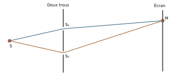
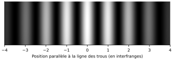
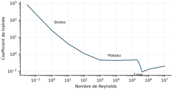
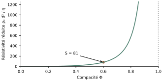
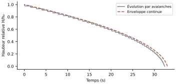

# ENS de Lyon, second concours 2020 — Physique · Corrigé brut

*Corrigé rédigé par IA, non officiel. Signalez toute erreur.*

**Rédaction** · GPT-6.2 Astra Ultra · vitesse non renseignée

## A — Questionnaire de physique

### Question A1 — Dispositif de Young

Une source monochromatique ponctuelle éclaire deux petits trous $S_1,S_2$ d’un même écran opaque. Une source centrée sur la médiatrice les éclaire en phase. À distance $D$, placer un écran dans leur zone de recouvrement. Chaque trou diffracte la lumière et devient une source secondaire cohérente.

### Question A2 — Franges

À petits angles, $\delta\simeq ax/D$, où $a=S_1S_2$ et $x$ est mesuré parallèlement à la direction des deux trous. Les franges claires en $x=m\lambda D/a$ alternent avec les sombres à une demi-interfrange. Les franges sont rectilignes, parallèles entre elles et perpendiculaires à $S_1S_2$, dans l’enveloppe de diffraction des trous.

### Question A3 — Loi de Stefan-Boltzmann

L’exitance totale d’un corps noir à température absolue $T$ vaut $M=\sigma T^4$, avec $\sigma\simeq5{,}67\times10^{-8}\ \mathrm{W\,m^{-2}\,K^{-4}}$. La puissance émise par une surface uniforme $S$ est $SM$.

### Question A4 — Traînée d’une sphère

Avec $F_D=\tfrac12\rho U^2 S_f C_D$ et $\mathrm{Re}=\rho U d/\eta$, la loi de Stokes donne $C_D=24/\mathrm{Re}$ à très petit Reynolds. Le coefficient décroît, approche un plateau voisin de 0,4–0,5 aux Reynolds de quelques milliers à $10^5$, puis présente une crise de traînée vers quelques $10^5$ pour une sphère lisse. Il remonte ensuite partiellement. Les transitions dépendent de la rugosité et de la turbulence incidente.

### Question A5 — Flux électromagnétique

Le vecteur de Poynting dans le vide est $\mathbf S=\mathbf E\times\mathbf B/\mu_0$, en $\mathrm{W\,m^{-2}}$.

### Question A6 — Milieu dispersif

Un prisme de verre transparent dévie différemment les couleurs car son indice dépend de la fréquence. La vitesse de phase $c/n(\omega)$ varie dans le spectre visible.

### Question A7 — Fonction d’onde

Pour un état pur d’une particule sans spin, $\psi(\mathbf r,t)$ est une amplitude complexe. Sa norme au carré donne la densité de probabilité de présence. La probabilité de détection dans un volume $\mathcal V$ est $\int_{\mathcal V}|\psi|^2\,\mathrm d^3r$ pour un état normalisé.

### Question A8 — Moment cinétique

Dans le référentiel de mesure de la vitesse, $\mathbf L_P=\overrightarrow{PM}\times m\mathbf v_M$.

### Question A9 — Enthalpie de vaporisation

L’enthalpie massique de vaporisation est la différence $h_{\rm vapeur}-h_{\rm liquide}$ des deux phases en équilibre à la pression et à la température de transition. C’est la chaleur à fournir à pression constante pour vaporiser une unité de masse, si seul le travail de pression intervient.

### Question A10 — Signe et ordre de grandeur

La vaporisation est endothermique. À 100 °C sous une atmosphère, $L_v\simeq+2{,}26\times10^6\ \mathrm{J\,kg^{-1}}$, soit environ $+41\ \mathrm{kJ\,mol^{-1}}$.

## B — Sablier intermittent

### Question B1 — Équilibre d’une colonne liquide

Notons $A_c=\pi d_c^2/4$ la section du conduit. Le modèle liquide impose $\delta P^\star=\rho_s gh_0$, avec $m=\rho_s A_c h_0$. Ainsi $\delta P^\star=mg/A_c=4mg/(\pi d_c^2)$. La différence de pression supporte ici le poids total de la colonne par unité de section.

### Question B2 — Pression hydrostatique de référence

Pour $m=0{,}010$ kg et $d_c=0{,}010$ m, $A_c=7{,}85\times10^{-5}\ \mathrm{m^2}$. On trouve $\delta P^\star\simeq1{,}25\times10^3$ Pa.

### Question B3 — Compression requise

La compression isotherme d’un nombre de moles fixé satisfait $P_0V=(P_0+\delta P^\star)(V+\Delta V_a)$. D’où $\Delta V_a/V=-\delta P^\star/(P_0+\delta P^\star)\simeq-\delta P^\star/P_0$. La diminution, exprimée en pourcentage positif, est $X\simeq100\,\delta P^\star/P_0$.

### Question B4 — Faisabilité volumique

Le volume d’air devrait diminuer de $X\simeq1{,}25\,\%$ au premier ordre (1,23 % exactement). La totalité des grains occupe un volume net $m/\rho_g=4$ mL pour un ballon de 100 mL, soit 4 %. La compression requise est accessible avant la vidange complète. Ce test de volume est une condition de possibilité. Les seuils réels et le passage de l’air entre les grains déterminent ensuite l’intermittence.

## Phase active

### Question B5 — Comparaison avec un liquide

Pour un écoulement idéal, la loi de Bernoulli entre la surface libre et la sortie donne $Q=(\pi d_o^2/4)\sqrt{2[gh+(P_{\rm haut}-P_{\rm bas})/\rho]}$ si la vitesse de la surface est négligeable et le terme sous la racine positif. À pression égale des deux côtés, c’est la loi de Torricelli $Q=(\pi d_o^2/4)\sqrt{2gh}$. Le débit liquide dépend donc de la hauteur restante.

### Question B6 — Débit mesuré

La droite de la figure 2 a pour pente environ $5/2$ en coordonnées log-log. Elle passe près de $(1\ \mathrm{mm},1\ \mathrm{mL\,s^{-1}})$ et $(2\ \mathrm{mm},5{,}7\ \mathrm{mL\,s^{-1}})$. On lit
$$Q_g\simeq10^{-6}\left(\frac{d_o}{10^{-3}\ \mathrm m}\right)^{5/2}\ \mathrm{m^3\,s^{-1}}.$$
Pour $d_o$ en mètres et $Q_g$ en $\mathrm{m^3\,s^{-1}}$, le coefficient numérique est environ 32. Sa dimension est $\mathrm{m^{1/2}\,s^{-1}}$.

### Question B7 — Rôle de la gravité

Si le débit dépend du diamètre de l’orifice et de la pesanteur, la combinaison de dimension $L^3/T$ est $Q_g=C\sqrt g\,d_o^{5/2}$. Le coefficient $C$ est sans dimension. La pente expérimentale est compatible avec cette loi. Le diamètre et la forme des grains peuvent entrer dans un facteur sans dimension, par exemple par $d/d_o$.

### Question B8 — Rôle des contacts entre grains

Le frottement aux parois et les chaînes de forces transmettent une partie du poids latéralement. Des arches de grains se forment et se défont près de l’ouverture. La vitesse de sortie est alors fixée surtout par une accélération gravitaire sur une distance de l’ordre de l’ouverture. Elle est de l’ordre de $\sqrt{g d_o}$. Cette description explique un débit presque indépendant du niveau de remplissage tant que la colonne est assez haute.

### Question B9 — Quantité d’air pendant une avalanche

Le sable entre rapidement dans le ballon et l’air ne peut remonter qu’en traversant une colonne peu perméable. Comme $T_A\ll T_P$, l’échange d’air durant une avalanche est négligeable au premier ordre dans cette séparation des durées. On peut donc y prendre $n_a$ constant.

### Question B10 — Variation du volume d’air

Le volume net de grains croît à débit constant $Q_g$. Dans le ballon rigide, $\Delta V_a(t)=-\Delta V_g(t)=-Q_gt$. À cet ordre de calcul, $V_a(0)$ peut être remplacé par $V$ dans les coefficients.

### Question B11 — Montée de pression

À température et nombre de moles constants, $P(t)=P_{\min} V_a(0)/[V_a(0)-Q_gt]$. Au premier ordre, $P(t)\simeq P_{\min}(1+t/\tau_A)$ avec $\tau_A=V/Q_g$. Pour 100 mL et 1 mL/s, $\tau_A\simeq100$ s. Cette durée caractérise une compression relative d’ordre un, bien supérieure aux faibles surpressions étudiées.

### Question B12 — Durée réduite de l’avalanche

L’arrêt se produit pour $P(T_A)=P_{\max}$. Ainsi $k_A=T_A/\tau_A=P_{\max}/P_{\min}-1$ dans le modèle linéarisé.

### Question B13 — Seuil réel et modèle liquide

Les surpressions imposées sont $\delta P_{\min}=10$ Pa et $\delta P_{\max}=100$ Pa. La pression hydrostatique de B2, environ 1250 Pa, dépasse même le seuil d’arrêt d’un facteur proche de 12,5. Les contacts et les parois soutiennent déjà une partie importante de la charge.

### Question B14 — Temps actif

$k_A=(1{,}001/1{,}0001)-1\simeq9{,}0\times10^{-4}$. La durée active vaut donc $T_A\simeq0{,}090$ s.

### Question B15 — Volume solide par avalanche

À débit constant, $\Delta V_g=Q_gT_A=k_AV\simeq9{,}0\times10^{-8}\ \mathrm{m^3}$, soit $0{,}090$ mL de grains par avalanche complète.

### Question B16 — Compacité

Pour une masse de sable $m_s$, le volume solide est $m_s/\rho_g$, le volume apparent $m_s/\rho_s$. La compacité vaut $\Phi=\rho_s/\rho_g=1500/2500=0{,}60$. La porosité vaut donc 0,40.

### Question B17 — Hauteur après plusieurs avalanches

Chaque avalanche enlève une masse fixe $\rho_g k_AV$. La masse restante est $m-n\rho_g k_AV=\rho_s A_c h_n$. En divisant par $m=\rho_s A_ch_0$, il vient $h_n=h_0(1-\alpha n)$ avec $\alpha=\rho_g k_AV/m$.

### Question B18 — Nombre d’avalanches

$h_0=m/(\rho_s A_c)\simeq0{,}0849$ m et $\alpha\simeq0{,}0225$. La valeur continue $1/\alpha\simeq44{,}4$ représente environ 44 avalanches complètes et un reste. Si l’écoulement final incomplet est dénombré, il y a une 45e décharge. Les hypothèses de colonne haute et de seuils fixes sont peu précises à la toute fin.

## Phase passive

### Question B19 — Analogie de Darcy

La relation $\delta P=R_a Q_a$ a la forme de la loi d’Ohm $\Delta U=RI$. Le débit joue le rôle du courant et la différence de pression celui de la tension. Avec $Q_a>0$ de bas en haut, la puissance dissipée est $\delta P Q_a=R_a Q_a^2$.

### Question B20 — Résistance et géométrie

Des couches empilées en série additionnent leurs différences de pression pour un même débit, d’où $R_a\propto h$. Des colonnes en parallèle additionnent leurs débits pour une même différence de pression, d’où $R_a\propto1/A_c$. On écrit $R_a=\rho_a h/A_c=4\rho_a h/(\pi d_c^2)$.

### Question B21 — Résistivité aérodynamique

$[R_a]=\mathrm{Pa\,s\,m^{-3}}$. On en tire $[\rho_a]=\mathrm{Pa\,s\,m^{-2}}$. Avec $\eta$ et $d$ comme seules grandeurs dimensionnées, $\rho_a=S(\Phi)\eta/d^2$.

### Question B22 — Effet de la compacité

$\rho_a=(36\eta/d^2)\Phi^2/(1-\Phi)^2$. La courbe part de zéro avec pente initiale nulle, croît et devient divergente comme $(1-\Phi)^{-2}$ près de 1. La réduction de la section libre et la tortuosité des pores freinent l’écoulement. Cette extrapolation vers $\Phi=1$ décrit la formule idéale.

### Question B23 — Préfacteur du sable

Pour $\Phi=0{,}60$, $S=(6\times0{,}60/0{,}40)^2=81$. Avec les données de l’énoncé, $\rho_a=81(1{,}8\times10^{-5})/(50\times10^{-6})^2=5{,}83\times10^5\ \mathrm{Pa\,s\,m^{-2}}$.

### Question B24 — Bilan de moles

En un temps $\mathrm dt$, un volume $Q_a\mathrm dt$ quitte le ballon inférieur, soit $Q_a\mathrm dt/v_m$ moles, aux conditions de référence au premier ordre. Ainsi $\mathrm dn_a/\mathrm dt=-Q_a/v_m$ ou $Q_a=-v_m\,\mathrm dn_a/\mathrm dt$. Le signe négatif traduit la convention de débit sortant.

### Question B25 — Relaxation de la surpression

Durant la phase passive, $V_a$ est constant et voisin de $V$. Le gaz parfait donne $\mathrm dn_a/\mathrm dt=V\,\mathrm d\delta P/\mathrm dt/(RT_0)$. Avec Darcy et B24,
$$\frac{\mathrm d\delta P}{\mathrm dt}+\frac{\delta P}{\tau_P}=0,\qquad \tau_P=\frac{R_aVv_m}{RT_0}.$$
Si l’on identifie exactement $v_m=RT_0/P_0$, cela s’écrit $\tau_P=R_aV/P_0$. La résistance est constante lors d’une pause et diminue d’une pause à la suivante.

### Question B26 — Pression pendant la pause

Avec $\delta P(0)=\delta P_{\max}$, la solution est $\delta P(t)=\delta P_{\max}\exp(-t/\tau_P)$. C’est la surpression qui tend vers zéro et la pression absolue qui tend vers $P_0$.

### Question B27 — Durée réduite de la pause

À la reprise des grains, $\delta P_{\min}=\delta P_{\max}\exp(-T_P/\tau_P)$. Donc $k_P=T_P/\tau_P=\ln(\delta P_{\max}/\delta P_{\min})=\ln10\simeq2{,}303$.

### Question B28 — Temps passif initial

Avec $h=h_0$, $R_{a0}=\rho_a h_0/A_c=6{,}30\times10^8\ \mathrm{Pa\,s\,m^{-3}}$. En conservant le volume molaire numérique imposé $v_m=22{,}4$ L/mol dans la relation de B25, $\tau_{P0}=0{,}566$ s et $T_{P0}=1{,}30$ s, environ 14,5 fois $T_A$. Si l’on emploie la valeur cohérente avec $P_0,T_0$ et le gaz parfait, $RT_0/P_0=24{,}9$ L/mol, on obtient $\tau_{P0}=0{,}630$ s et $T_{P0}=1{,}45$ s. Dans les deux conventions, la pause domine initialement.

## Vidange complète

### Question B29 — Temps passif et hauteur restante

Le seuil $k_P$ et la capacité pneumatique du ballon sont pris constants. La résistance de Darcy est proportionnelle à $h_n$, donc $\tau_{Pn}$ et $T_{Pn}=k_P\tau_{Pn}$ le sont également. On peut écrire $T_{Pn}=\beta h_n$ avec $\beta=T_{P0}/h_0$.

### Question B30 — Équation de l’enveloppe

Un cycle enlève la hauteur $\alpha h_0$ en une durée $T_A+\beta h_n$. Lorsque la variation par pas est petite, la pente de l’enveloppe est approchée par le taux de variation du pas, d’où
$$\frac{\mathrm dH}{\mathrm dt}=-\frac{\alpha h_0}{T_A+\beta H},\qquad H(0)=h_0.$$
La pente devient plus négative quand la colonne se raccourcit. Cette approximation continue lisse les avalanches discrètes.

### Question B31 — Intégration

Multiplier l’équation précédente par $T_A+\beta H$. En intégrant de $h_0$ à $H(t)$, on obtient
$$T_A(h_0-H)+\frac{\beta}{2}(h_0^2-H^2)=\alpha h_0\,t.$$
Le membre de gauche est positif quand la hauteur baisse et s’annule à $t=0$.

### Question B32 — Temps de vidange

En posant $H(t^\star)=0$, on trouve $t^\star=(T_A+T_{P0}/2)/\alpha$. Avec le volume molaire indiqué, cela donne $(0{,}090+1{,}30/2)/0{,}0225\simeq33$ s. Avec le volume molaire idéal à 300 K de B28, la valeur est 36,3 s. L’écoulement actif cumulé durerait seulement $(m/\rho_g)/Q_g=4$ s. Les pauses expliquent l’essentiel du temps total. Leur durée moyenne dans l’enveloppe est la moitié de la durée initiale. La fin de la vidange ne satisfait plus $T_P\gg T_A$, d’où l’intérêt de conserver $T_A$.

### Question B33 — Ballon supérieur fermé

Pour deux ballons de même volume initial, le transfert d’un volume de grains comprime le gaz du bas et détend celui du haut. La différence de pression $\Delta P=P_{\rm bas}-P_{\rm haut}$ croît donc environ deux fois plus vite, à débit granulaire et seuils de différence inchangés. La phase active dure approximativement deux fois moins longtemps. En phase passive, une mole d’air qui remonte fait à la fois baisser la pression du bas et monter celle du haut. La différence se relaxe deux fois plus vite avec la même résistance, donc le temps passif est aussi approximativement divisé par deux, à hauteur de sable identique. Plus généralement la capacité effective est proportionnelle à $(1/V_{\rm bas}+1/V_{\rm haut})^{-1}$.

[Sujet officiel](https://banques-ecoles.fr/cms/wp-content/uploads/2020/07/20_2c_ephy.pdf) · [Rapport du jury](https://banques-ecoles.fr/cms/wp-content/uploads/2020/09/20_2c_rap_ephy.pdf)
