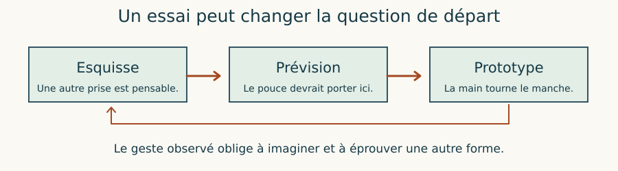

# Imaginer, anticiper, inventer · 2020 · Corrigé brut

*Corrigé rédigé par IA, non officiel. Signalez toute erreur.*

**Rédaction** · GPT-6.2 Astra Ultra · vitesse non renseignée · 25 novembre 2026

**Révision** · GPT-6.2 Astra Ultra · vitesse non renseignée · 26 novembre 2026

ENS Paris-Saclay · concours Design de première année · écrit de quatre heures. Les trois infinitifs composent à eux seuls le sujet.

[Sujet officiel, p. 1](https://ens-paris-saclay.fr/sites/default/files/CONCOURS/ANNALES_1C/1C_Design/2020/2020_Sujet_1A_Design_Philosophie_de_l_art.pdf)

## Introduction

Un atelier peut imaginer avec précision une chaise qui flotterait dans l’air et anticiper l’échec de sa fabrication avec les moyens dont il dispose. A-t-il pour autant inventé une chaise ? Les trois infinitifs du sujet concernent un rapport à ce qui n’est pas encore là. Ils n’engagent pourtant pas l’avenir de la même manière. Imaginer rend présent un absent ou une possibilité, anticiper engage un jugement sur ce qui pourrait arriver dans certaines conditions, inventer fait advenir une relation ou une solution qui change ce que l’on peut faire. Ces opérations forment-elles une succession où la dernière exécuterait ce que les deux premières avaient déjà contenu ? Comment une nouveauté authentique pourrait-elle alors apparaître ?

## I. Projeter suppose de distinguer le possible du probable

Pour concevoir une prise, je peux varier en imagination l’épaisseur du manche, inverser la position des doigts ou supposer l’objet utilisé dans l’obscurité. Je suspends ainsi quelques habitudes. Anticiper demande un engagement plus précis. Si la lame rencontre une résistance et que le poignet est mouillé, telle surface risque de glisser. Cette anticipation peut être démentie par l’essai. L’image d’une prise idéale n’est pas à elle seule une prévision sur ce que fera effectivement la main.

Anticiper a aussi un sens pratique. Lorsqu’on laisse une marge de réglage à une fixation, on a pris les devants sur une difficulté d’assemblage avant même de savoir si elle surviendra. La prévision peut être fausse et la précaution justifiée, si plusieurs états futurs restaient plausibles. Elle peut aussi être exacte sans que personne se soit préparé à la conséquence annoncée. L’imagination explore ainsi une pluralité de situations, tandis que l’anticipation engage dès maintenant une décision qui limite ou préserve les options à venir.

Le schéma s’arrête sur quelqu’un qui retourne le prototype. Il ne s’agit pas forcément d’une erreur à corriger chez l’utilisateur. La forme suggérait peut-être de saisir l’objet autrement que ne le pensait le dessinateur. Ce constat a deux conséquences distinctes. On peut reprendre la poignée pour rendre l’usage initial plus prévisible. On peut aussi examiner le geste imprévu et découvrir qu’un nouvel usage est préférable. Dans le second cas, l’observation porte atteinte à l’hypothèse d’origine et agrandit en même temps l’éventail du possible. Prévoir trop fidèlement des gestes déjà admis peut rendre la conception aveugle à sa meilleure trouvaille.

## II. Inventer fait parfois apparaître après coup ce qui semblait possible d’avance

Dans « Le Possible et le réel », repris dans *La Pensée et le mouvant*, Bergson observe que nous projetons volontiers dans le passé, comme sa possibilité toute prête, la nouveauté que le présent vient de produire. Une fois une œuvre connue, on peut s’en former rétrospectivement l’image. Cela ne prouve pas que cette image déterminée attendait déjà son exécution. La distinction compte pour l’histoire du design. Un croquis peut faire disparaître les pieds arrière d’une chaise en quelques traits. Il faut encore obtenir un porte-à-faux dont le tube, les courbures et les assemblages supportent réellement le corps.

En 1926, Mart Stam expérimente une assise privée de pieds arrière avec des tubes de conduite et des raccords. Dans le siège en porte-à-faux de Mies van der Rohe présenté à Stuttgart en 1927, la courbe des montants avant permet au tube d’acier davantage de souplesse. Le même principe de suspension déplace alors la question. Quelles déformations sous la charge sont acceptables ? Peuvent-elles devenir une qualité de l’assise ? Le projet d’un siège qui paraît flotter ne contient pas encore la sensation d’élasticité que certains modèles feront découvrir. Inventer consiste ici à mettre en relation une résistance du matériau et une possibilité corporelle jusque-là mal formulée. On anticipait des charges et des déformations. Le sens qu’elles prendraient pour la personne assise ne se déduisait pas du calcul seul.

## III. Une invention doit encore pouvoir être mise à l’épreuve par d’autres

Les trois opérations peuvent donc s’enchaîner dans les deux sens. Un prototype qui s’affaisse exactement comme le calcul le laissait prévoir confirme une anticipation. Ce résultat devient l’occasion d’une invention si le concepteur modifie le problème et demande désormais comment rendre cet affaissement limité, réversible et confortable. Il doit alors imaginer un autre siège et anticiper les effets de l’usage répété. Reproduire exactement une silhouette déjà connue ne permettrait pas de savoir laquelle de ces opérations a eu lieu.

Si toute surprise était une invention, un manche cassé à l’essai en serait aussitôt une. Or la rupture peut simplement interrompre le travail. Elle ne devient féconde que lorsque quelqu’un peut reprendre ce qu’elle fait voir, par exemple un effort localisé au mauvais endroit, et en tirer une organisation qui tienne dans d’autres circonstances. La nouveauté se distingue de l’accident par la possibilité de la comprendre, de la transmettre ou de s’en servir. Cette reprise appelle de nouvelles anticipations. Que se passera-t-il sous une charge différente, dans une autre main, après des années de fatigue du matériau ?

Dans l’enquête que John Dewey analyse dans *Logic: The Theory of Inquiry*, la situation problématique se précise à travers les opérations qui tentent de la transformer. Il en va de même lorsqu’un siège d’abord conçu comme une armature minimale devient intéressant pour son léger fléchissement. À ce moment, on doit inventer des essais qui n’auraient eu aucune raison d’être au début. L’anticipation précise ce qui conviendrait pour que le projet se poursuive. L’imagination a pour tâche de rouvrir cette définition des fins quand l’expérience le réclame. Une invention réorganise donc la relation entre les deux au lieu de récompenser mécaniquement leur bon déroulement.

## Conclusion

Imaginer, anticiper et inventer sont solidaires par le projet et distincts par leur épreuve. L’image explore, l’anticipation s’expose au démenti, l’invention fait apparaître une possibilité désormais praticable et partageable. La nouveauté oblige parfois à reprendre la fin qu’on s’était donnée et à inventer jusqu’aux critères qui permettront de l’éprouver.
