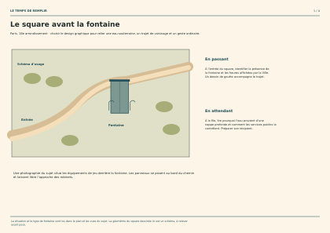
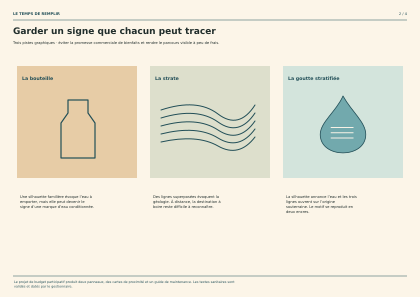
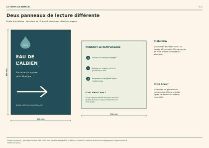
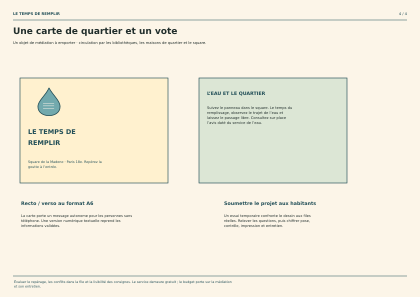

# ENS Paris-Saclay — Projet de design 2020 · Corrigé brut

*Corrigé rédigé par IA, non officiel.*

**Rédaction** · GPT-6.2 Astra Ultra · vitesse non renseignée

Le temps de remplir valorise la fontaine à l’Albien du square de la Madone par le design graphique. Deux panneaux et une carte de quartier relient l’origine de l’eau, le droit d’accès et les gestes quotidiens. Les 4 planches numérotées et anonymes sont au format 420 × 297 mm. Les échelles indiquées valent pour une planche seule imprimée sur A3 à 100 %.

## Planche 1 — Le square avant la fontaine

La mairie du 18e arrondissement lance, dans l’hypothèse de l’épreuve, un appel à projets pour un budget participatif. La proposition choisit le graphisme et la médiation de proximité. Un usager régulier connaît l’emplacement mais veut accéder facilement au point d’eau. Un visiteur venu jouer avec un enfant peut passer à côté de cette ressource sans la voir. Les photographies montrent le petit édicule vert et les jeux en arrière-plan. Une signalétique posée hors du passage apporte l’information pendant le trajet et l’attente. Le projet conserve l’accès libre durant les heures du square et ne réclame aucune inscription.

## Planche 2 — Garder un signe que chacun peut tracer

La bouteille est une image de consommation immédiate, mais assimilerait la fontaine à un distributeur commercial. La coupe de terrain rend le bassin parisien intelligible tout en restant trop abstraite comme repère. La goutte contenant trois strates constitue le signe retenu. Les bandes ne prétendent pas reproduire une coupe géologique à l’échelle. La même forme se lit sur le panneau d’entrée, le cartel de la fontaine et la carte à emporter. Le nom « Eau de l’Albien » arrive avant tout commentaire. Le programme ne promet aucun traitement médical. Les informations sanitaires relèvent de l’exploitant, et chaque panneau technique prévoit un emplacement daté pour les actualiser.

## Planche 3 — Deux panneaux de lecture différente

Au portail, le grand panneau indique la fontaine et la direction réellement observable depuis cette entrée. Près de l’attente, un second panneau rappelle les gestes d’usage et l’origine de la ressource. Le support est mat, à hauteur de lecture debout ou assise, hors de la trajectoire du remplissage. Une version en caractères agrandis peut être disponible auprès du gardien ou des services municipaux. L’eau du puits du square provient de l’Albien, le sujet indique une déferrisation avant distribution. Il mentionne une conservation courte et des précautions liées à la composition de cette eau. La fiche sanitaire datée du gestionnaire doit indiquer les conseils applicables au moment de la visite. La proposition graphique ne fixe pas d’horaires actuels ni de composant chiffré sans mesure récente.

## Planche 4 — Une carte de quartier et un vote

Une carte A6 de 148 × 105 mm circule dans les équipements de quartier. Elle mène au square sans transformer la fontaine en produit à vendre. Une version en texte accompagne les annonces sur les sites locaux et peut être lue à voix haute. Le dossier soumis au vote distingue les postes de relevé, conception, consultation des services, fabrication des deux supports, pose, premier tirage et entretien. Le coût définitif dépend des devis et des accords municipaux. Pendant un essai de quelques semaines avec panneaux temporaires, observer le nombre de personnes qui trouvent l’équipement, la compréhension des informations et les conflits d’attente. Les habitués et les visiteurs occasionnels peuvent rendre un avis sur papier. Le service décide ensuite de la pose et des modalités de mise à jour.

[Énoncé et annexes du concours](https://ens-paris-saclay.fr/sites/default/files/CONCOURS/ANNALES_1C/1C_Design/2020/2020_Sujet_1A_Design_Epreuve_Pratique.pdf)
