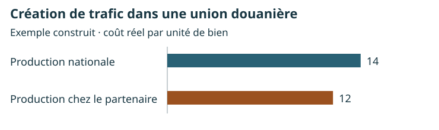

# ENS Paris-Saclay · Dominante économique 2020 — corrigé brut

*Corrigé rédigé par IA, non officiel. Signalez toute erreur.*

**Rédaction** · GPT-6.2 Astra Ultra · vitesse non renseignée · 26 novembre 2026

## Sujet

Dans quelle mesure la construction européenne a-t-elle bénéficié aux pays européens au vingtième siècle ?

### Une intégration construite après la division du continent

En 1919, les nouvelles frontières européennes fragmentent des systèmes productifs jusqu’alors intégrés. Les replis commerciaux des années 1930 révèlent ensuite le coût de décisions nationales qui se répondent. Après 1945, plusieurs États choisissent d’exercer ensemble une partie de leurs compétences. Le bénéfice de ce choix se mesure aux ressources économisées, aux capacités de croissance et à la stabilité procurée. Ces gains dépendent du pays, du groupe social et de la profondeur des engagements souscrits.

### Un marché agrandi et des producteurs disciplinés par la concurrence

La CECA met en commun le charbon et l’acier. Le traité de Rome de 1957 engage les Six dans une union douanière, achevée pour les droits internes industriels en 1968. Les industriels peuvent amortir un investissement sur de plus longues séries. L’arrivée d’un producteur européen plus efficace accroît le pouvoir d’achat des ménages et oblige les entreprises établies à améliorer leur productivité. L’Acte unique, signé en 1986, prolonge ce travail en s’attaquant aux obstacles réglementaires. La prévisibilité des règles communes peut rendre possible un investissement qu’aurait découragé le risque de restrictions unilatérales.

Jacob Viner distingue pourtant création et détournement de trafic. Si une unité produite pour 14 sur place est remplacée par une unité fabriquée pour 12 chez un partenaire, 2 de ressources sont économisées. Si un fournisseur extérieur aurait produit pour 10 et se trouve évincé par la préférence communautaire, le coût réel augmente. Les échanges intracommunautaires peuvent donc progresser dans les deux cas. Il faut connaître le fournisseur remplacé pour interpréter cette progression.

### Les gains ont une géographie et des contreparties

Des exploitants bénéficient de prix agricoles soutenus et de nouveaux débouchés grâce à la PAC organisée à partir de 1962. Les consommateurs paient certains produits plus cher et les contribuables financent le soutien. L’entrée de l’Espagne et du Portugal en 1986 élargit les marchés, attire des investissements et rend accessibles des fonds de modernisation. Cependant les nouveaux investissements se concentrent volontiers dans les régions déjà bien reliées. Les fonds structurels, renforcés à la fin des années 1980, traduisent la nécessité d’investir dans les liaisons et les qualifications pour diffuser les gains.

Les membres peuvent aussi protéger leur capacité de négociation extérieure grâce à un marché commun plus vaste. Les partenaires non membres profitent de débouchés nouveaux tout en subissant parfois le tarif extérieur ou en adoptant des normes qu’ils contribuent peu à définir. L’ensemble des États européens ne se confond donc à aucun moment avec la Communauté. Dans l’Europe divisée par la guerre froide, des économies d’Europe centrale et orientale participent à un autre espace organisé autour de l’URSS. La plupart de leurs adhésions à l’Union interviendront après la borne du sujet.

### Le degré d’engagement modifie le partage des risques

Avec le Système monétaire européen en 1979 puis l’euro scriptural en 1999 pour onze États, réduire l’incertitude de change facilite contrats et comparaisons de prix. Mais une économie frappée par un choc particulier dispose de moins de latitude pour ajuster le change ou les taux d’intérêt. La crise du mécanisme de change en 1992 illustre ce conflit avant même la monnaie unique. Mobilité du travail, budget public et mécanismes de solidarité deviennent déterminants pour absorber l’ajustement.

Au terme du siècle, la construction a procuré à ses membres un marché, des règles durables et des moyens d’investissement communs. L’ampleur de la croissance d’après-guerre doit aussi à la reconstruction, au progrès technique et à l’ouverture multilatérale. Le bénéfice proprement européen est le plus convaincant là où l’on peut identifier l’obstacle supprimé, les personnes qui supportent l’ajustement et la capacité commune qui les aide à le franchir.

## Sources et périmètre

La page 2 du cahier pose la dissertation sans tableaux ni annexes économiques. Le cas hôtelier des pages suivantes correspond à la dominante gestion. Aucun rapport de jury de cette dominante n’a été identifié dans les pièces consultées pour 2020. Les coûts du schéma sont des hypothèses pédagogiques.

[Cahier officiel, page 2](https://ens-paris-saclay.fr/sites/default/files/CONCOURS/ANNALES_1C/1C_D2_1/2020/2020_Sujet_1A_D2-1_Options.pdf#page=2) · [Index des annales](https://ens-paris-saclay.fr/admission/concours/concours-pre-master/annales-concours-pre-master?field_orientation_1c_target_id%5B%5D=289&field_year_target_id%5B%5D=541)
