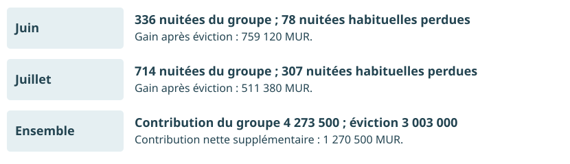

# ENS Paris-Saclay · Épreuve à option — dominante gestion 2020 — corrigé brut

*Corrigé rédigé par IA, non officiel. Signalez toute erreur.*

**Rédaction** · GPT-6.2 Astra Ultra · vitesse non renseignée · 26 novembre 2026

## Étude de cas

L’étude concerne un hôtel de 150 chambres et bungalows à Maurice. Les montants sont exprimés en roupies mauriciennes (MUR), les marges et les flux hors TVA sauf demande de prix TTC. Les coûts de petit-déjeuner des annexes 2 et 3 concernent des dossiers indépendants.

## Résolution des dossiers

### Partie 1 — Positionnement de l’hôtel

**1. Offre et clientèle.** Proposer un séjour haut de gamme à la clientèle qui recherche calme, service personnalisé et découverte de Maurice. L’hôtel dispose déjà d’une plage, d’un jardin et de services de bien-être. Organiser de petits groupes avec guides naturalistes, artisans et producteurs, rendre l’origine des produits visible et préserver l’accès des habitants au littoral. Un engagement mesuré sur l’eau, les déchets et les usages de la plage crédibilise la promesse. Ce positionnement donne une raison de choisir Flic-En-Flac au-delà du prix du forfait tout compris.

**2. Stratégie générique.** Il s’agit d’une différenciation focalisée au sens de Porter : le segment visé valorise l’expérience locale, l’attention du personnel et la faible pression environnementale, et peut accepter une prime de prix pour ces attributs. En mesurer le consentement à payer et le coût additionnel. Une augmentation du prix sans amélioration observable fragiliserait la réputation de l’établissement.

**3. Facteurs clés de succès.** Un facteur clé de succès est une condition de compétitivité particulièrement importante sur un marché. Pour le haut de gamme mauricien : continuité de la qualité de service, qualité sanitaire et confort, environnement littoral effectivement préservé, accès fiable et partenaires locaux capables d’assurer une expérience différenciée. La réservation et les avis doivent rendre ces caractéristiques visibles à des voyageurs comparant Maurice aux Seychelles ou aux Maldives.

**4. Six indicateurs non financiers.**

| Indicateur | Utilité pour une décision |
|---|---|
| Part de clients qui reviennent dans les deux ans | Vérifier la fidélisation au positionnement |
| Part des réclamations résolues avant le départ | Repérer les défaillances de service pendant le séjour |
| Participants aux visites avec partenaires locaux par 100 clients | Mesurer l’usage réel de l’offre culturelle |
| Litres d’eau consommés par nuitée occupée | Suivre l’empreinte du confort et cibler les fuites |
| Kilogrammes de déchets résiduels par nuitée | Adapter buffet, achats et tri |
| Taux d’occupation par segment et saison | Ajuster offres et effectifs sur les creux et les pointes |

### Partie 2 — Activité petit-déjeuner, premier trimestre N−2

**1. Compte différentiel.** En 90 jours, $q=150\times90\times0{,}92\times1{,}9=23\,598$ repas. Le tarif HT est $575/1{,}15=500$. Les achats coûtent 2 397 600, soit 101,60183 par repas. Le service mobilise chaque jour cinq heures, préparation et nettoyage inclus : $(5\times100+10\times80)\times5\times90\times1{,}10=643\,500$ de personnel chargé. Ces salaires sont fixes dans la plage étudiée.

| Poste trimestriel | MUR |
|---|---:|
| Ventes de repas | 11 799 000 |
| Achats variables | −2 397 600 |
| Marge variable sur repas | 9 401 400 |
| Produit fixe du partenariat | +250 000 |
| Personnel et coût de salle | −643 500 − 6 000 000 |
| **Résultat** | **3 007 900** |

**2. Seuil et exposition au risque.** La marge unitaire est $500-101{,}60183=398{,}39817$. Le montant fixe à couvrir par les repas est $6\,643\,500-250\,000=6\,393\,500$. Seuil théorique **16 048,02 repas**, soit **16 049 repas entiers**, **62,57 % d’occupation** et **8 024 008 MUR** de ventes de repas (ou 8 274 008 avec le contrat fixe). Les ventes dépassent le seuil de **3 774 992 MUR**, soit 7 549,98 repas. L’indice de sécurité rapporté aux ventes de repas vaut **31,99 %** (31,33 % avec la recette contractuelle incluse dans le dénominateur). Le levier de résultat par rapport au volume de repas vaut $9\,401\,400/3\,007\,900=3{,}126$. Une baisse de fréquentation de 1 % réduit le résultat d’environ 3,13 % sur cette plage. Suivre la saison, les pertes du buffet et le renouvellement du contrat à six ans ; le coût imputé de la salle n’est pas entièrement évitable à court terme.

**3. Hausse de 10 %.** À coûts fixes constants, le gain théorique est $0{,}10\times9\,401\,400=940\,140$, nouveau résultat **3 948 040**. Avec participation de 100 % et 1,9 voyageur par chambre constants, il faudrait 101,2 % d’occupation. La hausse suppose donc plus de voyageurs par chambre, une clientèle externe ou une modification de capacité, à chiffrer.

**4. Prix pour un résultat de 30 % du CA HT.** Soit $p$ le prix HT du repas. En incluant dans le CA la prestation fixe vendue aux producteurs, $(pq+250\,000)-(2\,397\,600+6\,643\,500)=0{,}30(pq+250\,000)$. Le prix TTC est 617,2445 MUR ; pour atteindre au moins l’objectif au centime, facturer **617,25 MUR TTC**. Si le ratio commercial porte uniquement sur les ventes de repas, le partenariat demeure un produit fixe hors dénominateur et l’équation devient $pq+250\,000-9\,041\,100=0{,}30pq$, soit **612,03 MUR TTC** au centime supérieur.

**5. Limites.** Le coût des ingrédients varie avec le gaspillage et la taille minimale du buffet. Les équipes peuvent devoir monter par palier au-delà d’un certain nombre de couverts entre 7 h et 10 h. La composition des clientèles et les contrats de prix changent selon la saison. Augmenter le prix d’une composante du séjour peut enfin affecter la réservation de la chambre elle-même.

### Partie 3 — Demande de l’équipe des Seychelles

**1. Les quatre calculs.** Il faut $42(8+17)=1\,050$ chambres-nuitées. (1) Recettes directes $1\,050\times4\,000=4\,200\,000$. (2) Petit-déjeuner gratuit pour 80 % et blanchisserie pour tous : $1\,050(0{,}8\times100+50)=136\,500$. (3) Marge sur dépenses annexes $1\,050\times200=210\,000$. Contribution directe **4 273 500** avant éviction. (4) Pour chaque jour, compter $\max(0,D-108)$ chambres traditionnelles refusées. Chaque chambre évincée coûtait peu à servir mais rapportait $5\,000+2(500-100)+2\times1\,000=7\,800$ de marge.

| Période | Nuitées habituelles évincées, dans l’ordre de l’annexe 3 | Manque à gagner | Gain net du groupe |
|---|---|---:|---:|
| Juin | 12, 17, 15, 9, 0, 14, 11, 0 = 78 | 608 400 | 759 120 |
| Juillet | 27, 42, 42, 35, 32, 17, 19, 12, 10, 10, 9, 8, 2, 4, 12, 14, 12 = 307 | 2 394 600 | 511 380 |
| **Total** | **385** | **3 003 000** | **1 270 500** |

Les deux séjours ont une contribution positive sous les hypothèses retenues. Le même lot devient déficitaire à partir de 548 nuitées habituelles évincées, car $4\,273\,500/7\,800=547{,}88$.

**2. Hypothèse d’éviction.** Les Jeux peuvent modifier la demande de voyageurs ordinaires dans les deux sens, entre effet d’événement et évitement des foules. Une vente historique de 150 chambres peut masquer des demandes refusées. Étudier le carnet de réservations, le rythme de prise des commandes, les jours déjà complets, les annulations et les hébergements concurrents. Chiffrer ensuite un scénario haut et bas plutôt qu’appliquer automatiquement un taux mensuel moyen.

**3. Gestion des prix.** Les chambres sont périssables chaque nuit, fixes à court terme, vendues à l’avance et demandées par des segments différents : les conditions de gestion du revenu sont réunies. Protéger un contingent à plein tarif aux dates de pointe et fermer les offres promotionnelles au rythme des réservations. Une majoration uniforme des chambres restantes peut faire fuir les habitués sur des dates où il subsiste de la capacité. Mesurer la contribution totale du séjour, y compris restauration et extras, et communiquer clairement les conditions tarifaires.

**4. Segmentation.** Loisirs, affaires et groupes sportifs peuvent remplir des périodes différentes, stabiliser l’emploi et réduire la dépendance à une seule clientèle. Ils demandent cependant des horaires, des prix et des prestations spécifiques ; une mauvaise programmation peut évincer les clients les plus fidèles, saturer les services ou dégrader la tranquillité recherchée par les autres hôtes.

**5. Dimensions qualitatives.** Examiner la capacité de blanchisserie, les heures de repas et contraintes nutritionnelles, les transferts vers les installations sportives, le repos du groupe et des autres voyageurs, les conditions d’annulation et la réputation de l’hôtel pendant l’événement. Une visibilité régionale peut ouvrir des contacts futurs, mais sa valeur doit être distinguée des recettes déjà garanties.

### Partie 4 — Projet des huit bungalows

**1. Sortie.** Au 1er janvier N−1 les dix anciens bungalows valent 12 000 000 en brut, dont $12\,000\,000\times10/15=8\,000\,000$ amortis. Pour la démolition sans produit de cession : D 2813 amortissements des constructions 8 000 000, D 675 valeur comptable des actifs sortis 4 000 000, C 213 constructions 12 000 000 (nomenclature applicable au sujet). La perte comptable n’est pas un décaissement.

**2. Actif et coût d’entrée.** Un actif est une ressource identifiable contrôlée du fait d’un événement passé et porteuse d’avantages économiques futurs. Le coût d’acquisition comprend le prix hors taxes récupérables, net de rabais, et les coûts directement attribuables à la mise en place et en état de fonctionner. Pour un bien construit, les coûts de production directement attribuables sont accumulés jusqu’à la disponibilité du bien.

**3. Démolition.** Retenons l’hypothèse d’un chantier unique : enlever les bungalows est indispensable pour construire les nouveaux sur leur emplacement, le décaissement immédiat de préparation de 2 000 000 entre donc dans le coût du nouvel ensemble. Ce n’est pas une obligation future de remise en état ; la VNC des anciens actifs sort séparément. Si la démolition est analysée comme une opération autonome de mise au rebut de bâtiments utilisés depuis dix ans, son coût peut être traité en charge de l’année N−1. Dans les deux lectures, **les 2 000 000 de trésorerie sortent bien en N−1** ; le calendrier des économies d’IS change. Les deux résultats sont donnés ci-dessous.

**4. Flux différentiel au 31 décembre N−1.** La construction coûte $8\times40\times80\,000=25\,600\,000$. Il faut aussi mesurer la contribution abandonnée des anciens bungalows pendant le chantier, par comparaison avec leur maintien. Sans projet, les 2 880 nuitées annuelles rapportent 10 944 000 ; leur coût variable est 2 188 800 et les à-côtés rapportent $2\,880\times1{,}8\times1\,000=5\,184\,000$ de marge. Après 600 000 de maintenance, l’excédent est **13 339 200**. Avec amortissement de 800 000 et IS de 18 %, le flux après IS est $13\,339\,200-0{,}18(13\,339\,200-800\,000)=11\,082\,144$.

Dans l’hypothèse d’une économie d’impôt immédiatement utilisable sur la VNC de 4 000 000, la sortie procure un effet fiscal de +720 000. Le projet engendre en N−1 le flux différentiel **$-25\,600\,000-2\,000\,000+720\,000-11\,082\,144=-37\,962\,144$ MUR**. Si la démolition est passée en charge immédiatement déductible, ajouter 360 000 d’économie d’IS, soit **−37 602 144**.

**5. Flux différentiel au 31 décembre N.** Avec $8\times360\times85\%=2\,448$ nuitées, le nouveau CA est **19 584 000** ; coûts variables 2 937 600 ; marge annexe $2\,448\times2{,}5\times1\,800=11\,016\,000$ et maintenance 320 000. Excédent de trésorerie avant IS **27 342 400**. Coût immobilisé 27 600 000, amortissement annuel 1 840 000 ; IS $0{,}18(27\,342\,400-1\,840\,000)=4\,590\,432$. Le nouveau flux vaut **22 751 968**. Retrancher les 11 082 144 que rapporteraient les anciens : **+11 669 824 MUR**. Si la démolition est passée en charge en N−1, l’amortissement annuel est de 1 706 666,67 ; le flux différentiel de N devient **+11 645 824**. Le BFR est ignoré conformément à l’annexe.

**6. VAN.** Ramener tous les flux futurs supplémentaires après impôt à la même date en les actualisant à un taux compatible avec leur risque et leur expression en monnaie constante, puis déduire les dépenses initiales. Une VAN positive signifie que le projet procure davantage que la rémunération demandée par les financeurs. Pour étendre le calcul sur quinze ans, il faut définir le scénario de remplacement ou de maintien des anciens bungalows après leur durée restante.

**7. Sensibilité.** Faire varier une hypothèse à la fois, puis construire des scénarios cohérents. Le prix de 8 000, l’occupation de 85 %, les 2,5 occupants et leur marge annexe conditionnent l’avantage des huit grandes unités sur les dix anciennes. Tester aussi les coûts de construction, un retard de mise en service et l’économie fiscale effective ; déterminer le prix ou l’occupation qui annule la VAN.

## Repère

## Sources

Épreuve à options, session 2020, banque ENS Paris-Saclay–ENSAI D2. Le prix public, les comportements de séjour, les données de fréquentation et les hypothèses du chantier proviennent des annexes du sujet.

[Sujet de la dominante, p. 3](https://ens-paris-saclay.fr/sites/default/files/CONCOURS/ANNALES_1C/1C_D2_1/2020/2020_Sujet_1A_D2-1_Options.pdf#page=3) · [Annales institutionnelles](https://ens-paris-saclay.fr/admission/concours/concours-pre-master/annales-concours-pre-master?field_orientation_1c_target_id%5B%5D=289&field_year_target_id%5B%5D=541)
