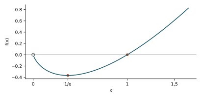

# ENS Paris-Saclay – ENSAI D2 · Mathématiques et statistiques 2020 · Corrigé guidé

*Corrigé rédigé par IA, non officiel. Signalez toute erreur.*

**Rédaction** · GPT-6.2 Astra Ultra · vitesse non renseignée

**Révision (tour 1)** · GPT-6.2 Astra Ultra · vitesse non renseignée

La composition de quatre heures associe une minimisation sous contrainte, la classification des endomorphismes nilpotents de dimension trois et une comparaison d’estimateurs pour la loi de Poisson. Les trois bonus sont traités. [Sujet officiel](https://ens-paris-saclay.fr/sites/default/files/CONCOURS/ANNALES_1C/1C_D2_1/2020/2020_Sujet_1A_D2-1_Maths.pdf) · [Rapport du jury](https://ens-paris-saclay.fr/sites/default/files/CONCOURS/ANNALES_1C/1C_D2_1/2020/2020_RAPPORT_ECRIT_D2_Maths.pdf)

## Problème 1. Minimisation avec un terme entropique

### Question 1.I.1

> [!INDICATION]
> Dériver deux fois et contrôler le signe sur le domaine.

#### Solution

Pour $x>0$, $h'(x)=\log x$ et $h''(x)=1/x$. Ainsi $f(x)=ax+\varepsilon(x\log x-x)$ a pour dérivées $f'(x)=a+\varepsilon\log x$ et $f''(x)=\varepsilon/x>0$. Le domaine $]0,\infty[$ étant un intervalle, $f$ y est strictement convexe.

### Question 1.I.2

> [!INDICATION]
> Résoudre f′(x) = 0 et préciser les deux limites.

#### Solution

Posons $x_0=e^{-a/\varepsilon}$. La dérivée croissante s’annule en $x_0$, est négative avant et positive après. Comme $x\log x\to0$ en zéro, $f(0^+)=0$. À l’infini $f(x)/x=a-\varepsilon+\varepsilon\log x\to+\infty$, donc $f(x)\to+\infty$.

| Intervalle | Signe de la dérivée | Variation de la fonction |
|---|---|---|
| De $0$ à $x_0$ | Négatif | De $0$ vers $-\varepsilon x_0$ en décroissant |
| En $x_0$ | Nul | Minimum $-\varepsilon x_0$ |
| De $x_0$ à l’infini | Positif | De $-\varepsilon x_0$ vers $+\infty$ en croissant |

### Question 1.I.3

> [!INDICATION]
> Identifier le minimum et la seconde intersection avec le niveau zéro.

#### Solution

Le graphe est strictement convexe, avec une pente tendant vers $-\infty$ près de zéro et une tangente horizontale en $x_0$. Sa limite à gauche est l’origine, exclue du domaine. On a $f(x)=x(a-\varepsilon+\varepsilon\log x)$, donc son unique zéro sur le domaine est $e^{1-a/\varepsilon}=e x_0$. Pour des paramètres généraux, le changement $x=x_0u$ écrit $f(x)=\varepsilon x_0(u\log u-u)$, ce qui détermine l’allure pour tous $a,\varepsilon>0$.

### Question 1.I.4

> [!INDICATION]
> Évaluer f au point où elle change de sens de variation.

#### Solution

Puisque $\log x_0=-a/\varepsilon$, $f(x_0)=-\varepsilon e^{-a/\varepsilon}$. Le tableau montre que toute autre valeur est strictement plus grande, tant à gauche qu’à droite. Le minimum global existe donc et il est atteint uniquement en $x_0$.

### Question 1.II.1

> [!INDICATION]
> Étudier la forme quadratique hessienne puis séparer les deux variables.

#### Solution

La hessienne de $J$ vaut $\operatorname{diag}(\varepsilon/x,\varepsilon/y)$. Ses deux valeurs propres sont strictement positives dans le quadrant convexe, donc $J$ y est strictement convexe. Il s’agit de la somme de deux fonctions à variables séparées. Par I.4, l’unique minimiseur est $x=e^{-a/\varepsilon},\ y=e^{-b/\varepsilon}$ et la valeur minimale est $-\varepsilon(e^{-a/\varepsilon}+e^{-b/\varepsilon})$.

### Question 1.II.2a

> [!INDICATION]
> Dériver le lagrangien en ses trois arguments.

#### Solution

Pour $L=J-\lambda(x+y-1)$, les équations sont
$$a+\varepsilon\log x-\lambda=0,\quad b+\varepsilon\log y-\lambda=0,\quad x+y=1.$$
La dernière est $\partial_\lambda L=0$.

### Question 1.II.2b

> [!INDICATION]
> Exploiter la régularité de la contrainte avant d’isoler les exponentielles.

#### Solution

Le gradient de la contrainte est $(1,1)\ne0$. Tout minimum situé dans le domaine ouvert vérifie donc les conditions de Lagrange avec un réel $\lambda$. Des deux premières équations on tire $x^*_\varepsilon=e^{(\lambda-a)/\varepsilon}$ et $y^*_\varepsilon=e^{(\lambda-b)/\varepsilon}$.

### Question 1.II.2c

> [!INDICATION]
> Factoriser l’exponentielle commune dans la somme imposée.

#### Solution

Notons $Z=e^{-a/\varepsilon}+e^{-b/\varepsilon}>0$. La contrainte donne $e^{\lambda/\varepsilon}Z=1$, donc $\lambda=-\varepsilon\log Z$. Ainsi
$$(x^*_\varepsilon,y^*_\varepsilon)=\left(\frac{e^{-a/\varepsilon}}Z,\frac{e^{-b/\varepsilon}}Z\right).$$
Les deux coordonnées sont strictement positives et leur somme est un.

### Question 1.II.2d

> [!INDICATION]
> Vérifier la suffisance des conditions sur la droite admissible.

#### Solution

Sur $0<x<1$, la restriction $G(x)=J(x,1-x)$ vérifie $G''(x)=\varepsilon(1/x+1/(1-x))>0$. Au point calculé, les deux composantes de $\nabla J$ valent $\lambda$, donc $G'=0$. Cette annulation sur une fonction strictement convexe assure l’existence et l’unicité du minimum contraint. Sa valeur est $\lambda-\varepsilon=-\varepsilon(1+\log Z)$, en utilisant $x+y=1$ dans $J$.

### Question 1.II.2e

> [!INDICATION]
> Comparer les deux poids après division par le plus grand.

#### Solution

Si $a<b$, le rapport $e^{-b/\varepsilon}/e^{-a/\varepsilon}=e^{-(b-a)/\varepsilon}$ tend vers zéro et $(x^*_\varepsilon,y^*_\varepsilon)\to(1,0)$. Si $b<a$, la limite est $(0,1)$. Si $a=b$, les deux poids sont identiques pour tout $\varepsilon$, donc la limite est $(1/2,1/2)$. Les deux premières limites sont des points du bord du domaine. Lorsque $a=b$, le coût linéaire $ax+by$ vaut $a$ sur toute la contrainte : c’est le terme strictement convexe $\varepsilon(h(x)+h(y))$ qui sélectionne le milieu pour tout $\varepsilon>0$.

## Problème 2. Endomorphismes nilpotents en dimension trois

### Question 2.1

> [!INDICATION]
> Suivre l’action de chaque matrice sur les vecteurs de la base canonique.

#### Solution

La matrice $N_1$ envoie $e_3$ sur $e_1$ et annule $e_1,e_2$, donc $N_1\ne0$ mais $N_1^2=0$. Son indice est deux. La matrice $N_2$ envoie successivement $e_3$ sur $e_2$, puis sur $e_1$, puis sur zéro. On a $N_2^2=N_1\ne0$ et $N_2^3=0$. Son indice est trois.

### Question 2.2a

> [!INDICATION]
> Utiliser la minimalité de l’indice.

#### Solution

Par définition de $p^*$, l’endomorphisme $f^{p^*-1}$ n’est pas nul. Il existe donc $x_0$ dont l’image par cette puissance est non nulle.

### Question 2.2b

> [!INDICATION]
> Dans une relation non triviale, isoler le coefficient du plus petit exposant.

#### Solution

Supposons $\sum_{j=0}^{p^*-1}c_j f^j(x_0)=0$ et choisissons le plus petit indice $k$ avec $c_k\ne0$ s’il existe. Appliquons $f^{p^*-1-k}$ à la relation. Les termes d’indice supérieur à $k$ sont annulés par nilpotence et les précédents ont coefficient nul. Il reste $c_k f^{p^*-1}(x_0)=0$, contradiction. Tous les coefficients sont donc nuls, ce qui prouve la liberté.

### Question 2.2c

> [!INDICATION]
> Compter les vecteurs de la chaîne indépendante.

#### Solution

La famille de 2b compte $p^*$ vecteurs libres de $\mathbb R^3$. Ainsi $p^*\le3$. Comme $f\ne0$, il vaut soit deux soit trois.

### Question 2.3a

> [!INDICATION]
> Appliquer f à un vecteur déjà dans son image.

#### Solution

Sous l’hypothèse $p^*=2$, $f^2=0$. Pour chaque $v=f(w)$ de l’image, $f(v)=f^2(w)=0$. Donc $\operatorname{Im}f\subset\ker f$.

### Question 2.3b

> [!INDICATION]
> Comparer les dimensions en utilisant le théorème du rang.

#### Solution

Si $\dim\ker f=1$, $\dim\operatorname{Im}f=3-1=2$. Un sous-espace de dimension deux ne peut être inclus dans un espace de dimension un. Par 3a, l’indice deux est donc impossible et $p^*=3$.

### Question 2.4

> [!INDICATION]
> Écrire les trois images dans la base de la chaîne.

#### Solution

Par 2b et 3b, $(x_0,f(x_0),f^2(x_0))$ est une base. Chacun des deux premiers vecteurs est envoyé sur le suivant, et le dernier sur zéro. La matrice, en lisant les images en colonnes, vaut
$$\begin{pmatrix}0&0&0\\1&0&0\\0&1&0\end{pmatrix}.$$

### Question 2.5

> [!INDICATION]
> Renverser l’ordre des vecteurs de cette base.

#### Solution

Dans $(f^2(x_0),f(x_0),x_0)$, le premier vecteur est annulé, le deuxième envoyé sur le premier et le troisième sur le deuxième. La matrice est exactement $N_2$.

### Question 2.6

> [!INDICATION]
> Choisir le premier vecteur dans l’image et compléter la base du noyau.

#### Solution

Si $\dim\ker f=2$, l’image est une droite $L$. Elle est stable par $f$ et la restriction à cette droite est nilpotente, donc nulle. Ainsi $L\subset\ker f$. Choisissons $w$ avec $u=f(w)\ne0$, puis $v$ tel que $(u,v)$ soit une base du noyau. Le vecteur $w$ n’appartient pas au noyau. Dans la base $(u,v,w)$, les deux premières images sont nulles et la troisième est $u$. La matrice est $N_1$.

## Problème 3. Loi de Poisson et comparaison de deux estimateurs

### Question 3.1a

> [!INDICATION]
> Utiliser la disjonction des cas et l’indépendance des deux tirages.

#### Solution

Pour $m\ge0$, les événements $(X_1=k,X_2=m-k)$ sont deux à deux disjoints pour $0\le k\le m$. Leur réunion donne l’événement cherché. Par indépendance,
$$\mathbb P(X_1+X_2=m)=e^{-2\lambda}\sum_{k=0}^m\frac{\lambda^k\lambda^{m-k}}{k!(m-k)!}
=e^{-2\lambda}\frac{\lambda^m}{m!}\sum_{k=0}^m\binom mk
=e^{-2\lambda}\frac{(2\lambda)^m}{m!}.$$

### Question 3.1b

> [!INDICATION]
> Identifier la loi par ses masses sur tous les entiers.

#### Solution

La somme prend ses valeurs dans $\mathbb N$ et les masses calculées correspondent à la loi de Poisson de paramètre $2\lambda$. Elles caractérisent sa loi.

### Question 3.1c

> [!INDICATION]
> Adapter le calcul du binôme à deux paramètres éventuellement différents.

#### Solution

Pour deux variables indépendantes de paramètres $a,b>0$, le calcul de 1a donne $e^{-(a+b)}\sum_k\binom mk a^k b^{m-k}/m!=e^{-(a+b)}(a+b)^m/m!$. Au rang un, $S_1=X_1$ a paramètre $\lambda$. Si $S_j$ a paramètre $j\lambda$, il est indépendant de $X_{j+1}$ puisque les variables initiales sont indépendantes. Le calcul précédent donne le paramètre $(j+1)\lambda$, ce qui établit $S_n\sim\mathcal P(n\lambda)$.

### Question 3.2

> [!INDICATION]
> Prendre l’espérance de la moyenne observable.

#### Solution

La moyenne $\overline X_n=S_n/n$ ne dépend que des observations et de $n$. Par linéarité et l’espérance $\lambda$ de chaque $X_i$, $\mathbb E_\lambda\overline X_n=\lambda$. C’est donc un estimateur sans biais.

### Question 3.3a

> [!INDICATION]
> Identifier les indicatrices et justifier leur indépendance.

#### Solution

Chaque $Y_i=\mathbf1_{X_i=0}$ suit une loi de Bernoulli de paramètre $p=\mathbb P(X_i=0)=e^{-\lambda}$. Les $Y_i$ sont indépendantes, étant fonctions séparées des $X_i$ indépendantes. Leur somme $N$ suit donc la loi binomiale de paramètres $n,p$.

### Question 3.3b

> [!INDICATION]
> Utiliser l’espérance binomiale.

#### Solution

L’estimateur observable $N/n$ est la proportion de zéros parmi les $n$ observations. Par 3a, $\mathbb E[N/n]=np/n=e^{-\lambda}$.

### Question 3.3c

> [!INDICATION]
> Identifier la loi de la somme des autres observations.

#### Solution

Pour $n\ge2$, $S_n-X_1$ suit la loi de Poisson de paramètre $(n-1)\lambda$ et est indépendant de $X_1$. Comme $\mathbb P(S_n=j)>0$ pour tout $j$, on obtient
$$\varphi(j)=\frac{\mathbb P(X_1=0)\mathbb P(S_n-X_1=j)}{\mathbb P(S_n=j)}
=\left(\frac{n-1}{n}\right)^j.$$
Si $n=1$, $S_1=X_1$ donc $\varphi(0)=1$ et $\varphi(j)=0$ pour $j>0$, ce qui correspond à la même formule avec $0^0=1$.

### Question 3.3d

> [!INDICATION]
> Calculer l’espérance sur la loi de la somme.

#### Solution

Le calcul de 3c donne un estimateur $\varphi(S_n)$ dont l’expression ne contient pas $\lambda$. Pour $q=1-1/n$, la loi de $S_n$ donne $\mathbb E[q^{S_n}]=e^{-n\lambda}\sum_{j\ge0}(qn\lambda)^j/j!=e^{n\lambda(q-1)}=e^{-\lambda}$. L’estimateur est donc sans biais.

### Question 3.3e

> [!INDICATION]
> Comparer les seconds moments en appliquant la convexité de l’exponentielle.

#### Solution

Par 3a, $\operatorname{Var}(N/n)=e^{-2\lambda}(e^\lambda-1)/n$. Le calcul de 3d appliqué à $q^2$ donne $\mathbb E[q^{2S_n}]=e^{n\lambda(q^2-1)}=e^{-2\lambda+\lambda/n}$. D’où
$$\operatorname{Var}(\varphi(S_n))=e^{-2\lambda}(e^{\lambda/n}-1).$$
Par convexité de l’exponentielle sur le segment $[0,\lambda]$, $e^{\lambda/n}\le1+(e^\lambda-1)/n$. La variance du second estimateur est donc au plus celle de $N/n$. Pour $n>1$ et $\lambda>0$, la stricte convexité rend l’amélioration stricte. Pour $n=1$, les deux estimateurs sont exactement la même indicatrice. Une vérification structurelle est donnée par l’échangeabilité : pour tout $j$, $\mathbb E[N/n\mid S_n=j]=n^{-1}\sum_i\mathbb P(X_i=0\mid S_n=j)=\varphi(j)$. La formule de variance totale montre également que la différence des variances est $\mathbb E[\operatorname{Var}(N/n\mid S_n)]\ge0$.
