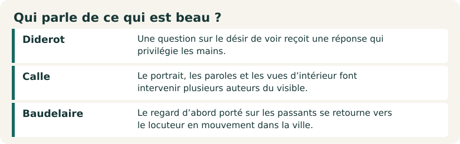

# La cécité · ENS-PSL 2020 — corrigé guidé

*Corrigé rédigé par IA, non officiel. Signalez toute erreur.*

**Rédaction** · GPT-6.2 Astra Ultra · vitesse non renseignée · 26 novembre 2026

Oral exceptionnel de 2020. Le jury prévoit 20 minutes de préparation, puis 10 minutes environ d’exposé et 10 minutes d’échange.

## Préparer la lecture

**Démarrer par la fin de la lettre.** Pourquoi préférer des bras allongés à des yeux ? Reconstituez le présupposé de l’interrogateur. Choisissez ensuite dans le dispositif de Calle et dans le sonnet un endroit où le spectateur ou le locuteur découvre la limite de son propre point de vue.

## Formuler la question

Le philosophe demande à un homme aveugle de naissance s’il aimerait avoir des yeux. La réponse déplace l’expérience de pensée jusque sur la Lune. Pourquoi les yeux de celui qui pose la question devraient-ils décider de la meilleure manière de la connaître ? Dans le sonnet de Baudelaire et dans le dispositif de Sophie Calle, la personne qui regarde est à son tour mise à l’épreuve. Que révèle un discours sur la cécité au sujet des certitudes et des limites de ceux qui voient ?

## Les conventions du beau à l’épreuve du tact

**Identifier la cible de l’ironie.** Après la proposition sur un jugement du beau qui serait appris, Diderot évoque des lecteurs, des spectateurs et des philosophes. Expliquez en quoi ce détour change la portée d’une affirmation qui, isolée, semblerait enfermer l’homme interrogé dans un manque.

Diderot commence par rapporter une capacité. Son interlocuteur peut juger d’une symétrie. L’architecture d’un ensemble de parties est accessible à la main et peut être comparée à d’autres dispositions. La difficulté arrive avec le mot « beau ». Comment savoir si la personne qui emploie ce mot exprime son propre jugement ou reproduit un usage qu’elle a appris ? Tout en posant d’abord la question à propos de son interlocuteur, Diderot la retourne contre les amateurs de théâtre et de livres. La vue et la lecture n’ont jamais garanti l’indépendance du goût. Bien des voyants répètent un jugement appris sans savoir davantage l’expliquer. L’ironie porte aussi sur les philosophes dont les théories étendues brillent moins par leur netteté.

Au terme de l’extrait, l’interlocuteur répond au discours qui le concerne. Des bras très longs lui donneraient, imagine-t-il, une connaissance de la Lune plus instructive que des télescopes. La disproportion comique fait apparaître le caractère conventionnel de l’hypothèse de départ. La curiosité et l’ambition de connaître peuvent se porter sur le perfectionnement d’un sens déjà éprouvé. Rien n’oblige à faire de la restitution d’une capacité supposée désirable le seul objet d’un souhait. Dans une rencontre de soin, la question de ce que quelqu’un veut pouvoir faire mérite donc sa place à côté de celle de la fonction que l’on étudie.

## De la réponse à l’œuvre

**Faire lire les cadres au jury.** Décrivez leur disposition et ce qu’on peut identifier sur les deux photographies d’intérieur. Distinguez la parole recueillie, sa transformation par l’artiste et la découverte du visiteur. Ces trois moments expliquent pourquoi une reconstitution peut respecter une distance.

Calle demande à des personnes aveugles de naissance ce qu’est pour elles l’image de la beauté. Le dispositif reproduit sur la page associe en haut un portrait et un texte, en bas deux vues d’intérieur, où se distinguent un lit d’un côté et un piano de l’autre. La différence des cadres permet au visiteur de passer de la parole à plusieurs vues sans jamais les fondre dans une seule. Le titre *Chez moi* ajoute une première personne à cette organisation. Le lieu a une valeur pour quelqu’un qui l’habite. Son apparence offerte au spectateur ne suffit pas à déterminer en quoi il est beau pour cet habitant.

La photographie propose une reconstitution. Cet écart est ce qu’il faut interpréter. Si le visiteur croit accéder directement à la perception d’autrui par deux vues d’une pièce, il oublie le travail de sélection, de traduction et de cadrage qui revient à l’artiste. S’il ne voit qu’un échec à produire l’image exacte d’une expérience, il oublie ce que le rapprochement des cadres lui permet de découvrir. Une réponse qui n’a pas besoin d’être visuelle pour avoir un sens peut donner lieu à une œuvre destinée à être regardée. Diderot avait interrogé ce que les mots du beau doivent aux conventions. Calle rend sensible la circulation de ces mots entre des personnes qui disposent de moyens différents de connaître leur environnement.

## Quand le regard revient au passant voyant

**Suivre les pronoms et les impératifs.** Qui parle à qui dans « Contemple-les » ? Qui paraît avec « je me traîne aussi » ? À qui s’adresse « Vois » ? Ces déplacements répondent à une question sur le locuteur du poème, sans attribuer aux personnes qu’il croise les croyances qu’il projette sur elles.

Baudelaire commence par un impératif adressé à sa propre âme. L’énonciateur se commande de contempler des passants qui ne lui parlent pas. Les comparaisons avec des mannequins puis des somnambules expriment sa difficulté à lire des gestes qu’il rencontre. Il leur prête même une orientation vers le ciel. Or la fin du sonnet transforme ce qui paraissait d’abord une description. La cité bruyante et avide de plaisirs entre dans la scène. Le « je » finit par avouer sa propre marche pénible. L’adverbe « aussi » le rapproche des autres passants avant que le comparatif ne lui fasse reconnaître un égarement peut-être plus grand.

La dernière interrogation reste en suspens. Elle en dit long sur l’inquiétude spirituelle du locuteur, beaucoup moins sur ce que cherchent réellement les personnes regardées. La majuscule finale du « Ciel » rend perceptible la portée qu’il donne à une orientation des visages. Là où Diderot donne la parole à son interlocuteur et où Calle juxtapose texte et images, le poème fait entendre une voix solitaire entourée de bruit. Sa force est dans l’exposition de cette limite. Ce retournement serait perdu si l’on utilisait les termes hostiles du premier quatrain pour caractériser les personnes aveugles.

## Conclure

Le tact instruit, la parole fait image, la vision peut s’égarer. Les trois œuvres ne rendent pas interchangeables les expériences sensorielles. Elles demandent à celui qui croit détenir d’avance la définition du beau ou d’une vie désirable d’examiner la part de convention et de projection contenue dans son regard. Entendre la réponse faite au philosophe demande finalement autant de travail que regarder l’installation ou lire le dernier tercet.

## Préparer la discussion

**Une objection à préparer.** Diderot parle parfois au nom de son interlocuteur. Le dialogue lui permet-il de corriger ce déséquilibre ? Sa réponse sur les mains déplace fortement la question posée mais reste rapportée et encadrée par le philosophe. L’installation de Calle permet la même distinction entre donner place à une voix et renoncer à tout choix de présentation.

## Sources

Les pages 2 à 4 présentent *Les Aveugles. Chez moi* de Sophie Calle (1986), la *Lettre sur les aveugles à l’usage de ceux qui voient* de Diderot (1749) et le sonnet « Les Aveugles » de Baudelaire (*Tableaux parisiens*).

[Sujet conservé](https://web.archive.org/web/20250805050133id_/https://medecine-humanites.ens.fr/wp-content/uploads/2020/06/3-Dossier-CE%CC%81CITE%CC%81-concours-MH2020.pdf) · [Rapport du jury](https://web.archive.org/web/20250710101648id_/https://medecine-humanites.ens.fr/wp-content/uploads/2020/06/Rapport-jury-Medecine-Humanites-2020-ED-DLB.pdf) · [Annales de l’ENS-PSL](https://medecine-humanites.ens.psl.eu/sujets-et-rapports-du-concours-2018/)
