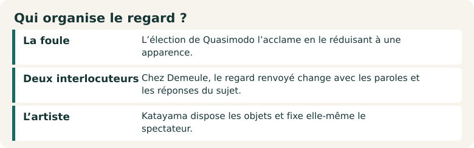

# La difformité physique · ENS-PSL 2020 — corrigé guidé

*Corrigé rédigé par IA, non officiel. Signalez toute erreur.*

**Rédaction** · GPT-6.2 Astra Ultra · vitesse non renseignée · 26 novembre 2026

Oral exceptionnel de 2020. Le jury prévoit 20 minutes de préparation, puis 10 minutes environ d’exposé et 10 minutes d’échange.

## Préparer la lecture

**Comparer deux scènes.** Nommez d’abord qui dispose la scène dans la fête des Fous et dans la photographie. Demandez ensuite qui peut rendre le regard. Ces deux questions suffisent pour introduire le terme « spéculaire » en l’expliquant devant le jury.

## Formuler la question

« La grimace était son visage. » La phrase de Hugo tombe au moment où le concours de grimaces paraît avoir trouvé son vainqueur. Elle fait plus que constater une apparence inhabituelle. Elle révèle l’erreur des spectateurs, qui avaient attribué au visage de Quasimodo une intention comique. Sur la photographie de Mari Katayama, c’est l’artiste elle-même qui a disposé autour de son corps des objets fabriqués et qui regarde vers nous. Entre l’erreur de la foule et l’adresse de l’artiste se dessine une question que reprend la psychologue Caroline Demeule. Qui peut donner forme à ce que les autres voient d’une personne ?

## L’épreuve du spectacle

**Suivre la chronologie de l’élection.** Repérez le moment de l’acclamation et celui de la découverte. Le rire, la consécration, la surprise et la réduction à une apparence peuvent coexister. Prenez une comparaison de Hugo pour montrer comment le lecteur lui-même participe à la fabrication de ce regard.

La fête des Fous possède ses règles propres. Chaque concurrent propose une grimace et le public doit couronner celle qui lui paraît la meilleure. Il y a donc, dans le premier mouvement de la foule, de la satisfaction et une reconnaissance, jusqu’à l’acclamation unanime. C’est ensuite seulement que l’écart entre un masque volontaire et un visage apparaît. Le triomphe peut coexister avec une violence du regard. Il accorde à Quasimodo un rang qui dépend entièrement de ce que les spectateurs trouvent remarquable en lui. La personne n’a pas pris la parole, et le passage de son visage à « toute sa personne » étend l’effet de grimace à sa démarche, à sa force, à ses gestes futurs.

Le narrateur n’observe pas cette réduction de l’extérieur. Il prétend d’abord renoncer à donner une idée du personnage, puis multiplie les comparaisons géométriques, animales et architecturales. Ces morceaux vivement figurés obligent le lecteur à composer lui-même un ensemble qu’on lui dit presque inimaginable. Pourtant un mélange de tristesse, d’étonnement et de malice affleure dans les traits. La vigueur et l’agilité dérangent la règle académique qui fait sortir la force de l’harmonie. La description est ainsi traversée par ce qui résiste à sa propre manie de classer.

## Le visage qu’une rencontre rend possible

**Expliquer une boucle avec des verbes.** Recevoir un regard, changer sa représentation de soi, se présenter autrement, recevoir une autre réponse. Ajoutez ensuite la parole et le nom propre pour montrer pourquoi la relation que décrit Demeule ne peut être ramenée à un simple miroir.

Le texte de Demeule donne un vocabulaire à cet effet du regard. Son modèle est celui d’une boucle. L’expression que rencontre une personne peut modifier l’image qu’elle a d’elle-même, donc sa manière de se présenter, donc ce que son interlocuteur lui renvoie ensuite. Le terme « spéculaire » évoque le miroir, mais un miroir matériel ne fait que réfléchir. La relation clinique dont il est question comprend de la parole et des réponses. Son devenir dépend de deux personnes. L’enjeu est de soutenir une reconnaissance de soi et du nom propre, ce que les applaudissements adressés au seul « pape des fous » ne garantissaient nullement.

Il faut aussi écouter le verbe « créer » dans la citation reprise par la psychologue. Une approche qui n’aurait pour horizon que le retour à une forme antérieure ferait de cette apparence perdue le seul avenir souhaitable. Ici la relation peut donner lieu à une façon nouvelle de se reconnaître. Le modèle interprète une dimension psychique et relationnelle du soin. La différence avec la fête est moins dans le nombre des regards que dans la possibilité de répondre, d’interpréter ce que l’on reçoit et d’y donner sa propre suite.

## Disposer soi-même ce qui sera vu

**Lire le possessif.** Dans le titre de Katayama, cherchez le possesseur et plusieurs référents possibles pour le « tu ». La fabrication des objets textiles et l’exercice de l’autoportrait étayent l’hypothèse de la réappropriation. Leur donner ce sens n’autorise pas à décider ce que l’artiste éprouve personnellement.

Dans *you’re mine #002*, le fond et les draps clairs isolent la figure assise. Le spectateur peut reconnaître des fleurs et des fragments de membres, puis hésiter sur la frontière entre corps et objets textiles. La notice précise que l’artiste confectionne ces objets. Le regard frontal et le contrôle de l’agencement changent donc la relation construite par Hugo. Ce que le public de la fête prenait à tort pour une mise en scène devient ici véritablement le fait de celle qui se montre. L’ordonnancement délicat des accessoires et la douceur des couleurs ralentissent une inspection qui voudrait inventorier rapidement toutes les différences.

Le titre anglais fait intervenir un « je » implicite, un « tu » et un possessif. À qui s’adresse-t-il ? À une partie de soi, à un objet, au visiteur ? L’hypothèse d’une réappropriation du corps est étayée par le fait qu’il s’agit d’un autoportrait, mais le pronom sans référent unique laisse une place à d’autres lectures. Le spectateur lui-même peut se trouver pris dans l’adresse. Rien n’autorise à transformer l’œuvre en dossier clinique. Là où Demeule décrit une relation professionnelle, Katayama compose un objet public dont elle maîtrise le cadre et dont personne ne peut clore d’avance l’interprétation.

## Conclure

Une description peut consacrer quelqu’un tout en l’enfermant dans la forme qui plaît au public. Un interlocuteur peut aussi soutenir une image de soi encore à venir. Une artiste peut enfin transformer les conditions sous lesquelles on regarde son propre corps. Le dossier fait ainsi de la « difformité » une question adressée à celui qui juge autant qu’à celui qu’il regarde. Il nous apprend à remarquer le moment où la personne acquiert la possibilité de répondre.

## Préparer la discussion

**Si le jury demande si Quasimodo est rejeté**, revenez à son élection. La foule reconnaît une supériorité dans le jeu qu’elle organise. Cette reconnaissance demeure ambiguë parce qu’elle dépend d’un critère imposé et qu’elle transforme une apparence en définition de toute la personne.

## Sources

Les pages 2 à 4 donnent l’autoportrait *you’re mine #002* de Mari Katayama (2014), une scène de *Notre-Dame de Paris* de Victor Hugo (1831, I, 5) et l’extrait de Caroline Demeule sur les effets du regard dans la relation clinique (2015).

[Sujet conservé](https://web.archive.org/web/20250814101259id_/https://medecine-humanites.ens.fr/wp-content/uploads/2020/06/2-Dossier-DIFFORMITE%CC%81-Concours-MH2020-.pdf) · [Rapport du jury](https://web.archive.org/web/20250710101648id_/https://medecine-humanites.ens.fr/wp-content/uploads/2020/06/Rapport-jury-Medecine-Humanites-2020-ED-DLB.pdf) · [Annales de l’ENS-PSL](https://medecine-humanites.ens.psl.eu/sujets-et-rapports-du-concours-2018/)
