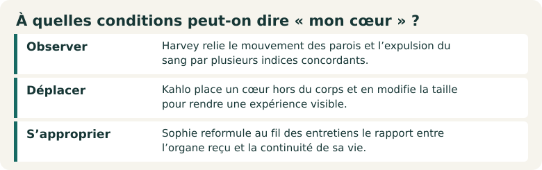

# Le cœur · ENS-PSL 2020 — corrigé brut

*Corrigé rédigé par IA, non officiel. Signalez toute erreur.*

**Rédaction** · GPT-6.2 Astra Ultra · vitesse non renseignée · 26 novembre 2026

Oral exceptionnel de 2020. Le jury prévoit 20 minutes de préparation, puis 10 minutes environ d’exposé et 10 minutes d’échange.

Dans le tableau de Frida Kahlo, le cœur occupe beaucoup de place aux pieds du personnage alors que la poitrine laisse voir un vide. Chez William Harvey, la place des cavités et le mouvement des parois sont au contraire essentiels à l’intelligence de ce qui se passe. Enfin, la personne interrogée par le sociologue Julien Biaudet peut savoir très bien quelle est la fonction de l’organe qu’elle a reçu et pourtant hésiter à dire comment il devient le sien. Le déplacement d’un cœur est-il seulement un changement de place ? Ces documents invitent à examiner ensemble ce que l’on peut voir du fonctionnement d’un organe et ce que signifie son appartenance à une personne.

## De ce que l’on voit à ce que l’on comprend

L’extrait de Harvey propose au lecteur de suivre une démonstration. Il commence par une analogie avec le muscle. Le changement de forme et de consistance du cœur se laisse comparer à une contraction. Vient ensuite un raisonnement géométrique. Si les parois s’épaississent au moment où l’ensemble se resserre, le volume des cavités diminue et le sang qu’elles contiennent doit être chassé. Le changement de couleur apporte un indice indépendant. Le texte passe de l’observation à la supposition puis à sa confirmation, jusqu’à déclarer le doute levé. Reconstituer cette progression permet d’apprécier ce que la science gagne en séparant la question du mouvement de toutes les valeurs associées au mot « cœur ».

La peinture semble renverser l’expérience. Le cœur isolé de Kahlo, d’un rouge qui se détache dans la partie inférieure gauche, occupe une place démesurée par rapport au corps de la figure debout. La couleur et le volume, qui servaient chez Harvey d’indices du mouvement, guident ici le parcours du regard entre la poitrine traversée et l’organe au sol. Le tableau mobilise une forme anatomique reconnaissable pour représenter un lien que le spectateur ne pourrait observer à la manière de Harvey. Une figure humaine demeure debout malgré une disposition impossible pour un organisme vivant. L’invraisemblance physique est précisément le moyen choisi pour faire percevoir une expérience.

## De quel cœur parle-t-on ?

L’enquête de Biaudet porte sur les remaniements de l’image du corps après une transplantation. Lors du premier entretien, Sophie dit penser au cœur comme si c’était le sien. Le « comme si » mêle affirmation et distance. Les rires notés dans la transcription, les reprises et la formule qui ramène le cœur à un organe rendent sensible le travail de formulation devant quelqu’un. La sociologie s’attache ici à la situation dans laquelle un récit peut se transformer. Son objet diffère de celui de Harvey. Il s’agit de comprendre ce qu’il devient possible de dire de l’organe.

Ce qui donne la vie est en effet aussi ce dont on parle familièrement pour dire l’attachement, le courage ou la souffrance. Sophie évoque elle-même ces associations lors d’un entretien ultérieur. Elle s’interroge sur la continuité entre ce qu’elle était et ce qu’elle est devenue. Prendre cette parole au sérieux consiste à respecter son statut de question. Rien dans le document n’établit qu’un organe transmettrait la personnalité ou les sentiments de quelqu’un d’autre. Dans le tableau de Kahlo, la présence d’un cœur hors du corps ne commande pas non plus un déchiffrement unique. Deux vêtements suspendus et le paysage partagé entre terre et eau multiplient les relations possibles entre un corps tel qu’on le voit, une histoire passée et les rôles dans lesquels une personne s’est reconnue.

## Faire place au temps de la personne

L’argument de Harvey rend intelligible une alternance qui se reproduit à chaque battement. Celui de Biaudet repose sur une autre durée. Le premier entretien et le troisième font apparaître des formulations qu’une seule rencontre n’aurait pas permis de comparer. Affirmer d’abord que le cœur est un organe peut être une manière de parler avec assurance dans une situation nouvelle. Poser plus tard une question sur les sentiments et la continuité de soi élargit cette première perspective. L’ancienne profession d’infirmière de la personne interrogée rend particulièrement nette la coexistence d’un savoir médical et d’une inquiétude sur ce qu’on devient. Les deux ne s’annulent pas.

Le titre espagnol *Recuerdo* introduit précisément le souvenir là où le spectateur pourrait prendre l’image pour la simple figuration d’une blessure présente. La notice propose au conditionnel un lien avec une épreuve affective dans la vie de Kahlo. Cette indication aide à comprendre comment la perte ou la trahison peuvent être éprouvées corporellement. Elle ne transforme pas la toile en document transparent sur une biographie. La taille du cœur, la séparation spatiale, la scène construite et la présence des vêtements font quelque chose que le seul rappel d’un événement passé ne ferait pas. Ils donnent au spectateur la possibilité de parcourir lui-même la distance entre l’organe et la personne.

Un cœur peut ainsi être connu par sa fonction, reconnu dans une image et revendiqué comme « mien ». Chacune de ces opérations exige des preuves et un temps différents. L’histoire de la médecine permet de comprendre le mouvement qui soutient la vie. L’art et la sociologie invitent à laisser une place, dans cette vie, à la question de savoir comment quelqu’un se reconnaît dans son corps.

## Sources

Les pages 2 à 4 donnent *Recuerdo (el Corazón)* de Frida Kahlo (1937), un passage de William Harvey sur le mouvement du cœur (1628) et l’enquête de Julien Biaudet sur le réajustement de l’image du corps après transplantation (2014).

[Sujet conservé](https://web.archive.org/web/20250427192542id_/https://medecine-humanites.ens.fr/wp-content/uploads/2020/06/5-Dossier-COEUR-concours-MH2020.pdf) · [Rapport du jury](https://web.archive.org/web/20250710101648id_/https://medecine-humanites.ens.fr/wp-content/uploads/2020/06/Rapport-jury-Medecine-Humanites-2020-ED-DLB.pdf) · [Annales de l’ENS-PSL](https://medecine-humanites.ens.psl.eu/sujets-et-rapports-du-concours-2018/)
