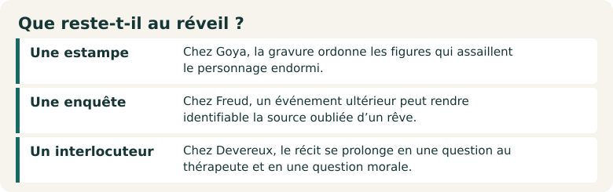

# Le rêve · ENS-PSL 2020 — corrigé guidé

*Corrigé rédigé par IA, non officiel. Signalez toute erreur.*

**Rédaction** · GPT-6.2 Astra Ultra · vitesse non renseignée · 26 novembre 2026

Oral exceptionnel de 2020. Le jury prévoit 20 minutes de préparation, puis 10 minutes environ d’exposé et 10 minutes d’échange.

## Préparer la lecture

**Décomposer le mot « réel ».** Peut-il vouloir dire « emprunté au vécu », « représenté devant un public » ou « capable d’engager une responsabilité » ? Attribuez une question à chaque document puis essayez de les échanger. La comparaison fait apparaître des préoccupations différentes sous un même mot.

## Formuler la question

Au réveil, on peut savoir avec certitude qu’on a rêvé quelque chose tout en ignorant d’où ce quelque chose a bien pu venir. Freud part de cet écart entre deux sortes de souvenir. Goya fait un choix différent. Il fait surgir des figures autour d’un dormeur dont le visage est caché. Devereux, enfin, donne place à un homme qui, après avoir rêvé de son thérapeute, s’adresse à lui comme à quelqu’un qui aurait pris part à l’événement. Que signifie dès lors attribuer une réalité à un rêve ? Il faut distinguer la provenance de son matériau, l’existence des images et leurs effets sur ceux qui en parlent.

## Un dormeur caché, des images offertes à tous

**Décrire avant d’interpréter.** Opposez le visage soustrait au regard et les animaux dont les yeux se multiplient. Utilisez ensuite les deux sens de *sueño* et le commentaire du manuscrit pour vérifier si la gravure condamne toute imagination.

Dans la gravure de Goya, la figure humaine est penchée sur une table. Son visage disparaît dans ses bras, alors que derrière elle se multiplient des yeux, des ailes, des silhouettes nocturnes. La partie sombre de l’image gagne en profondeur à mesure que les formes s’y pressent. Le spectateur comprend la menace ou la fascination de cette prolifération sans pouvoir inspecter les pensées du dormeur. Le mot espagnol *sueño*, qui peut désigner le sommeil et le rêve, empêche de séparer trop vite la raison simplement assoupie et la raison qui rêve elle-même.

Le commentaire du manuscrit du Prado donné par le dossier énonce une alternative. L’imagination peut produire des monstres lorsqu’elle est séparée de la raison et des merveilles lorsqu’elle lui est unie. L’estampe en accomplit presque les deux termes à la fois. Les êtres inquiétants sont précisément ce que l’artiste a réussi à composer et à rendre visible. Le dormeur est peut-être une figure de l’artiste, mais l’œuvre que nous avons devant nous suppose le travail éveillé de celui qui grave. Freud, lui aussi, refuse de conclure immédiatement de l’étrangeté d’une image à son indépendance absolue. L’apparence d’une invention sans source peut venir d’une difficulté de reconnaissance.

## Retrouver une source, reconnaître un interlocuteur

**Rejouer l’objection à Freud.** On peut se souvenir de la scène du rêve sans se souvenir d’une scène antérieure. Qu’apporte la rencontre ultérieure d’un détail ? Une réponse exacte précise le rôle du temps et conserve le caractère hypothétique de la recherche tant que la source reste introuvable.

Le raisonnement de Freud s’ouvre par ce qu’il présente comme acquis. Le rêve emprunte au vécu. L’objection vient de l’expérience commune. Il arrive que le rêveur se souvienne de la scène rêvée et ne retrouve rien, dans son histoire consciente, qui lui corresponde. L’auteur distingue ces deux souvenirs avec précision. Il propose que la rencontre ultérieure d’un détail rende reconnaissable un épisode ancien dont la trace s’était dérobée. La découverte tardive ne supprime pas l’étrangeté passée. Elle montre que l’absence momentanée d’explication pouvait être confondue avec une preuve d’origine entièrement nouvelle.

Chez Devereux, le rêveur identifie dans une voiture de fleuriste une représentation du thérapeute. L’identification pourrait clore une interprétation attentive au seul sens du symbole. Or l’homme en tire une question inattendue sur ce que le thérapeute aurait fait après avoir quitté le rêve. Ce déplacement transforme l’interprète en personnage auquel il est possible de s’adresser. L’air embarrassé et à demi humoristique relevé par Devereux est capital. Un même interlocuteur peut jouer avec plusieurs degrés d’adhésion à ce qu’il raconte. Cette hésitation rend le récit bien plus riche que l’opposition entre une croyance crédule et une explication supposée entièrement extérieure.

## Les suites morales du récit

**Faire parler l’anecdote sans la généraliser.** Identifiez la première interprétation de la voiture et la question que pose ensuite l’homme. L’humour relevé par Devereux doit entrer dans l’explication. C’est un indice de la position singulière du locuteur qui résiste aux affirmations globales sur une culture.

L’ethnopsychiatre rapporte le statut que des personnes accordent à certains événements rêvés aux règles de responsabilité qui peuvent s’y attacher. Réclamer le mérite d’un exploit rêvé engage aussi à reconnaître une part de responsabilité pour sa conduite. L’auteur nuance lui-même cette proposition en évoquant une responsabilité moins forte que pour les actions de la veille. Son vocabulaire collectif et le mot historique « primitifs », repris entre guillemets dans l’extrait, demandent une lecture critique. Une interaction singulière observée en consultation ne suffit pas à établir ce que pensent tous les membres d’un peuple. Écouter la nuance et l’humour de l’échange est déjà une manière de résister à cette généralisation.

Les deux analystes et l’artiste interrogent ainsi l’autorité de celui qui revient sur le rêve. Chez Freud, le lien éventuel à un souvenir doit être recherché et peut rester inconnu. Chez Devereux, le thérapeute se découvre mêlé à la parole qu’il cherche à comprendre. Goya, en dissimulant le visage et en exhibant l’imagerie nocturne, rappelle la différence entre présenter une forme et prouver ce qu’un autre a pensé. Dans une relation de soin, l’enjeu consiste aussi à comprendre ce que la personne fait d’un rêve au moment où elle le raconte à quelqu’un.

## Conclure

Le réveil ne ferme donc pas le rêve d’un seul coup. Il peut ouvrir une enquête de mémoire, un travail de forme ou une nouvelle relation à un auditeur. Ces suites donnent aux images une réalité dans la vie éveillée, tout en laissant ouverte la question de leur origine et de leur statut. C’est peut-être pour cela que le dormeur de Goya peut garder le visage caché alors que ses monstres nous regardent.

## Préparer la discussion

**Si le jury demande à quoi sert la référence artistique**, revenez à l’écart entre le personnage endormi et le travail de l’artiste qui rend l’image publique. Cet écart fournit une analogie précise avec le passage de l’expérience au récit lors d’un entretien. Il ne permet pas d’attribuer un rêve effectif au peintre.

## Sources

Les pages 2 à 4 réunissent une gravure des *Caprices* de Goya (1799), un extrait de *L’Interprétation du rêve* de Freud (1900) et deux passages de *Psychothérapie d’un Indien des plaines* de Georges Devereux (1951).

[Sujet conservé](https://web.archive.org/web/20250323020110id_/https://medecine-humanites.ens.fr/wp-content/uploads/2020/06/4-Dossier-RE%CC%82VE-Concours-MH2020.pdf) · [Rapport du jury](https://web.archive.org/web/20250710101648id_/https://medecine-humanites.ens.fr/wp-content/uploads/2020/06/Rapport-jury-Medecine-Humanites-2020-ED-DLB.pdf) · [Annales de l’ENS-PSL](https://medecine-humanites.ens.psl.eu/sujets-et-rapports-du-concours-2018/)
