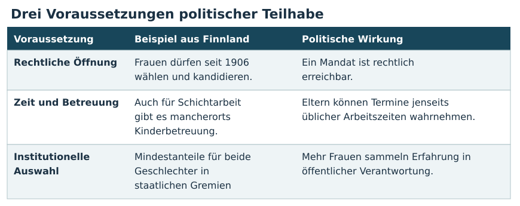

# ENS Rennes · D-E · Allemand 2020 — Corrigé guidé

*Corrigé rédigé par IA, non officiel. Signalez toute erreur.*

**Rédaction** · GPT-6.2 Astra Ultra · vitesse non renseignée

## I. Version

> [!INDICATION]
> Le texte passe du récit biographique à la critique du livre. Garder le titre allemand *Herkunft* en explicitant le jeu sur le mot « origine ». La rencontre de 2009 est racontée au présent.

Saša Stanišić est né en 1978 à Višegrad. À sa naissance, il était yougoslave. Lorsque cet État multinational s’est disloqué, sa famille est parvenue à fuir en Allemagne. Le nouveau livre de Stanišić, dans lequel il s’interroge sur lui-même à travers son autobiographie, s’intitule *Herkunft*, « Origine ». L’origine est toujours une construction, mais le comprendre ne suffit pas à apaiser le « stress identitaire ».

Un jour de 2009, Saša Stanišić se rend à Oskorusa, un village de montagne en Bosnie où son grand-père a grandi. Il y rencontre un vieux parent qui, en matière d’origines, ne goûte guère les arguties (« question complexe ! ») et lui explique sans détour : « D’ici. Tu viens d’ici. »

Mais qu’est-ce que cela veut dire, « d’ici » ? Le père de Stanišić était un Serbe de Bosnie, sa mère une musulmane, à ceci près qu’elle ne voulait rien avoir à faire avec la religion. […]

En 1992, la famille se retrouve à Heidelberg. Ce que signifie arriver en réfugié dans un pays étranger, les humiliations qu’il faut accepter, les sentiments de honte qu’il faut endurer, voilà ce que raconte *Herkunft* dans ses meilleurs passages. L’adolescent doit trouver des stratégies pour faire face au déclassement qu’il subit, mais au bout du compte, rien n’abat son heureux caractère. Sa volonté de voir le bon côté des choses est si forte que le monde finit par s’y plier. […]

Tandis que ses parents s’épuisent à l’étranger dans des emplois très en deçà de leurs qualifications, Saša est prêt à être tout ce qu’on voudra, sauf une victime. Il préfère donc se faire passer pour un Slovène plutôt que pour un Bosniaque : les gens pensent alors à des skieurs, pas à des victimes de guerre. Dans ces moments-là, il dit que les Alpes lui manquent, car en Allemagne on fait toujours bonne impression en disant que les Alpes vous manquent.

## II. Thème

> [!INDICATION]
> L’article attribue la critique climatique aux militants. Préserver le statut des déclarations en choisissant le discours direct ou indirect. *Bis zu* indique le plafond de production et *sich beteiligen* se construit avec *an* et le datif.

Am Montag, dem 13. Januar, haben auf Initiative der Umweltbewegung Fridays for Future in ganz Deutschland rund fünfzehn Kundgebungen stattgefunden, nachdem Siemens an seiner Beteiligung an einem umstrittenen Kohlebergwerk in Australien festgehalten hatte. Mit seiner Zustimmung zu „diesem katastrophalen Projekt“ gefährde Siemens „das im Pariser Abkommen festgeschriebene Ziel, die Erderwärmung auf 1,5 Grad Celsius zu begrenzen“, beklagte Fridays for Future am Sonntag in einer Mitteilung. In mehreren deutschen Großstädten, darunter Berlin, München und Hamburg, demonstrierten die Aktivisten vor den Niederlassungen des Industriekonzerns.

In der deutschen Hauptstadt hielten sie Schilder mit den Aufschriften „Stop Siemens“ und „Stop Adani“ hoch. Adani heißt der indische Mischkonzern, der dieses riesige Kohlebergwerk errichten will.

Auch in Australien fielen die Reaktionen heftig aus. Die Unterstützung durch das Unternehmen trage nicht nur zum Klimawandel bei, sondern werde auch zu mehr Naturkatastrophen führen, etwa zu Bränden wie jenen, die in Australien wüteten, erklärte Toby Thorpe von der Organisation School Strike for Climate Australia.

Nach einigen Tagen der Ungewissheit hatte Joe Kaeser, der Vorstandsvorsitzende des Industriekonzerns, am Sonntag die Beteiligung seines Unternehmens am Carmichael-Projekt bestätigt. Benannt ist es nach einem riesigen australischen Kohlebergwerk, in dem jährlich bis zu 27 Millionen Tonnen Kohle gefördert werden sollen.

## III.1. Aus welchen Gründen konnte in Finnland die Gleichstellung der Frauen in der Politik zur Wirklichkeit werden?

> [!INDICATION]
> Expliquer comment une mesure de la vie quotidienne rend une candidature politique possible. Les chiffres du texte décrivent la situation de décembre 2019. Ne pas confondre le quota dans des organismes publics avec une règle sur la composition du Parlement.

Der Aufstieg Sanna Marins lässt sich nur verstehen, wenn man auch die Bedingungen betrachtet, unter denen andere Frauen Verantwortung übernehmen können. Ende 2019 wurden alle fünf finnischen Regierungsparteien von Frauen geführt. Fast die Hälfte der Parlamentsmitglieder war weiblich. Diese Zahlen haben eine lange Vorgeschichte. Schon 1906 erhielten Frauen in Finnland sowohl das aktive als auch das passive Wahlrecht. Sie konnten also selbst kandidieren und über Generationen politische Erfahrung sammeln. Seit 1995 gelten für staatliche Gremien außerdem Mindestanteile von vierzig Prozent für beide Geschlechter.

Hinzu kommen Einrichtungen, die eine politische oder berufliche Laufbahn im Alltag erleichtern. Eltern haben Anspruch auf Kinderbetreuung, Ganztagsschulen bieten Mahlzeiten und Betreuung am Nachmittag an. Besonders deutlich wird der Nutzen am Beispiel einer alleinerziehenden Mutter mit unregelmäßigen Arbeitszeiten. In Helsinki gibt es Einrichtungen, die Kinder auch nachts oder am Wochenende betreuen. Wer eine solche verlässliche Möglichkeit hat, kann an einer späten Sitzung teilnehmen, ohne vorher jedes Mal eine private Lösung suchen zu müssen. Flexible Arbeitszeiten und die Möglichkeit, nach der Elternzeit an den Arbeitsplatz zurückzukehren, wirken in dieselbe Richtung.

Schließlich beeinflussen solche Regeln die Erwartungen der Gesellschaft. Wenn Mütter selbstverständlich erwerbstätig sind und Frauen regelmäßig Parteien führen, wird ihre Eignung für ein Amt weniger schnell allein nach ihrem Geschlecht beurteilt. Vollständig verschwunden sind die Unterschiede deshalb nicht. Der Artikel nennt ungleiche Löhne und einen höheren Anteil der Frauen an unbezahlter Sorgearbeit. Die politische Beteiligung ist vielmehr Ergebnis mehrerer Veränderungen, die sich gegenseitig verstärken.

*236 mots.*

## III.2. Meinen Sie, dass Gleichberechtigung und Gleichstellung zwischen Mann und Frau in Deutschland (Politik, Arbeitswelt, Gesellschaft) heute noch eine Illusion sind? Begründen Sie Ihre Antwort!

> [!INDICATION]
> *Gleichberechtigung* désigne l’égalité des droits, *Gleichstellung* inclut les conditions réelles de son exercice. Proposer un mécanisme pour chacun des trois domaines de la question, en distinguant les faits de la session et les mesures que l’on préconise.

Für Deutschland im Jahr 2020 wäre es falsch, die Gleichberechtigung als bloße Illusion zu bezeichnen. Frauen dürfen wählen, kandidieren und politische Ämter übernehmen, und seit vielen Jahren steht eine Bundeskanzlerin an der Spitze der Regierung. Diese Rechte haben konkrete Folgen. Der Erfolg einer einzelnen Politikerin zeigt allerdings noch nicht, welche Chancen eine unbekannte Bewerberin in einem Ortsverein hat. Wenn wichtige Gespräche stets spätabends stattfinden, ist eine Kandidatur für Menschen mit Betreuungspflichten schwieriger, auch wenn formal jeder willkommen ist.

Ähnliches gilt für die Arbeitswelt. Ein Betrieb kann Frauen und Männern für dieselbe Stelle denselben Lohn anbieten und trotzdem sehr unterschiedliche Laufbahnen hervorbringen. Wer wegen der Kinder über längere Zeit weniger Stunden arbeitet, wird möglicherweise bei der nächsten Beförderung übersehen. Verlässliche Betreuung und die Möglichkeit für beide Eltern, Arbeitszeit vorübergehend zu reduzieren und später wieder zu erhöhen, würden hier konkrete Wahlmöglichkeiten schaffen. Transparente Auswahlkriterien könnten außerdem zeigen, ob tatsächlich die für eine Aufgabe nötige Erfahrung bewertet wird.

In der Gesellschaft entscheidet sich vieles daran, was als selbstverständlich gilt. Ein Vater, der Angehörige pflegt, sollte seine Verlässlichkeit am Arbeitsplatz nicht stärker beweisen müssen als ein Kollege ohne solche Aufgaben. Ebenso wenig sollte eine Frau Anfeindungen im Internet als normalen Preis für ein öffentliches Amt hinnehmen müssen. Rechtliche Gleichheit ist also real und gibt Betroffenen Mittel, Benachteiligungen anzufechten. Ob daraus gleiche Handlungsspielräume entstehen, hängt davon ab, wie Familien, Arbeitgeber und politische Parteien Zeit, Einkommen und Verantwortung im Alltag verteilen.

*235 mots.*

[Sujet](https://www.ens-rennes.fr/medias/fichier/sujet-allemand-d-e-2020_1601913599549-pdf) · [Rapport](https://www.ens-rennes.fr/medias/fichier/rapport-de-jury-lv-allemand-d-e-2020_1604400129803-pdf)
