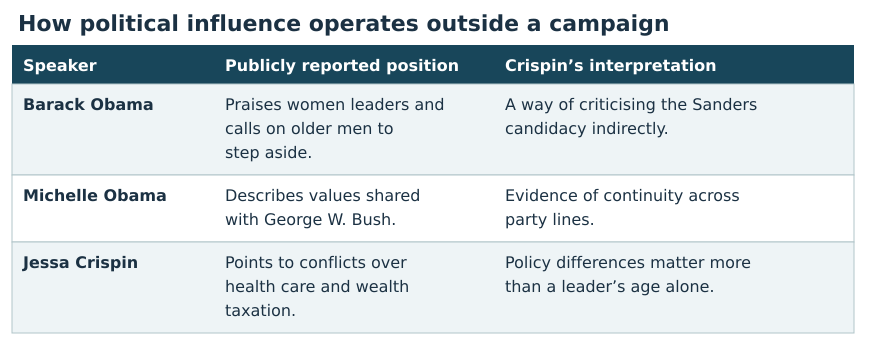

# ENS Rennes · D-E · Anglais 2020 — Corrigé guidé

*Corrigé rédigé par IA, non officiel. Signalez toute erreur.*

**Rédaction** · GPT-6.2 Astra Ultra · vitesse non renseignée

## I. Version

> [!INDICATION]
> *Impeached* désigne la mise en accusation par la Chambre des représentants. Seule la condamnation par le Sénat entraîne la destitution. Conserver les deux images judiciaires de l’introduction jusqu’au tribunal de l’opinion dans la chute.

En 231 ans, seuls trois présidents américains ont été mis en accusation en vue de leur destitution. Donald Trump comparaît désormais devant deux tribunaux. Les griefs à son encontre sont simples, et ils sont établis tant par les témoignages sous serment de responsables publics que par ses propres paroles et ses propres actes. On lui reproche d’avoir tenté, en bloquant une aide militaire, de faire pression sur le gouvernement ukrainien pour qu’il s’ingère dans une élection américaine. Son administration a essayé d’étouffer l’affaire. Il a refusé de coopérer à une enquête du Congrès autorisée par la Constitution.

Pourtant, le premier tribunal va presque à coup sûr l’acquitter. Les querelles sur les modalités du procès au Sénat se poursuivent, mais les dés y sont tellement pipés qu’il est extrêmement improbable que le Sénat le condamne et mette fin à sa présidence. Il ne faut pas seulement en accuser la majorité républicaine au Sénat, où la condamnation requiert une majorité des deux tiers. Il faut aussi incriminer la manière dont les républicains s’accrochent à un homme que nombre d’entre eux méprisent. Le chef du jury, Mitch McConnell, qui dirige la majorité sénatoriale, a déclaré avec fierté qu’il se réglerait sur les consignes des avocats de l’accusé. Lindsey Graham, qui devra, comme les autres sénateurs, jurer de rendre la justice en toute impartialité, a annoncé sans sourciller : « Je ne vais pas faire semblant d’être un juré impartial dans cette affaire. »

Le second tribunal est celui de l’opinion publique. Si, dans l’ensemble, les sondages indiquent que les partisans de la procédure de destitution sont désormais légèrement plus nombreux que ses adversaires, l’écart reste faible et pourrait de nouveau se resserrer. Dans les grandes lignes, les démocrates restent favorables à son procès, les républicains y sont opposés et les indépendants sont divisés. Selon un sondage de CNN, davantage de personnes pensaient que les accusations serviraient M. Trump qu’elles ne lui nuiraient.

## II. Thème

> [!INDICATION]
> Reconstruire la première phrase autour du verbe *promised*. La victoire est antérieure d’une semaine à la promesse. Pour « on attend toujours de savoir », employer un verbe de connaissance après l’expression de l’attente. Conserver la date de l’article, antérieure au départ officiel du Royaume-Uni.

On 19 December 2019, speaking in a House of Commons with many new members and a Conservative majority following his election victory a week earlier, Boris Johnson promised his fellow citizens a “new golden age”. What exactly does the British prime minister mean by that, as the United Kingdom prepares to bring forty-seven years of European Union membership to an end on the evening of Friday, 31 January?

The answer is all the harder to put into words because “we are not entirely sure that Downing Street has a real strategy”, a European diplomat confides. “I do not think the government has any vision for the country’s future,” adds Nick Wright, a political science researcher at University College London. “We have spent three and a half years tearing ourselves apart over Brexit without holding a genuine national debate about the United Kingdom’s role and place in the world after its divorce from the EU.”

Prime Minister Theresa May did place considerable emphasis on the idea of “Global Britain”. So far, however, Mr Johnson has made little use of it, and “we are still waiting to hear exactly what it means, what its ambition is and how it is actually to be achieved”, adds Sophia Gaston, director of the British Foreign Policy Group.

## III.1. How are the Obamas re-entering politics?

> [!INDICATION]
> Ancrer la lecture dans la primaire démocrate telle qu’elle se présente en décembre 2019. Attribuer à Jessa Crispin ses hypothèses sur les intentions de Barack Obama. Pour Michelle Obama, partir de sa déclaration réelle sur George W. Bush.

The Obamas are re-entering politics without running for office or formally endorsing a candidate. In Jessa Crispin’s account, the former president uses appearances before paying audiences and donors to influence how Democrats understand their options. He praises women as leaders and suggests that older men ought to make way. An apparently general observation can thus reach the primary campaign without the speaker ever appearing alongside a candidate or asking anyone for a vote.

Crispin reads the remark as an indirect intervention against Bernie Sanders. Age alone would hardly distinguish him from Joe Biden, and praise for women does not amount to an endorsement of Elizabeth Warren. What distinguishes Sanders more clearly is his challenge to policies that Obama considers achievements or regards as capable of gradual improvement. A proposal for national health insurance, for instance, raises questions about the record that the former president wishes to defend. The columnist also recalls a report that Obama might speak against Sanders if he appeared likely to win.

Michelle Obama's account of her friendship with George W. Bush likewise has political consequences. She speaks of shared values across party lines. Crispin asks which policies, including military interventions and support for financial institutions, that continuity might encompass. The distinction between statement and interpretation matters: neither the friendship nor Barack Obama’s remarks prove every motive the columnist attributes to the couple. They do show how former occupants of the White House can shape a contest through the audiences they address and the positions they make respectable.

*251 mots.*

## III.2. Do you agree with the statement that women are better leaders than men?

> [!INDICATION]
> Distinguer l’accès équitable aux fonctions dirigeantes de l’affirmation selon laquelle un sexe dirigerait mieux. Un exemple illustrera une compétence ou une contrainte institutionnelle ; une simple série de noms n’établit pas de loi générale.

I would welcome more women in leadership positions, but I do not think the claim that women are better leaders than men is a sound reason for doing so. Leading a government requires weighing evidence, choosing advisers and accepting responsibility when a decision goes wrong. Individuals of either sex can perform these tasks well or badly. A comparison of a few famous prime ministers would tell us as much about the crises they inherited and the institutions that constrained them as about the people themselves.

Representation nevertheless matters. A council drawn from a narrow group may overlook problems that its members rarely encounter. If women who depend on evening buses are heard when a transport budget is drawn up, the location of stops and the reliability of services may receive more attention. This is a reason to widen participation and listen to different experiences. It does not imply that every woman holds the same views on transport, or that a man cannot act on evidence provided by passengers.

Finally, expecting women in office to be naturally more caring can impose a double standard. A decision praised as decisive when a man takes it may be judged harsh when a woman does the same. A better approach would remove barriers to candidacy, provide equal opportunities to speak and judge all officeholders by publicly defensible criteria. Did they use the available evidence fairly, protect the rights of those affected and change course when the policy failed? Those questions give citizens a more demanding test than an assumption about gender.

*257 mots.*

[Sujet](https://www.ens-rennes.fr/medias/fichier/sujet-anglais-d-e-2020_1601913614866-pdf) · [Rapport](https://www.ens-rennes.fr/medias/fichier/rapport-de-jury-lv-anglais-d-e-2020_1604400142002-pdf)
