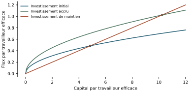
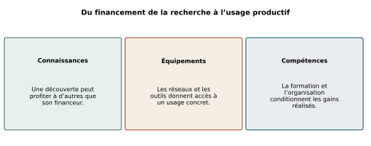

# ENS Rennes D-E — Composition d’ordre économique 2020 · Corrigé guidé

*Corrigé rédigé par IA, non officiel.*

**Rédaction** · GPT-6.2 Astra Ultra · vitesse non renseignée

## Quels investissements pour la croissance ?

### Introduction

> [!INDICATION]
> Distinguer l’actif réel de son mode de financement et préciser l’indicateur de croissance.

Construire une ligne ferroviaire, acheter une action déjà émise et former un apprenti engagent des ressources aujourd'hui pour un résultat futur. La comptabilité nationale ne les traite pourtant pas de la même manière. La construction durable peut entrer dans la formation brute de capital fixe (FBCF), définie par les acquisitions moins les cessions d'actifs fixes des producteurs résidents. L'achat d'un titre existant constitue une opération financière. La formation contribue au capital humain sans être, pour cette seule raison, enregistrée en FBCF. La recherche-développement peut en revanche être comptabilisée comme actif de propriété intellectuelle selon les règles des comptes nationaux. Distinguer catégories comptables et mécanismes économiques évite d'additionner des flux hétérogènes. [Insee, formation brute de capital fixe](https://www.insee.fr/fr/metadonnees/definition/c1371)

La croissance désigne ici l'augmentation durable de la production en volume. La production par habitant et la productivité du travail renseignent sur des aspects qui peuvent diverger du PIB total, notamment lorsque la population augmente. Un investissement déclenche immédiatement une demande mais ne transforme la capacité de produire que s'il fournit un actif utile, des connaissances ou une organisation qui seront effectivement mobilisés. Comment distinguer les investissements qui augmentent temporairement l'activité de ceux qui permettent une progression durable de la production et de la productivité ?

L'accumulation d'équipements procure des gains de niveau et peut diffuser des innovations. Sa composition, ses complémentarités et ses effets sur les ressources communes décident ensuite si elle peut soutenir durablement la croissance.

### I. L'accumulation accroît la capacité productive, avec des effets différents sur le niveau et sur le taux de croissance

#### A. Ajouter du capital par travailleur élève la production, mais rencontre des rendements décroissants

> [!INDICATION]
> Tracer les flux de maintien et d’investissement puis comparer les états stationnaires.

Une machine supplémentaire permet d'effectuer davantage d'opérations à travail donné. Il faut d'abord distinguer investissement brut et investissement net. Si l'entreprise achète deux machines pendant que deux machines équivalentes parviennent en fin de vie, le stock productif n'augmente pas à technique constante. Le remplacement peut cependant incorporer une technologie plus efficace. Le volume des achats, leur qualité et le capital déprécié doivent donc être examinés ensemble.

Dans le modèle de Solow, la production par unité de travail efficace s'écrit $y=f(k)$, où $k$ est le capital correspondant. À taux d'épargne $s$, la variation du capital vérifie en temps continu $\dot k=s f(k)-(n+g+\delta)k$. Le taux $n$ est la croissance du travail, $g$ celle de son efficacité et $\delta$ la dépréciation. La courbe d'investissement est concave si la productivité marginale du capital décroît. La droite de maintien indique ce qu'il faut produire pour remplacer le capital usé et équiper les unités supplémentaires de travail efficace. Leur intersection donne le capital stationnaire.

Prenons $f(k)=\sqrt{k}$ et $n+g+\delta=0{,}10$. Faire passer $s$ de 0,22 à 0,32 élève la valeur stationnaire de $k$ de 4,84 à 10,24. Pendant la transition, la production par travailleur croît plus vite. À la nouvelle stationnarité, le taux de croissance de long terme de la production par travailleur revient à $g$. Cette conclusion porte sur le modèle à progrès technique exogène. Elle explique l'utilité d'un rattrapage par l'équipement et la difficulté de perpétuer le même taux de croissance par une augmentation indéfinie du taux d'investissement.

#### B. La composition de l'investissement modifie la productivité des facteurs existants

> [!INDICATION]
> Suivre une machine depuis son acquisition jusqu’à son utilisation par une équipe formée.

L'équipement ne produit pas isolément. Une entreprise peut acheter une machine automatisée qui ne sera pleinement utilisable qu'après une formation et une réorganisation de la chaîne de production. Un investissement de productivité peut donc augmenter la valeur ajoutée sans hausse proportionnelle du nombre de machines. Un investissement de capacité qui reproduit un procédé connu peut rester nécessaire lorsqu'une entreprise dispose d'une demande solvable et utilise déjà ses équipements à pleine charge. L'opposition entre « ancien » et « innovant » ne suffit pas à classer les projets.

La recherche et les savoir-faire changent le raisonnement de long terme. Un procédé nouveau peut servir à plusieurs unités de production et inspirer des améliorations chez d'autres entreprises. Les travaux de Romer sur les idées et de Lucas sur le capital humain explicitent des mécanismes par lesquels l'effort actuel modifie les possibilités de production futures. Le rendement social d'une innovation peut dépasser son rendement privé si d'autres entreprises apprennent de son auteur. Il faut néanmoins une capacité d'absorption. Un brevet inexploitable faute de techniciens, de financement ou de débouché ne réalise pas à lui seul la croissance potentielle.

La demande conserve un rôle de sélection. Si des équipements restent durablement inutilisés faute de débouchés, leur simple existence ne suffit pas à soutenir la production. À l'inverse, maintenir la demande lors d'une crise peut éviter l'abandon d'un projet dont la rentabilité à long terme subsiste. Ce lien avec les fluctuations explique certaines décisions d'investissement sans confondre la reprise d'une usine temporairement arrêtée avec la croissance durable de sa productivité.

### II. Les rendements sociaux, les complémentarités et la soutenabilité orientent les choix privés et publics

#### A. Lorsque les gains débordent l'investisseur, le financement et la coordination deviennent décisifs

> [!INDICATION]
> Comparer le rendement appropriable par l’investisseur avec celui qui revient à l’ensemble des usagers.

Une entreprise compare les recettes futures qu'elle peut percevoir aux coûts et au risque présents. Si la recherche fondamentale bénéficie largement à d'autres, cette comparaison privée peut conduire à investir trop peu. Une infrastructure de réseau ouvre aussi des possibilités à de nombreux usagers qu'un seul investisseur aurait parfois du mal à facturer. Dans les modèles de croissance endogène associés à Barro, un capital public productif peut accroître le rendement du capital privé. Une voie ferrée fiable réduit les délais d'acheminement et peut rendre profitable l'installation d'une activité qui ne l'était pas.

Cette complémentarité ne garantit pas la qualité de toute dépense publique. Une ligne peu fréquentée mobilise des matériaux, des ingénieurs et des fonds qui auraient pu entretenir le réseau existant. Une évaluation doit comparer les bénéfices supplémentaires, les coûts d'exploitation et la meilleure solution concurrente, en tenant compte du temps et des incertitudes. Financer un actif durable par la dette peut répartir son coût entre générations bénéficiaires, mais les charges futures d'entretien doivent être explicitées. Le choix entre financement public, subvention d'une activité privée ou règle commune dépend de l'origine de l'écart entre rendement privé et rendement social.

Les petites entreprises innovantes illustrent une autre limite. Un prêteur peut mal apprécier un projet intangible et ne dispose pas d'un équipement facilement revendable comme garantie. Une meilleure information, un financement en fonds propres ou une garantie publique ciblée peuvent écarter un rationnement inefficace. La sélection reste nécessaire pour éviter que les pertes soient simplement reportées sur la collectivité. On doit rechercher l'investissement supplémentaire suscité par le dispositif et les connaissances effectivement diffusées.

#### B. Investir pour durer oblige à tenir compte des dommages évités et du capital transmis

> [!INDICATION]
> Examiner ensemble les dommages évités, les ressources mobilisées et l’usage réellement induit.

Une activité peut accroître le PIB mesuré en utilisant plus vite une ressource naturelle ou en laissant des dommages à la génération suivante. Le taux de croissance observé ne mesure pas directement l'évolution du patrimoine productif total ni du bien-être. Une rénovation thermique peut réduire une consommation d'énergie comptabilisée et libérer durablement des ressources pour d'autres usages. Une infrastructure carbonée peut offrir des services aujourd'hui et enfermer l'économie dans des dépenses de reconversion élevées. La durée de vie des équipements rend le calendrier de l'investissement déterminant.

Le diagnostic conduit à plusieurs instruments complémentaires. Un prix des émissions rapproche le calcul privé d'un coût collectif. L'investissement dans un réseau ou la recherche peut rendre disponible une alternative que le prix seul ne ferait pas apparaître assez vite. La formation permet le passage des métiers en recul à ceux qui se développent. Il faut examiner les situations de ménages ou de petites entreprises qui ne peuvent avancer le coût d'une rénovation même rentable à terme, et contrôler l'effet réellement obtenu. Une consommation unitaire réduite peut être partiellement compensée par une augmentation de l'usage.

Ces choix invitent à mesurer, à côté du PIB, la productivité, la diffusion des innovations, les usages du capital et les dommages environnementaux. Dans un pays manquant d'infrastructures, les gains d'un équipement de base peuvent être très élevés. Dans une économie déjà fortement équipée, l'entretien, l'organisation, l'éducation et l'amélioration qualitative peuvent apporter davantage qu'un nouvel équipement prestigieux. Aucune part universelle de l'investissement public ou immatériel ne saurait remplacer ce diagnostic.

### Conclusion

> [!INDICATION]
> Préciser à quelle condition l’investissement change le taux de croissance et pas seulement son niveau.

L'investissement entretient la croissance lorsqu'il renouvelle le capital nécessaire, l'affecte à des usages productifs et rend possibles de nouveaux gains de productivité. Le modèle de Solow explique pourquoi l'effort d'accumulation seul rencontre une limite. Les externalités de connaissances, les complémentarités entre actifs et la préservation des ressources expliquent pourquoi les choix de financement, d'organisation et de politique publique décident de la trajectoire au-delà de cette limite.

[Sujet distribué](https://www.ens-rennes.fr/medias/fichier/sujet-e-conomie-d-e-2020_1601913252050-pdf) · [Rapport du jury](https://www.ens-rennes.fr/medias/fichier/rapport-de-jury-economie-d-e-2020_1604400061022-pdf)
