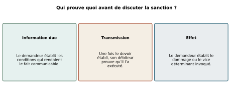
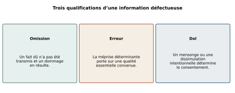

# ENS Rennes D-E — Droit civil 2020 · Corrigé brut

*Corrigé rédigé par IA, non officiel.*

**Rédaction** · GPT-6.2 Astra Ultra · vitesse non renseignée

## L’information dans la formation du contrat

### Introduction

Un propriétaire propose à la vente un local en affirmant qu’il pourra immédiatement servir de restaurant. Il sait qu’une restriction administrative fait obstacle à cet usage. L’acquéreur, qui a expressément indiqué son projet, l’ignore. L’affaire ne porte pas seulement sur le prix que chacun estime acceptable. Elle pose la question de savoir avec quelles connaissances le consentement a été donné, qui devait les transmettre et ce que devient le contrat lorsque cette transmission a fait défaut.

L’information est un fait, une caractéristique ou une donnée susceptible de guider le choix de contracter ou d’en fixer les conditions. Elle peut être demandée, communiquée spontanément, incorporée à l’accord, tue ou présentée inexactement. La formation couvre la phase au cours de laquelle les parties élaborent puis donnent leur consentement. L’exécution ultérieure intéresse le sujet lorsqu’elle révèle ce que les parties savaient en contractant. En droit commun applicable en 2020, l’article 1112-1 du Code civil consacre un devoir précontractuel d’information. Son manquement peut engager la responsabilité de son débiteur et, dans les conditions des articles 1130 et suivants, conduire à l’annulation. [Article 1112-1](https://www.legifrance.gouv.fr/codes/article_lc/LEGIARTI000032007138/2020-04-01)

Comment concilier la liberté de se renseigner et de négocier avec la protection de celui dont le consentement dépend d’un fait détenu par autrui ? Le droit répartit d’abord les informations déterminantes et la charge de les porter à la connaissance du partenaire. Il proportionne ensuite les conséquences de leur absence ou de leur altération à ce qu’elles ont changé dans la formation de l’accord.

### I. La loyauté de la formation oblige à transmettre certains faits, tout en laissant place à une appréciation personnelle de l’opération

#### A. Le caractère déterminant de l’information s’apprécie dans une relation identifiée

Les négociations sont libres et doivent satisfaire aux exigences de la bonne foi. L’article 1112-1 vise celui qui connaît une information dont l’importance est déterminante pour le consentement de l’autre, lorsque celui-ci l’ignore légitimement ou fait confiance à son cocontractant. Les informations déterminantes y sont rattachées par un lien direct et nécessaire au contenu du contrat ou à la qualité des parties. Cette combinaison évite deux excès. Il serait trop large d’exiger l’énumération de tout ce qu’une partie sait. Il serait trop étroit de réserver le devoir à un catalogue abstrait de données identiques pour tout contrat. [Article 1112](https://www.legifrance.gouv.fr/codes/article_lc/LEGIARTI000036829818/2020-04-01)

Dans l’exemple du restaurant, il faut montrer la réalité de la restriction, la connaissance du vendeur, le lien avec l’usage convenu et la place de ce fait dans le consentement de cet acheteur. Un renseignement secondaire pour une personne achetant un entrepôt peut être décisif pour celle qui a annoncé vouloir recevoir du public. Le statut professionnel, l’accès concret aux documents et les affirmations rassurantes déjà faites aident à apprécier l’ignorance légitime. Ils ne dispensent pas le juge de l’examen des circonstances. En droit commun, le texte vise l’information connue. Une obligation spéciale de recueillir ou de vérifier une donnée doit être établie sur son propre fondement.

Le devoir d’information n’est pas non plus identique à un conseil. Signaler la restriction permet au partenaire de juger. Lui recommander un montage ou apprécier si son entreprise sera rentable suppose une mission plus étendue. Le droit de la consommation peut, dans son champ, imposer au professionnel de communiquer certaines caractéristiques et certains prix avant l’engagement. Ces prescriptions précises complètent l’analyse du droit commun. Elles n’épuisent pas toute la question du consentement entre deux particuliers ou deux professionnels.

#### B. L’autonomie du jugement subsiste pour la valeur, tandis que la preuve de la transmission est spécialement organisée

L’estimation qu’un contractant se fait de la valeur de la prestation est expressément exclue du devoir de l’article 1112-1. Un acheteur averti qui pense pouvoir revendre plus cher n’est pas tenu d’enseigner sa propre estimation au vendeur. Il faut distinguer cette opinion d’un fait déterminant qui concourt à la valeur. Une restriction d’usage, la falsification d’une provenance promise ou l’incertitude connue sur une caractéristique convenue peuvent affecter le prix sans devenir de simples opinions sur le prix. La distinction évite à la fois de garantir à chacun une bonne affaire et de tolérer la dissimulation de la chose sur laquelle il s’engage. [Article 1136](https://www.legifrance.gouv.fr/codes/article_lc/LEGIARTI000032040998/2020-04-01)

La répartition de la preuve donne au devoir une efficacité pratique. Celui qui soutient qu’une information lui était due doit établir les circonstances qui en faisaient une information due. Il revient ensuite à la partie débitrice de prouver qu’elle l’a fournie. Des échanges mentionnant le projet de restaurant, une notification antérieure reçue par le vendeur et une communication datée à l’acheteur jouent ainsi des rôles différents. Une clause reconnaissant la remise d’un document précisément identifié peut participer à la preuve. Une formule générale par laquelle l’acheteur renoncerait à toute information ne pourrait neutraliser le devoir, que les parties ne peuvent limiter ou exclure.

La circulation de l’information est elle-même ordonnée. Une donnée confidentielle obtenue à l’occasion de négociations ne peut être utilisée ou divulguée sans autorisation sous peine de responsabilité de droit commun. Celui qui ouvre des discussions peut donc partager les faits nécessaires au consentement sans perdre toute protection sur leur usage ultérieur. Cette règle ne crée pas un droit général du futur partenaire à s’approprier les informations reçues. [Article 1112-2](https://www.legifrance.gouv.fr/codes/article_lc/LEGIARTI000032007140/2020-04-01)

### II. La sanction dépend de l’effet du défaut d’information sur la décision de contracter

#### A. Le défaut de transmission engage la responsabilité et peut révéler une erreur déterminante

La violation d’un devoir précontractuel ouvre une action en responsabilité si un dommage et un lien de causalité sont établis. L’absence de dol ne fait pas disparaître le devoir. Un vendeur négligent peut devoir réparer le préjudice directement causé par un renseignement omis alors que son intention de tromper n’est pas prouvée. L’acquéreur doit encore préciser ce qu’il aurait pu décider et le préjudice qui en résulte. La perte d’une chance réelle de négocier autrement n’équivaut pas automatiquement au gain maximal que l’opération aurait pu procurer.

L’annulation suit une exigence distincte. L’article 1112-1 renvoie aux vices du consentement. Au sens de l’article 1130, sans le vice, la partie n’aurait pas contracté ou aurait contracté à des conditions substantiellement différentes. Si l’erreur spontanée porte sur les qualités essentielles convenues, expressément ou tacitement, de la prestation, elle peut justifier la nullité sous réserve notamment de son caractère excusable. Si les parties ont expressément accepté un aléa sur une qualité, l’erreur sur cette qualité est exclue. Une simple mauvaise appréciation économique sans erreur sur les qualités essentielles ne suffit pas. [Article 1130](https://www.legifrance.gouv.fr/codes/article_lc/LEGIARTI000032040901/2020-04-01) · [Article 1132](https://www.legifrance.gouv.fr/codes/article_lc/LEGIARTI000032040846/2020-04-01) · [Article 1133](https://www.legifrance.gouv.fr/codes/article_lc/LEGIARTI000032040841/2020-04-01)

Revenons au local. Si la possibilité de recevoir du public constituait une qualité essentielle convenue, l’acheteur peut établir une erreur déterminante et en demander la sanction même en l’absence de mensonge. S’il connaissait la restriction et a volontairement accepté le risque d’une autorisation future, la même déception économique ne prouve pas le vice. Les documents remis avant la signature servent ainsi à établir la connaissance réelle et la répartition du risque, en plus de prouver le respect ou le manquement au devoir.

#### B. La tromperie intentionnelle élargit la protection de la victime sans abolir la distinction entre fait et estimation

Le dol peut résulter de manœuvres, de mensonges ou de la dissimulation intentionnelle d’une information que son auteur sait déterminante pour l’autre. Dans notre exemple, faire croire que l’autorisation a été délivrée altère le choix plus directement encore que négliger un avertissement. Le silence lui-même est un dol si la dissimulation et la connaissance de son importance sont établies. L’absence de mise à disposition d’un document ne prouve pas mécaniquement ces éléments intentionnels. Dater une lettre administrative, des échanges sur la destination du local et le refus délibéré de communiquer une réponse donne au juge des faits distincts à apprécier. [Article 1137](https://www.legifrance.gouv.fr/codes/article_lc/LEGIARTI000036829827/2020-04-01)

L’erreur provoquée par le dol est toujours excusable. Elle peut emporter nullité même lorsqu’elle porte sur la valeur ou sur un simple motif. Ce principe se concilie avec l’exclusion de la seule estimation. Ne pas révéler sa propre estimation n’est pas un dol. Fabriquer une expertise ou mentir sur un fait en vue d’obtenir le consentement peut, en revanche, provoquer une erreur sur la valeur qui sera sanctionnée. Le vice ouvre une nullité relative qui protège la partie trompée. La nullité entraîne en principe restitution des prestations échangées. Des dommages-intérêts peuvent compenser un préjudice subsistant sous les conditions de la responsabilité, sans double indemnisation. [Article 1139](https://www.legifrance.gouv.fr/codes/article_lc/LEGIARTI000032040982/2020-04-01) · [Article 1131](https://www.legifrance.gouv.fr/codes/article_lc/LEGIARTI000032040836/2020-04-01) · [Article 1178](https://www.legifrance.gouv.fr/codes/article_lc/LEGIARTI000032041243/2020-04-01)

Il existe enfin des mécanismes particuliers qui sécurisent l’information sans généraliser l’annulation. Dans un pacte de préférence, le tiers peut demander par écrit au bénéficiaire s’il entend s’en prévaloir. Si cet écrit fixe un délai raisonnable et avertit de la conséquence du silence, l’absence de réponse dans le délai ferme au bénéficiaire la voie de la substitution ou de la nullité du contrat avec le tiers. La loi précise ici l’auteur, le destinataire, la forme et l’effet de l’interrogation. Cet exemple confirme que les effets du silence dépendent de la règle et des intérêts protégés. [Article 1123](https://www.legifrance.gouv.fr/codes/article_lc/LEGIARTI000032040825/2020-04-01)

### Conclusion

L’information contribue à former un consentement libre en permettant le choix sur les faits essentiels. La bonne foi impose leur communication dans une situation déterminée, sous un régime de preuve précis, et laisse à chacun son évaluation du prix. Lorsque le choix est faussé, la responsabilité répare un dommage établi et la nullité suppose un vice déterminant. La distinction entre omission, erreur et dissimulation intentionnelle maintient ensemble l’efficacité de la protection et la sécurité de l’accord formé.

[Sujet distribué](https://www.ens-rennes.fr/medias/fichier/sujet-droit-civil-d-e-2020_1601913567141-pdf) · [Rapport du jury](https://www.ens-rennes.fr/medias/fichier/rapport-de-jury-droit-civil-d-e-2020_1604400072742-pdf)
