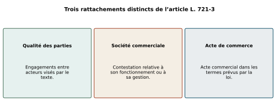
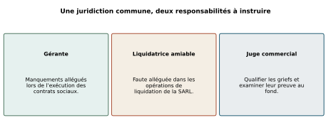

# ENS Rennes D-E — Droit commercial 2020 · Corrigé guidé

*Corrigé rédigé par IA, non officiel.*

**Rédaction** · GPT-6.2 Astra Ultra · vitesse non renseignée

## Commentaire de Cass. com., 14 novembre 2018, n° 16-26.115 — Le juge compétent pour les actes du gérant et du liquidateur amiable

### Introduction

> [!INDICATION]
> Reconstituer les demandes successives en indiquant le défendeur de chaque procédure.

La compétence du tribunal de commerce dépend-elle de la qualité de la personne assignée ou du lien de la contestation avec la gestion d’une société commerciale ? La difficulté apparaît lorsque les personnes visées sont des dirigeantes qu’un tiers poursuit personnellement. S’y ajoute ici une circonstance propre à brouiller l’analyse. Une procédure prud’homale avait déjà opposé ce tiers, SFR, à l’ancienne gérante de son distributeur. La juridiction compétente pour les indemnités liées à l’emploi doit être distinguée de celle qui doit examiner des griefs tenant à l’activité de la société.

De mars 2001 à mars 2005, la SARL Le Portable télécom, devenue Fresh délices, a été liée à SFR par des contrats de partenariat et de distribution. À partir de 2007, sa gérante, Mme Y., a engagé une instance prud’homale et obtenu de SFR diverses indemnités. SFR a saisi le tribunal de commerce des conséquences de cette décision sur l’exécution des contrats. Après liquidation amiable de Fresh délices, elle reproche à Mme Y. des manquements rattachés à cette exécution et à Mme X., liquidatrice, une faute dans ses fonctions. Le tribunal de commerce de Paris rejette leur exception d’incompétence. Sur leur contredit, la cour d’appel de Paris accueille cette exception le 20 septembre 2016. SFR se pourvoit. [Arrêt du 14 novembre 2018](https://www.legifrance.gouv.fr/juri/id/JURITEXT000037644592/)

La chambre commerciale casse sans renvoi, déclare le contredit mal fondé et le rejette. Le visa est le même pour les deux moyens, l’article L. 721-3 du code de commerce. Comment une contestation opposant une société à deux personnes physiques dépourvues de la qualité de commerçantes peut-elle relever du tribunal de commerce ? La Cour distingue les fondements de compétence, puis rattache par une même exigence de lien direct les opérations du gérant et celles du liquidateur à la société.

### I. La contestation relative à la société commerciale dispose d’un fondement propre de compétence

#### A. La qualité personnelle de commerçant ne conditionne pas tous les chefs de l’article L. 721-3

> [!INDICATION]
> Distinguer les différents chefs de compétence de l’article L. 721-3.

Le texte comprend plusieurs chefs distincts. Sont notamment visées les contestations relatives aux engagements entre commerçants, celles relatives aux sociétés commerciales et celles relatives aux actes de commerce entre toutes personnes. La SARL est commerciale par la forme. En revanche, sa gérante ne devient pas personnellement commerçante du seul fait qu’elle accomplit, en qualité d’organe, des opérations au nom de la société. La liquidatrice ne le devient pas davantage parce qu’elle réalise ou clôt des opérations sociales.

La cour d’appel avait insisté sur l’absence de qualité de commerçante et sur l’absence d’acte de commerce personnel. Ces constats répondent à deux critères possibles. Ils ne suffisent pas à exclure le troisième, autonome, de la contestation relative à une société commerciale. L’indication est utile lorsque le défendeur est une personne physique et l’action présentée comme une responsabilité personnelle. La juridiction compétente doit qualifier l’objet de cette action. Elle ne peut déduire sa compétence ou son incompétence du seul nom des parties.

Il serait symétriquement excessif d’attraire devant le juge commercial toute personne qui exerce ou a exercé un mandat social. Une dette privée étrangère à la gestion resterait soumise à ses règles propres. La Cour ne déclare pas commerciaux tous les actes personnels des mandataires sociaux. Elle rattache à la société une contestation déterminée par les opérations effectivement reprochées. Ainsi comprise, la compétence spéciale ne dissout pas la distinction entre le patrimoine social et celui des dirigeantes.

#### B. Les manquements reprochés à la gérante au cours de l’exécution du contrat présentent un lien direct avec la gestion

> [!INDICATION]
> Nommer le lien entre les manquements attribués à la gérante et l’exécution des contrats de distribution.

Le premier moyen porte sur les griefs adressés à Mme Y. SFR lui reproche d’être à l’origine du dommage résultant de l’inexécution des obligations de la société dans les contrats commerciaux de distribution. La Cour juge que les manquements commis par le gérant d’une société commerciale à l’occasion de l’exécution d’un contrat se rattachent directement à sa gestion. Savoir si l’opération a pris la forme d’une action ou d’une omission ne suffit pas à lever ce lien. L’organisation de l’exécution ou le défaut d’une diligence requise peuvent l’un et l’autre relever de l’activité de direction.

La procédure prud’homale explique la naissance du différend sans en déterminer toute la compétence. Ce qui restait à juger devant le tribunal de commerce ne consistait pas à reconnaître de nouveau un contrat de travail ou à fixer des indemnités de licenciement. SFR voulait faire examiner les conséquences et responsabilités relatives à la gestion du distributeur. Ce fondement matériel explique comment deux litiges liés par les mêmes événements peuvent relever de juridictions différentes sans que le second juge réforme la décision du premier.

La formule de la Cour concerne la compétence. Elle ne dispense pas SFR de démontrer, devant le juge du fond, les conditions de la responsabilité qu’elle invoque contre la personne physique. Le lien direct avec la gestion sociale n’est pas la preuve d’une faute réparable envers le tiers, du dommage ni de sa causalité. Confondre les deux étapes convertirait une règle de répartition juridictionnelle en condamnation anticipée.

### II. Le rattachement fonctionnel survit à l’ouverture d’une liquidation amiable

#### A. Le liquidateur, comme le gérant, réalise des opérations qui engagent l’intérêt social

> [!INDICATION]
> Comparer le but de la gérance et celui des opérations de liquidation amiable.

La seconde personne assignée est Mme X., en qualité de liquidatrice amiable. L’article L. 237-12 du code de commerce prévoit sa responsabilité envers la société et envers les tiers pour les conséquences dommageables des fautes commises dans l’exercice de ses fonctions. Le fait que ce régime figure dans le code de commerce ne détermine pas à lui seul une compétence. Il faut encore relier la contestation au chef pertinent de l’article L. 721-3. La cour d’appel, au contraire, avait tiré de l’absence de qualité personnelle de commerçante et d’actes commerciaux une compétence civile.

La Cour de cassation procède par analogie fonctionnelle. Le liquidateur agit dans l’intérêt social et réalise des opérations rattachées directement à la gestion de la société commerciale. L’intérêt social ne disparaît pas dès la dissolution, puisque les opérations de liquidation restent à conduire. Les fonctions du gérant et celles du liquidateur ne sont pas identiques. Le premier administre une société en activité, tandis que le second est chargé de liquider ses affaires. Leur point commun, décisif pour le litige, est d’agir dans un cadre social dont procède la faute alléguée.

Cette extension évite que le même type de contestation change de juge pour le seul motif que les opérations sont conduites en vue de la clôture. Elle n’autorise pas à confondre la liquidation amiable de l’espèce avec une procédure collective judiciaire, qui comporte des règles propres. Elle ne rend pas non plus le liquidateur garant de toutes les dettes de la société. Le rattachement explique où la demande doit être jugée et laisse ouverte la réponse de fond.

#### B. La cassation sans renvoi tranche définitivement l’incident de compétence et lui seul

> [!INDICATION]
> Relire les trois verbes du dispositif avant d’en tirer une conclusion sur la responsabilité.

L’arrêt du 20 septembre 2016 relevait du contredit, recours alors ouvert contre la décision d’un premier juge sur sa compétence. Le sujet avertit que cette procédure a ensuite été supprimée à compter du 1er septembre 2017. Il convient de lire le dispositif à la lumière de la loi applicable au recours en cause. Le mot « contredit » désigne ici une voie de recours précisément située dans le temps et non une demande de réparation de SFR.

Les constatations nécessaires au rattachement étant acquises, la Cour applique l’article 627 du code de procédure civile. Elle casse intégralement, dit n’y avoir lieu à renvoi et rejette le contredit. Le rejet de l’exception par le tribunal de commerce produit ainsi ses effets. La Cour n’avait pas à demander à une nouvelle cour d’appel de vérifier si les dirigeantes étaient commerçantes ou si elles avaient personnellement accompli des actes de commerce. Ses deux motifs rendent ces vérifications indifférentes à la solution de compétence.

La portée pratique se lit dans ce que le juge commercial doit encore faire. Il lui appartiendra d’entendre les griefs, les preuves et les moyens de défense relatifs à chacune des fonctions. Une solution différente sur la responsabilité de la gérante et sur celle de la liquidatrice resterait compatible avec l’unité du fondement juridictionnel. L’arrêt assure une qualification cohérente des contestations relatives à la société tout en maintenant l’individualisation des obligations de ses organes.

### Conclusion

> [!INDICATION]
> Retrouver la question de fond que le tribunal devra encore juger.

La chambre commerciale rattache les deux demandes au fonctionnement de Fresh délices. L’exécution des contrats par la gérante comme les opérations de liquidation de la liquidatrice peuvent donner lieu à des contestations relatives à une société commerciale. La qualité personnelle de commerçante est dès lors indifférente. Le dispositif fixe la juridiction appelée à juger ces demandes et réserve l’appréciation de la responsabilité propre à chaque défenderesse.

[Sujet distribué](https://www.ens-rennes.fr/medias/fichier/sujet-e-preuve-a-options-d-e-2020_1605522582741-pdf) · [Rapport du jury](https://www.ens-rennes.fr/medias/fichier/rapport-de-jury-droit-commercial-d-e-2020_1604400105037-pdf)
