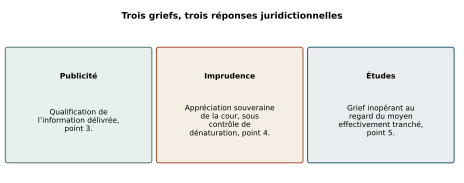

# ENS Rennes D-E — Droit public 2020 · Corrigé brut

*Corrigé rédigé par IA, non officiel.*

**Rédaction** · GPT-6.2 Astra Ultra · vitesse non renseignée

## Commentaire de CE, 22 novembre 2019, n° 422655 — Information du public, carence du maire et responsabilité de l’État

### Introduction

Une activité nautique pratiquée hors d’une zone surveillée se déroule aux risques et périls de l’intéressé. Pour autant, le maire est-il dispensé d’avertir les usagers de tout danger ? Et à quelles conditions la victime peut-elle reprocher au préfet d’avoir omis de se substituer à lui ? L’arrêt du Conseil d’État du 22 novembre 2019 lie ces deux interrogations sans faire de la puissance publique le garant de l’absence d’accident.

Le 5 août 2012, un surfeur est victime d’une attaque de requin à Saint-Leu, à La Réunion, à moins de 300 mètres du rivage et dans la réserve naturelle nationale marine. Sa famille demande à l’État 150 000 euros en réparation. Le tribunal administratif de La Réunion rejette la demande le 12 mai 2016. La cour administrative d’appel de Bordeaux confirme le rejet le 28 mai 2018. M. et Mme A. demandent au Conseil d’État, juge de cassation, d’annuler cet arrêt. Leur action est dirigée contre l’État. L’appréciation des diligences municipales intervient notamment parce qu’elle détermine si le préfet devait agir en substitution. [Décision du Conseil d’État, n° 422655](https://www.conseil-etat.fr/fr/arianeweb/CE/decision/2019-11-22/422655)

Le Conseil rejette le pourvoi. Il confronte l’avertissement effectivement donné aux dangers que les usagers doivent normalement anticiper, puis vérifie selon des intensités différentes l’appréciation de l’imprudence et la pertinence des moyens de cassation. La solution permet de distinguer trois questions souvent confondues, à savoir l’existence d’un devoir public, son éventuelle inexécution et l’imputabilité des préjudices réclamés.

### I. L’intervention subsidiaire du préfet dépend d’une carence municipale appréciée concrètement

#### A. L’absence de surveillance n’efface pas le devoir de publicité appropriée

L’article L. 2213-23 du code général des collectivités territoriales confie au maire la police des baignades et de certaines activités nautiques à partir du rivage. Cette police s’étend en mer jusqu’à la limite de 300 mètres. Le maire détermine les zones et périodes de surveillance et doit assurer une publicité appropriée de la réglementation, en mairie et sur les lieux de pratique. La mention « aux risques et périls » hors des zones et périodes surveillées décrit une limite à la surveillance. Elle ne vaut pas exonération générale de toute fonction de police dans un site connu et fréquenté.

Le point 2 précise le contenu du devoir. Dans un lieu fréquenté hors des zones surveillées, il faut signaler par une publicité appropriée la réglementation applicable et les dangers qui excèdent ceux contre lesquels les usagers doivent normalement se prémunir. La norme contient donc deux appréciations. Il faut savoir si des personnes pratiquent effectivement l’activité concernée et si le danger appelle, au regard de leur connaissance normale, un avertissement particulier. La seule survenue d’un accident grave ne remplace aucun de ces examens.

Le risque mentionné dans le dossier tenait au lieu et à une activité précise. La proximité du rivage met la situation dans le périmètre de la police municipale spéciale. La présence d’une réserve nationale et l’intervention possible de services de l’État ne suffisent pas à faire disparaître la compétence du maire. L’arrêt répond à la prétention dirigée contre l’État en la rapportant à sa condition légale, à savoir l’insuffisance alléguée des diligences municipales qui aurait appelé la substitution préfectorale.

#### B. L’information locale étant suffisante, le pouvoir de substitution ne fonde ici aucune faute de l’État

L’article L. 2215-1 confère au représentant de l’État dans le département des pouvoirs de police dans les conditions qu’il fixe, notamment s’il n’a pas été pourvu aux mesures nécessaires par les autorités municipales. Le point 2 en tire pour les lieux considérés la conséquence qu’en cas de carence du maire il revient au préfet d’exercer ces pouvoirs. Il ne s’agit donc ni d’un pouvoir concurrent toujours interchangeable avec celui du maire ni d’une irresponsabilité de principe du préfet. La condition de carence est le pivot du raisonnement.

Un arrêté municipal du 1er mars 2011 désignait le site comme dangereux, interdisait la baignade et mentionnait les risques de l’accès. Un panneau visible sur place portait la mention « baignade interdite, site dangereux, accès à vos risques et périls ». La cour a pu considérer que ces éléments assuraient une publicité appropriée même sans mention spécifique du danger de requin. Le Conseil contrôle la qualification retenue et juge que la cour a suffisamment motivé sa réponse. Il ne date pas une nouvelle mesure à prendre après l’accident. Il examine ce qui existait avant celui-ci.

La formulation du panneau importe. Une interdiction de la baignade ne doit pas être réécrite en interdiction générale du surf. L’appréciation se fonde aussi sur le signalement visible du caractère dangereux de l’accès au site. Déduire de l’arrêt que tout panneau générique suffirait, quelle que soit sa lisibilité ou la spécificité d’un danger, irait au-delà de ses motifs. Ici, compte tenu des éléments retenus, le maire a satisfait au devoir d’information. La conclusion sur la substitution suit. En l’absence de carence à suppléer, l’État n’a pas commis la faute alléguée en laissant cette mesure à l’autorité communale.

### II. La responsabilité indemnitaire et le contrôle de cassation ont chacun des limites distinctes

#### A. L’imprudence de la victime est retenue comme cause exclusive dans les circonstances de l’espèce

Le point 4 concerne l’attribution de l’accident, non plus seulement l’étendue des obligations publiques. La cour a pris en compte l’expérience de l’intéressé, sa résidence à La Réunion depuis 1981, sa connaissance des lieux et l’information fournie par les autorités. En rapprochant ces éléments, elle a jugé qu’il ne pouvait ignorer le risque et que l’accident était imputable à sa seule imprudence. La notoriété d’un risque sur une île ne suffirait pas, en dehors de l’analyse de faits précis, à statuer sur toute victime future.

Cette imputation ne se confond pas avec l’examen préalable de la carence. Un défaut de signalisation imputable à l’autorité et une imprudence individuelle pourraient, dans une autre affaire, être discutés ensemble et déboucher sur un partage. À l’inverse, constater un dommage et une imprudence ne démontre pas automatiquement quelle faute publique aurait pu le causer. Le raisonnement administratif demande successivement une obligation pertinente, un manquement et un lien entre les faits et le préjudice. Le point 4 confirme ici le rejet sans formuler de règle de responsabilité automatique des pratiquants.

Le Conseil précise aussi l’intensité de son contrôle. L’adéquation de la publicité faisait l’objet au point 3 d’un examen de qualification. Le jugement porté sur la connaissance personnelle du risque et l’imputation à la seule imprudence relève ici de l’appréciation souveraine des juges du fond. Le Conseil vérifie que leur arrêt est suffisamment motivé et qu’ils n’ont pas dénaturé les pièces. Il ne reconstitue pas librement l’ensemble des faits comme le ferait un troisième degré de juridiction.

#### B. Une critique de l’absence d’études ne répond pas au motif sur lequel la cour s’était prononcée

Les requérants soutenaient devant la cour que le préfet aurait commis une faute en n’ordonnant pas de prélèvements. En cassation, ils critiquaient la qualification de l’absence d’études qui auraient permis d’apprécier l’utilité de telles mesures. Les propositions ne portent pas sur la même décision administrative. La cour avait répondu au moyen qui lui était soumis, et le grief visant une omission d’études ne permet pas de censurer le motif qu’elle a réellement adopté. Le Conseil le déclare inopérant et écarte aussi l’insuffisance de motivation alléguée.

Le point 5 n’énonce donc aucun jugement scientifique général sur les mesures discutées. Il statue sur la relation entre un moyen de cassation et la décision attaquée. Cette distinction est essentielle à la portée de l’arrêt. Une critique de la politique publique en général ne saurait tenir lieu d’identification de l’erreur de droit, de qualification ou de dénaturation dont serait entaché l’arrêt d’appel.

Le rejet du pourvoi, avec les conclusions accessoires de frais, maintient le rejet de la demande indemnitaire. Le Conseil ne fixe pas une indemnité nulle après appréciation des postes de dommage. Il confirme qu’aucun des griefs présentés ne justifie la cassation de la décision qui avait refusé la condamnation demandée. L’arrêt éclaire les conditions d’une action contre l’État sans rendre inutile une analyse renouvelée lorsqu’un lieu, un avertissement ou un usager diffèrent.

### Conclusion

Le maire doit informer même au-delà des zones surveillées lorsque les dangers du lieu fréquenté le justifient. L’information retenue dans cette affaire permet d’écarter la carence qui aurait fondé un devoir de substitution préfectorale. L’expérience et la connaissance personnelle du risque expliquent l’imputation retenue par la cour. L’articulation entre ces conclusions et l’office du juge de cassation donne sa mesure exacte au rejet du pourvoi.

[Sujet distribué](https://www.ens-rennes.fr/medias/fichier/sujet-e-preuve-a-options-d-e-2020_1605522582741-pdf) · [Rapport du jury](https://www.ens-rennes.fr/medias/fichier/rapport-de-jury-droit-public-d-e-2020_1604400093156-pdf)
