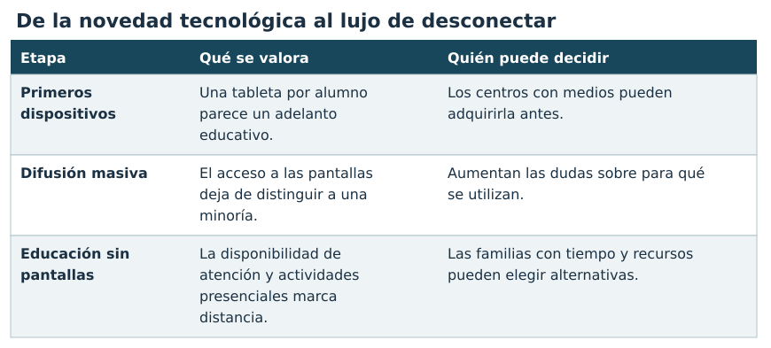

# ENS Rennes · D-E · Espagnol 2020 — Corrigé brut

*Corrigé rédigé par IA, non officiel. Signalez toute erreur.*

**Rédaction** · GPT-6.2 Astra Ultra · vitesse non renseignée

## I. Version

Le 22 septembre a lieu la Journée mondiale sans voiture, qui vise à éveiller chez les citoyens du monde une conscience écologique beaucoup plus forte. Nous savons tous qu’avoir une voiture facilite la vie. Mais la présence d’un trop grand nombre de voitures dans une ville augmente considérablement son empreinte carbone et agrandit un peu plus le trou dans la couche d’ozone. En 1997, la Grande-Bretagne est devenue le premier pays à adopter cette initiative à l’échelle nationale. Il a toutefois fallu attendre l’an 2000 pour que la Commission européenne proclame la Journée mondiale sans voiture et étende à une semaine entière les activités qui l’accompagnent.

Si l’origine de cette initiative remonte à 1973, lorsque plusieurs pays européens ont vu diminuer leurs réserves de pétrole, et donc de carburant, la proclamation d’une Journée mondiale sans voiture a avant tout pour but de nous faire réfléchir au bon usage de cette machine. Les voitures aggravent non seulement la pollution de l’environnement et les nuisances sonores, mais elles rendent aussi nos rues moins sûres et les gens plus sédentaires, avec des conséquences pour la santé telles que l’obésité et les troubles circulatoires et artériels. Nous savons qu’une journée sans voiture ne changera pas cette réalité, mais elle nous permet de prendre conscience que nous ne sommes pas si dépendants de ce mode de transport et qu’il n’est pas nécessaire de sortir sa voiture pour aller voir le voisin qui habite au coin de la rue ou accompagner les enfants à l’école qui se trouve à dix minutes à pied.

## II. Thème

Hace poco me preguntaron: «¿Cómo animar a las mujeres a orientarse hacia las profesiones de la inteligencia artificial [IA]?». ¡No tenía la respuesta! No creo que así nazcan las vocaciones. Por lo general, una profesión es una elección de vida, un compromiso con una especialidad. Es, ante todo, cuestión de convicción, y esto vale tanto para los hombres como para las mujeres. Así pues, la pregunta más adecuada sería: ¿cómo pueden las profesiones relacionadas con la IA convencer a las mujeres de que se dediquen a ellas? ¿Y hasta qué punto les resultan atractivas? En este caso, la pregunta nos concierne a todos: ¿qué atractivo tienen las profesiones de la IA y, en términos más generales, las del sector digital?

Hay que aumentar el valor y el impacto social de las profesiones tecnológicas. La formación del profesorado en las disciplinas que conducen a la IA, las matemáticas y la informática, es una cuestión crucial, como también lo es mejorar sus sueldos, porque todo está relacionado como en un sistema. Despertar el interés y suscitar vocaciones es una tarea que empieza muy pronto. No basta con diseñar un programa escolar sin reflexionar suficientemente sobre el porqué de sus contenidos y sobre la utilidad de unas fórmulas matemáticas desprovistas de sentido práctico.

## III.1. ¿Cómo está presentada la interacción entre las pantallas y la educación?

Eva Millet presenta la relación entre pantallas y educación como una inversión del significado social de un mismo objeto. Cuando se comercializó el iPad, algunos colegios privados exhibían sus tabletas en las jornadas de puertas abiertas. Tener un dispositivo por alumno parecía garantizar una enseñanza moderna. Las familias con menos recursos aspiraban a un acceso semejante y las autoridades se propusieron evitar una brecha digital. Una vez difundidas las pantallas, su mera presencia dejó de servir como señal de privilegio.

En ese momento el artículo dirige la mirada a Silicon Valley. Algunos de los profesionales que mejor conocen el negocio tecnológico limitan el uso de esos aparatos en casa o eligen escuelas que prescinden de ellos durante los primeros años. Millet destaca la paradoja mediante testimonios personales y comparaciones provocadoras. También menciona investigaciones sobre la atención, el sueño y los resultados escolares. Es importante distinguir la preocupación expresada por las familias de una prueba causal: observar una relación entre muchas horas de pantalla y notas más bajas no permite saber por sí solo qué produjo esa diferencia.

El giro final es económico. Una familia acomodada puede pagar actividades, disponer de adultos que acompañen al niño o elegir un centro con un proyecto pedagógico diferente. Así, una educación desconectada puede funcionar como una nueva forma de distinción. La autora invita a preguntarse no solo quién posee una tableta, sino quién dispone del tiempo, el dinero y la información necesarios para decidir cuándo apartarla.

*242 mots.*

## III.2. ¿En qué medida le parece positivo educar a un niño de hoy sin pantalla?

Educar a un niño sin pantallas puede ser positivo si eso significa reservar tiempo real para jugar, conversar, leer y dormir. Durante una comida, por ejemplo, apartar los teléfonos permite que los miembros de una familia se escuchen. En una salida al parque, observar directamente las plantas o inventar un juego con otros niños proporciona experiencias que una aplicación difícilmente sustituye. Estas decisiones tienen sentido por la actividad que hacen posible, incluso si en otros momentos se utiliza un dispositivo.

Sin embargo, convertir la ausencia total de pantallas en el objetivo de toda la infancia me parece poco realista y, en algunos casos, injusto. Un niño que vive lejos de sus abuelos puede mantener con ellos una conversación por vídeo. Un adolescente que prepara un trabajo escolar necesita aprender a comprobar la procedencia de una fotografía, comparar fuentes y proteger sus datos. Si la escuela excluye siempre los dispositivos, es probable que adquieran esas competencias sobre todo quienes tienen ayuda en casa. La desigualdad cambiaría de forma sin desaparecer.

Preferiría una incorporación gradual y acompañada. Antes de utilizar una tableta, el profesor o la familia pueden preguntar para qué sirve en esa actividad, cuánto tiempo requiere y qué ocurriría si se dejara a un lado. También conviene que los adultos respeten los límites que proponen. El propósito sería que el niño llegara a elegir con criterio. Saber apagar la pantalla y saber usarla cuando permite hacer algo valioso son dos capacidades educativas complementarias.

*243 mots.*

[Sujet](https://www.ens-rennes.fr/medias/fichier/sujet-espagnol-d-e-2020_1601913626913-pdf) · [Rapport](https://www.ens-rennes.fr/medias/fichier/rapport-de-jury-lv-espagnol-d-e-2020_1604400155989-pdf)
