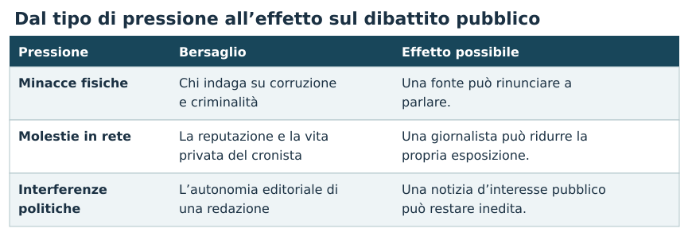

# ENS Rennes · D-E · Italien 2020 — Corrigé guidé

*Corrigé rédigé par IA, non officiel. Signalez toute erreur.*

**Rédaction** · GPT-6.2 Astra Ultra · vitesse non renseignée

## I. Version

> [!INDICATION]
> *Accudire* signifie prendre soin de quelqu’un ou de quelque chose. Pour traduire les séries d’infinitifs, rétablir le rythme de l’appel adressé aux adultes. La dernière phrase inclut les enfants des deux sexes.

**Cadeaux de Noël : « Achetez une épée à votre fille ». Sur les réseaux sociaux, un appel à l’égalité jusque sous le sapin**

« Il est triste d’entrer dans un magasin de jouets et de constater qu’un garçon peut être astronaute, chevalier, guerrier, pilote de drone ou d’avion, champion cycliste ou bâtisseur en Lego. Une fille, elle, peut faire la cuisine, repasser, coudre, faire la vaisselle, s’occuper de la maison et de ses poupées. » Ainsi commence un message sur les cadeaux de Noël qui circule depuis quelques jours sur les réseaux sociaux. Il appelle les « pères et mères », et, ajouterons-nous, tous ceux qui cherchent des cadeaux à déposer sous le sapin, à « élargir les horizons ».

Et, pourquoi pas, à acheter « à votre petite fille une épée lumineuse pour qu’elle puisse sauver le monde, une petite voiture, un ballon de football, un vélo. Bref, quelque chose qui lui fasse comprendre et sentir qu’elle peut devenir tout ce qu’elle veut ». À apprendre « aux garçons que faire la cuisine peut être extraordinaire. Faire la vaisselle, repasser et s’occuper de la maison sont des tâches importantes, que doivent se partager tous les membres de la famille ».

En somme, « apprenez aux garçons et aux filles que celui qui salit la vaisselle la lave, que le bleu ciel n’est pas réservé aux garçons et que le rose n’est pas réservé aux filles ». Car, conclut le message, « garçons et filles rêvent tout autant de changer le monde et d’être les héros de leurs histoires imaginaires : ne brisons pas ces rêves ».

## II. Thème

> [!INDICATION]
> Le texte distingue les règles successives jusqu’en 2011, puis en 2014. *Ordine degli avvocati* et *albo* désignent respectivement l’organisme professionnel et le registre. Conserver les formulations commerciales entre guillemets en les distinguant des faits relatés.

**Per diventare avvocati gli studenti italiani imboccano la «via spagnola»**

Nelle facoltà italiane di giurisprudenza la chiamano «via spagnola». «Diventare avvocati senza master né esame di Stato», riassumono sui loro siti alcune aziende italiane, che promettono agli studenti italiani in difficoltà con le dure prove di accesso alla professione «un percorso rapido, grazie alla normativa europea», per conseguire il titolo di avvocato in Spagna «e, di conseguenza, stabilirsi in Italia».

Nella penisola meno della metà dei candidati supera le prove orali. Fino al 2011 agli studenti italiani in possesso di una laurea in giurisprudenza conseguita nel proprio Paese bastava far riconoscere il titolo in Spagna, senza sostenere alcun esame, per potersi iscrivere direttamente a un *colegio de abogados*, l’equivalente spagnolo dell’ordine degli avvocati francese. Nel corso degli anni si sono aggiunti altri requisiti: dapprima una prova di riconoscimento ritenuta facilissima dagli italiani, poi, nel 2014, un master specialistico obbligatorio e un esame di accesso alla professione che, in realtà, consiste soltanto in una serie di quesiti a scelta multipla.

Per una cifra che va dai 3.000 agli 8.000 euro circa, alcune aziende italiane si occupano quindi dell’intero iter: raccogliere i documenti per la domanda d’iscrizione, organizzare i viaggi, far riconoscere in Spagna la laurea italiana in giurisprudenza, far sostenere all’interessato l’esame di accesso alla professione forense presso un’università e provvedere all’iscrizione all’ordine professionale spagnolo e, infine, a quello italiano.

## III.1. Quali minacce peserebbero attualmente sulla libertà di stampa secondo il rapporto 2018 Demonishing The Media?

> [!INDICATION]
> L’article de 2018 distingue un relevé d’agressions dans l’Union d’autres chiffres portant sur des périodes, des types de faits ou des régions différents. Employer le conditionnel d’attribution avec *secondo il rapporto*, puis commenter un mécanisme concret d’autocensure.

Secondo il rapporto del 2018 citato da Cristina Mastrandrea, le minacce alla libertà di stampa riguarderebbero anche democrazie europee che riconoscono formalmente il diritto di informare. La Costituzione italiana tutela la libera manifestazione del pensiero e vieta la censura della stampa. Ciò non impedisce, però, che qualcuno tenti di far tacere un cronista quando un’inchiesta mette in discussione interessi economici o politici. Il testo riferisce che nell’Unione europea sono state registrate 445 aggressioni fisiche nel periodo considerato, di cui 83 in Italia. Sono segnalazioni raccolte dall’indagine, non una misura completa di tutti gli episodi subiti.

La violenza colpisce in particolare chi indaga sul proprio territorio. Graziella Di Mambro, per esempio, è stata minacciata per il suo lavoro sugli appalti e sulla gestione dei rifiuti. A un’aggressione si aggiunge un effetto meno visibile: una fonte potrebbe rinunciare a testimoniare se teme di essere identificata, e altri cronisti potrebbero evitare lo stesso argomento. Le molestie in rete e le campagne di denigrazione possono rafforzare questa pressione quotidiana anche senza un intervento diretto dello Stato.

Esistono poi interferenze istituzionali. Norme giustificate con la sicurezza nazionale possono ostacolare il giornalismo investigativo, mentre un’emittente pubblica dipendente dal potere politico fatica a controllarne l’operato. Per il cittadino il danno consiste anche nelle domande che nessuno osa più fare. La pluralità delle testate, l’autonomia editoriale e una risposta efficace alle minacce aiutano a dare contenuto concreto alla garanzia costituzionale.

*232 mots.*

## III.2. Quali sono, secondo te, i vantaggi e gli svantaggi della professione del giornalista?

> [!INDICATION]
> Une réponse personnelle peut partir d’une enquête locale. Opposer aux avantages réels du métier ses contraintes matérielles, puis envisager les conditions concrètes d’un travail indépendant.

Il vantaggio più interessante del mestiere di giornalista, a mio giudizio, è la possibilità di rendere comprensibile qualcosa che riguarda tutti ma che pochi hanno il tempo di verificare. Se un comune annuncia che una scuola sarà ristrutturata, il cronista può leggere il contratto, visitare l’edificio, incontrare genitori e tecnici e spiegare perché i lavori siano in ritardo. Il risultato non è soltanto una notizia: i cittadini dispongono di elementi precisi per chiedere conto di una decisione. Si impara inoltre a formulare domande migliori quando gli interlocutori hanno esperienze diverse dalle proprie.

La stessa vicinanza alle persone crea responsabilità. Pubblicare in fretta un’accusa non verificata può danneggiare una reputazione; rivelare involontariamente l’identità di una fonte può metterla in difficoltà. Occorre quindi saper rinunciare a un titolo vistoso, cercare conferme indipendenti e dare all’interessato la possibilità di rispondere. A volte è difficile ottenere quel tempo quando la redazione dispone di pochi mezzi o remunera il collaboratore soltanto per i pezzi pubblicati.

Ci sono anche orari imprevedibili, pressioni degli inserzionisti e, per chi segue certi argomenti, minacce alla propria sicurezza. Non considero questi rischi una prova di coraggio che ogni giovane aspirante debba accettare da solo. Una redazione seria offre consulenza legale, condivide la verifica dei fatti e protegge le persone che lavorano sul campo. In tali condizioni sceglierei il giornalismo per la sua utilità pubblica e per il piacere di scoprire, con pazienza, ciò che una prima impressione non rivela.

*239 mots.*

[Sujet](https://www.ens-rennes.fr/medias/fichier/sujet-italien-d-e-2020_1601913639264-pdf) · [Rapport](https://www.ens-rennes.fr/medias/fichier/rapport-de-jury-lv-italien-d-e-2020_1604400164396-pdf)
