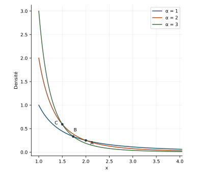
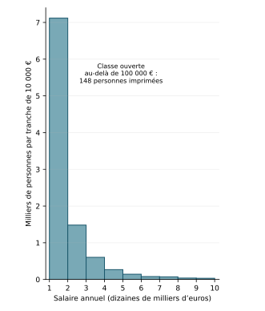
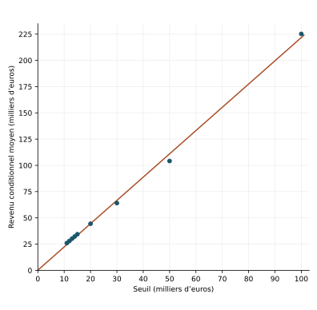

# ENS Rennes D-E — Mathématiques appliquées et statistiques 2020 · Corrigé guidé

*Corrigé rédigé par IA, non officiel. Signalez toute erreur.*

**Rédaction** · GPT-6.2 Astra Ultra · vitesse non renseignée

**Révision** · GPT-6.2 Astra Ultra · vitesse non renseignée

**Tirages de cadeaux et distribution des revenus.** Le fascicule associe dérangements, loi de Pareto et deux ajustements sur des salaires français. En partie IV, les effectifs du premier tableau et le total annoncé diffèrent de vingt personnes.

## Exercice I. Option et cadeau

### Question E.I.1

> [!INDICATION]
> Compléter les probabilités dans la partition des options et dans celle des cadeaux.

#### Solution

Avec les deux catégories de cadeaux du modèle, les huit probabilités, dans l’ordre de la question, sont $P(M)=0{,}21$, $P(P)=0{,}45$, $P(C)=0{,}34$, $P(J)=0{,}45$, $P(N\mid M)=0{,}60$, $P(J\mid M)=0{,}40$, $P(J\mid P)=0{,}45$ et $P(N\mid P)=0{,}55$.

### Question E.I.2

> [!INDICATION]
> Multiplier la fréquence de l’option par la probabilité du cadeau dans cette option.

#### Solution

Par la formule des probabilités composées, $P(M\cap J)=P(M)P(J\mid M)=0{,}21\times0{,}40=0{,}084$.

### Question E.I.3.a

> [!INDICATION]
> Décomposer le don de nourriture selon les trois options.

#### Solution

La formule des probabilités totales pour la partition $(M,P,C)$ donne $P(N)=0{,}21\times0{,}60+0{,}45\times0{,}55+0{,}34x$, soit $0{,}55=0{,}3735+0{,}34x$.

### Question E.I.3.b

> [!INDICATION]
> Isoler x sans arrondir les produits intermédiaires.

#### Solution

$P(N\mid C)=(0{,}55-0{,}3735)/0{,}34=353/680\simeq0{,}52$.

### Question E.I.4

> [!INDICATION]
> Rapporter la probabilité conjointe à celle de la nourriture.

#### Solution

Par la formule de Bayes, $P(C\mid N)=P(C)P(N\mid C)/P(N)=0{,}1765/0{,}55=353/1100\simeq0{,}32$.

## Exercice II. Dérangements

### Question E.II.1

> [!INDICATION]
> Énumérer les permutations sans point fixe jusqu’à trois personnes.

#### Solution

Une personne seule se tire elle-même ; pour deux, seul l’échange convient ; pour trois, les deux cycles de longueur 3 conviennent. Ainsi $(d_1,d_2,d_3)=(0,1,2)$. Parmi respectivement $1,2,6$ tirages équiprobables, cela donne $(a_1,a_2,a_3)=(0,1/2,1/3)$.

### Question E.II.2

> [!INDICATION]
> Compter tous les tirages sans remise en distinguant les personnes.

#### Solution

Le tirage attribue une permutation des $n$ noms aux $n$ élèves. Chaque permutation a probabilité $1/[n(n-1)\cdots1]=1/n!$. Exactement $d_n$ conviennent, donc $a_n=d_n/n!$.

### Question E.II.3.a

> [!INDICATION]
> Soustraire (n+1) fois le nombre précédent dans la relation admise.

#### Solution

Pour $n\ge2$, $u_{n+1}=n(d_n+d_{n-1})-(n+1)d_n=-(d_n-nd_{n-1})=-u_n$. La suite géométrique a pour raison $-1$ et premier terme $u_2=1-2\times0=1$.

### Question E.II.3.b

> [!INDICATION]
> Réintroduire les deux termes qui définissent u.

#### Solution

$u_n=u_2(-1)^{n-2}=(-1)^n$. Ainsi $d_n=nd_{n-1}+(-1)^n$ pour $n\ge2$.

### Question E.II.4

> [!INDICATION]
> Faire apparaître le dernier terme dans le passage au rang suivant.

#### Solution

À $n=1$, $1!(1-1)=0=d_1$. Si $d_n=n!\sum_{k=0}^n(-1)^k/k!$, alors
$$d_{n+1}=(n+1)d_n+(-1)^{n+1}=(n+1)!\left(\sum_{k=0}^n\frac{(-1)^k}{k!}+\frac{(-1)^{n+1}}{(n+1)!}\right).$$
C’est la formule au rang $n+1$, d’où la récurrence.

### Question E.II.5

> [!INDICATION]
> Diviser le dénombrement par le nombre total de permutations.

#### Solution

$a_n=\displaystyle\sum_{k=0}^n(-1)^k/k!$ pour tout $n\ge1$.

### Question E.II.6

> [!INDICATION]
> Reconnaître le développement en série entière d’une fonction usuelle.

#### Solution

Par la série exponentielle en $-1$, $a_n\to e^{-1}\simeq0{,}36788$. Le quotient de deux termes consécutifs de la série est $-1/(k+1)$ ; c’est la série de l’exponentielle, parfois appelée par inadvertance « géométrique » dans le rapport.

Le critère des séries alternées donne le contrôle numérique $|a_n-e^{-1}|\le 1/(n+1)!$. Par exemple, $d_4=9$, donc $a_4=9/24=0{,}375$. L’écart à $e^{-1}\simeq0{,}36788$ est inférieur à $1/120$.

## Problème I. Courbes des densités pour un seuil unitaire

### Question P.I.1

> [!INDICATION]
> Écrire la fonction comme une puissance de x sur la demi-droite étudiée.

#### Solution

Pour $x\ge1$, $f_\alpha(x)=\alpha x^{-(\alpha+1)}$ avec $\alpha+1>0$. Sa limite en $+\infty$ vaut 0.

### Question P.I.2

> [!INDICATION]
> Dériver une puissance de la variable positive.

#### Solution

Comme $x\ge1$, la puissance réelle est dérivable et $f'_\alpha(x)=-\alpha(\alpha+1)x^{-\alpha-2}<0$. La fonction décroît strictement de $f_\alpha(1)=\alpha$ vers 0.

### Question P.I.3

> [!INDICATION]
> Dériver une seconde fois pour établir la convexité.

#### Solution

$f''_\alpha(x)=\alpha(\alpha+1)(\alpha+2)x^{-\alpha-3}>0$ ; $f_\alpha$ est strictement convexe sur $[1,\infty[$.

### Question P.I.4

> [!INDICATION]
> Diviser les deux ordonnées puis résoudre une équation en puissance.

#### Solution

Pour $\alpha\ne\beta$, l’égalité équivaut à $x^{\beta-\alpha}=\beta/\alpha$. Elle a une unique solution positive $c=(\beta/\alpha)^{1/(\beta-\alpha)}$. Comme $\ln(\beta/\alpha)$ a le signe de $\beta-\alpha$, on a $c>1$. Le point commun est $(c,\alpha c^{-\alpha-1})$.

### Question P.I.5

> [!INDICATION]
> Calculer les trois abscisses d’intersection et vérifier les ordonnées communes.

#### Solution

Dans le repère orthonormé de 3 cm par unité, les courbes partent de $(1,1)$, $(1,2)$ et $(1,3)$. Les intersections sont $A=(2,1/4)$ pour $(1,2)$, $B=(\sqrt3,1/3)$ pour $(1,3)$ et $C=(3/2,16/27)$ pour $(2,3)$. Elles décroissent ensuite vers l’axe horizontal.

## Problème II. Loi de Pareto de seuil quelconque

### Question P.II.1

> [!INDICATION]
> Vérifier signe, régularité et intégrale totale.

#### Solution

La fonction est positive ou nulle, continue par morceaux sur $\mathbb R$, et son unique saut en $x_0>0$ n’affecte pas l’intégrale. Pour $A\ge x_0$,
$$\int_{x_0}^A\alpha x_0^\alpha t^{-\alpha-1}dt=1-(x_0/A)^\alpha\to1.$$
L’intégrale sur $]-\infty,x_0[$ est nulle. Ce sont bien les propriétés d’une densité.

### Question P.II.2.a

> [!INDICATION]
> Couper l’intégration au début du support.

#### Solution

La fonction de répartition vaut $F(x)=0$ pour $x<x_0$ et $F(x)=1-(x_0/x)^\alpha$ pour $x\ge x_0$. En particulier $F(x_0)=0$.

### Question P.II.2.b

> [!INDICATION]
> Prendre le logarithme de la probabilité de queue.

#### Solution

Pour $x\ge x_0$, $1-F(x)=(x_0/x)^\alpha>0$, donc $\ln(1-F(x))=\alpha\ln x_0-\alpha\ln x$.

### Question P.II.2.c

> [!INDICATION]
> Chercher le quantile d’ordre un demi sur le support.

#### Solution

$F(x)=1/2$ équivaut à $(x_0/x)^\alpha=1/2$, soit $x=x_0\,2^{1/\alpha}$. C’est l’unique médiane puisque $F$ est continue et strictement croissante sur son support.

### Question P.II.3

> [!INDICATION]
> Comparer le premier moment à l’intégrale d’une puissance sur une demi-droite.

#### Solution

$X$ est positive et $\mathbb EX=\alpha x_0^\alpha\int_{x_0}^\infty t^{-\alpha}dt$ est finie exactement si $\alpha>1$ (divergence logarithmique à 1). Dans ce cas elle vaut $\alpha x_0/(\alpha-1)$.

### Question P.II.4

> [!INDICATION]
> Déterminer quand le deuxième moment existe avant de soustraire le carré de la moyenne.

#### Solution

Le deuxième moment est $\alpha x_0^\alpha\int_{x_0}^\infty t^{1-\alpha}dt$, fini exactement si $\alpha>2$. Il vaut alors $\alpha x_0^2/(\alpha-2)$ et la variance est
$$\operatorname{Var}X=\frac{\alpha x_0^2}{\alpha-2}-\frac{\alpha^2x_0^2}{(\alpha-1)^2}=\frac{\alpha x_0^2}{(\alpha-2)(\alpha-1)^2}.$$

## Problème III. Caractérisation par la moyenne au-dessus d’un seuil

### Question P.III.1

> [!INDICATION]
> Comparer l’intégrande du numérateur à x fois celui du dénominateur.

#### Solution

Sur $[x,\infty[$, $(t-x)f(t)\ge0$. Par intégration, $\int_x^\infty tf(t)dt\ge x\int_x^\infty f(t)dt$. Le dénominateur étant strictement positif, $M_X(x)\ge x$.

### Question P.III.2

> [!INDICATION]
> Évaluer les deux queues à partir de x plutôt que du seuil initial.

#### Solution

Pour $x\ge x_0$ et $\alpha>1$, le numérateur vaut $\alpha x_0^\alpha x^{1-\alpha}/(\alpha-1)$ et le dénominateur vaut $(x_0/x)^\alpha$. Leur quotient est $M_X(x)=\alpha x/(\alpha-1)$.

### Question P.III.3.a

> [!INDICATION]
> Exploiter le support de la densité.

#### Solution

Comme $X$ est à valeurs dans $[x_0,\infty[$, $G(x_0)=\int_{x_0}^\infty f(t)dt=1$.

### Question P.III.3.b

> [!INDICATION]
> Ramener chaque queue à une constante moins une intégrale à borne supérieure variable.

#### Solution

$G(x)=1-\int_{x_0}^xf(t)dt$ et $H(x)=\mathbb EX-\int_{x_0}^xtf(t)dt$. La continuité des intégrandes permet d’appliquer le théorème fondamental. Ainsi $G'=-f$ et $H'=-xf$ (dérivées à droite au seuil).

### Question P.III.3.c

> [!INDICATION]
> Dériver H égal à kxG et éliminer H prime.

#### Solution

Puisque $G>0$, l’hypothèse donne $H=kxG$. En dérivant, $xG'=H'=kG+kxG'$. On obtient $G=(1-k)xG'/k$.

### Question P.III.3.d

> [!INDICATION]
> Choisir l’exposant qui annule la dérivée du produit.

#### Solution

Posons $a=k/(k-1)>0$. D’après la relation précédente $xG'=-aG$, donc $I'=x^{a-1}(aG+xG')=0$. Ainsi $x^aG(x)=x_0^aG(x_0)=x_0^a$ et $G(x)=(x_0/x)^a$.

### Question P.III.3.e

> [!INDICATION]
> Retrouver la fonction de répartition sur son support et en dehors.

#### Solution

Pour $x\ge x_0$, $F(x)=1-G(x)=1-(x_0/x)^a$ ; pour $x<x_0$, $F(x)=0$. C’est la fonction de répartition de $\operatorname{VP}(k/(k-1);x_0)$.

## Problème IV. Revenus et estimation des paramètres

### Question P.IV.1.a

> [!INDICATION]
> Distinguer la grandeur observée des effectifs qui décrivent sa distribution.

#### Solution

Le caractère observé est le salaire annuel, quantitatif continu, regroupé en classes. La colonne $x_i$ de ce premier tableau donne des effectifs entiers pour ces classes.

### Question P.IV.1.b

> [!INDICATION]
> Faire correspondre les aires aux effectifs et isoler la classe ouverte.

#### Solution

Les neuf classes bornées ont la même largeur, donc les hauteurs sont proportionnelles aux effectifs imprimés : 7 118, 1 481, 602, 268, 143, 79, 71, 38 et 32. Sur papier elles occupent chacune 1 cm de large et 2 cm de haut pour 1 000 personnes. On indique séparément les 148 personnes de la classe ouverte : sa largeur infinie ne définit pas une hauteur d’histogramme comparable. La chute rapide des premières classes puis la longue queue à droite rappellent les densités décroissantes de Pareto.

### Question P.IV.1.c

> [!INDICATION]
> Additionner d’abord les dix effectifs. Comparer ensuite la fréquence accumulée à 100 000 € dans le second tableau au nombre de personnes de la dernière classe.

#### Solution

Avec les centres 15 000, 25 000, …, 95 000 € et la moyenne imposée 225 240 € pour la classe ouverte, la somme pondérée imprimée vaut **234 855 520 €**. Les effectifs imprimés totalisent **9 980**, dont 9 832 dans les neuf classes bornées. La moyenne estimée des 9 980 observations listées vaut donc **23 532,62 €**.

Le second tableau donne $F(100000)=0{,}9832$. Sur les 10 000 personnes annoncées, cela implique 168 personnes dans la dernière classe, au lieu de 148. Avec cette correction cohérente, la moyenne estimée des **10 000** personnes vaut $(234855520+20\times225240)/10000=\mathbf{23936{,}03}$ €. Diviser la seule somme imprimée par 10 000 donnerait 23 485,55 € et laisserait vingt salaires sans contribution.

Si les vingt salaires absents ont une moyenne inconnue $m$, la moyenne estimée des 10 000 personnes s’écrit $(234855520+20m)/10000$. Dans l’interprétation où la dernière classe compte 168 personnes, on conserve pour cette classe la moyenne de 225 240 € fournie par le second tableau.

### Question P.IV.2.a

> [!INDICATION]
> Associer chaque seuil à la moyenne au-dessus de ce seuil, en gardant les mêmes unités.

#### Solution

En milliers d’euros les neuf couples sont $(11;25{,}997)$, $(12;28{,}011)$, $(13;30{,}214)$, $(14;32{,}253)$, $(15;34{,}365)$, $(20;44{,}400)$, $(30;64{,}086)$, $(50;104{,}142)$ et $(100;225{,}240)$. L’échelle demandée est de 2 cm pour 10 milliers d’euros en abscisse et 2 cm pour 25 milliers en ordonnée.

### Question P.IV.2.b

> [!INDICATION]
> Calculer la corrélation de Pearson avec les neuf couples.

#### Solution

En euros, $\bar x=29444{,}44$, $\bar y=65412{,}00$, $V(x)\simeq761358024{,}69$, $V(y)\simeq3749219624{,}89$ et $\operatorname{Cov}(x,y)\simeq1687710888{,}89$. Le rapport $r=\operatorname{Cov}(x,y)/\sqrt{V(x)V(y)}\simeq0{,}99893$, soit **1,00 au centième**. La liaison affine croissante est très forte.

### Question P.IV.2.c

> [!INDICATION]
> Appliquer les formules de la pente et de l’ordonnée à l’origine avec les données en euros.

#### Solution

Avec $a=\operatorname{Cov}(x,y)/V(x)\simeq2{,}216711$ et $b=\bar y-a\bar x\simeq142{,}169126$, la droite est $\widehat y\simeq2{,}22x+142{,}17$ en euros. Elle figure sur le nuage de la question 2.a.

### Question P.IV.2.d

> [!INDICATION]
> Comparer la régression à la propriété caractéristique du problème III.

#### Solution

La constante 142,17 € est petite devant des revenus conditionnels compris entre 25 997 et 225 240 €. La relation observée approche donc $M(x)\simeq kx$ avec $k>1$. La partie III caractérise la loi de Pareto lorsque cette relation est exacte à tout seuil du support. Ici elle motive un modèle empirique.

### Question P.IV.2.e

> [!INDICATION]
> Inverser la relation entre la pente et l’indice de Pareto.

#### Solution

La pente estime $k=\alpha/(\alpha-1)$. Avec sa valeur non arrondie, on obtient $\widehat\alpha=k/(k-1)\simeq1{,}82$.

### Question P.IV.2.f

> [!INDICATION]
> La moyenne de Pareto égale le seuil multiplié par la pente de la moyenne conditionnelle.

#### Solution

D’après II.3, $\mathbb EX=kx_0$, donc $\widehat x_0=\bar s/k$. Pour les 10 000 revenus avec la correction documentée en IV.1.c, $23936{,}032/2{,}216711237\simeq\mathbf{10797{,}99}$ €. Avec les seuls 9 980 revenus effectivement listés, on obtient **10 616,00 €**. Ces estimations utilisent la pente non arrondie.

### Question P.IV.3.a

> [!INDICATION]
> Prendre des logarithmes naturels, en distinguant F de sa fonction de survie.

#### Solution

À partir des neuf seuils dans l’ordre du tableau, on obtient les valeurs au centième suivantes.

| Seuil (€) | $t_i=\ln x_i$ | $z_i=\ln(1-F(x_i))$ |
|---:|---:|---:|
| 11 000 | 9,31 | −0,17 |
| 12 000 | 9,39 | −0,32 |
| 13 000 | 9,47 | −0,46 |
| 14 000 | 9,55 | −0,60 |
| 15 000 | 9,62 | −0,73 |
| 20 000 | 9,90 | −1,24 |
| 30 000 | 10,31 | −1,97 |
| 50 000 | 10,82 | −2,94 |
| 100 000 | 11,51 | −4,09 |

### Question P.IV.3.b

> [!INDICATION]
> Utiliser les données logarithmiques avant leur arrondi pour calculer la corrélation.

#### Solution

On trouve $V(t)\simeq0{,}505124$, $V(z)\simeq1{,}617614$ et $\operatorname{Cov}(t,z)\simeq-0{,}903800$. Le coefficient de Pearson est $r\simeq-0{,}99985$, soit $-1{,}00$ au centième. Une droite décroissante ajuste très bien ces neuf points.

### Question P.IV.3.c

> [!INDICATION]
> Calculer la pente de z en t et imposer le passage par le point moyen.

#### Solution

La pente est $A=\operatorname{Cov}(t,z)/V(t)\simeq-1{,}789263$ et l’ordonnée à l’origine est $B=\bar z-A\bar t\simeq16{,}477864$. Au centième, $\widehat z=-1{,}79t+16{,}48$.

### Question P.IV.3.d

> [!INDICATION]
> Comparer les deux coefficients du modèle logarithmique à ceux de II.2.b.

#### Solution

Pour la loi de Pareto, $\ln(1-F(x))=-\alpha\ln(x)+\alpha\ln x_0$. L’alignement des points $(t_i,z_i)$ et la pente négative sont précisément la forme attendue du modèle sur ces seuils.

### Question P.IV.3.e

> [!INDICATION]
> Identifier les paramètres avec les coefficients non arrondis de la droite.

#### Solution

On estime $\alpha=-A\simeq\mathbf{1{,}79}$ et $x_0=\exp(B/\alpha)\simeq\mathbf{9989{,}61}$ €. On utilise les logarithmes et les coefficients initiaux à pleine précision avant l’arrondi final, car l’exponentiation est sensible à l’arrondi de la pente.

Les deux estimations de $\alpha$ se situent entre 1 et 2. Dans les deux modèles de Pareto ajustés, le revenu a donc une moyenne finie et un deuxième moment infini. Le tableau d’effectifs fini conserve sa propre dispersion empirique.
