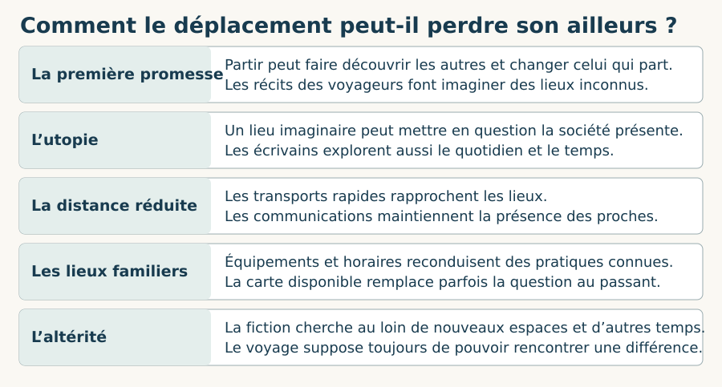
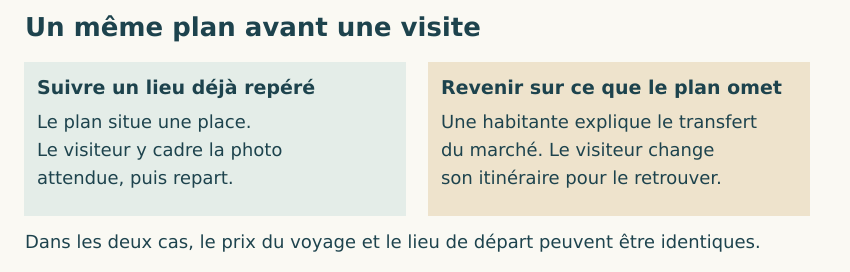

# ENS · Cycle master mathématiques — Français et culture générale 2020 · Corrigé brut

*Corrigé rédigé par IA, non officiel. Signalez toute erreur.*

**Rédaction** · GPT-6.2 Astra Ultra · vitesse non renseignée

**Autocontrôle** · GPT-6.2 Astra Ultra · vitesse non renseignée

**Révision (tour 1)** · GPT-6.2 Astra Ultra · vitesse non renseignée · 26 novembre 2026

## Sujet et consignes

École Normale Supérieure Paris-Saclay et École Normale Supérieure de Rennes. Session 2020. Second concours – Admission en cycle master mathématiques. Aucun document et aucune calculatrice autorisés. Durée de l’épreuve, trois heures.

Thierry Paquot, « L’effacement programmé de l’ailleurs », Esprit, 7/2016 (juillet-août), p. 59–64. Texte p. 2–4 du PDF, avec une note sur Mme de Parabère p. 3. Questions p. 4.

Résumer le texte en 220 mots (avec une marge de tolérance de + ou – 10%). Le nombre exact de mots utilisés sera indiqué en fin de résumé. L’intervalle admis va de 198 à 242 mots.

Sous forme d’un développement construit, commenter, au choix, l’une des deux réflexions suivantes de l’auteur : Chaque exercice vaut dix points. Les deux options sont traitées ici.

Le catalogue de la session répertorie le feuillet de français comme seul document pour cette matière. [Annales de Paris-Saclay](https://ens-paris-saclay.fr/admission/voie-eleve-concours/concours-cycle-master/annales-2nd-concours?field_orientation_2c_target_id%5B%5D=313&field_year_target_id%5B%5D=541&field_test_2c_target_id%5B%5D=419)

## 1. Résumé

Le tourisme de masse laisse place à des rencontres attentives, mais le voyageur emporte souvent son monde familier avec lui. Aller ailleurs devrait pourtant permettre de devenir autre. Du temps des grandes explorations, chaque départ pouvait transformer les cartes. Les récits des voyageurs passionnaient un public avide de terres inconnues.

Cette géographie inachevée permet à Thomas More de situer hors de toute carte une société meilleure. Ses successeurs critiquent leur propre monde en décrivant des sociétés imaginaires que les récits de voyage rendent plausibles et désirables. Le dépaysement se trouve aussi dans la banalité quotidienne observée par Stendhal ou dans les époques lointaines où Gautier se projette.

Les transports rapides modifient notre expérience des distances. Les communications instantanées changent davantage encore le sens du voyage. Des touristes visitant Paris continuent de converser avec leurs proches et leur envoient des photographies de lieux longuement consultés avant le départ. Ils se déplacent sans rencontrer de véritable surprise.

Les équipements, les horaires et les manières de consommer se ressemblent partout. Les cartes constamment actualisées dispensent de solliciter le savoir des habitants. Avec cet effacement des lieux inconnus, la littérature utopique décline et la fiction reporte ses explorations vers les planètes ou les temps futurs. Pour découvrir ce que nous pouvons devenir, nous avons pourtant besoin de rencontrer une altérité, jusque dans nos vies.

**220 mots.**

## 2a. L’ailleurs, l’utopie et la découverte de soi

« Sans ailleurs, plus d’utopie, sans ailleurs, moins de voyage, cela est lié à notre condition d’humain qui, en fin de compte, ne se découvre qu’en découvrant l’autre en lui. »

Quand Thomas More confie à un voyageur le récit d’une île inconnue, il donne au lecteur un moyen de penser ce qui, dans sa propre société, lui semblait aller de soi. Thierry Paquot relie cette opération à l’expérience même du voyageur. Une part de soi se révélerait seulement dans la rencontre d’un ailleurs. Que devient cette possibilité quand presque toute la planète a été cartographiée ? La distance géographique ouvre une épreuve de comparaison, mais seule une disposition à voir autrement permet de la transformer en découverte.

L’utopie donne une forme particulièrement nette à cette opération. Dans le premier livre de More, les peines infligées aux voleurs ne suppriment pas la pauvreté produite notamment par la clôture des terres. Le second livre permet d’imaginer une autre organisation des ressources. Qu’on approuve ou non les règles de l’île, le déplacement a déjà modifié la question du lecteur. Une conduite jusque-là tenue pour inévitable apparaît comme le résultat d’institutions que d’autres pourraient remplacer. Le lieu fictif produit ainsi un effet réel sur la manière d’habiter le lieu connu.

Paquot s’arrête sur les deux sens possibles du nom inventé par More en 1516. Un « bon lieu » promet un bonheur que le lecteur peut désirer. Un « sans lieu » le prive de la possibilité d’aller vérifier l’existence de l’île. Ce défaut de coordonnées entretient la question politique du livre. Le lecteur doit juger lui-même ce que les institutions décrites changeraient à sa vie. La carte achevée laisse cette épreuve intellectuelle intacte.

Encore faut-il que l’altérité résiste à ce que le voyageur lui demande de prouver. Celui qui part à la recherche d’une société entièrement généreuse ou entièrement attardée peut accumuler des images et retrouver partout ses propres catégories. Un touriste qui ne considère l’étal d’un marché que comme une réserve de couleurs pour son album voit peu de chose des rapports entre producteurs, vendeurs et habitués. Si une personne sur place lui apprend pourquoi un produit a disparu ou pourquoi le marché change de jour, elle modifie le cadre même de ce qu’il regardait. Le voyage a produit une connaissance de soi quand il a fait sentir la limite d’une attente.

Un ailleurs peut dès lors s’ouvrir sans destination vierge. Relire le plan ancien de son quartier avec un habitant qui y a travaillé avant la fermeture d’une usine suffit parfois à faire apparaître une ville inconnue sous les rues familières. La fiction peut de même déplacer l’expérience dans le temps et demander ce qu’une société future trouvera étrange dans nos règles présentes. L’inconnu tient moins au blanc d’une carte qu’au droit laissé à une voix, à une pratique ou à une œuvre de démentir nos évidences. Ce droit est nécessaire à la fois au voyage qui transforme et à l’utopie qui rend le présent discutable.

## 2b. Les touristes sont-ils de simples consommateurs ?

« …il serait exagéré de considérer tous les touristes comme de simples consommateurs de l’industrie touristique, nécessairement niais ou béats. »

On peut réserver deux places dans la même visite guidée et faire deux voyages différents. L’un recueille les images qu’il s’attendait à voir. L’autre écoute une remarque du guide sur la transformation du quartier et retourne le lendemain regarder les bâtiments depuis un autre point de vue. Tous deux ont payé un service. Cette donnée ne décide pas, à elle seule, de la qualité de leur attention. Paquot prévient qu’il serait exagéré de considérer tous les touristes comme des « consommateurs » nécessairement crédules ou satisfaits. Comment reconnaître les contraintes d’une industrie de masse sans nier les capacités de ceux qui l’utilisent ?

Les entreprises touristiques ont de bonnes raisons de standardiser une expérience. Un grand hôtel propose des horaires prévisibles, une agence garantit la visite des monuments attendus et une plateforme classe les lieux selon des notes faciles à comparer. Le voyageur pressé est incité à substituer un signe de réussite, telle la photo prise au bon endroit, au temps nécessaire pour comprendre ce qu’il voit. Quand les mêmes commerces s’installent auprès des sites et que les loyers des habitants augmentent, l’organisation touristique transforme aussi la réalité que l’on voyageait pour connaître. L’effet ne dépend donc pas exclusivement de la naïveté supposée de chaque individu.

La standardisation peut pourtant être une condition d’accès. Un itinéraire connu à l’avance autorise le voyage d’une famille qui doit pouvoir repérer des ascenseurs ou faire reposer un enfant. Un guide rémunéré peut expliquer le rôle d’une institution locale qu’aucun détail visible ne permettrait de deviner. Même un téléphone peut isoler son utilisateur dans une conversation lointaine ou lui permettre de traduire une question adressée ici. La liberté du regard ne se mesure donc pas au caractère coûteux, solitaire ou imprévu d’un déplacement. Faire de l’aventurier indépendant le seul bon voyageur reviendrait à réserver les vertus du voyage à ceux qui disposent de temps, de ressources et de mobilité.

Le voyageur de Paquot a déjà parcouru virtuellement les rues qu’il veut photographier. Ce repérage antérieur explique la force du circuit marchand. Une remarque reçue sur place peut pourtant contredire le plan le plus exact. La carte situe l’ancienne halle. Une habitante indique où les commerces ont dû se déplacer et ce que les anciens clients y ont perdu. Le visiteur peut alors réviser le récit qu’il destinait à ses proches. La question porte sur l’usage qu’il fait de sa première information.

Une rencontre plus attentive commence quand les personnes visitées peuvent agir sur les conditions de la visite et donner leur interprétation des lieux. Un parcours conduit par d’anciens ouvriers dans un site reconverti ne garantit pas à tout visiteur une expérience profonde. Il lui permet toutefois de poser une question dont la réponse n’est écrite sur aucune brochure. On peut juger la structure d’une industrie et les effets collectifs qu’elle produit sans attribuer d’avance à chacun de ses clients la même manière de voir. Le consommateur devient aussi un interlocuteur lorsqu’il accepte que le séjour lui apprenne autre chose que ce qu’il était venu acheter.

[Sujet officiel](https://ens-paris-saclay.fr/sites/default/files/CONCOURS/ANNALES_2C/2C_Math/2020_Sujet_2C_Maths_Francais.pdf)
