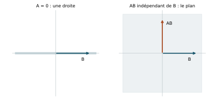

# ENS Paris-Saclay et Rennes — Cycle master mathématiques 2020 · Corrigé brut

*Corrigé rédigé par IA, non officiel. Signalez toute erreur.*

**Rédaction** · GPT-6.2 Astra Ultra · vitesse non renseignée

**Révision** · GPT-6.2 Astra Ultra · vitesse non renseignée · 26 novembre 2026

**Sous-groupes matriciels et contrôle linéaire.** Les problèmes A et B sont indépendants. La fermeture d’un sous-groupe dans la question A.7 dépend de l’espace ambiant ; l’équation du problème B est comprise sous sa forme intégrale.

## A.I. Exponentielle et logarithme matriciels

### Question A.1

La norme opératorielle est sous-multiplicative, donc $\|M^i/i!\|\le\|M\|^i/i!$. Sur $\|M\|\le R$, la série est normalement convergente car $\sum R^i/i!=e^R$. L’espace des matrices est complet. La somme existe et la convergence uniforme sur toute boule de polynômes continus montre que $M\mapsto e^M$ est continue.

### Question A.2.a

Si $AB=BA$, le coefficient de degré total $j$ dans le produit est $\sum_{i=0}^j A^iB^{j-i}/[i!(j-i)!]=(A+B)^j/j!$ par le binôme. Le produit de Cauchy est permis par convergence absolue, donc $e^{A+B}=e^Ae^B$. Par récurrence $e^{kA}=(e^A)^k$ pour $k\in\mathbb N$, avec $e^0=I$.

### Question A.2.b

$M$ commute avec $-M$ et $e^Me^{-M}=e^{-M}e^M=e^0=I$. Ainsi $e^M$ est toujours inversible et son inverse vaut $e^{-M}$.

### Question A.3.a

La puissance $P_i(M)=M^i$ est polynomiale dans les entrées, donc de classe $C^1$. Pour $i\ge1$,
$$dP_i(M)[H]=\sum_{j=0}^{i-1}M^jHM^{i-1-j}.$$
En développant $(M+H)^i$, ces termes sont ceux à un seul facteur $H$ ; tous les autres termes de variation ont au moins deux facteurs $H$. Pour $i=0$, la fonction est constante et sa différentielle nulle.

### Question A.3.b

Sur $\|M\|\le R$ avec $R>0$, $\|dP_i(M)\|\le i R^{i-1}$. La série des différentielles divisées par $i!$ converge donc normalement sur chaque boule, puisque $\sum_{i\ge1}R^{i-1}/(i-1)!=e^R$. Avec A.1, le théorème de dérivation des séries en dimension finie donne une somme $C^1$ et $d\exp(M)=\sum_{i\ge1}dP_i(M)/i!$.

### Question A.3.c

La différentielle de l’exponentielle en 0 vaut $H\mapsto H$. Seul le terme de degré 1 contribue, tous les termes de degré supérieur contenant un facteur $M=0$.

### Question A.4

$\exp$ est $C^1$, $\exp(0)=I$, et $d\exp(0)$ est l’identité, donc inversible. Le théorème d’inversion locale donne des ouverts $U\ni0$ et $V\ni I$ tels que $\exp:U\to V$ soit un $C^1$-difféomorphisme. Par A.2.b, $V\subset GL_n(\mathbb K)$. La différentielle de son inverse en $I$ est $d\log(I)=(d\exp(0))^{-1}=\operatorname{Id}$.

### Question A.5.a

$e^{tM}e^{tN}=(I+tM+o(t))(I+tN+o(t))=I+t(M+N)+o(t)$. Ce produit est dans $V$ pour $t$ assez petit. Puisque $\log(I)=0$ et $d\log(I)=\operatorname{Id}$, on trouve $\log(e^{tM}e^{tN})=t(M+N)+t\eta(t)$ avec $\|\eta(t)\|\to0$ lorsque $t\downarrow0$.

### Question A.5.b

Pour $k$ assez grand, $e^{M/k}e^{N/k}=\exp((M+N+\eta(1/k))/k)$. Par A.2.a, sa puissance $k$ est $\exp(M+N+\eta(1/k))$, qui tend vers $e^{M+N}$ par continuité. Cette formule ne requiert pas que $M$ et $N$ commutent.

## A.II. Topologie des sous-groupes

### Question A.6

La translation à gauche $\ell_M(N)=MN$ est continue car la multiplication matricielle est continue. Elle est bijective avec inverse $\ell_{M^{-1}}$, lui aussi continu. C’est donc un homéomorphisme de $GL_n(\mathbb K)$.

### Question A.7.a

**Le résultat imprimé est faux dans $M_n(\mathbb K)$.** Prenons $G=GL_n(\mathbb K)$. Il est ouvert, par continuité du déterminant, mais $I/j\to0$ avec $I/j\in G$ et $0\notin G$. L’indication établit l’énoncé relatif suivant : un sous-groupe ouvert de $GL_n(\mathbb K)$ est fermé **dans $GL_n(\mathbb K)$**. En effet son complément dans ce groupe est la réunion des classes $MG$, $M\notin G$, ouvertes par A.6. Les matrices singulières sont absentes de cette réunion.

### Question A.7.b

La réciproque est fausse aussi. Le sous-groupe $\{I\}$ est fermé dans $M_n(\mathbb K)$ et dans $GL_n(\mathbb K)$, mais il n’est ouvert dans aucun des deux car $(1+1/j)I\ne I$ converge vers $I$.

### Question A.8.a

Si $\|R\|<1$, la série $S=\sum_{j\ge0}R^j$ converge absolument. Pour la somme partielle $S_m$, on a $(I-R)S_m=S_m(I-R)=I-R^{m+1}$. Ce dernier terme tend vers $I$. Par continuité du produit, $I-R$ est inversible et $(I-R)^{-1}=S$.

### Question A.8.b

Pour $M$ inversible et $\|M^{-1}H\|<1$, $M+H=M(I+M^{-1}H)$ est inversible par A.8.a. On obtient donc un voisinage ouvert de chaque $M$ inclus dans $GL_n$. De plus $(M+H)^{-1}=(I+M^{-1}H)^{-1}M^{-1}$ tend vers $M^{-1}$, puisque la série de Neumann donne $\|(I+R)^{-1}-I\|\le\|R\|/(1-\|R\|)$. L’inversion est continue et est sa propre inverse, donc un homéomorphisme.

### Question A.9.a

Prenons un voisinage ouvert $W$ de $I$ dans $G$. Par A.8.b restreint à $G$, $W^{-1}$ est ouvert ; $V=W\cap W^{-1}$ est un voisinage ouvert de $I$ et $V^{-1}=V$.

### Question A.9.b

Pour $m\ge2$, $V^m=\bigcup_{P\in V^{m-1}} PV$. Chaque $PV$ est ouvert dans $G$ par la translation, donc $V^m$ est ouvert. Le cas $m=1$ est immédiat.

### Question A.9.c

La réunion $G_0$ contient $I$ et est ouverte par A.9.b. Un produit d’éléments de $V^j$ et $V^k$ appartient à $V^{j+k}$. Comme $V=V^{-1}$, l’inverse d’un mot de $V^j$ est encore dans $V^j$. C’est donc un sous-groupe. Son complément dans $G$ est réunion de classes ouvertes, donc $G_0$ est fermé dans $G$. Si $G$ est connexe, ce sous-ensemble ouvert et fermé non vide est $G$ tout entier.

### Question A.10.a

Pour $N$ fixé, $\psi_N(M)=N^{-1}M^{-1}NM$ est continue sur $G$ par continuité de l’inversion et du produit. De plus $\psi_N(I)=I$.

### Question A.10.b

Si $N\in H$ et $M\in G$, la normalité donne $M^{-1}NM\in H$, donc $\psi_N(M)\in H$. Comme $G$ est connexe, son image continue est connexe. Dans l’espace discret $H$, un sous-ensemble connexe non vide est réduit à un point ; ce point est $I$ d’après A.10.a. Il en résulte $M^{-1}NM=N$ pour tout $M$, donc $N\in Z$. Ainsi $H\subset Z$.

### Question A.10.c

Si $\psi_N(G)\subset Z$ et $Z$ est discret, le même argument de connexité donne $\psi_N(G)=\{I\}$ et $N\in Z$. Si $NZ$ est central dans $G/Z$, le commutateur $N^{-1}M^{-1}NM$ appartient à $Z$ pour tout $M$, donc $N\in Z$ et $NZ=Z$. Le centre du quotient est ainsi trivial.

## A.III. Sous-groupes fermés et directions infinitésimales

### Question A.11

$0\in L_G$ et, pour $M\in L_G$, $a\in\mathbb R$, $e^{t(aM)}=e^{(ta)M}\in G$ pour tout $t\in\mathbb R$. Pour $M,N\in L_G$, tous les produits $(e^{tM/k}e^{tN/k})^k$ appartiennent à $G$. Par A.5.b, ils tendent vers $e^{t(M+N)}$, qui est inversible. Comme $G$ est fermé relativement à $GL_n$, cette limite est dans $G$. Ainsi $M+N\in L_G$ et $L_G$ est un sous-espace vectoriel réel.

### Question A.12.a

Les matrices diagonales inversibles forment un groupe, l’inverse s’obtenant en inversant les coefficients diagonaux. L’annulation des entrées hors diagonale définit un fermé de l’espace de matrices. Son intersection avec $GL_n$ est donc un sous-groupe fermé relativement à $GL_n$.

### Question A.12.b

Si $M\in L_{D_n}$, tous les coefficients hors diagonale de $e^{tM}$ sont nuls, donc ceux de sa dérivée en 0, qui est $M$, aussi. Réciproquement l’exponentielle de toute matrice diagonale est diagonale inversible. Ainsi $L_{D_n}$ est l’ensemble de toutes les matrices diagonales sur $\mathbb K$.

### Question A.13.a

$S^1$ est un sous-groupe multiplicatif de $\mathbb C^*$, fermé comme image réciproque de $\{1\}$ par le module. Or $|e^{tz}|=e^{t\operatorname{Re}z}$. Cela vaut 1 pour tout réel $t$ exactement si $\operatorname{Re}z=0$, donc $L_{S^1}=i\mathbb R$.

### Question A.13.b

L’application $a+ib\mapsto\left(\begin{smallmatrix}a&-b\\b&a\end{smallmatrix}\right)$ est un morphisme injectif. Sur $S^1$, son image est le groupe des rotations $SO_2(\mathbb R)$. L’inverse y lit les deux coefficients de la première colonne, donc est continu, tout comme le morphisme. L’image est compacte comme image du cercle, donc fermée dans $GL_2(\mathbb R)$.

### Question A.14.a

Si $P^tP=Q^tQ=I$ (notation $P^t={}^{t}P$), alors $(PQ)^tPQ=Q^tP^tPQ=I$. Une telle matrice $P$ est inversible avec $P^{-1}=P^t$ et l’inverse satisfait encore l’équation. L’identité appartient au groupe. Comme $P\mapsto P^tP$ est continue, l’image réciproque de $I$ est fermée.

### Question A.14.b

Pour $M\in L_{O_n}$, $(e^{tM})^t e^{tM}=I$. La dérivée en 0 donne $M^t+M=0$. Inversement, si $M^t=-M$, $(e^{tM})^t=e^{tM^t}=e^{-tM}$, donc $e^{tM}$ est orthogonale pour tout $t$. Ainsi $L_{O_n}=\{M:M^t=-M\}$. Même pour $\mathbb K=\mathbb C$, il s’agit ici de la transposée ordinaire figurant dans le sujet.

### Question A.15

Non. Pour $G=S^1\subset GL_1(\mathbb C)$, A.13 donne $L_G=i\mathbb R$ : il contient $i$ mais pas $i\cdot i=-1$. Il n’est donc pas stable par la multiplication complexe.

## B.I. Système linéaire avec contrôle intégrable

### Question B.1

Le contrôle est seulement dans $L^1$ : sa valeur peut changer sur un ensemble négligeable et $t\mapsto Ax+Bu(t)$ peut être discontinue. Le théorème classique de Cauchy–Lipschitz à second membre continu en temps n’est donc pas directement applicable. Le sujet définit la solution par l’équation intégrale (2), insensible aux modifications sur un ensemble négligeable.

### Question B.2

Pour $t_j\to t$, les fonctions $1_{[0,t_j]}f$ convergent presque partout vers $1_{[0,t]}f$, l’éventuelle exception à la borne $t$ étant négligeable. Leur norme est majorée par $|f|\in L^1$. Le théorème de convergence dominée donne $g(t_j)\to g(t)$, donc $g$ est continue sur $[0,T]$.

### Question B.3

Posons $h(t)=M+K\int_0^t\phi(s)ds$. Alors $\phi\le h$ et $h'=K\phi\le Kh$. Ainsi $(e^{-Kt}h(t))'\le0$, ce qui donne $\phi(t)\le h(t)\le Me^{Kt}$. La preuve vaut aussi pour $M=0$.

### Question B.4

Pour deux solutions $x,y$ avec les mêmes $u,x_0$, la différence vérifie $x(t)-y(t)=\int_0^t A(x-y)(s)ds$. Donc $\phi(t)=|x(t)-y(t)|\le\|A\|\int_0^t\phi(s)ds$. Grönwall, B.3 avec $M=0$, donne $\phi=0$. La solution est unique si elle existe.

### Question B.5

Avec $u$ continu et $x=e^{tA}\lambda(t)$, l’équation impose $e^{tA}\lambda'=Bu$, donc $\lambda(t)=x_0+\int_0^te^{-sA}Bu(s)ds$. L’intégrande continu rend la fonction dérivable, et la substitution vérifie la condition initiale ainsi que l’équation. On obtient
$$x_u(t)=e^{tA}\left(x_0+\int_0^te^{-sA}Bu(s)ds\right).$$
Cette solution classique satisfait donc (2), et est unique par B.4.

### Question B.6.a

Le terme $Ax$ est continu, donc intégrable sur le segment ; $|Bu(s)|\le\|B\||u(s)|$ presque partout, donc $Bu\in L^1$. L’intégrale est définie indépendamment du représentant de $u$. Par B.2 elle est continue en $t$. Ainsi $F(x,u)(t)=x(t)-x_0-\int_0^t(Ax(s)+Bu(s))ds$ est continue.

### Question B.6.b

Pour $t\le T$, le terme $x_0$ disparaît et
$$|F(x,u)(t)-F(y,v)(t)|\le (1+T\|A\|)\|x-y\|_\infty+\|B\|\|u-v\|_{L^1}.$$
Le supremum conserve cette borne. On peut prendre $K=\max(1+T\|A\|,\|B\|)$.

### Question B.7.a

Pour $u\in L^1$, posons $\Phi(u)(t)=e^{tA}(x_0+\int_0^t e^{-sA}Bu(s)ds)$. L’intégrande est dans $L^1$ car le facteur matriciel est borné sur le segment ; B.2 donne une trajectoire continue. Pour deux contrôles,
$$\|\Phi(u)-\Phi(v)\|_\infty\le C\|u-v\|_{L^1},\qquad C=\sup_{0\le s\le t\le T}\|e^{(t-s)A}B\|<\infty.$$
Les multiples de $A$ commutent, d’où la forme du noyau (ou directement $e^{tA}e^{-sA}=e^{(t-s)A}$ par l’équation différentielle en $t$). Donc $\Phi$ est continue et coïncide avec la solution de B.5 pour $u$ continu.

### Question B.7.b

Si $u$ est continu, B.5 donne $F(\Phi(u),u)=0$. Pour $u\in L^1$, le rappel de densité fournit $u_j$ continus avec $u_j\to u$ dans $L^1$. Par B.7.a, $\Phi(u_j)\to\Phi(u)$ uniformément, et B.6.b donne $F(\Phi(u),u)=\lim_jF(\Phi(u_j),u_j)=0$.

### Question B.7.c

Puisque $F(\Phi(u),u)=0$, la fonction $\Phi(u)$ est bien une solution au sens de (2). Elle est unique par B.4, et pour tout $u\in L^1$,
$$x_u(t)=e^{tA}x_0+\int_0^t e^{(t-s)A}Bu(s)ds.$$

## B.II. Ensemble accessible et condition de rang

### Question B.8.a

Le produit $e^{-sA}B$ est une matrice fixée pour chaque $s$ et bornée sur le segment. L’intégrale de $e^{-sA}Bu(s)$ est donc bien définie et linéaire en $u$. La multiplication par $e^{TA}$ préserve la linéarité ; c’est l’application $\Psi$.

### Question B.8.b

D’après B.7.c, $x_u(T)=e^{TA}x_0+\Psi(u)$. Ainsi $\operatorname{Acc}(T)=e^{TA}x_0+\operatorname{Im}\Psi$. Ce translaté d’un sous-espace est l’espace entier exactement lorsque $\operatorname{Im}\Psi=\mathbb R^n$, donc lorsque $\Psi$ est surjective.

### Question B.9.a

Si $\Psi$ n’est pas surjective, son image est un sous-espace propre de $\mathbb R^n$. Son orthogonal a donc une dimension au moins 1 et contient un vecteur $v\ne0$.

### Question B.9.b

L’orthogonalité donne $0=\int_0^T v^te^{(T-s)A}Bu(s)ds$ pour tout contrôle $u$. Prenons pour $u(s)$ le transposé de la ligne $h(s)=v^te^{(T-s)A}B$, fonction continue donc admissible. On obtient $\int_0^T|h(s)|^2ds=0$. La continuité impose $h(s)=0$ partout. En posant $t=T-s$, $v^te^{tA}B=0$ sur $[0,T]$.

### Question B.9.c

Les dérivées successives à droite de $v^te^{tA}B$ en $t=0$ sont $v^tA^j B$. Comme la fonction est nulle sur $[0,T]$ avec $T>0$, chacune est nulle, en particulier pour $j=0,\ldots,n-1$.

### Question B.10.a

Écrivons $P=Q\chi_A+R$ avec $\deg R<n$. Cayley–Hamilton donne $P(A)=R(A)$, combinaison linéaire de $I,A,\ldots,A^{n-1}$. Toutes les lignes $v^tA^jB$ correspondantes étant nulles, $v^tP(A)B=0$.

### Question B.10.b

Pour $t$ fixé, $P_m(A)=\sum_{j=0}^m t^jA^j/j!$ converge vers $e^{tA}$ par le préambule de B. Par B.10.a et continuité du produit, $v^te^{tA}B=\lim_m v^tP_m(A)B=0$ pour tout $t\in[0,T]$.

### Question B.10.c

Pour chaque $u$, $v^t\Psi(u)=\int_0^Tv^te^{(T-s)A}Bu(s)ds=0$ d’après B.10.b. L’image est donc incluse dans $v^\perp$, hyperplan propre puisque $v\ne0$. Ainsi $\Psi$ n’est pas surjective.

### Question B.11

Les conditions $v^tA^jB=0$ pour $0\le j<n$ équivalent à $v^tC=0$ pour $C=(B,AB,\ldots,A^{n-1}B)$. Par B.9 et B.10, $\Psi$ est surjective si et seulement si $\ker C^t=\{0\}$, c’est-à-dire $\operatorname{rg}C=n$. B.8.b donne $\operatorname{Acc}(T)=\mathbb R^n$ exactement dans ce cas. La figure compare $B=(1,0)^t$ avec $A=0$, puis avec $Ae_1=e_2$ et $Ae_2=0$.

Dans le second exemple de la figure, pour $x_0=0$ et $u(s)=a+bs$, les deux coordonnées finales sont
$$x_1(T)=Ta+\frac{T^2}{2}b,\qquad x_2(T)=\frac{T^2}{2}a+\frac{T^3}{6}b.$$
En effet, $e^{(T-s)A}B=e_1+(T-s)e_2$. Le déterminant de cette application de $(a,b)$ vaut $-T^4/12$. À chaque $T>0$, ces seuls contrôles affines permettent donc déjà de réaliser toute cible du plan.

### Question B.12

Si $\operatorname{rg}C=n$, alors $\operatorname{Acc}(t)=\mathbb R^n$ pour tout $t\in]0,T]$. Un contrôle défini jusqu’à $t$ peut être prolongé par zéro jusqu’à $T$.
