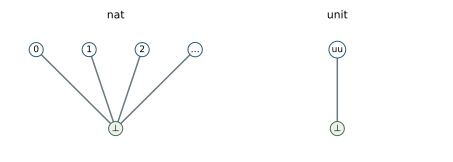
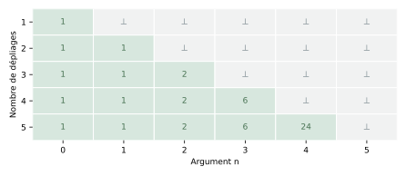
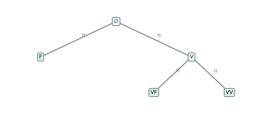

# ENS MP · Informatique-mathématiques 2020 · Corrigé brut

*Corrigé rédigé par IA, non officiel. Signalez toute erreur.*

**Rédaction** · GPT-6.2 Astra Ultra · vitesse non renseignée · 25 novembre 2026

On note $\bot_\tau$ le plus petit élément du domaine de type $\tau$. Les fragments de code suivent le langage du sujet. Les lignes de la forme `P = …` donnent des noms à des termes fermés et peuvent être développées par substitution.

## I · Types et ordres partiels complets

### Question 1.1 · Suites croissantes dans le domaine des naturels

**a.** Dans l'ordre plat $D=\mathbb N\uplus\{\bot\}$, une suite croissante est soit constamment $\bot$, soit de la forme $\bot,\ldots,\bot,n,n,\ldots$ pour un entier $n$ et un préfixe éventuellement vide. En effet, dès sa première valeur définie, le seul élément qui lui soit supérieur est elle-même.

**b.** Dans le premier cas, la borne supérieure vaut $\bot$. Dans le second elle vaut $n$, valeur atteinte et majorant de la suite. Comme $\bot$ est le plus petit élément, cela prouve la complétude au sens du sujet.



### Question 1.2 · Applications de nat vers unit

**a.** Pour une suite croissante de $D$, son supremum est atteint et la suite devient constante. Une application croissante $f$ transforme cette suite en une suite croissante qui atteint $f(\sup_i x_i)$ et reste constante ensuite. D'où $f(\sup_i x_i)=\sup_i f(x_i)$.

**b.** Si $f(\bot)=\mathrm{uu}$, alors $\mathrm{uu}\le f(n)$ pour tout $n$. Le seul choix est la constante $\mathrm{uu}$, qui est bien continue. Il y a exactement **une** telle application.

**c.** Pour $i\in\mathbb N$, poser $f_i(\bot)=\bot$ et $f_i(n)=\mathrm{uu}$ pour $n<i$, $\bot$ sinon. Ces fonctions sont croissantes, donc continues. On a $f_i<f_{i+1}$, ce que distingue la valeur en $i$.

### Question 1.3 · Borne supérieure point par point

**a.** Écrivons $f(e)=\sup_i f_i(e)$. Si $e\le e'$, chaque $f_i(e)\le f_i(e')\le f(e')$, d'où $f(e)\le f(e')$. Pour une suite croissante $(e_j)$, posons $a_{ij}=f_i(e_j)$. Ce tableau croît en chacun de ses indices. La diagonale $a_{kk}$ en majore toute case à partir de $k=\max(i,j)$. Par la propriété de plus petit majorant, les deux bornes itérées $\sup_i\sup_j a_{ij}$ et $\sup_j\sup_i a_{ij}$ sont donc toutes deux égales à $\sup_k a_{kk}$. Par continuité de chaque $f_i$, on obtient

$$

f(\sup_j e_j)=\sup_i\sup_j f_i(e_j)=\sup_j f(e_j).

$$

Ainsi $f$ est continue. Cet argument n'exige que des bornes de suites croissantes, celles fournies dans le sujet.

**b.** Par construction $f_i\le f$. Si $g$ majore toute la suite, $g(e)$ majore tous les $f_i(e)$, donc $f(e)\le g(e)$ pour chaque $e$. La fonction continue $f$ de la sous-question a est ainsi son supremum dans l'ordre fonctionnel. Avec le plus petit élément déjà défini, cela donne un ordre partiel complet.

## II · Programmes et interprétation

### Question 2.1 · Condition exacte de typage

Il faut et il suffit qu'il existe $b\in\{\mathtt{unit},\mathtt{bool},\mathtt{nat}\}$ tel que $t(x)=t(y)=t(z)=b$ et $\tau=(b\Rightarrow b)$. Les deux branches ont ce même type $b$ et la comparaison de $x$ à $y$ a le type booléen.

### Question 2.2 · Tester la parité et calculer un pas de Collatz

**a.** Pour $n\in\mathbb N$, l'interprétation compare $2\lfloor n/2\rfloor$ et $n$. Elle vaut $\mathrm{tt}$ exactement lorsque $n$ est pair, $\mathrm{ff}$ sinon. Sur $\bot_{\rm nat}$, la division, la multiplication puis l'égalité sont strictes et la valeur est $\bot_{\rm bool}$.

**b.** Le programme fermé suivant a l'interprétation demandée, la variable $x$ étant de type `nat`.

```text
fun x → if pe x then x/2 else (3 × x) + 1
```

### Question 2.3 · Approximations successives de la factorielle

**a.** Écrivons $F=\llbracket p\rrbracket$. On a $F(f)(\bot)=\bot$, $F(f)(0)=1$. Pour $n>0$, $F(f)(n)=n f(n-1)$ si $f(n-1)$ est défini, et $\bot$ sinon. Le choix de branche évalue la comparaison à zéro avant la multiplication.

**b.** Pour tout $i\ge0$, $F^{i+1}(\bot)(e)=e!$ si $e\in\{0,\dots,i\}$, et $\bot$ sinon, y compris pour $e=\bot$. Pour $i=0$, le premier dépliage n'atteint que le cas $n=0$. Au pas suivant, l'appel au prédécesseur défini donne $n(n-1)!$ jusqu'à $i+1$ et reste indéfini au-delà.

**c.** La sémantique de `rec` prend le supremum de ces approximations, qui se calcule point par point par la Q1.3. En tout entier $k$ la valeur devient $k!$ et le reste. En $\bot$ toutes les approximations restent $\bot$. Ce sont donc les valeurs de $\llbracket\mathrm{rec}\ p\rrbracket$.



### Question 2.4 · Reconnaître les trajectoires atteignant 1

**a.** Avec $f:\mathtt{nat}\Rightarrow\mathtt{unit}$ et $n:\mathtt{nat}$, prendre

```text
q = fun f → fun n → if n = 1 then uu else f (pc n)
```

Le premier dépliage depuis le bas reconnaît uniquement 1. Par récurrence, le passage de $i+1$ à $i+2$ dépliages reconnaît soit $n=1$, soit les $n$ pour lesquels une des $i+1$ premières valeurs à partir de $f_c(n)$ est 1. Cela équivaut à l'existence d'un $k\le i+1$ tel que $f_c^k(n)=1$.

**b.** Prendre `p = rec q`. En $n>0$, le supremum croissant de valeurs dans $\{\bot,\mathrm{uu}\}$ vaut $\mathrm{uu}$ exactement si un dépliage fini le vaut. Le résultat est donc équivalent à l'existence du témoin $k$ demandé.

### Question 2.5 · Limites de la calculabilité

**a.** De $\bot\le\mathrm{uu}$ vers la même chaîne, les seules applications croissantes sont la constante $\bot$, l'identité et la constante $\mathrm{uu}$. Elles sont interprétées par `fun x → DIVunit`, `fun x → x` et `fun x → uu` avec $x:\mathtt{unit}$. Cela épuise les éléments du domaine fonctionnel.

**b.** Pour chaque partie $A\subseteq\mathbb N$ définissons $f_A(\bot)=\bot$ et $f_A(n)=\mathrm{uu}$ si $n\in A$, $\bot$ sinon. Ces fonctions sont distinctes pour des $A$ distincts et continues par la Q1.2. L'ensemble des parties de $\mathbb N$ est non dénombrable, alors que les programmes sont dénombrables et chacun a une seule interprétation. Certaines de ces fonctions sont donc non calculables.

### Question 2.6 · Conjonction sur unit

Avec $x,y:\mathtt{unit}$, on peut prendre

```text
fun x → fun y → if x = uu then y else DIVunit
```

Si $x=\bot$, l'égalité et le résultat sont $\bot$. Si $x=\mathrm{uu}$, la valeur est exactement $y$. Ainsi le résultat vaut $\mathrm{uu}$ précisément lorsque les deux arguments valent $\mathrm{uu}$. Cela reste vrai dans tout environnement.

### Question 2.7 · Existence détectée par disjonction parallèle

**a.** On obtient l'ensemble des $f$ tels que $f(\mathrm{tt})=\mathrm{uu}$ ou $f(\mathrm{ff})=\mathrm{uu}$, l'un ou l'autre suffisant. La sémantique parallèle permet d'obtenir la réponse même si l'autre application diverge.

**b.** L'ensemble est $\{f\in\llbracket\mathtt{nat}\Rightarrow\mathtt{unit}\rrbracket:\exists n\in\mathbb N,\ f(n)=\mathrm{uu}\}$. À partir de 0, chaque dépliage du `rec` étend d'un entier la recherche en parallèle. Le calcul ne demande pas une évaluation de $f(\bot)$.

## III · Ouverts et compacts calculatoires

### Question 3.1 · Ouverture et fermeture du domaine entier

Pour $x:\tau$, `fun x → uu` reconnaît tout $\llbracket\tau\rrbracket$, y compris $\bot_\tau$. Son complément est le vide, reconnu par `fun x → DIVunit`. Le domaine entier est donc ouvert calculatoire et fermé calculatoire.

### Question 3.2 · Ouverts de unit

Les préimages de $\mathrm{uu}$ par ces trois fonctions sont $\varnothing$, $\{\mathrm{uu}\}$ et $\{\bot,\mathrm{uu}\}$. Ce sont tous les ouverts de `unit`. Reconnaître seulement $\bot$ contredirait la croissance, car $\bot\le\mathrm{uu}$.

### Question 3.3 · Image réciproque d’un ouvert

Soient $P:\tau\Rightarrow\tau'$ un programme pour $f$ et $Q:\tau'\Rightarrow\mathtt{unit}$ un reconnaisseur de $U$. Le programme `fun x → Q (P x)`, où $x:\tau$ est fraîche, a le type $\tau\Rightarrow\mathtt{unit}$. En $e$, sa valeur est $\mathrm{uu}$ si et seulement si $f(e)\in U$. C'est le témoin d'ouverture cherché.

### Question 3.4 · Réunion et intersection binaires

**a.** Soient $P,Q:\tau\Rightarrow\mathtt{unit}$ les témoins des ouverts $U,V$. Le témoin de leur réunion est `fun x → (P x) ∥u (Q x)` : l'une des deux évaluations réussit précisément pour $x\in U\cup V$.

**b.** Le témoin de leur intersection est `fun x → (P x) &u (Q x)` : par la Q2.6, les deux évaluations doivent réussir, précisément pour $x\in U\cap V$.

### Question 3.5 · Réunion dénombrable uniforme

Soit $P:\mathtt{nat}\Rightarrow\tau\Rightarrow\mathtt{unit}$ le programme fourni. Avec les types $g:\mathtt{nat}\Rightarrow\tau\Rightarrow\mathtt{unit}$, $k:\mathtt{nat}$ et $x:\tau$, écrire

```text
Q = fun g → fun k → fun x → (P k x) ∥u (g (k+1) x)
R = fun x → (rec Q) 0 x
```

Notons $G_j=\llbracket Q\rrbracket^j(\bot)$. Par récurrence, $G_j(k)(e)=\mathrm{uu}$ exactement s'il existe $i$ avec $k\le i<k+j$ et $e\in U_i$. Pour $j=0$ l'intervalle est vide. Le dépliage teste $i=k$ en parallèle des $j$ indices à partir de $k+1$, d'où l'hérédité. La propriété A donne l'existence d'un $j$ fini, soit exactement $e\in\bigcup_{i\ge k}U_i$. Pour $k=0$, $R$ reconnaît la réunion. La présence du programme uniforme $P$ est ce qui rend l'énumération calculable.

### Question 3.6 · Trois familles de compacts calculatoires

**a.** Pour le vide, `fun p → uu` convient : la propriété universelle sur l'ensemble vide est toujours vraie.

**b.** Si $\bot_\tau\in E$, prendre `fun p → p DIVτ`. Une réussite sur tout $E$ inclut la réussite en $\bot_\tau$. Réciproquement, $\llbracket p\rrbracket(\bot_\tau)=\mathrm{uu}$ implique par croissance $\llbracket p\rrbracket(e)=\mathrm{uu}$ pour tout $e$.

**c.** Soit $F$ fermé calculatoire et $Q$ un reconnaisseur de son complément. Si $\bot_\tau\in F$, appliquer b. Si $\bot_\tau\notin F$, alors $Q$ réussit en bas, donc partout ; $F$ est vide et a s'applique. Cette disjonction est une preuve d'existence d'un témoin pour chaque fermé, sans exiger un test calculable du cas à partir de $Q$.

### Question 3.7 · Compacité d’un ensemble d’entiers

Si $U=\{n_1,\ldots,n_r\}$ est fini, le quantificateur `fun p → (p n₁) &u … &u (p nᵣ)` convient. Pour $r=0$, utiliser la constante de la Q3.6.

Réciproquement, soit $T$ un programme témoin pour $U\subseteq\mathbb N$. Le programme `fun x → if x = x then uu else uu` dénote la fonction stricte $h$ qui vaut $\mathrm{uu}$ sur tous les naturels et $\bot$ en $\bot$. Pour chaque entier $m$, le terme `fun x → if (x−m) = 0 then uu else DIVunit` dénote $h_m$ qui reconnaît exactement $0,\ldots,m$ et est strict. La soustraction du langage est tronquée à zéro. Les $h_m$ sont croissants en $m$ et leur supremum point par point est $h$.

Puisque $h$ réussit sur $U$, la propriété du témoin donne $\llbracket T\rrbracket(h)=\mathrm{uu}$. Sa continuité implique que cette valeur est le supremum des $\llbracket T\rrbracket(h_m)$. Dans `unit`, il faut donc qu'un de ces termes soit $\mathrm{uu}$. Comme $h_m$ est bien **calculable**, la propriété du quantificateur s'applique à lui aussi et force $U\subseteq\{0,\ldots,m\}$. Donc $U$ est fini.

## IV · Espace de Cantor

### Question 4.1 · Un préfixe fini suffit pour une suite donnée

Notons $s{<}k$ le préfixe de longueur $k$. Les éléments $f_{s{<}k}$ sont stricts, croissent avec $k$ et leur supremum est $f_s$ : sur un entier $j$, la valeur $s_j$ est installée dès $k=j+1$, et sur $\bot$ la valeur reste $\bot$. Par continuité du programme $p$, $\mathrm{uu}=\llbracket p\rrbracket(f_s)=\sup_k\llbracket p\rrbracket(f_{s{<}k})$. Une suite de `unit` de supremum $\mathrm{uu}$ l'atteint. Le minimum des longueurs admissibles existe par bon ordre de $\mathbb N$.

### Question 4.2 · Préfixer un argument partiel

Fixons un environnement où la variable $y$ vaut $f_{s{<}k}$. Le programme $b::y$ envoie $\bot$ sur $\bot$ par stricte évaluation de l'égalité à 0. Il envoie 0 sur $b$, et $n+1$ sur $f_{s{<}k}(n)$, soit $s_n$ si $n<k$ et $\bot$ sinon. C'est exactement $f_{(b::s){<}(1+k)}$. Par les clauses de l'abstraction et de l'application, on obtient l'égalité demandée

$$

\llbracket p/b\rrbracket(f_{s{<}k})=\llbracket p\rrbracket(f_{(b::s){<}(k+1)}).

$$

Cette identité de valeurs vaut aussi pour les suites totales en passant à la borne supérieure.

### Question 4.3 · Borne uniforme sur tous les préfixes

**a.** Pour un mot fini $w$, notons $p/w$ les spécialisations successives dans l'ordre de ses lettres. En itérant la Q4.2, appliquer $p/w$ à la fonction partout indéfinie revient à appliquer $p$ au préfixe $w$, indéfini au-delà. Pour $w=s_0\ldots s_{i-1}$ avec $i=k(s,p)$, cette valeur est $\mathrm{uu}$. Pour toute suite $t$, $f_{t{<}0}$ est précisément la fonction partout indéfinie. Le minimum pour $t$ et $p/w$ vaut donc 0, d'où $K(p/w)=\{0\}$, aussi lorsque $i=0$.

**b.** Si $K(p/\mathrm{tt})$ et $K(p/\mathrm{ff})$ avaient des bornes $M_t,M_f$, toute suite $b::s$ serait acceptée après au plus $1+\max(M_t,M_f)$ bits par la Q4.2. Ce serait une borne de $K(p)$, contradiction. Chaque $p/b$ satisfait bien l'hypothèse de réussite sur tout $C$ puisque $b::s$ est toujours une suite totale.

**c.** Supposons $K(p)$ non borné. Choisissons successivement, par b, un bit $s_j$ qui laisse $K(p/(s_0\ldots s_j))$ non borné, en préférant par exemple $\mathrm{tt}$ si les deux conviennent. On a ainsi une suite infinie $s$. La Q4.1 lui fournit un $i=k(s,p)$ fini. D'après a, après ses $i$ premiers bits, l'ensemble des profondeurs est $\{0\}$, contredisant la construction. Ainsi $K(p)$ est borné ; étant un sous-ensemble non vide de $\mathbb N$, il a un maximum.

### Question 4.4 · Décroissance du module sur chaque branche

**a.** Soit $i=k(b::s,p)>0$. La Q4.2 avec $k=i-1$ donne une réussite de $p/b$ sur $f_{s{<}(i-1)}$. Ainsi $k(s,p/b)\le i-1<i$. La minimalité de $i$ impose même l'égalité $k(s,p/b)=i-1$.

**b.** Si $k(s,p)=0$ pour une suite, $p$ accepte la fonction partout indéfinie. Tous les préfixes de longueur nulle étant identiques, $K(p)=\{0\}$. Si $|p|>0$, toutes les profondeurs sont donc positives. Pour chaque $s$ et chaque $b$, la partie a donne $k(s,p/b)\le k(b::s,p)-1\le|p|-1$. En prenant le maximum, $|p/b|<|p|$ pour **chacun** des deux bits.

### Question 4.5 · Un quantificateur calculable pour l’espace de Cantor

Posons $S=\mathtt{nat}\Rightarrow\mathtt{bool}$, $P=S\Rightarrow\mathtt{unit}$ et $A=P\Rightarrow\mathtt{unit}$. Le suffixe `/b` désigne l'expression du sujet, réécrite avec une variable fraîche si nécessaire. Avec $a:A$ et $p:P$, construire le programme fermé

```text
H = fun a → fun p →
      (p DIV_S) ∥u ((a (p/tt)) &u (a (p/ff)))
T = rec H
```

Ici `DIV_S` a pour valeur la fonction partout indéfinie, l'élément $f_{s{<}0}$. La disjonction parallèle permet que la réussite sur ce préfixe termine le calcul même si les deux appels récursifs n'ont pas encore abouti. Le terme `T` a le type $A$.

**Correction.** Soit $T_j=\llbracket H\rrbracket^j(\bot_A)$. Montrons par récurrence que si $T_j(\llbracket p\rrbracket)=\mathrm{uu}$, alors $p$ réussit sur toutes les suites totales. Pour $j=0$, l'hypothèse est impossible. Au pas suivant, soit $p$ réussit sur la fonction vide et alors il réussit sur toutes ses extensions par croissance ; soit les deux spécialisations réussissent avec $T_j$. L'hypothèse de récurrence s'applique aux deux, et toute suite totale commence par l'un des deux bits. La Q4.2 pour les suites totales conclut. Comme $\llbracket T\rrbracket$ est le supremum des $T_j$ et `unit` est plat, une réussite de $T$ a lieu à un stade fini. Elle implique donc la propriété universelle.

**Complétude.** Supposons que $p$ réussisse sur tout $C$. Le module $m=|p|$ est fini par la Q4.3. Montrons que $T_{m+1}(\llbracket p\rrbracket)=\mathrm{uu}$. Si $m=0$, le premier terme `p DIV_S` réussit et $T_1$ suffit. Si $m>0$, les deux programmes $p/b$ réussissent partout et ont un module strictement inférieur par la Q4.4. L'induction forte fournit pour chacun une réussite à un stade au plus $m$. Les approximations $T_j$ croissent, donc $T_m$ suffit pour les deux. Leur conjonction réussit au dépliage suivant. Ceci donne $\llbracket T\rrbracket(\llbracket p\rrbracket)=\mathrm{uu}$. Les deux implications prouvent que $T$ est le quantificateur de compacité demandé. Son code n'a pas à calculer le module.


