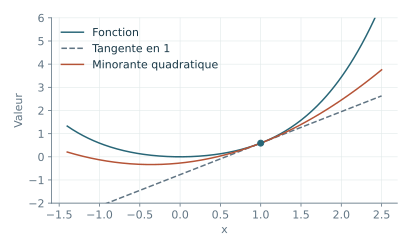
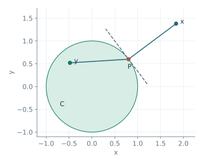
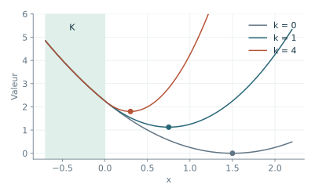
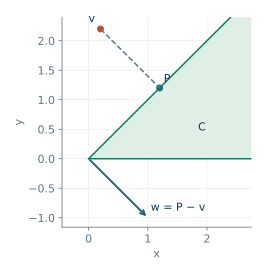
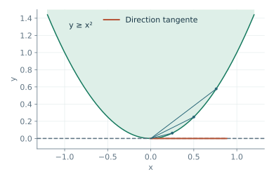
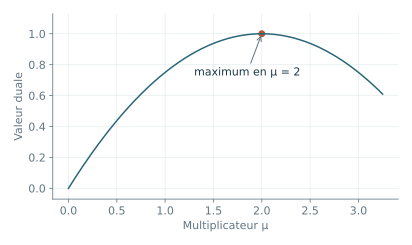
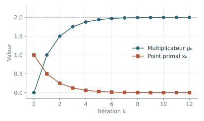

# ENS MP — Mathématiques C 2020 · Corrigé brut

*Corrigé rédigé par IA, non officiel.*

**Rédaction** · modèle exact non renseigné (famille GPT-6) · effort non renseigné · vitesse non renseignée

**Révision** · modèle exact non renseigné (famille GPT-6) · effort non renseigné · vitesse non renseignée

**Révision (tour 2)** · GPT-6.2 Astra Ultra · vitesse non renseignée

**Révision (tour 3)** · GPT-6.2 Astra Ultra · vitesse non renseignée · 25 novembre 2026

**Révision** · GPT-6.2 Astra Ultra · vitesse non renseignée · 26 novembre 2026

Épreuve commune à Ulm, Lyon, Paris-Saclay et Rennes, durée 4 h. Les contraintes sont écrites $g_i(x)\le0$ et les multiplicateurs sont positifs ou nuls.

## I. Préliminaires

### Question I.1a

Pour $s,t\in\mathbb R$ et $0\le\lambda\le1$, le point de la droite de paramètre $(1-\lambda)s+\lambda t$ est le barycentre de poids $1-\lambda,\lambda$ des points de paramètres $s,t$. L’inégalité de convexité de $f$ entre ces deux points est exactement celle de $\varphi_{x,y}$. Réciproquement, appliquer la convexité de $\varphi_{x,y}$ entre les paramètres 0 et 1 donne celle de $f$ entre $x$ et $y$. Cela inclut $x=y$, où la restriction est constante.

### Question I.1b

L’application $t\mapsto x+t(y-x)$ est dérivable, de dérivée $y-x$. La règle de la chaîne donne $\varphi'_{x,y}(t)=df_{x+t(y-x)}(y-x)=\langle\nabla f(x+t(y-x)),y-x\rangle$.

### Question I.1c

Si $f$ est convexe, pour $0<t\le1$ on a $[\varphi(t)-\varphi(0)]/t\le\varphi(1)-\varphi(0)$. Faire tendre $t$ vers zéro dans I.1b donne $f(y)\ge f(x)+\langle\nabla f(x),y-x\rangle$. Inversement supposons cette inégalité vraie en tout point. Pour $z=(1-t)x+ty$, appliquer l’inégalité en $z$ d’abord à $x$, puis à $y$. Pondérer par $1-t$ et $t$ et additionner. La partie linéaire s’annule puisque $(1-t)(x-z)+t(y-z)=0$. Il reste $f(z)\le(1-t)f(x)+tf(y)$.

### Question I.1d

Additionner les deux inégalités de I.1c pour $(x,y)$ et $(y,x)$ donne $\langle\nabla f(y)-\nabla f(x),y-x\rangle\ge0$. Dans l’autre sens, sur la droite $z_t=x+t(y-x)$, la monotonie appliquée à $z_s,z_t$ donne $(t-s)(\varphi'(t)-\varphi'(s))\ge0$. La dérivée est donc croissante. Le théorème des accroissements finis appliqué entre 0 et 1 donne $\varphi(1)-\varphi(0)\ge\varphi'(0)$, soit le critère de I.1c.

### Question I.2

L’inégalité de support en $x^\star$ donne $f(y)\ge f(x^\star)+\langle0,y-x^\star\rangle=f(x^\star)$ pour tout $y$. C’est un minimum global.

### Question I.3a

On a $\nabla g_\alpha(x)=\nabla f(x)-\alpha x$. En développant $\|y\|^2=\|x\|^2+2\langle x,y-x\rangle+\|y-x\|^2$, on obtient
$$g_\alpha(y)-g_\alpha(x)-\langle\nabla g_\alpha(x),y-x\rangle=f(y)-f(x)-\langle\nabla f(x),y-x\rangle-\tfrac\alpha2\|y-x\|^2.$$
La positivité du membre de gauche caractérise la convexité de $g_\alpha$ par I.1c. Celle du membre de droite est l’$\alpha$-convexité demandée.

### Question I.3b

D’après I.1d, $g_\alpha$ est convexe si et seulement si $\langle\nabla g_\alpha(y)-\nabla g_\alpha(x),y-x\rangle\ge0$ pour tous $x,y$. En substituant le gradient calculé en I.3a, on obtient exactement $\langle\nabla f(y)-\nabla f(x),y-x\rangle\ge\alpha\|y-x\|^2$.

### Question I.4

Choisir $x_0\in K$. Par coercivité, prendre $R>\|x_0\|$ tel que $\|x\|>R$ entraîne $f(x)>f(x_0)$. L’ensemble non vide $K\cap\overline B(0,R)$ est fermé borné en dimension finie, donc compact. La fonction continue $f$ y atteint son minimum, en un point $x^\star$. Hors de la boule, $f(x)>f(x_0)\ge f(x^\star)$, ce qui rend ce minimum global sur $K$.

### Question I.5

La minoration en zéro donne $f(x)\ge f(0)-\|\nabla f(0)\|\|x\|+\alpha\|x\|^2/2$. Le terme quadratique assure la coercivité. La différentiabilité implique la continuité, donc I.4 assure l’existence. La convexité de $g_\alpha$ au milieu et l’identité du parallélogramme donnent
$$f((x+y)/2)\le\tfrac12(f(x)+f(y))-\tfrac\alpha8\|x-y\|^2.$$
Si deux minimiseurs distincts appartenaient à $K$, leur milieu, également dans $K$, aurait une valeur strictement plus petite. Le minimiseur est unique.

### Question I.6a

La fonction $F(y)=\|y-x\|^2/2$ a pour gradient $y-x$ et vérifie I.3b avec $\alpha=1$. Par I.5, elle a un unique minimiseur sur $C$. Comme le carré est strictement croissant sur $\mathbb R_+$, c’est exactement l’unique point le plus proche de $x$.

### Question I.6b

Pour $y\in C$, le segment $\bar x+t(y-\bar x)$ appartient à $C$ pour $0\le t\le1$. Si $\bar x$ est la projection, la dérivée à droite en 0 du carré de la distance y est positive ou nulle, soit $-2\langle x-\bar x,y-\bar x\rangle\ge0$. Réciproquement, développer $\|x-y\|^2=\|x-\bar x\|^2+\|y-\bar x\|^2-2\langle x-\bar x,y-\bar x\rangle$ donne $\|x-y\|\ge\|x-\bar x\|$. D’où le résultat, par unicité de I.6a.

### Question I.6c

Posons $p=P_C(x)$ et $q=P_C(y)$. I.6b donne $\langle x-p,q-p\rangle\le0$ et $\langle y-q,p-q\rangle\le0$. Leur somme donne $\|p-q\|^2\le\langle x-y,p-q\rangle\le\|x-y\|\,\|p-q\|$. Si $p=q$, l’assertion est immédiate. Sinon, diviser par $\|p-q\|$.

### Question I.7

Si $B(x,r)\subset K$, pour un $h$ quelconque on peut choisir $h_k=h$ et $t_k=r/((k+1)(1+\|h\|))$. Alors $x+t_kh_k\in B(x,r)$ et $t_k\to0$ par valeurs positives. Ainsi $A_K(x)=\mathbb R^n$.

### Question I.8

Pour les suites associées à $h$, $x^\star+t_kh_k\to x^\star$. À partir d’un certain rang, $f(x^\star+t_kh_k)\ge f(x^\star)$. Diviser le développement différentiel par $t_k>0$. Le reste vaut $o(1)\|h_k\|$ et tend vers zéro puisque $(h_k)$ est bornée. On obtient $\langle\nabla f(x^\star),h\rangle\ge0$. À l’intérieur, prendre $h=-\nabla f(x^\star)$ donne $\nabla f(x^\star)=0$.

## II. Pénalisation

### Question II.1

Chaque ensemble $\{g_i\le0\}$ est fermé par continuité et convexe par l’inégalité de convexité. Leur intersection $K$ possède ces deux propriétés et elle est non vide par hypothèse. Appliquer I.5 à $f$.

### Question II.2

Posons $\beta(x)=\sum_i(\max(0,g_i(x)))^2$. Sur $K$, $\beta(x)=0$ et $f_k(x)=f(x)$ pour tout $k$. Hors de $K$, au moins un terme est strictement positif, donc $f_k(x)=f(x)+k\beta(x)\to+\infty$.

### Question II.3

Pour une fonction croissante convexe $h$ et une fonction convexe $g$, $h(g((1-t)x+ty))\le h((1-t)g(x)+tg(y))\le(1-t)h(g(x))+th(g(y))$. Ici $h(s)=(\max(0,s))^2$ est dérivable même en 0, avec $h'(s)=2\max(0,s)$ croissante et positive. Ainsi $\beta$ est convexe et différentiable. Comme $f-\alpha\|\cdot\|^2/2$ et $k\beta$ sont convexes, I.3a rend $f_k$ $\alpha$-convexe y compris pour $k=0$. I.5 sur $\mathbb R^n$ donne l’unique $x_k$.

### Question II.4

La pénalité est positive et s’annule en $x^\star$. Par minimalité, $f(x_k)\le f_k(x_k)\le f_k(x^\star)=f(x^\star)$.

### Question II.5a

Comme $x_{\varphi(k)}\to\bar x$, $f(x_{\varphi(k)})\to f(\bar x)$. Par II.4, $0\le\varphi(k)\beta(x_{\varphi(k)})\le f(x^\star)-f(x_{\varphi(k)})$, donc $\beta(x_{\varphi(k)})\to0$. La continuité de $\beta$ donne $\beta(\bar x)=0$, c’est-à-dire $\bar x\in K$.

### Question II.5b

En passant à la limite dans II.4, $f(\bar x)\le f(x^\star)$. Comme $\bar x\in K$, il y a égalité et l’unicité de II.1 donne $\bar x=x^\star$.

### Question II.6

Par II.4, tous les $x_k$ sont dans le sous-niveau $\{f\le f(x^\star)\}$, fermé par continuité, borné par coercivité, donc compact. Si la suite ne tendait pas vers $x^\star$, une sous-suite resterait à distance au moins $\varepsilon>0$ de ce point. Elle aurait une sous-suite convergente dans le compact et sa limite contredirait II.5b.

### Question II.7

Les inégalités $f(x_k)\le f_k(x_k)\le f(x^\star)$ de II.4 et la convergence $f(x_k)\to f(x^\star)$ donnent $f_k(x_k)\to f(x^\star)$. On en tire aussi $k\beta(x_k)\to0$ par différence. La valeur minimale monte vers cette limite : $f_{k+1}\ge f_k$ point par point entraîne $\min f_{k+1}\ge\min f_k$. La violation $\beta(x_k)$ décroît. En effet, ajoutons $f_k(x_k)\le f_k(x_{k+1})$ et $f_{k+1}(x_{k+1})\le f_{k+1}(x_k)$ et simplifions. Il reste $\beta(x_{k+1})\le\beta(x_k)$.

Dans l’exemple de la figure, $x^\star=0$, $f(x)=(x-3/2)^2$ et $\beta(x)=\max(0,x)^2$. Sur $x\ge0$, la dérivée du critère pénalisé s’annule en $x_k=3/[2(k+1)]$. Sur $x\le0$, son minimum est atteint en zéro. Ainsi $f_k(x_k)=\frac94\frac{k}{k+1}$ monte vers $9/4$ et $\beta(x_k)=\frac{9}{4(k+1)^2}$ donne bien $k\beta(x_k)\to0$.

## III. Théorème de Karush–Kuhn–Tucker

### Question III.1a

Si $x=\sum a_i u_i$ et $y=\sum b_i u_i$ avec $a_i,b_i\ge0$, alors $(1-t)x+ty=\sum((1-t)a_i+tb_i)u_i$ avec des coefficients positifs ou nuls pour $0\le t\le1$. De plus $0\in C$ et $C$ est stable par multiplication par tout réel positif.

### Question III.1b

Si les $u_i$ sont libres, l’application $T:(a_i)\mapsto\sum a_i u_i$ est un isomorphisme de $\mathbb R^m$ sur le sous-espace $E$ qu’ils engendrent. Ce sous-espace est fermé en dimension finie et $T^{-1}:E\to\mathbb R^m$ est continu. Pour toute suite $x_k\in C$ convergeant vers $x$, on a $x\in E$ et $T^{-1}x_k\to T^{-1}x$. Les coordonnées de la limite sont positives ou nulles. Ainsi $x\in C$.

### Question III.1c

Pour $x\in C$, choisir une représentation avec le minimum de coefficients strictement positifs, de support $I$. Si la famille sur $I$ était liée, prendre une relation non triviale $\sum_{i\in I}a_i u_i=0$ et changer éventuellement tous les signes pour avoir un $a_i>0$. Poser $s=\min_{a_i>0}\mu_i/a_i>0$. Les $\mu_i-sa_i$ sont tous positifs ou nuls et au moins l’un s’annule. Ils représentent encore $x$, contradiction. Le support minimal est donc libre, avec le support vide pour $x=0$. Cela prouve l’inclusion de $C$ dans l’union demandée. L’autre inclusion vient en complétant par des coefficients nuls. Une union finie de fermés de III.1b est fermée.

### Question III.2a

Écrivons $p=P_C(v)$. I.6b donne $\langle v-p,y-p\rangle\le0$ pour tout $y\in C$. Choisir successivement $y=0$ et $y=2p$, deux points du cône, force $\langle v-p,p\rangle=0$.

### Question III.2b

Pour $w=p-v$ et $v=p-w$, III.2a donne $\langle v,w\rangle=-\|w\|^2<0$, car $v\notin C$. Par I.6b, $\langle w,y-p\rangle\ge0$ et donc $\langle w,y\rangle\ge0$ pour tout $y\in C$. Prendre chacun des $u_i$.

### Question III.3

Si $v\in C$, tout $w$ dont les produits avec les $u_i$ sont positifs ou nuls satisfait aussi $\langle w,v\rangle\ge0$, par combinaison positive. L’assertion (ii) est exclue. Si $v\notin C$, III.2b fournit précisément un témoin de (ii). Les deux possibilités sont donc exhaustives et exclusives.

### Question III.4

Pour $h\in A_K(x)$ et $i\in I_x$, $g_i(x+t_kh_k)\le0=g_i(x)$. Diviser le développement au premier ordre par $t_k>0$. Comme $h_k\to h$ est bornée, le reste divisé par $t_k$ tend vers zéro. Ainsi $\langle\nabla g_i(x),h\rangle\le0$ pour toute contrainte active.

### Question III.5

Pour un $h$ vérifiant toutes les inégalités de III.4, posons $h_k=h+v/(k+1)$ avec $v$ donné par (H). Pour chaque $k$ fixé et chaque contrainte active, $\langle\nabla g_i(x^\star),h_k\rangle<0$. La différentiabilité donne donc $g_i(x^\star+t h_k)<0$ pour $t>0$ assez petit. Les contraintes inactives restent strictement satisfaites par continuité. Leur nombre total étant fini, choisir un $t_k\in]0,1/(k+1)]$ qui convient à toutes simultanément. Alors $t_k\to0$ et $h_k\to h$ prouvent l’admissibilité. L’inclusion inverse est III.4. S’il n’y a aucune contrainte active, un voisinage entier est admissible. L’hypothèse (H) peut être décisive. Sur la droite, la contrainte $g(x)=x^2\le0$ donne $K=\{0\}$ et $A_K(0)=\{0\}$. Comme $g'(0)=0$, son inégalité linéarisée admet tous les réels. Pour $f(x)=x$, le point $0$ minimise bien $f$ sur $K$, mais $f'(0)+\mu g'(0)=1$ pour tout $\mu$. On voit ici exactement pourquoi la qualification intervient dans la construction des multiplicateurs.

### Question III.6

Considérons l’application linéaire $T:v\mapsto(\langle\nabla g_i(x^\star),v\rangle)_{i\in I_{x^\star}}$. Ses lignes indépendantes lui donnent rang $|I_{x^\star}|$. Elle est donc surjective et la colonne dont toutes les entrées valent $-1$ a un antécédent $v$, ce qui fournit (H). Pour la famille vide l’hypothèse est automatiquement vérifiée.

### Question III.7

Appliquer Farkas à $v=-\nabla f(x^\star)$ et aux $u_i=\nabla g_i(x^\star)$ pour les indices actifs. S’il existait $w$ avec $\langle v,w\rangle<0$ et $\langle u_i,w\rangle\ge0$, alors $h=-w$ vérifierait toutes les inégalités de III.5 et $\langle\nabla f(x^\star),h\rangle<0$, en contradiction avec I.8. Ainsi $-\nabla f(x^\star)$ est combinaison positive des gradients actifs. Prendre ces coefficients pour $\mu_i^\star$ et mettre les autres à zéro. Stationnarité, signe et complémentarité sont vérifiés. Si l’ensemble actif est vide, I.8 donne déjà $\nabla f(x^\star)=0$.

### Question III.8

Avec les multiplicateurs donnés, $L(x)=f(x)+\sum_i\mu_i^\star g_i(x)$ est convexe et dérivable. Sa dérivée est nulle en $x^\star$, donc I.2 donne $L(x)\ge L(x^\star)$. Pour $x\in K$, $f(x)\ge L(x)$ par les signes, et $L(x^\star)=f(x^\star)$ par complémentarité. Ainsi $x^\star$ est un minimiseur global.

## IV. Étude du problème dual

### Question IV.1

Pour un $x\in K$, tous les termes $\mu_i g_i(x)$ sont négatifs ou nuls et $\mu=0$ atteint la borne $f(x)$. Hors de $K$, il existe $i$ avec $g_i(x)>0$ et $L(x,t e_i)\to+\infty$ quand $t\to+\infty$. Prendre l’infimum sur $x\in\mathbb R^n$ donne exactement $\inf_{x\in K}f(x)$.

### Question IV.2

Pour $\mu\ge0$, la somme $\sum_i\mu_i g_i$ est convexe. La fonction $x\mapsto L(x,\mu)-\alpha\|x\|^2/2$ l’est donc aussi, par I.3a appliquée à $f$. L’objectif en $x$ est différentiable et $\alpha$-convexe. I.5 sur $\mathbb R^n$ assure l’existence et l’unicité de $x_\mu$.

### Question IV.3a

La propriété de selle signifie $L(\bar x,\mu)\le L(\bar x,\bar\mu)\le L(x,\bar\mu)$ pour tous $x\in\mathbb R^n$ et $\mu\in\mathbb R^p_+$. La borne de gauche doit être finie. Par IV.1, $\bar x\in K$ et $L(\bar x,\bar\mu)=f(\bar x)$. Pour tout $x\in K$, $f(\bar x)\le L(x,\bar\mu)\le f(x)$. Ainsi $\bar x$ résout (P).

### Question IV.3b

Pour chaque $\mu\ge0$, $G(\mu)\le L(\bar x,\mu)\le L(\bar x,\bar\mu)=G(\bar\mu)$. La dernière égalité vient du minimum en $x$ dans la définition de selle. Ainsi $\bar\mu$ résout (Q).

### Question IV.3c

Par IV.1 et IV.3a, $\inf_x\sup_{\mu\ge0}L(x,\mu)=f(\bar x)$. Par IV.3b, $\sup_{\mu\ge0}\inf_x L(x,\mu)=G(\bar\mu)$. Ces deux valeurs valent $L(\bar x,\bar\mu)$ et sont donc égales.

### Question IV.4

La stationnarité de III.7 donne $\nabla_x L(x^\star,\mu^\star)=0$. La convexité en $x$ implique que $x^\star$ minimise $L(\cdot,\mu^\star)$. La faisabilité et la complémentarité donnent pour tout $\mu\ge0$ la borne $L(x^\star,\mu)\le f(x^\star)=L(x^\star,\mu^\star)$. C’est un point selle. IV.3b conclut.

### Question IV.5a

Par convexité de l’orthant, $\mu_t=\mu+t\xi=(1-t)\mu+t(\mu+\xi)\ge0$ si $0\le t\le1$. Évaluer le minimum de $L(\cdot,\mu_t)$ au point $x_\mu$ donne la borne supérieure suivante. Évaluer celui de $L(\cdot,\mu)$ au point $x_{\mu_t}$ donne la borne inférieure. Pour $t>0$,
$$\langle g(x_{\mu_t}),\xi\rangle\le\frac{G(\mu_t)-G(\mu)}t\le\langle g(x_\mu),\xi\rangle.$$
Les bornes ont même limite par les continuités postulée et connue. Au maximiseur $\bar\mu$, chaque quotient dans la direction $\xi=\mu-\bar\mu$ est négatif ou nul. D’où $\langle g(x_{\bar\mu}),\mu-\bar\mu\rangle\le0$ pour tout $\mu\ge0$.

### Question IV.5b

L’inégalité précédente signifie que $L(x_{\bar\mu},\mu)\le L(x_{\bar\mu},\bar\mu)$ pour tout $\mu\ge0$. Par définition, $x_{\bar\mu}$ minimise $L(\cdot,\bar\mu)$. Le couple est un point selle et IV.3a donne le résultat. En coordonnées, prendre $\mu=\bar\mu+t e_i$ révèle $g_i(x_{\bar\mu})\le0$, puis $\mu=0$ donne la complémentarité.

### Question IV.6a

La stationnarité en $x_\mu$ donne $\nabla f(x_\mu)=-A^{\mathsf T}\mu$. Pour $d=x_\mu-x_\nu$, I.3b et Cauchy–Schwarz donnent
$$\alpha\|d\|^2\le\langle-A^{\mathsf T}(\mu-\nu),d\rangle\le\|A^{\mathsf T}\|\,\|\mu-\nu\|\,\|d\|.$$
Si $d\ne0$, diviser. La même majoration $\|d\|\le(\|A^{\mathsf T}\|/\alpha)\|\mu-\nu\|$ vaut trivialement si $d=0$. L’application est lipschitzienne.

### Question IV.6b

Le polyèdre non vide $K$ est fermé convexe, donc I.5 donne l’unique $x^\star$. Les lignes de $A$ sont indépendantes, toute sous-famille active aussi. III.6–7 et IV.4 fournissent un multiplicateur $\mu^\star$ optimal. Pour tout autre maximiseur $\bar\mu$, IV.5b, applicable grâce à IV.6a, oblige $x_{\bar\mu}=x^\star=x_{\mu^\star}$. La stationnarité donne $A^{\mathsf T}(\mu^\star-\bar\mu)=0$. Le rang $p$ assure l’injectivité de $A^{\mathsf T}$, donc $\bar\mu=\mu^\star$.

### Question IV.6c

IV.5a donne $\langle g(x_{\mu^\star}),\mu-\mu^\star\rangle\le0$ pour tout $\mu$ dans l’orthant. Après multiplication par $\rho>0$, c’est exactement I.6b pour le point à projeter $\mu^\star+\rho g(x_{\mu^\star})$ et le projeté $\mu^\star$. Cette relation de point fixe exprime en coordonnées faisabilité et complémentarité.

### Question IV.6d

Posons $d_k=x_{\mu_k}-x^\star$, $e_k=\mu_k-\mu^\star$. Par I.6c, l’itération et IV.6c donnent $\|e_{k+1}\|^2\le\|e_k+\rho A d_k\|^2$. Or $\langle e_k,A d_k\rangle=-\langle\nabla f(x_{\mu_k})-\nabla f(x^\star),d_k\rangle\le-\alpha\|d_k\|^2$ par IV.6a et I.3b. L’hypothèse donnée est $\|A d_k\|^2\le(\alpha/\rho)\|d_k\|^2$. En développant le carré,
$$\|e_{k+1}\|^2\le\|e_k\|^2-\rho\alpha\|d_k\|^2.$$
Sommer de 0 à $N$ donne $\rho\alpha\sum_{k=0}^N\|d_k\|^2\le\|e_0\|^2$. Ainsi $\|d_k\|\to0$ et $x_{\mu_k}\to x^\star$. La somme fournit aussi une estimation à un rang fini :
$$\min_{0\le k\le N}\|x_{\mu_k}-x^\star\|\le\frac{\|\mu_0-\mu^\star\|}{\sqrt{\rho\alpha(N+1)}}.$$
Dans l’exemple du schéma, $f(x)=(x-1)^2$, $g(x)=x$, $\rho=1$ et $\mu_0=0$. La stationnarité donne $x_{\mu_k}=1-\mu_k/2$. La projection conserve ici $1+\mu_k/2\ge0$, donc $\mu_k=2(1-2^{-k})$ et $x_{\mu_k}=2^{-k}$.

### Question IV.6e

L’inégalité de IV.6d rend $(\|\mu_k-\mu^\star\|)$ décroissante, donc $(\mu_k)$ est bornée. Choisir une sous-suite convergeant vers un $\bar\mu$ de l’orthant fermé. Par continuité de IV.6a, $x_{\bar\mu}=x^\star$. La stationnarité en IV.6a donne $A^{\mathsf T}\bar\mu=-\nabla f(x^\star)=A^{\mathsf T}\mu^\star$. L’injectivité de $A^{\mathsf T}$ impose $\bar\mu=\mu^\star$. Ainsi une sous-suite des distances tend vers zéro. Leur décroissance force la convergence de toute la suite vers $\mu^\star$.
