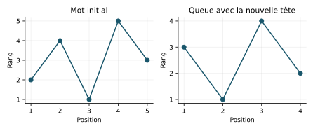
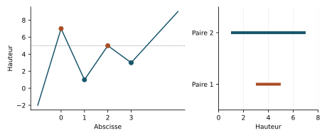

# ENS · MP · Mathématiques D 2020 · Corrigé brut

*Corrigé rédigé par IA, non officiel. Signalez toute erreur.*

**Rédaction** · GPT-6.2 Astra Ultra · vitesse non renseignée

**Révision (tour 1)** · GPT-6.2 Astra Ultra · vitesse non renseignée · 26 novembre 2026

Les cinq parties étudient les graphes à extrémums distincts, leur réalisation polynomiale, les permutations alternantes et la stabilité des sous-niveaux. [Sujet officiel](https://www.ens.psl.eu/sites/default/files/20_mp_mathd_sujet.pdf) · [Rapport du jury](https://www.ens.psl.eu/sites/default/files/20_mp_rap_emathd.pdf)

## I. Forme des graphes et déformations

### Question I.1a

Si $a$ est un maximum relatif, prenons un intervalle ouvert $J$ contenant $a$ où $f\le f(a)$. Tout autre $b\in J$ tel que $f(b)=f(a)$ serait aussi maximum relatif. L’injectivité de $f$ sur $E(f)$ exclut ce $b$. Le maximum est strict. Le raisonnement appliqué à $-f$ traite les minimums.

### Question I.1b

Si deux points $u<v$ de l’adhérence d’une même composante avaient même image, le segment $]u,v[$ serait sans extrémum. Une valeur différente de $f(u)$ y imposerait cependant un maximum ou minimum intérieur par compacité de $[u,v]$. Si toutes les valeurs sont égales, tout point intérieur est un extrémum. D’où l’injectivité sur l’adhérence, y compris pour les composantes non bornées. Une injection continue sur un intervalle est strictement monotone. À droite d’un maximum, la branche descend. À l’extrémité suivante, un changement de sens est nécessaire, donc on trouve un minimum. L’argument avec $-f$ donne l’autre sens.

### Question I.1c

Les deux applications $\beta$ respectent l’ordre. Ainsi $\sigma_f(i)$ est le rang de la hauteur au $i$-ème extrémum en partant de la gauche. Par 1b, ces hauteurs montent et descendent alternativement. La permutation appartient à $MD(n)$ si le premier extrémum est un minimum et à $DM(n)$ sinon.

### Question I.2a

Toute bijection croissante continue de $\mathbb R$ sur $\mathbb R$ est un homéomorphisme croissant. Les identités donnent la réflexivité, les inverses la symétrie, et les compositions la transitivité. Si $f=\psi\circ g\circ\varphi$, alors $x$ est un maximum ou minimum de $f$ exactement lorsque $\varphi(x)$ est un maximum ou minimum, respectivement, de $g$. La bijection $E(f)\to E(g)$ impose des cardinaux égaux.

### Question I.2b

Définissons $\chi$ affine sur chaque $[u_i,u_{i+1}]$, joignant $(u_i,v_i)$ à $(u_{i+1},v_{i+1})$. Sur les deux demi-droites prenons respectivement $x-u_1+v_1$ et $x-u_n+v_n$. Les morceaux continus se raccordent, ont des pentes strictement positives, et les limites sont $-\infty,+\infty$. Ainsi $\chi$ est la bijection voulue, y compris pour $n=1$.

### Question I.2c

Si $f=\psi\circ g\circ\varphi$, la croissance de $\varphi$ préserve le rang des abscisses et celle de $\psi$ le rang des valeurs. Les deux permutations coïncident. Réciproquement, si les rangs sont identiques, 2b fournit $\psi$ croissante envoyant les hauteurs ordonnées de $g$ sur celles de $f$. Écrivons $h=\psi\circ g$. En particulier les extrémums correspondants de $h$ et de $f$ ont exactement la même valeur. Sur chaque branche de $f$, définissons $\varphi=(h|_{J})^{-1}\circ f$, où $J$ est la branche correspondante de $h$. Les sens et les images coïncident, même sur les branches infinies puisque les limites y sont infinies du côté imposé par le sens de variation. Ces homéomorphismes croissants se raccordent aux extrémums et couvrent la droite, donnant $f=h\circ\varphi$.

### Question I.2d

Prenons $g(x)=x^3-3x$ et $f=\arctan\circ g$. Ils ont les mêmes deux extrémums en abscisse et la même permutation. Pourtant $g$ est surjective sur $\mathbb R$ et $f$ est bornée. La surjectivité serait conservée par deux changements de variables bijectifs. Ces fonctions ne sont donc pas équivalentes.

### Question I.3a

Posons $\zeta(s,x)=(1-s)x+s\chi(x)$. L’expression est continue conjointement. Pour chaque $s$, elle est strictement croissante, de limites infinies aux deux extrémités, donc bijective sur $\mathbb R$. Les deux conditions aux temps zéro et un résultent de la formule.

### Question I.3b

Si $f=\psi\circ g\circ\varphi$, posons $\varphi_s=(1-s)\mathrm{Id}+s\varphi$, $\psi_s=(1-s)\mathrm{Id}+s\psi$ et $h_s=\psi_s\circ g\circ\varphi_s$. Ces homéomorphismes croissants assurent $h_s\sim g$. L’image de $g$ est bornée, donc les $h_s$ sont bornées. La fonction $g$ a des limites finies à gauche et à droite, car ses branches extrêmes sont monotones. Prolongeons $g$ à la droite compactifiée $[-\infty,+\infty]$. Comme $\varphi_s(x)$ est entre $x$ et $\varphi(x)$, elle tend vers chaque infini uniformément en $s$. Ainsi $(s,x)\mapsto h_s(x)$ se prolonge continûment sur le produit compact $[0,1]\times[-\infty,+\infty]$ (métriser le second facteur par $\arctan$). Sa continuité uniforme implique $\|h_s-h_t\|_\infty\to0$ lorsque $t\to s$. Le chemin va de $g$ à $f$.

### Question I.3c

Posons $h_s(x)=\arctan(x^3-sx)$, $0\le s\le1$. À $s=0$, la fonction est strictement croissante et n’a aucun extrémum. Pour $s>0$, les racines simples de $3x^2-s$ sont $\pm\sqrt{s/3}$ et donnent un maximum et un minimum de valeurs distinctes. Toute la famille est donc dans $S\cap C_b^0$. Comme $x^3-sx$ tend uniformément vers les deux infinis pour $s\in[0,1]$, l’application se prolonge continûment sur le même rectangle compact qu’en 3b. Le chemin est continu pour la norme uniforme.

## II. Réalisation des formes par des polynômes

### Question II.1a

L’application $g=\mathrm{Id}-\varphi^{-1}\circ f$ est $C^1$ et $Dg(0)=0$. La continuité de $Dg$ et l’ouverture de $O$ donnent la boule annoncée, avec $\|Dg\|\le1/2$. Sa convexité et l’inégalité des accroissements finis rendent $g$ demi-lipschitzienne sur cette boule. Si $f(x)=f(y)$, alors $x-y=g(x)-g(y)$ et $\|x-y\|\le\|x-y\|/2$, donc $x=y$.

### Question II.1b

Pour $\|x\|\le r$, $g(0)=0$ donne $\|g(x)\|\le r/2$. Ainsi $\|h(x)\|\le r/2+\|z_0\|<r$ et la boule fermée est envoyée dans elle-même.

### Question II.1c

L’application $h$ est demi-lipschitzienne sur la boule fermée, complète en dimension finie. Le théorème du point fixe fournit $a=h(a)=a-\varphi^{-1}f(a)+z_0$. On obtient $f(a)=\varphi(z_0)$ et $\|a\|\le r$.

### Question II.1d

Comme $\varphi$ est un isomorphisme, $W$ est ouvert. L’ensemble $V=f^{-1}(W)\cap B(0,\varepsilon)$ l’est aussi. La question 1c donne la surjectivité de $f|_V$, et 1a l’injectivité. Pour $x,y\in V$, la demi-contraction donne $\|x-y\|\le2\|\varphi^{-1}\|\,\|f(x)-f(y)\|$. L’inverse est donc continu, ce qui donne l’homéomorphisme.

### Question II.2

Si $U\subset O$ est ouvert et $a\in U$, appliquons 1 à $x\mapsto f(a+x)-f(a)$ sur $U-a$. Il existe un voisinage ouvert de $f(a)$ contenu dans $f(U)$. Cela vaut en tout point de $f(U)$, qui est donc ouvert.

### Question II.3a

L’intégrande est de degré au plus $n-1$ et s’annule en zéro. Sa primitive $d_{x,j}$ nulle en zéro a donc degré au plus $n$, et sa dérivée s’annule aussi en zéro. Le polynôme est divisible par $t^2$, d’où $d_{x,j}(t)=t^2\chi_{x,j}(t)$ avec $\chi_{x,j}\in P_{n-2}$.

### Question II.3b

La primitive $F(x,t)=\int_0^t\pi_x(u)\,du$ est polynomiale en toutes ses variables. Ainsi $Y_i(x)=F(x,x_i)$ est $C^1$. La règle de chaîne donne $\partial_jY_i=d_{x,j}(x_i)+\delta_{ij}\pi_x(x_i)=d_{x,j}(x_i)$. La fonction $\pi_x$ est positive sur $]0,x_1[$ et change de signe à chaque racine simple $x_i$, d’où $Y_1>0$ et les inégalités strictes alternées requises.

### Question II.3c

Si $\sum_j c_j\chi_{x,j}=0$, multipliant par $t^2$ puis dérivant, on obtient $\sum_j c_j t\prod_{\ell\ne j}(x_\ell-t)=0$. Pour $t=x_i$, seul demeure $c_ix_i\prod_{\ell\ne i}(x_\ell-x_i)=0$, donc $c_i=0$. L’indépendance de $n-1$ vecteurs en dimension $n-1$ donne une base.

### Question II.3d

Si $DY(x)c=0$, les équations sont $x_i^2\sum_j c_j\chi_{x,j}(x_i)=0$. Les $x_i$ sont distincts et non nuls, donc le polynôme de degré $\le n-2$ a $n-1$ racines et est nul. Par 3c, $c=0$. La différentielle carrée est inversible.

Pour vérifier le calcul en présence de deux paramètres, prenons $n=3$ et $0<a<b$. Alors $\pi(t)=t(a-t)(b-t)$ et les deux intégrales valent
$$Y_1=\frac{a^3(2b-a)}{12},\qquad Y_2=\frac{b^3(2a-b)}{12}.$$
Le déterminant de leur jacobienne vaut $-a^2b^2(b-a)^2/6$, strictement négatif sur l’ouvert du sujet. Il s’annule sur les bords $a=0$ et $a=b$, précisément ceux qu’écarte l’hypothèse des points critiques distincts et positifs.

### Question II.4a

La quantité $\int_0^1|P|$ est une norme sur $P_n$, puisque tout polynôme continu d’intégrale absolue nulle est nul. En dimension finie, la forme linéaire « coefficient de degré $n$ » est continue, donc sa valeur absolue est majorée par $A\int_0^1|P|$ pour un $A>0$. Pour les polynômes unitaires cela donne $C_n\ge1/A>0$.

### Question II.4b

Notons $L=x_{n-1}$. Le polynôme $(-1)^{n-1}\pi_x(Lt)/L^n$ est unitaire de degré $n$. Par 4a, $C_nL^{n+1}\le\int_0^L|\pi_x(u)|\,du$. En décomposant aux $x_i$ et utilisant le signe constant sur chaque intervalle, cette intégrale vaut $Y_1+\sum_{i=1}^{n-2}(-1)^i(Y_{i+1}-Y_i)$.

### Question II.4c

La formule $Y_i(x)=F(x,x_i)$ de 3b est polynomiale sur tout $\mathbb R^{n-1}$. Sa restriction au fermé $0\le x_1\le\cdots\le x_{n-1}$ fournit le prolongement continu demandé.

### Question II.4d

La question 4b borne $x_{n-1}$ uniformément si $Y(x)\in K$, puisque l’expression de droite est continue sur le compact $K$. Tous les $x_i$ sont alors bornés. Pour une suite de ces points convergeant vers $x$, on a $0\le x_1\le\cdots\le x_{n-1}$ et la valeur prolongée $Y(x)\in K$ puisque $K$ est fermé. Si $x_1=0$, alors $Y_1=0$. Si $x_i=x_{i+1}$, alors $Y_i=Y_{i+1}$. Ces deux possibilités contredisent $K\subset U_{n-1}$. Ainsi $x$ appartient à l’ouvert initial et $Y^{-1}(K)$ est fermé dans l’espace ambiant. Il est donc compact.

### Question II.5

Par 2 et 3d, l’image de $Y$ est ouverte. Si $Y(x_j)\to y\in U_{n-1}$, ces valeurs et leur limite constituent un compact de $U_{n-1}$. Par 4d, on peut extraire $x_{j_k}\to x\in O_{n-1}$, et $Y(x)=y$. L’image est donc relativement fermée. L’ouvert $U_{n-1}$ est convexe, car décrit par des inégalités linéaires strictes. Il est connexe et l’image non vide est tout $U_{n-1}$.

### Question II.6

On interprète l’hypothèse d’infinité comme en I.2c, $|f(x)|\to+\infty$ aux deux bouts. Pour $n\ge2$, quitte à traiter $-f$ puis à changer le signe du polynôme, supposons que le premier extrémum est un minimum. Soustrayons sa hauteur $h$. Les $n-1$ hauteurs suivantes forment un vecteur de $U_{n-1}$, atteint par $Y(x)$ grâce à 5. Le polynôme $G(t)=h+\int_0^t\pi_x(u)\,du$ a degré $n+1$ et exactement $n$ extrémums, situés en $0,x_1,\ldots,x_{n-1}$. La dérivée est négative juste avant zéro et positive juste après. Les hauteurs ordonnées en abscisse sont celles de $f$, donc I.2c donne l’équivalence. Le retour à $-f$ conserve une transformation verticale croissante en conjuguant celle-ci par $y\mapsto-y$. Pour $n=0$, une fonction monotone de limites infinies est équivalente à $x$ ou $-x$. Pour $n=1$, elle est équivalente à $h+x^2$ ou $h-x^2$ par inversion des deux branches comme en I.2c.

## III. Bijection entre permutations alternantes

### Question III.1

Échanger chaque valeur $v$ avec $m+1-v$ est une permutation des rangs et une involution. Cette opération inverse chaque comparaison adjacente, donc échange bijectivement $MD(m)$ et $DM(m)$. Si $\sigma(i)<\sigma(j)$, chacun des $\sigma(j)-\sigma(i)-1$ entiers strictement intermédiaires est atteint en un indice et un seul par bijectivité de $\sigma$. Cela donne le compte annoncé.

### Question III.2

Dans $B(n,k)$, l’écart $k+1$ ne peut dépasser $n$. Inversement, si $0\le k\le n-1$, commençons par $n-k,n+1$, puis plaçons alternativement le plus petit et le plus grand rang restant jusqu’à épuisement. La permutation est montée-descente.

Dans $C(n,s,k)$, les deux premiers rangs sont imposés, $v=n+2-k$ en deuxième position et $u=v-s-1$ en première. Il faut $s+k\le n$ et $k\le n-1$, car $v$ a au moins deux rangs distincts inférieurs, aux positions un et trois. Ces conditions suffisent. Parmi les rangs restants, le plus petit est alors inférieur à $v$. Prenons-le en troisième position, puis alternons plus grand et plus petit rang disponible. On inclut ainsi $s=0$ dès que $k<n$.

### Question III.3a

Il y a $k$ valeurs strictement supérieures à $\sigma(2)$. Aucune ne figure aux positions 1, 2, 3 puisque $\sigma(1),\sigma(3)<\sigma(2)$. Elles figurent donc aux positions $j\ge4$ et sont toutes supérieures à $\sigma(3)$. Ainsi $m\ge k$.

### Question III.3b

La nouvelle première valeur $\sigma(j_k)+1/2$ dépasse $\sigma(3)$ et ne coïncide avec aucun entier. La suite commençant en $\sigma(3)$ suit la partie conservée de $\sigma$, donc les comparaisons sont bien descente-montée. Parmi les termes conservés aux anciens indices $j\ge4$, exactement $\sigma(j_1),\ldots,\sigma(j_k)$ se trouvent strictement entre $\sigma(3)$ et $\sigma(j_k)+1/2$.

### Question III.3c

Les $n+1$ valeurs de $\xi$ sont distinctes. L’application $\bar\xi=\beta_A\circ\xi$ réalise une bijection sur $\Delta_{n+1}$. Comme $\beta_A$ est strictement croissante, elle conserve toutes les comparaisons, donc $\bar\xi\in DM(n+1)$.

### Question III.3d

Par 3b, $\bar\xi(1)-\bar\xi(2)=k+1$. Le complément des rangs transforme cette différence en $\eta(2)-\eta(1)=k+1$, et l’alternance en montée-descente par 1. Ainsi $\eta\in B(n,k)$.

### Question III.4a

Dans $\xi=\mathrm{Opp}(\eta)$, le premier terme dépasse le deuxième de $k+1$. Les $k$ entiers strictement intermédiaires apparaissent parmi les indices $j\ge3$. Ils dépassent tous $\xi(2)$, d’où $m\ge k$.

### Question III.4b

Les $k$ plus grands des $n$ termes $\xi(2),\ldots,\xi(n+1)$ figurent parmi les $\xi(j_r)$ et sont supérieurs à $\xi(2)$. La coupure $u_2=\xi(j_k)-1/2$ dépasse donc $\xi(2)$ et laisse exactement $k$ termes au-dessus, $m'=n-k\ge s$ au-dessous. La seconde coupure $u_1=\xi(i_s)-1/2$ place exactement $s$ des termes de la queue entre $u_1$ et $u_2$.

### Question III.4c

Les deux coupures sont distinctes et $u_1<u_2>\xi(2)$. La permutation $\sigma$ obtenue en standardisant $\theta=(u_1,u_2,\xi(2),\ldots,\xi(n+1))$ alterne. Par 4b, il y a $k$ valeurs au-dessus du sommet et $s$ entre les deux premiers termes. On a donc $\sigma\in C(n,s,k)$. Dans la construction directe, la queue privée de ses deux premiers éléments garde exactement l’ordre de $\xi(2),\ldots,\xi(n+1)$. Le nouveau premier terme est placé au-dessus de $\xi(2)$, avec exactement $k$ termes de cette queue entre eux. Cela détermine une unique coupure dans la liste ordonnée, précisément celle de l’ancien $\xi(1)$. La standardisation redonne donc $\xi$, puis le complément redonne $\eta$.

### Question III.4d

Si une permutation a pour image $\eta$, toute sa queue à partir du troisième terme est prescrite à standardisation près par $\xi(2),\ldots,\xi(n+1)$. Dans son ordre total, le deuxième terme doit laisser exactement $k$ termes de la queue au-dessus de lui. Le premier doit se placer sous le deuxième, laissant exactement $s$ termes entre eux. Ces insertions imposent tous les rangs, donc l’antécédent de 4c est unique. Avec son existence, cela prouve la bijectivité.

### Question III.5

Posons $b_{n,k}=|B(n,k)|$ et $b_{1,0}=1$. Pour $k\ge1,s=0$ dans le domaine de III.2, la même bijection fonctionne en plaçant $u_1$ immédiatement sous $u_2$, sans terme de la queue entre ces coupures (par exemple $u_1=u_2-1/4$). Pour $k=0$, le sommet de $C(n,s,0)$ est le maximum, le premier terme est prescrit et les $n$ autres termes forment un mot montée-descente standardisé. Ainsi $|C(n,s,0)|=E_n$. Dans $B(n,0)$ les deux premiers rangs sont consécutifs : supprimer le premier puis standardiser donne un mot descente-montée de longueur $n$. L’inverse insère un rang juste sous la tête. D’où $b_{n,0}=E_n$, avec $E_1=1$.

En partitionnant $B(n+1,s)$ selon $k=n+2-\sigma(2)$, on obtient
$$b_{n+1,s}=\sum_{k=0}^{\min(n-1,n-s)} b_{n,k}\quad(0\le s\le n),\qquad E_{n+1}=\sum_{k=0}^{n-1}b_{n,k}.$$
Les premières lignes sont $(1)$, $(1,1)$, $(2,2,1)$, $(5,5,4,2)$.

## IV. Nombres alternants, séries et réduction modulo un nombre premier

### Question IV.1a

Prenons $E_0=E_1=1$ pour le mot vide et le singleton. La valeur 1 apparaît en position impaire $i$. Parmi les $n$ autres valeurs, choisissons les $i-1$ placées à gauche. Leur ordre est un mot montée-descente standardisé. À droite le mot commence par une descente, donc donne $E_{n+1-i}$ ordres par III.1. Les deux raccords à 1 sont automatiques. En sommant, $E_{n+1}=\sum_{i\in I_{n+1}}\binom n{i-1}E_{i-1}E_{n+1-i}$.

### Question IV.1b

Pour $n\ge1$, la valeur maximale $n+1$ occupe une position paire $i$. Par le même choix des valeurs et standardisation de chaque côté, on obtient la même formule sommée sur les $i$ pairs, les deux types d’alternance étant équipotents. Ajoutons les deux identités puis posons $j=i-1$. Ainsi $2E_{n+1}=\sum_{j=0}^n\binom nj E_jE_{n-j}$.

### Question IV.2a

Puisque $0\le E_n\le n!$, $|(E_n/n!)x^n|\le |x|^n$. La comparaison géométrique donne convergence absolue pour $|x|<1$ et rayon au moins égal à un.

### Question IV.2b

Sur $]-1,1[$ les séries dérivées convergent localement uniformément et le produit de Cauchy est licite par convergence absolue. Pour $n\ge1$, 1b identifie le coefficient de $x^n$ dans $2f'$ à celui de $f^2$. En degré zéro, $2E_1=2$ et $E_0^2=1$. Ainsi $2f'=f^2+1$.

### Question IV.2c

On a $(\arctan f)'=1/2$ et $f(0)=1$. Ainsi $f(x)=\tan(x/2+\pi/4)$, l’argument restant dans $]-\pi/2,\pi/2[$. La formule de demi-angle donne $\tan(x/2+\pi/4)=(1+\sin x)/\cos x$. Les parties paire et impaire donnent respectivement
$$\sec x=\sum_{n\ge0}E_{2n}\frac{x^{2n}}{(2n)!},\qquad \tan x=\sum_{n\ge0}E_{2n+1}\frac{x^{2n+1}}{(2n+1)!}.$$

### Question IV.3a

Sur chaque monôme, $D=(1+X^2)d/dX$, donc c’est vrai sur tout polynôme par linéarité. Au rang zéro, $P_0=X$. Si $\tan^{(n)}x=P_n(\tan x)$, la règle de chaîne donne $\tan^{(n+1)}x=(1+\tan^2x)P_n'(\tan x)=P_{n+1}(\tan x)$. L’intervalle demandé évite tous les pôles.

### Question IV.3b

La composition des trois applications linéaires a pour source et but $V_m$. Sa matrice $M_m$ a $(M_m)_{ij}=j$ si $|i-j|=1$ et zéro sinon ($1\le i,j\le m$). En particulier sa diagonale est nulle, sa surdiagonale est $2,3,\ldots,m$ et sa sous-diagonale $1,2,\ldots,m-1$.

### Question IV.4a

Avec $C_0=1$, la dernière diagonale apporte $YC_{m-1}$ et le produit des deux coefficients voisins apporte $-m(m-1)C_{m-2}$. Cela donne $C_m=YC_{m-1}-m(m-1)C_{m-2}$ pour $m\ge2$, avec $C_1=Y$, $C_2=Y^2-2$.

### Question IV.4b

On a $C_m(0)=(-1)^m\det M_m$ et $C_m(0)=-m(m-1)C_{m-2}(0)$. Pour $m$ impair, le résultat est nul. Pour $m=2r$, il vaut $(-1)^r(2r)!$, qui est aussi $\det M_{2r}$.

### Question IV.4c

Dans $J_k(m)$, les sélections sans $m-1$ sont celles de $J_k(m-1)$. Celles qui contiennent $m-1$ s’obtiennent en ajoutant cet indice à $J_{k-1}(m-2)$, car $m-2$ est alors interdit. Le poids est multiplié par $(m-1)m$. Les sommes de produits vérifient donc $c_{m,k}=c_{m-1,k}+m(m-1)c_{m-2,k-1}$ avec poids vide un et indices impossibles de poids nul. Substituer dans 4a et utiliser les premières valeurs donne $C_m=\sum_{k=0}^{\lfloor m/2\rfloor}(-1)^k c_{m,k}Y^{m-2k}$.

### Question IV.5a

Une translation conserve le cardinal et l’écart un entre deux classes, donc préserve $\mathcal P_k$. Son inverse est $\tau_{-\alpha}$ et $\tau_{\alpha+\beta}=\tau_\alpha\circ\tau_\beta$. Cela donne le morphisme annoncé.

### Question IV.5b

L’appartenance à la même orbite est réflexive, symétrique et transitive par l’identité, les inverses et la composition. Si un $P$ était fixé par une translation non nulle, il serait fixé par toutes ses puissances, donc par toutes les translations puisque $p$ est premier. Étant non vide, il serait tout $\mathbb F_p$, contraire à $k\le(p-1)/2$. Toutes les orbites ont donc $p$ éléments. Translater un élément de $P$ sur zéro et ordonner les autres résidus donne le représentant demandé.

### Question IV.5c

Pour $P\in\mathcal P_k$, posons $w(P)=\prod_{a\in P}a(a+1)$ dans $\mathbb F_p$. Si $P$ rencontre $0$ ou $-1$, son poids est nul. Toutes les autres parties, écrites dans l’ordre croissant des représentants $1,\ldots,p-2$, correspondent exactement aux $J_k(p-1)$ de 4c. Ainsi $\bar c_{p-1,k}=\sum_{P\in\mathcal P_k}w(P)$. Décomposons en orbites de représentants $\{0,a_2,\ldots,a_k\}$. Le translaté de paramètre $\ell$ a poids $\ell(\ell+1)\prod_{j=2}^k(a_j+\ell)(a_j+\ell+1)$ et le terme $\ell=0$ s’annule. La somme est celle annoncée.

### Question IV.6a

La somme des différences vaut $p^{q+1}$, divisible par $p$. On a $S_0=p$. Si $1\le q\le p-2$ et si les sommes précédentes sont nulles modulo $p$, le développement du binôme laisse $(q+1)S_q\equiv0\pmod p$. Comme $q+1$ est inversible, $S_q\equiv0$.

### Question IV.6b

Écrivons $d=p-1$, $e=d/2$, $c=(-1)^e$. Pour $1\le k<e$, le polynôme en $\ell$ de 5c a degré $2k\le p-2$. En adjoignant le terme nul $\ell=0$, 6a montre $c_{p-1,k}\equiv0$. Le terme constant est $\det M_{p-1}=(-1)^e(p-1)!\equiv-c$ par Wilson. Ainsi $C_{p-1}\equiv Y^d-c$. Cayley-Hamilton donne $M_{p-1}^d\equiv cI$.

### Question IV.6c

Écrivons $M=M_{p-1}$ sur $\mathbb F_p$. Pour $0\le r<d$, le vecteur $M^re_1$ est nul après l’indice $r+1$ et son coefficient à cet indice est $r!$, par le seul trajet montant. Ce coefficient est inversible. Ces $d$ vecteurs sont donc une base. Un polynôme de degré $<d$ annulant $M$ est ainsi nul. La division par $Y^d-c$ et 6b montrent que $Q(M)=0$ modulo $p$ équivaut à la divisibilité de $\bar Q$ par $Y^d-c$.

### Question IV.7a

D’après 2c et 3a, $E_{2n+1}=(D^{2n+1}X)(0)=[X]D^{2n}X$, puisque le terme constant de $DP$ est le coefficient linéaire de $P$. La partie constante d’un polynôme est tuée par $D$. Les termes de degré $\ge p$ ne peuvent produire un degré inférieur à $p$ modulo $p$, car le seul passage possible $X^p\mapsto pX^{p-1}+pX^{p+1}$ est nul. Ainsi la projection sur les degrés $1,\ldots,p-1$ commute avec l’itération projetée modulo $p$. On obtient $\bar E_{2n+1}=e_1^\top M^{2n}e_1=u_{2n}$.

### Question IV.7b

La relation $M^d=cI$ donne la période $d/2$ si $c=1$ et la période $d$ si $c=-1$. Pour prouver la minimalité, supposons que $T>0$ est une période. Par 7a, $e_1^\top M^j(M^{2T}-I)e_1=0$ pour $j$ pair. Cela vaut aussi pour $j$ impair car chaque multiplication par $M$ change la parité du support. Les lignes $e_1^\top M^j$, $0\le j<d$, forment une base du dual : leur dernier coefficient non nul, à l’indice $j+1$, est $(j+1)!\ne0$ modulo $p$. Ainsi $(M^{2T}-I)e_1=0$, puis la cyclicité de 6c donne $M^{2T}=I$. Dans la division de $Y^{2T}-1$ par $Y^d-c$, si $2T=qd+r$ avec $0\le r<d$, le reste est $c^qY^r-1$. Il est nul exactement si $r=0$ et $c^q=1$. Les plus petits $T$ sont donc $(p-1)/2$ pour $p\equiv1\pmod4$ et $p-1$ pour $p\equiv3\pmod4$.

### Question IV.7c

Écrivons $\sec^{(j)}x=\sec x\,Q_j(\tan x)$. La règle de chaîne donne $Q_0=1$, $Q_{j+1}=LQ_j$ avec $L=(1+X^2)d/dX+X$, et $E_{2n}=Q_{2n}(0)$. Sur $\mathbb F_p$, les degrés $0,\ldots,p-1$ sont stables car le coefficient de $X^{j+1}$ est $j+1$. Dans la base des monômes, les deux diagonales voisines de la matrice $N$ portent $1,\ldots,p-1$. Alors $e_0$ est cyclique et les lignes $e_0^\top N^j$ forment une base, par les mêmes trajets de coefficient $j!$, pour $0\le j<p$.

Pour calculer le spectre, homogénéisons en degré $p-1$, avec $F(U,V)=U^{p-1}Q(V/U)$. L’opérateur $-V\partial_U+U\partial_V$ se déshomogénéise en $L$ puisque $-(p-1)=1$ dans le corps. Sur une extension contenant $i^2=-1$, les formes $U+iV$ et $U-iV$ sont propres de valeurs $i$ et $-i$. Leurs monômes homogènes de degré $p-1$ donnent les $p$ valeurs propres distinctes $i(p-1-2j)$ pour $0\le j<p$, soit $i\mathbb F_p$. Le polynôme minimal est donc $Y(Y^{p-1}-c)$ où $c=i^{p-1}=(-1)^{(p-1)/2}$.

Dès $n=1$, $E_{2n}\bmod p$ a les mêmes périodes minimales qu’en 7b. En effet une période $T$ sur cette queue donne, par parité puis par les bases cycliques ci-dessus, $N^2(N^{2T}-I)=0$. Cela équivaut à $Y^{p-1}-c$ divisant $Y^{2T}-1$, et la réciproque suit de la même identité. Le terme initial $E_0$ est exceptionnel : une période dès $n=0$ obligerait de même $N^{2T}=I$, impossible puisque zéro est valeur propre. Par exemple modulo trois, la suite commence par $1,1,2,1,2,\ldots$.

Pour $p=5$, la décomposition spectrale donne $c=1$ et la période de la queue des termes pairs est $2$. Les premiers coefficients de $1/\cos x$ donnent $E_0,E_2,E_4,E_6,E_8=1,1,5,61,1385$, donc les résidus $1,1,0,1,0$. La suite à partir de $E_2$ alterne les classes $1,0$. Le terme $E_0$ empêche bien la périodicité de longueur deux dès l’origine.

## V. Composantes des sous-niveaux et stabilité du code

### Question V.1a

Comme $f(-\infty)=-\infty$ et $f(+\infty)=+\infty$, les deux branches extrêmes sont croissantes. Chaque extrémum strict change le sens de variation. La liste commence par un maximum, finit par un minimum et alterne, d’où égalité des deux effectifs. Par continuité, $\{f<y\}$ est ouvert et ses composantes sont les intervalles ouverts maximaux qu’il contient, non vides et disjoints. La branche de gauche fournit toujours un intervalle non borné à gauche.

### Question V.1b

Dans un voisinage ponctué de $M$, on a $f<f(M)$. Les deux demi-voisinages appartiennent à deux composantes de l’ouvert $\{f<f(M)\}$, nécessairement distinctes puisque $M$ les sépare et ne s’y trouve pas. Ces composantes sont uniques et ont pour extrémité commune $M$.

### Question V.1c

Comme $f(+\infty)=+\infty$, la composante de droite se termine en un $b>M$ fini. Si $f(b)<f(M)$, l’ouverture la prolongerait, et $f(b)>f(M)$ contredirait la continuité au bord. Donc $I^+(M)=]M,b[$ et $f(b)=f(M)$. À gauche, il en va de même pour une extrémité finie $a<M$ avec $f(a)=f(M)$, ou bien $I^-(M)=]-\infty,M[$. Cette dernière possibilité se produit si aucun point à gauche ne revient au niveau $f(M)$.

### Question V.2

Faisons croître le niveau $y$. Entre deux valeurs critiques, les composantes gardent les mêmes extrémums, par stricte monotonie sur les branches. À la naissance d’une composante bornée en un minimum, marquons ce minimum comme disponible. La composante issue de $-\infty$ garde une marque fictive de hauteur $-\infty$. Au passage par un maximum $M$, les deux composantes de V.1b fusionnent et aucune autre ne change. Par récurrence, chacune a une seule marque, son minimum le plus bas ou la marque fictive. Affectons à $M$ la plus haute des deux et gardons la plus basse pour la composante fusionnée. La marque affectée est réelle puisque seule la composante gauche peut être non bornée. La distinctivité des valeurs extrémales donne l’unicité.

Ces marques sont exactement les minimums encore disponibles dans les deux composantes visées par la règle imprimée. Le procédé produit donc $\Phi$ et l’application est injective puisqu’une marque déjà utilisée disparaît. L’égalité des cardinaux de V.1a donne la surjectivité.

### Question V.3a

Autour de chaque extrémum $x$ choisissons un petit segment fermé, intérieur à $]-R,R[$, ces segments étant disjoints. Les deux valeurs aux extrémités sont strictement inférieures à $f(x)$ pour un maximum, strictement supérieures pour un minimum. Prenons $\varepsilon_0$ inférieur à la moitié de la plus petite de ces différences absolues. Pour $\|g-f\|_R<\varepsilon_0$, les mêmes comparaisons entre centre et bords persistent, et $g$ possède un extrémum intérieur du même type sur chaque segment. Leurs abscisses distinctes donnent la borne.

### Question V.3b

Écrivons $\mu=|E(f)|+2k$. Le cas $k=0$ est donné par $g=f$. Choisissons sur une branche croissante dans $]-R,R[$ un segment $[a,b]$ où $0<f(b)-f(a)<\varepsilon$ et dont l’intervalle de hauteurs évite toutes les anciennes valeurs critiques. C’est possible sur une branche, en évitant un nombre fini de niveaux. Plaçons à l’intérieur $2k$ sommets d’abscisses croissantes et de hauteurs distinctes entre $f(a)$ et $f(b)$, alternativement dans le tiers supérieur puis inférieur. Interpolons linéairement en incluant les deux points de bord et gardons $f$ ailleurs. Les raccords ont le même sens de variation des deux côtés. On crée exactement $k$ maxima et $k$ minima, toutes les hauteurs sont distinctes, et l’erreur uniforme est strictement inférieure à $\varepsilon$.

### Question V.4a

Les extrémums sont distincts, en nombre fini, et tous intérieurs à $]-R,R[$. Les écarts mutuels et les deux distances aux bords de la définition sont donc strictement positifs, d’où $\gamma_0>0$. La continuité de $f$ en chaque extrémum fournit un rayon donnant l’écart de hauteur $<\varepsilon/4$. Prenons $\gamma$ strictement inférieur à tous ces rayons et à $\gamma_0$.

### Question V.4b

Notons $z$ le maximum de $g$ dans $[m-\gamma,M-\gamma]$. Prenons $2\alpha_0<f(M)-f(M-\gamma)$, positif par croissance de la branche. Au point $t=\max(z,m)\in[m,M-\gamma]$, $g(t)<g(M)$. Juste à droite de $z$, la fonction $g$ décroît strictement. Si elle n’avait aucun extrémum entre $z$ et $M$, elle y décroîtrait jusqu’au bout par I.1b, contre $g(t)<g(M)$. Son premier extrémum après $z$ est un minimum dans $]z,M[$, donc dans le segment demandé.

### Question V.4c

Soit $w$ ce successeur. Si $z\ge m$, la croissance sur $[m,M]$ donne $f(z)-f(w)\le0$. Si $z<m$, on a $f(z)-f(w)\le f(m-\gamma)-f(m)<\varepsilon/4$, car $f$ décroît jusqu’à $m$ puis croît jusqu’à $M$. Alors $g(z)-g(w)<\varepsilon/4+2\alpha_1<\varepsilon$ en choisissant $0<\alpha_1<\min(\alpha_0,3\varepsilon/8)$.

### Question V.4d

Entre le maximum $M$ et le minimum suivant $m$, la fonction $-f$ est croissante. Les démonstrations de 4b et 4c n’utilisent que la monotonie locale, les comparaisons aux extrémités et la proximité uniforme. Appliquées à $-f,-g$, elles donnent un successeur, maximum de $g$, avant $m$ et une montée de hauteur $<\varepsilon$. On peut prendre $2\alpha_2<f(m-\gamma)-f(m)$ et $2\alpha_2<3\varepsilon/4$.

### Question V.4e

Écrivons $M_1=\min E(f)$ et $m_*=\max E(f)$. À gauche, tout maximum de $g$ dans $[-R,M_1-\gamma]$ est suivi d’un minimum avant $M_1$, dès que $2\alpha<f(M_1)-f(M_1-\gamma)$. Cette descente a hauteur $\le2\alpha$ par croissance de $f$. Tout minimum de ce segment a aussi un maximum précédent, puisque les branches de gauche de $f$ et de $g$ coïncident et croissent. À droite, chaque maximum de $g$ dans $[m_*-\gamma,R]$ est suivi d’un minimum au plus tard en $R$, car la branche finale croît. La descente est $<\varepsilon/4+2\alpha$ : seule la portion $[m_*-\gamma,m_*]$ peut contribuer à une perte de $f$. Le dernier minimum peut ne pas avoir de successeur. Ces constats distinguent les petites oscillations des extrémums principaux aux deux bouts.

### Question V.5a

Notons $x_1<\cdots<x_{2r}$ les anciens extrémums et choisissons $\varepsilon_0$ inférieur au quart du plus petit écart entre leurs hauteurs. Fixons $\gamma$ comme dans le sujet. Dans chaque fenêtre $[x_j-\gamma,x_j+\gamma]$, le maximum ou minimum correspondant de $g$ est intérieur si $2\alpha$ est inférieur aux écarts entre $f(x_j)$ et les hauteurs des deux bords. Son abscisse $z_j$ est unique car $g$ a des valeurs distinctes aux extrémums. De plus $|g(z_j)-f(x_j)|\le\alpha$ par comparaison des maxima ou des minima sur le même segment. Les hauteurs des $z_j$ ont donc le même ordre que celles des $x_j$ pour $2\alpha$ inférieur à l’écart minimal.

Précisons pourquoi de nouveaux petits sommets ne changent pas l’appariement principal. Entre deux fenêtres successives d’anciens minima, en incluant ces fenêtres, l’ancien maximum intermédiaire est l’unique maximum absolu : sur les deux petits morceaux au-delà des minima, les hauteurs dépassent celles des minima de moins de $\varepsilon/4$ par (2) et monotonie. Elles restent sous le sommet par le choix de $\varepsilon_0$. Sur le compact obtenu en retirant l’intérieur de la fenêtre du sommet, le maximum est donc strictement plus bas. En prenant $2\alpha$ sous cet écart, le maximum absolu de $g$ entre les deux minima principaux est précisément son sommet principal intermédiaire. Le raisonnement de signe opposé donne le minimum principal comme minimum absolu entre deux sommets principaux. Aux bouts, la même comparaison s’applique sur les branches tronquées en $\pm R$ si elles contiennent le domaine considéré, puis par monotonie hors de $[-R,R]$ ; plus directement, sur la demi-droite à gauche du premier minimum principal le maximum absolu reste le premier sommet, et sur celle à droite du dernier sommet principal le minimum absolu reste le dernier creux. Les limites infinies permettent de ramener ces deux écarts stricts à des compacts. Il y a seulement un nombre fini de conditions sur $\alpha$.

Au niveau d’un sommet principal $z_j$, parcourons chaque côté jusqu’au premier sommet principal de hauteur supérieure, ou jusqu’à la branche infinie. Tous les minima principaux intermédiaires sont atteints dans la composante adjacente : le maximum sur la liaison de deux minima consécutifs est le sommet intermédiaire. Le minimum absolu de chaque segment entre sommets est le creux principal qui s’y trouve. Cela vaut également pour la dernière portion, où la composante s’arrête sur la remontée vers le sommet supérieur, après avoir atteint ce creux. Côté gauche non borné on garde la marque fictive. Les deux marques les plus basses sont donc déterminées par le seul ordre des hauteurs principales, exactement comme pour $f$. La règle de V.2 conserve chaque paire : si $m=\Phi(M)$, alors $m_g=\Phi_g(M_g)$.

### Question V.5b

Prenons une tolérance $0<\eta<\min(\varepsilon,\varepsilon_0)$ dans 4a et 5a, puis un $\alpha$ assez petit pour leurs conclusions et $2\alpha+\eta/4<\varepsilon$. Pour les paires principales, les deux hauteurs bougent d’au plus $\alpha$ chacune, donc les longueurs d’au plus $2\alpha$. Chaque longueur de $C(f)$ possède sa correspondante dans $C(g)$, zéro compris.

Soit $z$ un maximum de $g$ qui n’est pas principal. Depuis $z$, suivons dans un sens où $f$ monte la branche de $f$ jusqu’à son ancien sommet $M$, puis jusqu’au maximum principal $M_g$ de cette fenêtre. Sur ce dernier petit trajet $f\ge f(M)-\eta/4$ par (2). Si la branche monte jusqu’à $+\infty$, allons directement à un point où $g>g(z)$. Dans le premier cas, $g(M_g)>g(z)$ : dans la fenêtre c’est l’unicité du maximum, et hors de la fenêtre sur la branche qui y mène c’est la stricte marge au sommet, une fois $\alpha$ pris assez petit. Cette marge existe aussi près des anciens minima, par séparation des hauteurs. Le trajet entier vérifie $g\ge g(z)-2\alpha-\eta/4$. Du côté de ce trajet, la composante adjacente de $\{g<g(z)\}$ s’arrête au premier retour à $g(z)$, avant la valeur plus haute. Son minimum a donc une hauteur au moins $g(z)-2\alpha-\eta/4$. V.2 apparie $z$ à la plus haute des deux marques latérales : sa longueur est $<\varepsilon$. Elle est à distance $<\varepsilon$ de $0\in C(f)$. Les deux maximums qui définissent la distance de Hausdorff sont ainsi strictement inférieurs à $\varepsilon$.
