# ENS Ulm — PC, Chimie B 2020 · Corrigé brut

*Corrigé rédigé par IA, non officiel.*

**Rédaction** · GPT-6.2 Astra Ultra · vitesse non renseignée

Le corrigé traite intégralement 80 des 81 questions. La question 61 couvre les degrés d’oxydation, le rôle des réactifs, la demi-équation organique et la structure de 29. La demi-équation conduisant au dichlore et le bilan qui l’inclut restent hors de la couverture.

## 1. Protéines en solution et calorimétrie

### Question 1 — Cohésion de la structure repliée

À 300 K, $RT\simeq2{,}5\ \mathrm{kJ\,mol^{-1}}$. Un contact de dispersion représente typiquement une fraction à quelques kJ par mole, une liaison hydrogène quelques unités à quelques dizaines, une interaction entre charges opposées quelques unités à plusieurs dizaines selon solvatation et distance. De nombreuses contributions faibles peuvent donc stabiliser le même repliement. L’effet hydrophobe regroupe les surfaces apolaires et réduit leur contact avec l’eau ; son bilan relève d’une énergie libre et non d’une liaison élémentaire. Un pont disulfure éventuel est une liaison covalente, d’énergie de l’ordre de $200$–$300\ \mathrm{kJ\,mol^{-1}}$.

### Question 2 — Action du pH

Le pH modifie les populations protonées des chaînes latérales. Protoner un carboxylate ou déprotoner un ammonium peut supprimer un pont salin ; les nouveaux états de charge modifient aussi les répulsions et le réseau de liaisons hydrogène. Le bilan d’énergie libre du repliement peut ainsi changer de signe sans rupture des liaisons peptidiques.

### Question 3 — Chaleur du balayage linéaire

Avec $T(t)-T_0=\alpha t$ et $C_p$ constant, $q_p(t)=\int_{T_0}^{T(t)}C_p\,dT=C_p\alpha t$. La puissance fournie est $dq_p/dt=C_p\alpha$ ; elle s’exprime en watts si $\alpha$ est en kelvins par seconde.

### Question 4 — Capacité d’excès

Puisque $dq_p^{\rm ex}=C_p^{\rm ex}\,dT$, la puissance supplémentaire est $P^{\rm ex}=C_p^{\rm ex}\alpha$. Ainsi $C_p^{\rm ex}=P^{\rm ex}/\alpha$ en joules par kelvin. Elle est positive lorsque l’échantillon absorbe de l’énergie pour se dénaturer.

### Question 5 — Température de début et enthalpie

La courbe s’écarte de la ligne de base vers 40 °C, à quelques degrés près. Le pic, vers 61–62 °C, correspond au maximum de capacité d’excès. L’enthalpie de dénaturation de la quantité étudiée est l’aire $\Delta H=\int C_p^{\rm ex}(T)\,dT$, après soustraction de la ligne de base et sur toute la transition. L’aire est en mJ avec les unités de la figure ; il faut connaître la quantité de protéine pour obtenir une enthalpie molaire.

### Question 6 — Du dépliement au précipité

Une protéine globulaire soluble enfouit généralement une partie de ses groupes hydrophobes et expose des groupes polaires. La dénaturation expose des plages apolaires. Des chaînes dépliées peuvent alors s’associer par ces plages, diminuer leur surface apolaire en contact avec l’eau et former des agrégats assez grands pour précipiter. Cette issue dépend de la protéine et du milieu.

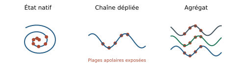

## Osmométrie et dimensions des polymères

### Question 7 — Sens de l’osmose

À pression et température égales, $\mu_{1,A}=\mu_1^*(T,P)$ dans le solvant pur et $\mu_{1,B}=\mu_1^*(T,P)+RT\ln a_{1,B}$ dans la solution. En solution diluée $a_{1,B}<1$, donc $\mu_{1,B}<\mu_{1,A}$. Le solvant traverse la membrane de A vers B jusqu’à l’égalité des potentiels, atteinte grâce à la surpression du côté B. Le soluté reste dans B.

### Question 8 — Relation de van ’t Hoff

À l’équilibre, $\mu_1^*(T,P)=\mu_1^*(T,P+\Pi)+RT\ln x_1$. Pour un solvant peu compressible, $\mu_1^*(P+\Pi)-\mu_1^*(P)\simeq\bar V_1\Pi$. Comme $\ln x_1=\ln(1-x_2)\simeq-x_2$, on trouve $\Pi\simeq RT x_2/\bar V_1$. Dans la limite diluée $x_2\simeq n_2/n_1$ et $V\simeq n_1\bar V_1$, donc $\Pi=RT\,n_2/V=RTC_2$.

### Question 9 — Masse molaire qui intervient dans l’osmose

Si $n_i$ désigne la quantité de chaînes de masse molaire $M_i$, alors $C_2=\sum_i n_i/V$, tandis que $C_m=\sum_i n_iM_i/V$. Leur quotient vaut $C_m/C_2=M_n$. On obtient donc $\Pi/C_m=RT/M_n$.

### Question 10 — Caractère colligatif

En régime idéal dilué, l’abaissement du potentiel chimique du solvant dépend de la fraction molaire du soluté, donc du nombre de chaînes. Un gramme de chaînes courtes contient plus de particules qu’un gramme de chaînes longues et produit plus de pression. Le rapport masse totale/nombre de moles est précisément la moyenne en nombre.

### Question 11 — Lecture de l’ordonnée à l’origine

L’ordonnée 1,98 donne à dilution infinie $\Pi/C_m=0{,}0198\ \mathrm{kPa\,L\,g^{-1}}$. Comme $1\ \mathrm{kPa\,L}=1\ \mathrm J$, $M_n=8{,}314\times298/0{,}0198\simeq1{,}25\,10^5\ \mathrm{g\,mol^{-1}}$, soit environ 125 kDa par molécule. On utilise l’interception de la droite et non un point arbitraire à concentration finie.

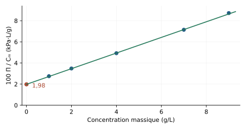

### Question 12 — Deuxième coefficient du viriel

La pente $0{,}74$ donne $RT A_2=0{,}0074\ \mathrm{kPa\,L^2\,g^{-2}}$. À 298 K on trouve $A_2\simeq2{,}99\,10^{-6}\ \mathrm{L\,mol\,g^{-2}}$, ou $2{,}99\,10^{-3}\ \mathrm{m^3\,mol\,kg^{-2}}$. Son signe positif correspond au bon solvant de l’énoncé.

### Question 13 — Pourquoi la chaîne ne se tend pas complètement

Un bon solvant favorise les contacts solvant–monomère et gonfle la pelote. Mais une chaîne entièrement étirée n’a que très peu de conformations accessibles. La perte d’entropie accroît le terme $-T\Delta S$ de l’énergie libre. L’équilibre conserve de nombreux arrangements et donne une pelote gonflée dont l’extension reste inférieure à la longueur de contour.

### Question 14 — Pelote en bon solvant

La chaîne explore un large volume. Ses boucles sont majoritairement entourées de solvant et les contacts à grande distance le long de la chaîne sont peu favorisés. Le dessin montre une configuration possible parmi de nombreuses configurations thermiques.

### Question 15 — Pelote en mauvais solvant

La macromolécule se contracte en globule afin de limiter les contacts monomère–solvant défavorables. À longueur égale, son rayon de giration diminue et les contacts internes augmentent ; plusieurs chaînes peuvent aussi s’agréger si la solubilité devient insuffisante.

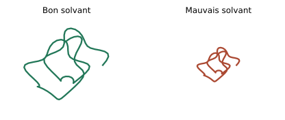

## Séparation en colonne

### Question 16 — Choix de la phase mobile

Le bon solvant maintient le polymère dissous en pelotes individuelles et évite compaction excessive, agrégation et précipitation. Il rend possible un classement par taille hydrodynamique dans des conditions identiques à celles de l’étalonnage.

### Question 17 — Accès aux pores

Une macromolécule trop grande reste dans le liquide entre les billes. Une plus petite peut visiter certains pores ; les plus petites atteignent presque tout le volume poreux. Cette sélectivité est géométrique, en supposant négligeable l’adsorption sur le support.

### Question 18 — Ordre d’élution

La macromolécule du chemin 1 contourne les billes, parcourt moins de volume et sort en premier. Elle est plus grande que celle du chemin 2, qui pénètre les pores, en ressort puis circule de nouveau entre les billes. Les petites molécules sortent en dernier.

### Question 19 — Volume accessible

Le liquide interstitiel représente $V_0$, le volume poreux total $V_t-V_0$. Une fraction accessible $x_j$ donne $V_{e,j}=V_0+x_j(V_t-V_0)$ avec $0\le x_j\le1$. Les plus grandes molécules exclues sortent à $V_0$ ; les plus petites, perméant à tous les pores, sortent à $V_t$.

### Question 20 — Limites de l’étalonnage

$V_1\simeq V_0$ (environ 13 mL sur la figure) marque l’exclusion totale des grandes espèces. $V_2\simeq V_t$ (environ 22–23 mL) marque la perméation totale des petites. Seule la zone 2 entre ces bornes sépare les masses dans la gamme utile, avec $\ln(M/M_0)$ décroissant. Les espèces au-dessus de la gamme se confondent à $V_1$ et celles en dessous à $V_2$. Les zones 1 et 3, hors intervalle, ne permettent pas d’attribution de masse.

### Question 21 — Moyennes à partir du chromatogramme

Pour une tranche de largeur $\Delta V_i$ et de hauteur $h_i$, la masse $m_i$ est proportionnelle à $h_i\Delta V_i$ si la réponse est linéaire. L’étalonnage au centre de la tranche donne $M_i$, donc $n_i=m_i/M_i$. Les deux résultats sont $M_n=\sum m_i/\sum(m_i/M_i)$ et $M_w=\sum m_iM_i/\sum m_i$. Le facteur de réponse commun s’élimine. Le même calcul vaut avec les fractions massiques normalisées.

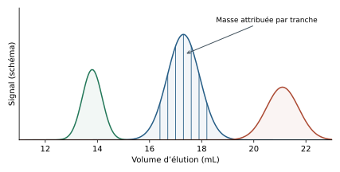

### Question 22 — Ouverture de l’époxyde du gel

En milieu basique une fraction suffisante de l’azote secondaire de $\mathrm{HN(CH_2CO_2^-)_{2}}$ est non protonée. Son doublet attaque par l’arrière le méthylène terminal de l’époxyde. Le doublet C–O se reporte sur O, puis un transfert de proton donne le β-aminoalcool. Le greffon se termine ainsi par $\mathrm{-OCH_2CH(OH)CH_2N(CH_2CO_2^-)_{2}}$. À pH 10 les carboxylates restent disponibles pour la complexation et l’azote est un meilleur nucléophile qu’en milieu acide.

### Question 23 — Critères de recouvrement et valence de Cu²⁺

Des orbitales doivent avoir des symétries compatibles pour que l’intégrale de recouvrement soit non nulle, se recouvrir spatialement et être assez voisines en énergie pour que le mélange soit significatif. $\mathrm{Cu^{2+}}$ est $[\mathrm{Ar}]3d^9$. Les cinq 3d, la 4s et les trois 4p constituent la base de valence du modèle. La s est sphérique ; chaque p a deux lobes opposés sur son axe. Les $d_{xy},d_{xz},d_{yz}$ pointent entre les axes, $d_{x^2-y^2}$ sur x et y, et $d_{z^2}$ porte deux lobes axiaux et un tore équatorial de phase inverse.

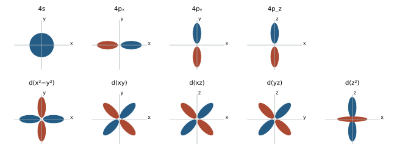

### Question 24 — Interactions octaédriques

L’eau donne un doublet de O dans une liaison σ dirigée vers Cu. Pour les six charges donneuses situées sur les axes, les combinaisons qui se transforment comme des orbitales du métal sont détaillées dans le tableau. Les trois d de type $t_{2g}$ ont leurs nœuds sur les directions métal–O et restent non liantes dans ce modèle σ. Les deux d de type $e_g$ ont des recouvrements dirigés vers les ligands et contribuent à des orbitales d dominantes antiliantes plus élevées. Le champ octaédrique sépare donc les cinq d en trois et deux.

| Fragment | Signes ou symétrie caractéristique | Orbitale de Cu |
|---|---|---|
| 1 | Pairs selon les trois axes, même phase partout, $a_{1g}$ | $4s$ |
| 2 | Oppose la paire x à la paire y, nulle sur z, $e_g$ | $3d_{x^2-y^2}$ |
| 3 | Oppose la paire z au plan xy, $e_g$ | $3d_{z^2}$ |
| 4 | Impaire sur y, nulle sur les autres axes, $t_{1u}$ | $4p_y$ |
| 5 | Impaire sur z, nulle sur les autres axes, $t_{1u}$ | $4p_z$ |
| 6 | Impaire sur x, nulle sur les autres axes, $t_{1u}$ | $4p_x$ |

### Question 25 — Azote donneur de l’histidine

L’azote de type pyridine, représenté sans H, possède un doublet dans une orbitale du plan, disponible pour Cu(II). Le doublet de l’azote pyrrolique N–H participe au sextet aromatique. L’imidazole neutre est un ligand L, donneur σ par ce doublet. Sur le support, l’amine tertiaire de l’iminodiacétate est aussi de type L ; ses deux oxygènes carboxylates sont des donneurs anioniques X dans le comptage covalent. Le support est donc chélatant, de type LX₂, et l’imidazole complète la coordination par un quatrième site.

### Question 26 — Les quatre combinaisons liantes tétraédriques

La combinaison 1, de même phase sur les quatre ligands, a la symétrie $a_1$ et recouvre $4s$. Les trois autres sont de type $t_2$. Dans le repère de la figure 15, la combinaison 2 oppose les sommets de part et d’autre selon y et recouvre $4p_y$ et $3d_{xz}$. La 3 correspond à $4p_z$ et $3d_{xy}$, la 4 à $4p_x$ et $3d_{yz}$. Pour former chaque orbitale liante, on choisit les phases du métal pour que ses lobes et les lobes des donneurs en regard soient de même signe. Les quatre schémas indiquent ces phases ; la valeur absolue des coefficients dépend des énergies. Les deux autres d sont nulles dans les quatre directions diagonales du cube.

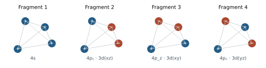

### Question 27 — Remplir le diagramme tétraédrique

Les orbitales réparties en blocs sont $a_1$ (fragment 1 et 4s), $t_2$ (fragments 2–4, trois d et trois p de même symétrie) et $e$ (deux d métalliques). Les quatre combinaisons liantes sont pleines avec huit électrons. Dans les niveaux à caractère d, le doublet e non liant reçoit quatre électrons et le triplet $t_2$ supérieur en reçoit cinq, soit $e^4t_2^5$ et un électron célibataire. Les niveaux très hauts à caractère 4p et 4s restent vides. La donation stabilise les liaisons, malgré une occupation partielle de niveaux antiliants. La faible stabilisation de champ d’un ion $d^9$ et la dégénérescence incomplètement remplie rendent possible une déformation de la géométrie tétraédrique idéale.

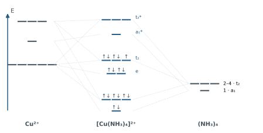

### Question 28 — Utilité de la chaîne greffée

Une chaîne polymère greffée porte plusieurs époxydes et peut donc recevoir de nombreux motifs chélatants pour un seul ancrage. Elle espace aussi ces sites de la surface. La densité de ligands accessibles, donc la capacité du gel, augmente par rapport à une petite molécule monofonctionnelle.

### Question 29 — Deux vagues d’élution

Le premier éluant entraîne en premier lieu les protéines non retenues ou faiblement retenues. La protéine présentant le motif de reconnaissance demeure davantage liée aux ions du gel. Après changement d’éluant vers 40 mL, la concurrence accrue libère la fraction retenue, d’où le second signal, de maximum vers 48 mL. L’absorbance à 280 nm indique de la matière protéique ; le gel d’électrophorèse renseigne sur son identité de masse et sa pureté.

### Question 30 — Rôle du tampon à pH 7

À pH 7, une part importante des imidazoles d’histidine, dont le $pK_a$ conjugué est voisin de 6, est sous forme neutre coordinante. Un milieu plus acide les protonerait et affaiblirait la liaison au cuivre. Un pH modéré limite aussi les modifications de structure des protéines et la formation d’espèces hydroxylées du cuivre.

### Question 31 — Imidazole dans le premier éluant

Une faible quantité d’imidazole concurrence surtout les fixations faibles ou peu spécifiques de protéines possédant un site isolé. La protéine présentant plusieurs histidines proches reste préférentiellement retenue. Le premier lavage diminue ainsi l’entraînement de contaminants dans la fraction suivante.

### Question 32 — Concurrence durant l’élution

L’imidazole libre en excès occupe des sites du cuivre et déplace les histidines de la protéine retenue. Avec un second éluant dix fois moins concentré, la concurrence et la désorption seraient plus faibles. Le second pic devrait être retardé, généralement plus étalé et plus bas ; sur la même fenêtre, une partie de la protéine pourrait rester fixée. La première vague, enregistrée avec l’éluant 1, serait identique.

## Électrophorèse et lecture du gel

### Question 33 — Limites de la couche mince classique

Sur une plaque ordinaire de silice, une protéine présente de nombreux sites d’adsorption et migre difficilement de façon réversible dans les éluants usuels. Faible solubilité, dénaturation et traînées limitent la résolution. Dans un gel aqueux on peut régler le pH et séparer les protéines selon leur mobilité sous champ.

### Question 34 — Vitesse limite dans un liquide visqueux

Sur l’axe du champ, $m\dot v=qE-6\pi\eta rv$. Avec $\tau=m/(6\pi\eta r)$, $v(t)=qE(1-e^{-t/\tau})/(6\pi\eta r)$. La vitesse tend vers $v_\infty=\mu_l E$, avec la mobilité algébrique $\mu_l=q/(6\pi\eta r)$. Le sens de migration s’inverse avec le signe de $q$.

### Question 35 — Réaction de l’atmosphère ionique

La charge intégrée du nuage compensateur est $-q$. Sous champ, les contre-ions tendent à migrer en sens opposé à la particule en entraînant du solvant. La déformation et le retard de relaxation du nuage s’opposent aussi au déplacement. La résultante supplémentaire $\vec F_r$ freine la particule ; elle est opposée à $q\vec E$.

### Question 36 — Mobilité effective

Si $F_r$ désigne le module de la force retardatrice, $|\mu_e|=(|q|-F_r/E)/(6\pi\eta r)<|\mu_l|$. Avec une notation vectorielle, $6\pi\eta r\,\vec v=q\vec E+\vec F_r$. L’augmentation de la viscosité ralentit la migration. À charge et taille données, une force ionique plus élevée écrante davantage la charge effective et tend aussi à réduire la mobilité. Le pH règle l’ionisation, le tampon la force ionique et le gel la discrimination de taille. Le champ et la durée règlent la distance parcourue, en évitant un échauffement qui changerait la viscosité.

### Question 37 — Point isoélectrique et mobilité mesurée

Le zéro se situe entre pH 4,60 ($+0{,}18$ µm par seconde) et pH 5,20 ($-0{,}25$). Une interpolation locale donne $4{,}60+0{,}60\times0{,}18/(0{,}18+0{,}25)\simeq4{,}85$. À pH 4,20, $\mu_e=0{,}50\,10^{-6}/150\simeq+3{,}33\,10^{-9}\ \mathrm{m^2\,V^{-1}\,s^{-1}}$, dans le sens positif choisi pour le champ.

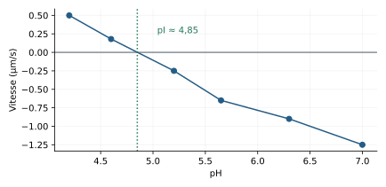

### Question 38 — Comment le SDS donne un classement en masse

Le SDS déplie les protéines et leur confère une charge négative approximativement proportionnelle au nombre de résidus, donc à la masse. Les différences de charge native et de structure tridimensionnelle sont fortement atténuées. Le réseau de polyacrylamide freine davantage les longues chaînes : à temps égal les petites migrent plus loin. Une gamme étalon permet de relier migration et masse moléculaire apparente.

### Question 39 — Lecture des pistes du gel

Les pistes L et F présentent de nombreuses bandes. Après changement d’éluant, les fractions 1 à 4 contiennent une bande principale entre les repères 30 et 46 kDa, autour de 37–39 kDa par interpolation. Les autres bandes sont plus faibles ; les fractions montrent un enrichissement relatif, avec des traces de contaminants encore visibles. La présence d’une bande de même migration dans F indique qu’une part de matière de cette taille peut sortir avant l’élution spécifique.

## 2. Action sur la synthèse du cholestérol

### Question 40 — Réduction du dérivé d’acyle

Le thioester de l’HMG-CoA, traité comme un ester, est réduit jusqu’à l’alcool primaire de l’acide mévalonique, avec libération du fragment soufré. En chimie organique, un hydrure tel que $\mathrm{LiAlH_4}$ peut réaliser la réduction d’un ester après traitement aqueux, mais peut aussi réduire d’autres groupes du substrat. L’enzyme reconnaît celui-ci et permet une réduction sélective dans l’eau, avec un cofacteur donneur d’équivalents réducteurs.

### Question 41 — Deux positions dans la voie du cholestérol

Dans le schéma simplifié, le Mevacor agit en amont sur l’HMG-CoA réductase et réduit l’alimentation des branches issues des intermédiaires isopréniques, y compris celle des ubiquinones. L’acide zaragozique A agit plus en aval sur la squalène synthase, après la bifurcation. Il est donc, d’après ce seul critère de sélectivité métabolique, mieux placé pour limiter les effets sur les autres produits. La planche ne compare pas la tolérance clinique réelle des traitements.

### Question 42 — Profil énergétique catalysé

Un catalyseur offre un chemin dont la barrière d’activation déterminante est moins élevée, parfois avec des intermédiaires. Il accélère les échanges dans les deux sens. À température fixée, il ne change ni l’enthalpie libre standard globale, ni la constante d’équilibre, car les états initial et final sont les mêmes.

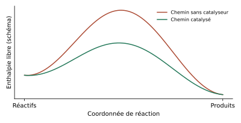

### Question 43 — Cycle michaelien avec un concurrent

Sans inhibiteur, $E+S\rightleftharpoons ES\to E+P$ dans le modèle du sujet, avec $V=d[P]/dt=k_{\rm cat}[ES]$. En présence de I on ajoute la branche réversible $E+I\rightleftharpoons EI$. EI est inactif et empêche le même E de lier S. Seul ES produit P, de sorte que la loi élémentaire de production est inchangée.

### Question 44 — Loi de vitesse sans inhibiteur

Avec les constantes thermodynamiques du sujet, $K_M=[E][S]/(C^\circ[ES])$. Le bilan $[E]_T=[E]+[ES]$ donne $[ES]=[E]_T[S]/(C^\circ K_M+[S])$. D’où $V_{\max}=k_{\rm cat}[E]_T$ et $V=V_{\max}[S]/(C^\circ K_M+[S])$. En convention usuelle de concentration, la constante michaelienne est $C^\circ K_M$.

### Question 45 — Abscisse de demi-vitesse

Sans inhibiteur, $V=V_{\max}/2$ impose $[S]=C^\circ K_M$. À une ordonnée voisine de 50, la courbe sans inhibiteur donne environ $0{,}4$ à $0{,}45\ \mathrm{\mu mol\,L^{-1}}$. On retiendra $C^\circ K_M\simeq0{,}4\ \mathrm{\mu mol\,L^{-1}}$ pour les estimations qui suivent.

### Question 46 — Bilan avec enzyme inhibée

Le bilan devient $[E]_T=[E]+[ES]+[EI]$, avec $[EI]=[E][I]/(C^\circ K_I)$. Lorsque $[S]$ devient très grande à concentration fixée de I, $[ES]\to[E]_T$ : l’inhibiteur compétitif ne modifie pas $V_{\max}=k_{\rm cat}[E]_T$.

### Question 47 — Loi de vitesse compétitive

Le bilan s’écrit $[E]_T=[E]\{1+[S]/(C^\circ K_M)+[I]/(C^\circ K_I)\}$. En substituant dans $V=k_{\rm cat}[ES]$, on obtient $V=V_{\max}[S]/\{[S]+C^\circ K_M(1+[I]/(C^\circ K_I))\}$. La présence de I augmente ainsi la constante apparente sans modifier l’asymptote.

### Question 48 — Demi-vitesse avec inhibiteur

En présence de $8\,10^{-11}\ \mathrm{mol\,L^{-1}}$ d’inhibiteur, l’abscisse de demi-vitesse est d’environ $0{,}8\ \mathrm{\mu mol\,L^{-1}}$ (lecture graphique). Cette abscisse vaut $C^\circ K_M^{\rm app}$.

### Question 49 — Constante d’inhibition

Les deux abscisses sont dans le rapport $K_M^{\rm app}/K_M\simeq2$. Or ce rapport est $1+[I]/(C^\circ K_I)$. Il vient $C^\circ K_I\simeq[I]\simeq8\,10^{-11}\ \mathrm{mol\,L^{-1}}$, soit environ 80 pM ; la constante $K_I$ sans dimension a la valeur numérique $8\,10^{-11}$ avec $C^\circ=1\ \mathrm{mol\,L^{-1}}$.

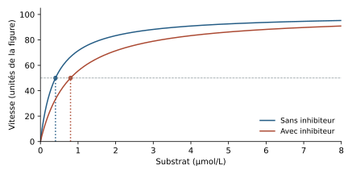

### Question 50 — Valeur de la CI₅₀

La relation de Cheng–Prusoff s’écrit $\mathrm{CI}_{50}=C^\circ K_I\{1+[S]/(C^\circ K_M)\}$. À $5\ \mathrm{\mu mol\,L^{-1}}$ de substrat, on obtient $8\,10^{-11}(1+5/0{,}4)\simeq1{,}1\,10^{-9}\ \mathrm{mol\,L^{-1}}$. C’est une inhibition puissante dans cet essai. $K_I$ caractérise l’affinité à conditions physicochimiques fixées, tandis que la CI₅₀ rapporte la concentration requise dans un essai à teneur en substrat définie. La comparaison de CI₅₀ suppose des conditions comparables ; ni l’une ni l’autre n’est une dose à administrer.

## 3. Synthèse de l’intermédiaire 31

### Question 51 — Protection des deux alcools du diol 16

Posons $\mathrm{PMB}=p$-méthoxybenzyle. Former les deux alcoolates de $\mathrm{HOCH_2C{\equiv}CCH_2OH}$ avec au moins deux équivalents d’une base telle que NaH dans un solvant aprotique sec. Introduire au moins deux équivalents de $\mathrm{PMBCl}$. Chaque O attaque le carbone benzylique par substitution bimoléculaire, avec départ de chlorure. Le produit 17 est $\mathrm{PMBOCH_2C{\equiv}CCH_2OPMB}$. La base doit déplacer la déprotonation de l’alcool et limiter la concurrence d’un nucléophile apporté par le milieu.

### Question 52 — Hydrostannation catalysée par le palladium

L’étape 1 est l’addition oxydante de la liaison H–Sn à $\mathrm{Pd^0L_2}$, qui donne B avec Pd(II). La fixation de l’alcyne puis son insertion dans la liaison Pd–H conservent Pd(II) dans C et D. L’étape 4 est l’élimination réductrice du lien vinyle–Sn, qui restitue Pd(0). Dans 18, $\mathrm{PMBOCH_2{-}CH{=}C(SnBu_3){-}CH_2OPMB}$, H et $\mathrm{SnBu_3}$ sont du même côté de la double liaison et les deux chaînes $\mathrm{CH_2OPMB}$ de l’autre. A, B, C, D ont donc respectivement les degrés 0, +II, +II, +II.

### Question 53 — Donation et rétrodonation

Dans une coordination latérale, l’orbitale π occupée de l’alcyne donne vers une orbitale métallique vide de bonne symétrie. Inversement, une orbitale d occupée du métal transfère de la densité vers l’orbitale π* vacante de l’alcyne. Cette rétrodonation affaiblit la liaison multiple. Un palladium pauvre en électrons peut mieux accepter la donation mais rétrodonne moins ; on ne peut affirmer qu’un appauvrissement renforce toujours la coordination. Pour un alcyne accepteur π, la perte de rétrodonation peut au contraire la défavoriser.

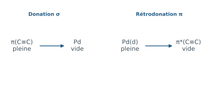

### Question 54 — Alcène iodé de la réaction de Wittig

La transformation donne $\mathrm{MeO_2C{-}C(I){=}CH{-}CH_2OSEM}$ et $\mathrm{Ph_3P{=}O}$. Dans le Z demandé, I et $\mathrm{CH_2OSEM}$ se trouvent du même côté. L’éther SEM masque le groupe alcool qui pourrait protoner l’ylure ou perturber la génération de celui-ci. L’aldéhyde reste le site de l’oléfination.

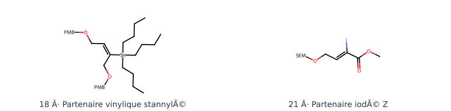

### Question 55 — Double liaison attendue pour l’oxydation

Dans $\mathrm{OsO_4}$, Os est au degré +VIII ; le centre est électrophile et réagit préférentiellement avec un alcène riche en électrons. Pour repérer les atomes de 22, écrivons $\mathrm{G{-}a{=}b(-J){-}c(CO_2Me){=}dH{-}L}$, où $\mathrm{G=J=CH_2OPMB}$, $\mathrm{L=CH_2OSEM}$ et a porte aussi H. Si l’ester est bien conjugué, il appauvrit c=d par effet mésomère attracteur. On attendrait donc l’attaque de a=b.

### Question 56 — Effet de la torsion du groupe ester

L’arrangement coplanaire maximise normalement la conjugaison entre $\mathrm{C{=}C}$ et $\mathrm{C{=}O}$. Le voisinage encombré des substituants peut imposer une torsion autour de la liaison simple qui les relie. Lorsque les plans sont presque perpendiculaires, la délocalisation π entre c=d et l’ester devient faible. La liaison c=d retrouve ainsi une réactivité suffisante pour être celle qui réagit expérimentalement. Dans 23, a=b subsiste et c,d portent chacun OH à la place de leur liaison π. Les deux O sont apportés syn sur la face qui, dans 25, donne les deux liens C–O de l’acétonide en coins pleins. Le carbonyle de l’ester reste intact.

### Question 57 — Formation de l’acétonide

Dans 24 un pont $\mathrm{c{-}O{-}C(CH_3)_2{-}O{-}d}$ relie les deux OH de 23 en un 1,3-dioxolane à cinq chaînons. L’APTS protone un oxygène méthoxy du diméthoxypropane. Départ de méthanol et attaque d’un OH du diol donnent un cétal mixte après déprotonation. Protonation du second méthoxy, départ de méthanol et attaque intramoléculaire de l’autre OH ferment le cycle ; la dernière déprotonation régénère l’acide. Le bilan libère deux méthanols. Dans ces substitutions, les O neutres ont deux doublets et les oxoniums $\mathrm{O^+}$ à trois liaisons en ont un.

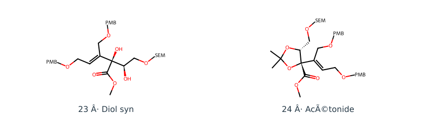

### Question 58 — Pourquoi cycliser un seul des alcools libres ?

L’acétonide retire les deux nouveaux OH du jeu des transestérifications et conserve leur relation stéréochimique. Le retrait des PMB libère les hydroxyméthyles G et J. L’O de J, attaché à b, attaque le carbonyle de l’ester de c. L’intermédiaire tétraédrique expulse le groupe méthoxy sous forme de méthanol et donne une γ-lactone à cinq chaînons : O(J)–CH₂(J)–b–c–C(O). Le chemin concurrent depuis G passe aussi par a et donne un cycle plus grand, avec davantage de contraintes de géométrie. Le produit 25 conserve le bras G–OH et l’alcène a=b.

### Question 59 — Deux syn-diols et migration de la lactone

La seconde dihydroxylation ajoute OH sur a et sur b par la même face. Les deux possibilités sont donc le couple de OH vers l’avant ou le couple vers l’arrière de la face de référence de 25. Les centres déjà présents sur c,d sont identiques dans ces deux diastéréoisomères. En milieu acide, le carbonyle de la lactone est protoné. L’OH porté par a l’attaque et donne un intermédiaire tétraédrique. Après transfert de proton, la liaison acyle–O(J) se rompt, le carbonyle se reforme et le bras J devient $\mathrm{CH_2OH}$. L’oxygène sur a constitue désormais l’oxygène de la nouvelle γ-lactone. La face retenue est celle qui laisse l’OH de b en arrière et $\mathrm{b{-}CH_2OH(J)}$ en avant sur 27 ; le substituant $\mathrm{a{-}CH_2OH(G)}$ y apparaît en arrière. L’autre syn-diol inverserait les deux centres a et b.

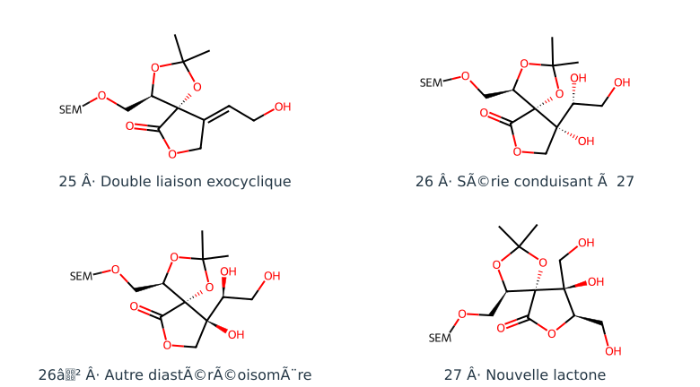

### Question 60 — Silylation différenciée des alcools

C’est la protection d’un alcool par formation d’un éther silylé : l’oxygène attaque Si, le chlorure part, puis la base élimine le proton. Imidazole et DMAP favorisent le transfert du silicium et la neutralisation de l’acide libéré. Le groupe TPS volumineux sélectionne le bras primaire G le plus accessible, sur a. Le bras primaire J, voisin du centre b plus encombré, reste disponible pour l’oxydation en aldéhyde qui conduit ensuite à 28.

### Question 61 — Degrés d’oxydation et transformation du formyle

Le chlore est à +III dans $\mathrm{ClO_2^-}$ ; le phosphore est à +V dans $\mathrm{H_2PO_4^-}$. Le chlorite participe à l’oxydoréduction, tandis que le phosphate fournit le milieu tampon. Dans 28, le site oxydé est l’aldéhyde du bras J. Pour le couple organique, $\mathrm{RCHO+H_2O\to RCO_2H+2H^++2e^-}$. Le composé 29 a donc la structure de 28 avec $\mathrm{CHO\to CO_2H}$, les autres fonctions et centres conservés. Cette réponse partielle couvre le couple organique et la structure de 29 ; la demi-équation conduisant au dichlore et le bilan qui l’inclut restent hors couverture.

### Question 62 — Fluorure de sodium et fluorure de tétrabutylammonium

En milieu organique comme le THF, le gros cation tétrabutylammonium facilite la solubilité du sel et laisse le fluorure davantage disponible pour attaquer Si. NaF forme un réseau ionique serré et est peu soluble dans ce milieu. La réaction du fluorure avec Si est favorisée par la formation de la liaison Si–F ; la différence entre les deux sels vient surtout de la disponibilité du nucléophile.

## Construction des chaînes latérales

### Question 63 — Oxygène transférable

Les deux familles contiennent une liaison O–O relativement faible. Le transfert d’un oxygène peut être couplé à la rupture de cette liaison et à la formation des deux liaisons C–O de l’époxyde. Ici la coordination au titane, acide de Lewis, active le peroxyde et organise sa rencontre avec l’alcool allylique. Le tartrate impose un environnement chiral.

### Question 64 — Approche du groupe peroxo

C’est la HO π occupée de l’alcène qui donne vers l’orbitale acceptrice de la liaison peroxyde, à composante $\sigma^*_{\rm O-O}$. Les lobes π se trouvent aux deux faces de l’alcène. L’oxygène transféré s’approche au-dessus ou au-dessous du plan défini par les deux carbones et leurs substituants, de façon approximativement normale à ce plan et en regard des deux carbones.

### Question 65 — Face sélectionnée par le tartrate

Le substrat se fixe sur le titane par l’oxygène de l’alcool allylique. Dans l’arrangement du (−)-D-tartrate représenté, l’O transféré se trouve sur la face qui, replacée dans la projection de 32 (les deux bras carbonés vers le haut), conduit à placer le pont O en arrière du plan initial. Le caractère suprafacial conserve la relation cis entre $\mathrm{CH_2OPMB}$ et $\mathrm{CH_2Ph}$. En numérotant depuis l’extrémité alcool protégée, les centres de l’époxyde majoritaire sont $2R,3S$. L’image miroir est minoritaire ; un excès énantiomérique de 81 % correspond à 90,5 % et 9,5 %.

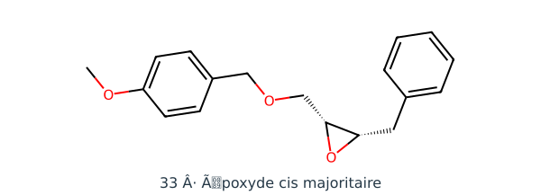

### Question 66 — Orbitales frontalières de l’oxirane

Du fragment éthylène, les orbitales σ déjà engagées sont plus éloignées en énergie ou sans recouvrement approprié. On retient la π et la π* du doublet C=C, l’une occupée et l’autre vide. Avec les six électrons de valence de O, on place huit électrons : $(1a_1)^2(2a_1)^2(1b_2)^2(b_1)^2$. Les orbitales $2b_2$ puis $3a_1$ sont vacantes. La HO $b_1$ est essentiellement le doublet non liant $2p_x$ de O, avec deux lobes de phases contraires hors du plan $yz$ du cycle. La BV $2b_2$ est antiliante pour la liaison au fragment oxygène, avec de forts coefficients de phases opposées sur les deux carbones issus de π*. La composante O de symétrie correspondante est $2p_y$ ; le mélange antiliant est dominé par le fragment carboné, plus haut en énergie.

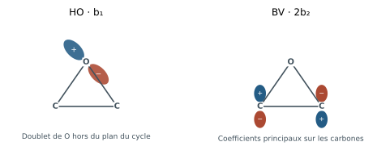

### Question 67 — Sites électrophile et nucléophile de l’oxirane

Un électrophile peut recevoir le doublet de O ; il approche une face d’un lobe du doublet $p_x$, hors du plan du cycle pour la HO représentée. Un nucléophile utilise les lobes carbonés de la BV et attaque un des carbones par l’arrière de la liaison C–O qui s’ouvre. L’angle Nu–C–O tend vers 180°, avec inversion au carbone attaqué. Dans un époxyde substitué en milieu non acide, l’accessibilité stérique différencie les deux sites.

### Question 68 — Oxydation de Swern

Le chlorure d’oxalyle et le DMSO à froid, suivis de triéthylamine, transforment $\mathrm{HOCH_2{-}CH(OPMB){-}CH(CH_3){-}CH_2Ph}$ en $\mathrm{OHC{-}CH(OPMB){-}CH(CH_3){-}CH_2Ph}$. Les configurations des deux centres préexistants sont conservées. La fonction nouvellement disponible pour la réaction suivante est un aldéhyde.

### Question 69 — Addition du bras porteur d’un acétal

L’extrémité $\mathrm{C{-}MgBr}$ de 36 fournit par son carbone une liaison C–C au carbone du formyle ; les électrons π vont sur O, qui se lie au magnésium. Un traitement aqueux modérément acide à la fin donne l’alcool secondaire de 37, en gardant le dioxolane. Employer un éther sec, par exemple le THF, avec verrerie sèche et atmosphère inerte, puis hydrolyser après l’addition. Le carbone de l’ancien aldéhyde peut être attaqué sur ses deux faces diastéréotopiques. Le lien ondulé C–OH indique une configuration non spécifiée ou un mélange de diastéréoisomères, sans imposer le rapport 1:1.

### Question 70 — Alkylation en α sous forme d’hydrazone

L’azaénolate lithié de l’hydrazone se représente sous une forme à charge sur le carbone α. Ce carbone attaque le $\mathrm{CH_2I}$ primaire de 39 et l’iodure part par substitution bimoléculaire. La liaison C=N de l’hydrazone se reforme. En notant Aux le N du cycle pyrrolidine substitué de la SAMP, 41 s’écrit $\mathrm{Aux{-}N{=}CH{-}CH(CH_3){-}CH_2{-}CH(CH_3){-}CH_2CH_3}$ ; le carbone $\mathrm{CH(CH_3)}$ voisin de C=N est le nouveau centre, l’autre provient de 39.

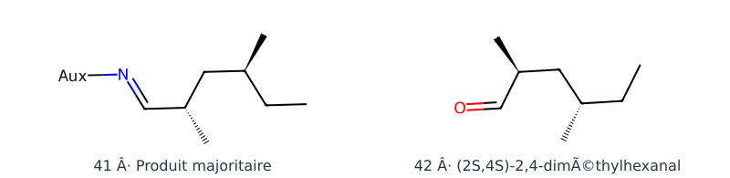

### Question 71 — Chélation du lithium et excès diastéréoisomérique

Le cycle à six sommets suit $\mathrm{Li{-}N_{imine}{-}N_{pyr}{-}C^*_{pyr}{-}CH_2{-}O{-}Li}$. Le doublet de l’oxygène méthoxy complète la chélation. Les deux repliements de type chaise placent différemment le cycle pyrrolidine et l’appendice autour du plan Li–N–C=C. Le conformère qui réduit les interactions pseudoaxiales expose la face opposée au volume de l’auxiliaire. L’électrophile y approche le carbone α par la face Re (priorités locales carbone de l’imine, méthyle, H). Après alkylation, les priorités de ce nouveau centre sont branche C=N, chaîne issue de 39, méthyle, H ; la configuration majoritaire est S. Elle se lit également sur 42 en remplaçant C=N par CHO, le méthyle du nouveau centre en avant. Un excès de 92 % signifie $x_{\rm maj}-x_{\rm min}=0{,}92$ et $x_{\rm maj}+x_{\rm min}=1$, donc 96 % de majoritaire et 4 % de minoritaire.

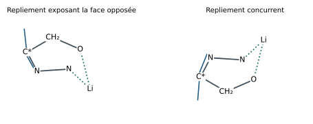

### Question 72 — Ozone et libération de l’aldéhyde

L’ozone est décrit par $\mathrm{^{-}O{-}O^+{=}O\leftrightarrow O{=}O^+{-}O^-}$. Le terminal simplement lié a trois doublets, le terminal doublement lié deux, l’oxygène central un. Une addition dipolaire sur C=N engage le terminal nucléophile de l’ozone vers C, le doublet π de C=N vers le terminal électrophile et le doublet π de O=O vers l’oxygène central ; un adduit cyclique peut ainsi se former. Sa fragmentation libère le carbonyle de 42. L’hydrazone a fourni l’équivalent nucléophile de l’aldéhyde et l’auxiliaire chiral a contrôlé la face d’alkylation ; son retrait restitue la fonction formyle.

## Couplage et cœur bicyclique

### Question 73 — Couplage du dithiane et de l’aldéhyde

Le carbone lithié du dithiane, équivalent d’un anion acyle masqué, attaque le carbone de l’aldéhyde de 31. Le doublet π va sur O ; le traitement aqueux donne un alcool secondaire. L’aldéhyde plus accessible et plus électrophile réagit prioritairement aux esters et au carbonyle de la lactone lors de l’addition à froid. Les deux faces du formyle donnent des épimères au carbone qui porte maintenant OH. Si $R_{31}$ est tout le résidu de 31 privé de son CHO et $R_{44}$ le carbone acétal soufré de 44 avec tous ses substituants, 46 est $\mathrm{R_{31}{-}C^*(OH)(H){-}R_{44}}$, de configuration R. Dans la figure, OH, $R_{44}$ puis $R_{31}$ tournent dans le sens horaire avec H vers l’arrière. Le classement des deux branches carbonées commence par (S,S,C) devant (O,C,H).

### Question 74 — Dégager sélectivement l’alcool silylé

Traiter brièvement 46 à froid dans un milieu aqueux organique faiblement acide, par exemple un mélange acide acétique/eau/THF, et arrêter au retrait du triméthylsilyle. L’éther O–TMS, très accessible, est plus labile que l’éther encombré de la chaîne latérale. Une longue exposition ou un excès de fluorure risquerait de cliver également ce dernier. On conserve les protections encore nécessaires en surveillant la conversion.

### Question 75 — Rendre au dithiane son carbonyle

Le dioacétal soufré est l’équivalent protégé d’une cétone. Après retrait de TMS et hydrolyse du dithiane, 47 est $\mathrm{R'_{31}{-}CH(OH){-}C(=O){-}T}$, où $R'_{31}$ est le résidu précédent de 31 avec OH à la place d’OTMS et $\mathrm{T=CH_2CH_2C(=CH_2)CH(Osilyle)CH(CH_3)CH_2Ph}$ est la chaîne de 44. Les deux $\mathrm{CH}$ stéréogènes de T et l’alcool secondaire issu du formyle gardent leur disposition. La substitution des deux S par O révèle le carbonyle à la jonction avec T.

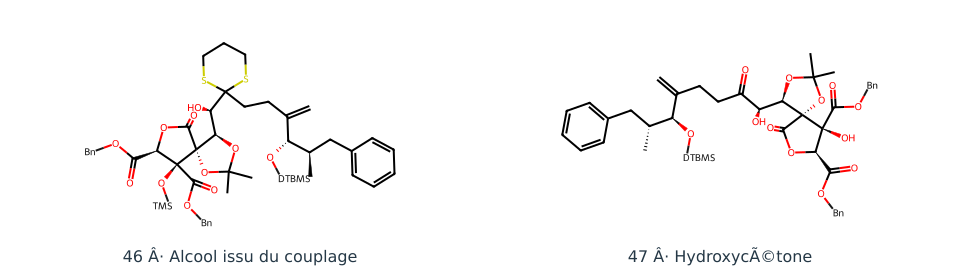

### Question 76 — Fermeture du troisième cycle

La protonation de l’oxygène de la cétone rend son carbone plus électrophile. L’oxygène de l’alcool dévoilé à la question 74 attaque ce carbone par l’intérieur de la molécule, avec transfert du doublet π sur l’oxygène initial du carbonyle. Une déprotonation forme le nouveau pont C–O. Le carbone portant T se retrouve lié à OH et à l’oxygène cyclique, ce qui donne l’hémicétal 48. L’OH de l’ancien aldéhyde demeure libre ; son attaque directe formerait un cycle à trois chaînons.

### Question 77 — Capture de l’oxocarbénium 49

Le carbone de la double liaison $\mathrm{O^+=C}$ qui porte la chaîne latérale est l’électrophile de 49. L’OH en coin plein sur le carbone inférieur gauche, lui-même porteur de $\mathrm{CO_2Me}$ en arrière, attaque ce carbone du même côté du cycle. Le doublet π se reporte sur l’oxygène oxonium et l’oxygène entrant perd son proton. On forme le pont interne du bicyclo[3.2.1] de 50. Cette disposition rapproche les deux partenaires avec fermeture de cycles peu contraints. Les OH vicinaux, orientés différemment ou trop proches par le contour, ne donneraient pas cette combinaison de taille de cycle et de face accessible.

### Question 78 — Origine des esters méthyliques

La méthanolyse acide peut ouvrir la lactone et transestérifier un ester benzylique. Le méthanol en grand excès est la source des groupes méthoxy des deux $\mathrm{CO_2Me}$ de 50. Le passage aux trois esters benzyliques uniformise la protection des carboxyles et permet leur libération commune plus tard, en préservant les esters des chaînes latérales si les conditions sont adaptées.

### Question 79 — Estérifier sélectivement l’alcool en C₆

Une estérification de Steglich est possible : activer le carboxyle de 43 avec une carbodiimide, par exemple DCC, en présence catalytique de DMAP dans un solvant organique sec. L’alcool libre de C₆ attaque l’acyle activé et donne l’ester insaturé de 52. Les ajustements de protections décrits dans le sujet limitent l’acylation des autres sites. Cette méthode évite un long chauffage acide du cœur acétal.

### Question 80 — Placer l’acétate au bon site

Acétyler d’abord l’alcool secondaire libre de la chaîne latérale avec l’anhydride acétique, une amine tertiaire et, si nécessaire, DMAP. L’alcool du cœur destiné à rester OH est encore masqué par TES ; l’autre OH tertiaire est plus encombré. Libérer ensuite l’alcool O–TES par un traitement sélectif de désilylation, par exemple fluorure tamponné à froid, en conservant les esters. Inverser l’ordre exposerait deux alcools secondaires à l’acétylation et diminuerait la régiosélectivité.

### Question 81 — Libérer les trois carboxyles

Cliver par hydrogénolyse les trois liaisons $\mathrm{RCO_2{-}CH_2Ph}$ pour libérer trois $\mathrm{RCO_2H}$. Le principe est celui d’une débenzylation catalytique sur palladium. Pour ce substrat insaturé, une hydrogénolyse par transfert utilisant un donneur tel que le 1,4-cyclohexadiène et $\mathrm{Pd(OH)_2/C}$ permet de viser les esters benzyliques sans saturer systématiquement les alcènes. Une surveillance de la chimiosélectivité et de la configuration de la chaîne est nécessaire : une épimérisation partielle a été signalée sur ce squelette. L’acétate et l’ester insaturé de C₆ restent dans la structure de 1.

Les structures de la troisième partie et la discussion de la débenzylation finale peuvent être confrontées au travail de K. C. Nicolaou et collaborateurs, publié en 1995 dans *Chemistry — A European Journal*, pages 467–494. Les numéros des molécules y diffèrent de ceux du sujet. [Publication de référence](https://chemistry-europe.onlinelibrary.wiley.com/toc/15213765/1995/1/7)
