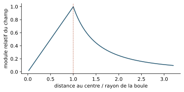
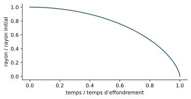
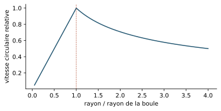
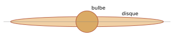
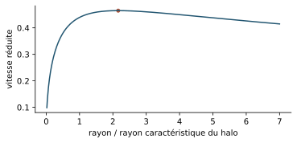
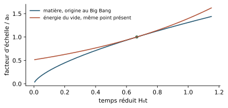

# ENS Ulm PC 2020 — Physique C · Corrigé brut

*Corrigé rédigé par IA, non officiel. Signalez toute erreur.*

**Lecture du rapport du jury** · GPT-6.2 Astra Ultra · vitesse non renseignée

**Rédaction** · GPT-6.2 Astra Ultra · vitesse non renseignée

## Gravitation et secteur sombre de l’Univers

**Corrigé partiel.** Questions 1 à 15 et 20 à 66 traitées. Les questions 16 à 19, relatives à la comparaison de trajectoires, sont hors couverture.

## Champ de gravitation et chute libre

### Question 1 — Champ électrostatique

Le champ électrostatique obéit à $\nabla\cdot\mathbf E=\rho_q/\epsilon_0$ et $\nabla\times\mathbf E=\mathbf0$. La force sur une charge ponctuelle au repos vaut $\mathbf F=q\mathbf E$. La divergence est un scalaire et le rotationnel un vecteur.

### Question 2 — Équations de la gravitation

Le champ newtonien d’une masse ponctuelle est attractif, $\mathbf K=-Gm\mathbf e_r/r^2$. Son flux à travers une sphère vaut $-4\pi Gm$. Par superposition et passage à la forme locale, $\nabla\cdot\mathbf K=-4\pi G\rho$ et $\nabla\times\mathbf K=\mathbf0$. Ici $\rho=dm/dV$ est la masse volumique, en $\mathrm{kg/m^3}$.

### Question 3 — Signe des sources

Les deux signes de charge électrique permettent attraction ou répulsion, ainsi que la neutralité d’un système composé de charges. Les masses ordinaires sont positives et la gravitation newtonienne entre deux de ces masses est toujours attractive.

### Question 4 — Boule uniformément chargée

La distribution est invariante par rotation autour du centre. De plus tout plan contenant le centre et le point de calcul est plan de symétrie, donc le champ polaire appartient à leur intersection, le rayon. Sa norme ne dépend que de $r$. Par Gauss, $4\pi r^2E_r=Q_{\rm int}/\epsilon_0$. Pour $r<R$, $\mathbf E=\rho_{q,0}r\mathbf e_r/(3\epsilon_0)$ et pour $r>R$, $\mathbf E=\rho_{q,0}R^3\mathbf e_r/(3\epsilon_0r^2)$. Le champ est continu à la surface.

### Question 5 — Boule de masse constante par volume

La même symétrie donne $4\pi r^2K_r=-4\pi GM_{\rm int}$. À l’intérieur $\mathbf K=-(4\pi G\rho_0/3)\mathbf r$. À l’extérieur $M_{\rm int}=M=4\pi\rho_0R^3/3$, donc $\mathbf K=-GM\mathbf r/r^3$. Au centre la résultante s’annule par symétrie.

### Question 6 — Détecter un champ électrique uniforme

Un observateur neutre peut lâcher une particule de charge positive connue et mesurer localement son accélération. Sa direction est celle de $\mathbf E$ et sa norme donne $E$ si la masse et la charge sont connues. Une particule opposément chargée dévie en sens inverse.

### Question 7 — Référentiel en chute libre

Si le repère de l’observateur est en translation d’accélération $\mathbf a_O=\mathbf K$, Newton s’y écrit $m\mathbf a'=m\mathbf K+\mathbf F_{\rm autres}-m\mathbf a_O$. La force d’inertie d’entraînement annule le poids. Dans un champ uniforme le mouvement relatif obéit donc à $m\mathbf a'=\mathbf F_{\rm autres}$.

### Question 8 — Expérience locale

Dans un repère en chute libre et sans rotation, tous les corps soumis seulement au champ uniforme ont la même accélération. Leurs séparations relatives ne révèlent donc ni sa direction ni son intensité. Un champ variant dans l’espace pourrait en revanche produire une accélération différentielle mesurable.

### Question 9 — Impesanteur en orbite

La station et l’astronaute à l’intérieur suivent presque la même orbite de chute libre autour de la Terre. En l’absence de contact il n’y a donc pas de force d’appui qui donne une sensation de poids. L’accélération gravitationnelle reste de l’ordre de $9\,\mathrm{m/s^2}$ à cette altitude.

### Question 10 — Masse grave et masse inertielle

Dans le référentiel galiléen $m_i\mathbf a=m_g\mathbf K$, soit $\mathbf a=\mathbf K/\alpha_{\rm eq}$ avec la convention imprimée $\alpha_{\rm eq}=m_i/m_g$. En électrostatique $m_i\mathbf a=q\mathbf E$. Le rapport $q/m_i$ dépend du corps, peut changer de signe et possède des dimensions. La chute universelle n’a donc pas d’analogue pour les charges électriques.

### Question 11 — Effets de marée

L’accélération d’un repère en translation produit la même force d’inertie par unité de masse en tout point. Le champ d’une masse localisée présente généralement un gradient et des forces de marée entre points voisins. Il peut être annulé par chute libre en un point, mais son gradient ne disparaît pas sur une région étendue. La présence des sources intervient dans ce gradient via l’équation de Gauss.

### Question 12 — Chute sur la Lune

Dans le vide lunaire, une différence d’accélération ne peut pas s’expliquer par un freinage aérodynamique notable. Deux objets de composition et de forme différentes lâchés ensemble du même point depuis le repos doivent arriver au même moment s’ils ont le même rapport $m_i/m_g$. La comparaison teste l’universalité de ce rapport.

### Question 13 — Précision temporelle du test

À la surface $g_L=GM_L/R_L^2$. Le temps de chute depuis $z_0$ vaut $t(\alpha)=\sqrt{2z_0\alpha/g_L}=t_1\sqrt\alpha$. Pour $\alpha=1+\delta\alpha$, $|t-t_1|\simeq t_1|\delta\alpha|/2$. Une précision $\delta t$ donne donc $|\delta\alpha|\lesssim2\delta t\sqrt{GM_L/(2z_0R_L^2)}$.

### Question 14 — Ordre de grandeur lunaire

Les données donnent $g_L\simeq1{,}6\,\mathrm{m/s^2}$ et $t_1\simeq1{,}1\,\mathrm s$ pour un mètre. Avec $\delta t=0{,}02\,\mathrm s$, $2\delta t/t_1\simeq0{,}036$, soit environ $4\times10^{-2}$ à un chiffre significatif. Cette expérience illustre une égalité à quelques pour cent.

### Question 15 — Deux conservations à même altitude

La force est verticale, donc la quantité de mouvement horizontale se conserve, $v_{B,x}=\dot x_0$. La conservation de l’énergie mécanique entre deux points à même altitude impose $v_B^2=v_A^2$. La composante horizontale étant identique, $|v_{B,y}|=|\dot y_0|$. Le départ est montant et l’arrivée descendante, d’où $v_{B,y}=-\dot y_0$.

## Effondrement d’une sphère homogène

### Question 20 — Accélération relative des grains

À l’instant initial, le champ intérieur est linéaire. Le référentiel du grain en $\mathbf r$ a l’accélération $\mathbf K(\mathbf r)$. La force apparente sur son voisin est donc $m[\mathbf K(\mathbf r+\delta\mathbf r)-\mathbf K(\mathbf r)]=-(4\pi G\rho_0m/3)\delta\mathbf r$. La différence dépend seulement du déplacement relatif.

### Question 21 — Homogénéité de la contraction

Le champ de marée précédent est isotrope et indépendant de $\mathbf r$. Un observateur intérieur en chute libre ne trouve donc aucune direction distinguant le centre par ce test local. Toutes les petites séparations initialement au repos suivent le même facteur de contraction. Les volumes se multiplient par son cube et une densité uniforme reste uniforme tant que les couches ne se croisent pas.

### Question 22 — Équation du facteur d’échelle

La direction d’une séparation reste fixe et $\delta\mathbf r=x(t)\delta\mathbf r_0$. La conservation de masse dans chaque sphère comobile impose $\rho(t)x^3=\rho_0$. Ainsi $\delta\ddot{\mathbf r}=-(4\pi G\rho_0/3)\delta\mathbf r/x^3$, ou $\ddot x=-4\pi G\rho_0/(3x^2)$ avec $x(0)=1$ et $\dot x(0)=0$.

### Question 23 — Intégrale première

Notons $A=4\pi G\rho_0/3$. Multiplier $\ddot x=-A/x^2$ par $\dot x$ donne $d(\dot x^2/2)/dt=d(A/x)/dt$. Avec les conditions initiales, $\dot x^2/2=A(1/x-1)$. Pour la contraction, on choisit ensuite la racine négative.

### Question 24 — Singularité de la boule sans pression

$x=0$ signifie que toutes les séparations initialement finies s’annulent au même instant et que la densité du modèle diverge. Des grains physiques ont une taille finie. Les collisions, pressions et autres interactions deviennent essentielles avant cet état, qui marque une limite du modèle idéal.

### Question 25 — Temps d’effondrement

La branche négative de Q23 donne $t_{\rm eff}=(2A)^{-1/2}\int_0^1 dx/\sqrt{1/x-1}$. L’intégrale vaut $\pi/2$ par le formulaire ou par $x=\sin^2u$. On obtient $t_{\rm eff}=\sqrt{3\pi/(32G\rho_0)}$. À densité fixée, le rayon et la masse des grains disparaissent ; une boule plus dense s’effondre plus vite.

## Distribution visible et halo de la Voie lactée

### Question 26 — Parsec

Une seconde d’arc vaut $\pi/(180\times3600)\simeq4{,}85\times10^{-6}\,\mathrm{rad}$. À petit angle $D_{\rm pc}=D_{TS}/\tan(1'')\simeq1{,}5\times10^{11}/(4{,}85\times10^{-6})\simeq3\times10^{16}\,\mathrm m$.

### Question 27 — Puissance de la Voie lactée

Un soleil du modèle émet $L_\odot=4\pi R_\odot^2\sigma T_{\rm surf}^4\simeq4\times10^{26}\,\mathrm W$. En multipliant par $2$ à $4\times10^{11}$ étoiles assimilées au Soleil, on trouve une luminosité galactique de l’ordre de $10^{38}\,\mathrm W$.

### Question 28 — Rotation stationnaire

Chacune des orbites idéales garde $r$ et $z$ constants, donc sa vitesse est tangentielle, $\mathbf v=r\dot\theta\mathbf e_\theta$. L’axisymétrie, la stationnarité et l’hypothèse d’indépendance en $z$ font de $\dot\theta$ une fonction du seul rayon. Sa connaissance fixe le mouvement collectif du disque.

### Question 29 — Équilibre radial

L’accélération d’une étoile sur un cercle est $-v_\theta^2\mathbf e_r/r$. La deuxième loi de Newton donne donc $K_r=-v_\theta^2/r$ pour l’axe radial orienté vers l’extérieur. L’équilibre relie la vitesse observée à la composante centripète du champ.

### Question 30 — Masse déduite de la vitesse

À symétrie sphérique, Gauss donne $K_r=-GM_{\rm int}(r)/r^2$ dans le plan équatorial. Par Q29, $v_\theta^2(r)=GM_{\rm int}(r)/r$, donc $M_{\rm int}=rv_\theta^2/G$. C’est la relation entre courbe de rotation et masse gravitant à l’intérieur du rayon.

### Question 31 — Boule homogène

À l’intérieur $M_{\rm int}=4\pi\rho_0r^3/3$ et $v_\theta=\sqrt{4\pi G\rho_0/3}\,r$. À l’extérieur $M_{\rm int}=M$ et $v_\theta=\sqrt{GM/r}$. La courbe croît linéairement jusqu’à $R$ puis décroît comme $r^{-1/2}$, en restant continue.

### Question 32 — Bulbe et disque

Le bulbe est une distribution sphérique, de rayon de cœur $75\,\mathrm{pc}$ et de coupure caractéristique $2\,\mathrm{kpc}$. Le disque s’étend surtout dans le plan. Sa longueur radiale de décroissance exponentielle est $3\,\mathrm{kpc}$ et sa hauteur caractéristique $0{,}3\,\mathrm{kpc}$. Ces paramètres décrivent une décroissance progressive de densité.

### Question 33 — Masse stellaire du disque

L’intégration en $z$ de $e^{-|z|/z_d}/(2z_d)$ vaut un. La masse vaut alors $M_d=2\pi\Sigma_{d,0}\int_0^\infty r e^{-r/R_d}dr=2\pi\Sigma_{d,0}R_d^2$. Avec $750\,M_\odot/\mathrm{pc^2}$ et $R_d=3000\,\mathrm{pc}$, on obtient $4\times10^{10}\,M_\odot$ à un chiffre significatif.

### Question 34 — Région visible et loi lointaine

Hors de $r=xR_d$, la fraction de masse du disque est $(1+x)e^{-x}$. À cinq longueurs d’échelle, soit $15\,\mathrm{kpc}$, elle tombe près de 4 %. Prendre $R_{\rm vis}$ de l’ordre de 15 à 20 kpc inclut aussi le bulbe. Au-delà, la masse visible enfermée varie peu et la prédiction est $v_\theta\simeq\sqrt{GM_{\rm vis}}\,r^{-1/2}$. Le préfacteur mesure la masse visible totale du modèle.

### Question 35 — Courbes observées

La figure 2 montre une forte montée centrale, puis une vitesse presque constante autour de $150\,\mathrm{km/s}$ pour NGC 3198. Pour NGC 2403 on lit environ $130$ à $140\,\mathrm{km/s}$ au-delà de quelques kpc. Cette tenue des vitesses loin du centre est incompatible avec la chute képlérienne attendue si toute la masse était déjà enfermée dans la région visible.

### Question 36 — Halo étendu

Une vitesse presque constante implique $M_{\rm int}(r)\simeq v^2r/G$, donc une masse qui continue à croître au-delà des régions lumineuses. En symétrie sphérique un halo de densité grossièrement en $1/r^2$ dans l’intervalle observé produirait ce comportement. L’adjectif « noire » indique que sa présence est inférée gravitationnellement sans émission lumineuse comparable à celle des étoiles.

### Question 37 — Limites du profil de halo

Pour $r\ll R_h$, le profil de Navarro–Frenk–White tend comme $1/r$. La densité ponctuelle diverge mais la masse du cœur, proportionnelle à $\int_0^r s\,ds$, reste finie et tend vers zéro. Pour $r\gg R_h$, $\rho_h\propto r^{-3}$ et l’intégrale de masse croît comme $\int dr/r$. Une extension à l’infini donne donc une masse logarithmiquement divergente et exige une limite physique.

### Question 38 — Échelle de NGC 3198

Pour $x=r/R_h$, l’intégration donne $M_h(<r)=4\pi\rho_{h,0}R_h^3[\ln(1+x)-x/(1+x)]$. Ainsi $v=\sqrt{4\pi G\rho_{h,0}}R_h f(x)$ avec $f^2=\ln(1+x)/x-1/(1+x)$. La figure 3 monte vite, atteint un maximum large vers $x\simeq2$ puis varie lentement. Sur la figure 2 le maximum de NGC 3198 se situe vers 13 à 15 kpc, soit $R_h$ de l’ordre de $6$ à $7\,\mathrm{kpc}$ dans cette lecture simplifiée. Le disque contribue aussi à la courbe réelle.

### Question 39 — Masse limitée du halo

À la coupure $r=\beta R_h$, $M_h=4\pi\rho_{h,0}R_h^3[\ln(1+\beta)-\beta/(1+\beta)]$. Avec $R_h=18\,000\,\mathrm{pc}$, $\rho_{h,0}=0{,}012\,M_\odot/\mathrm{pc^3}$ et $\beta\simeq10$, on obtient $\sim1{,}3\times10^{12}\,M_\odot$, environ trente masses de disque. Le halo étendu domine le bilan global dans ce modèle.

### Question 40 — Densités locales galactiques

Au plan galactique à $r=8\,\mathrm{kpc}$, le bulbe est négligeable. Le disque donne $750e^{-8/3}/600\simeq0{,}09\,M_\odot/\mathrm{pc^3}$. Pour $x=8/18$, le halo donne $0{,}012/[x(1+x)^2]\simeq0{,}01\,M_\odot/\mathrm{pc^3}$. Le halo étendu domine globalement, alors que la densité visible prédomine localement dans le plan selon ces profils lissés.

## Mouvement vertical et densité locale

### Question 41 — Poisson dans le disque

Dans le système axisymétrique, $\partial_\theta K_\theta=0$ et le champ gravitationnel n’a pas de composante azimutale par symétrie méridienne. Ainsi $-4\pi G\rho=r^{-1}\partial_r(rK_r)+\partial_z K_z$. Avec $rK_r=-v_\theta^2$, on en déduit $\rho=[r^{-1}\partial_r(v_\theta^2)-\partial_zK_z]/(4\pi G)$. Un champ vertical de rappel a bien une dérivée négative près du plan.

### Question 42 — Courbe presque plate

Près du rayon solaire la vitesse de rotation varie peu avec le rayon, comme sur une portion presque plate de la courbe de rotation. La dérivée radiale de $v_\theta^2$ est donc petite. Dans l’approximation locale de disque mince on retient $\rho\simeq-(\partial_zK_z)/(4\pi G)$.

### Question 43 — Rappel vers le plan

À $z>0$, la gravité de la couche galactique attire vers les $z$ décroissants, $K_z<0$. À $z<0$, $K_z>0$ ; par symétrie $K_z(0)=0$. Une étoile liée oscille autour du plan en s’arrêtant verticalement à deux hauteurs extrêmes. Le mouvement est proche d’un oscillateur harmonique seulement si le champ est linéaire en $z$.

### Question 44 — Énergie verticale d’une étoile

La dynamique $\dot v_z=K_z$ se réécrit $v_z\,dv_z/dz=K_z$. Entre le plan et l’altitude $z$, $v_z(z)^2=v_z(0)^2+2\int_0^z K_z(s)ds$. L’intégrale est négative de part et d’autre du plan, donc la vitesse verticale en valeur absolue décroît en s’en éloignant.

### Question 45 — Densité dans l’espace position–vitesse

$\bar\rho_i\,dv_z\,d^3V$ est un nombre, d’où $[\bar\rho_i]=\mathrm{s/m^4}$. En intégrant l’expression imprimée en $v_z$ sur toute la droite, la gaussienne normalisée a pour intégrale 1 et il reste $\tilde\rho_i(0)$ en $\mathrm{m^{-3}}$. Il s’agit d’une densité en nombre.

### Question 46 — Distribution stationnaire

Le mouvement vertical sans collisions conserve les trajectoires dans l’espace $(z,v_z)$. Son flot $(\dot z,\dot v_z)=(v_z,K_z(z))$ a une divergence nulle dans cet espace, donc la densité de phase se conserve le long d’une trajectoire stationnaire. Avec $J(z)=\int_0^zK_z(s)ds$, $v_z(0)^2=v_z^2-2J(z)$. On en tire $\bar\rho_i[z,v_z]=\tilde\rho_i(0)e^{J(z)/\sigma_i^2}e^{-v_z^2/(2\sigma_i^2)}/(\sqrt{2\pi}\sigma_i)$, où $\sigma_i$ est la dispersion du type d’étoile considéré.

### Question 47 — Masse estimée par les populations d’étoiles

L’intégration en vitesse donne $\tilde\rho_i(z)=\tilde\rho_i(0)e^{J(z)/\sigma_i^2}$. Ainsi $K_z=\sigma_i^2\partial_z\ln\tilde\rho_i$ pour une dispersion constante. Combiné à Q42, cela donne $\rho_{\rm totale}\simeq-\sigma_i^2\partial_z^2\ln\tilde\rho_i/(4\pi G)$. La population observée sert de traceur du champ dû à toute la matière.

### Question 48 — Excès local de masse

La différence entre densité gravitant et visible vaut $0{,}033\,M_\odot/\mathrm{pc^3}$. Si les incertitudes indiquées sont indépendantes, son écart-type est $\sqrt{0{,}015^2+0{,}011^2}\simeq0{,}019\,M_\odot/\mathrm{pc^3}$. L’estimation centrale suggère une composante invisible plus élevée que les $0{,}013$ du halo de Q40 ; l’écart entre cette prédiction et la différence mesurée vaut seulement environ un écart-type. La mesure reste compatible avec le halo et ne suffit pas à établir une concentration supplémentaire dans le disque.

## Expansion cosmologique et énergie noire

### Question 49 — Domaine newtonien

Einstein a formulé la relativité générale au début du XXe siècle, avec les équations du champ de 1915. La gravitation newtonienne constitue une approximation pour des vitesses petites devant $c$, des potentiels faibles au sens $|\Phi|/c^2\ll1$ et des effets de propagation négligeables sur les échelles considérées.

### Question 50 — Volume comobile

Chaque longueur entre points comobiles est multipliée par $a_2/a_1$. En trois dimensions toutes les composantes s’étirent dans la même proportion, donc $V_2=V_1(a_2/a_1)^3$.

### Question 51 — Origine cosmologique

Si dans ce modèle $a(t)$ tend vers zéro en un temps fini dans le passé, on retrouve la singularité initiale associée au Big Bang. Les distances comobiles physiques tendent vers zéro dans la description classique et le passé correspond à un état très dense et chaud. L’événement ne définit aucun centre spatial privilégié.

### Question 52 — Temps de Hubble

Pour $a(t)=\alpha t$, $H=1/t$, donc $t_0=1/H_0=4{,}55\times10^{17}\,\mathrm s$. Avec un an $\simeq365\times24\times3600=3{,}15\times10^7\,\mathrm s$, cela fait $1{,}44\times10^{10}$ ans, environ quatorze milliards d’années dans ce modèle linéaire.

### Question 53 — Homogénéité de Friedmann

$H^2$ a pour dimension $\mathrm{s^{-2}}$. Comme $u$ est une énergie volumique, $u/c^2$ a la dimension d’une masse volumique. Ainsi $G u/c^2$ a pour dimension $(\mathrm{m^3\,kg^{-1}\,s^{-2}})(\mathrm{kg\,m^{-3}})=\mathrm{s^{-2}}$, ce qui vérifie l’égalité.

### Question 54 — Bilan thermodynamique comobile

Pour un volume fermé comobile, l’adiabaticité réversible et le seul travail de pression donnent $d(uV)=-P\,dV$. Comme $\dot V/V=3H$, on obtient $\dot u=-3H(u+P)$. Le premier terme associé à $u$ traduit la dilution et celui associé à $P$ le travail d’expansion.

### Question 55 — Accélération de l’expansion

Dérivons $H^2=8\pi Gu/(3c^2)$ et remplaçons $\dot u$ par Q54. Il vient $\dot H=-4\pi G(u+P)/c^2$ sur la branche en expansion. Or $\ddot a/a=\dot H+H^2$, donc $\ddot a/a=-4\pi G(u+3P)/(3c^2)$. L’expansion accélère si $u+3P<0$, ralentit si $u+3P>0$ et est à accélération nulle à l’égalité.

### Question 56 — Fluide d’équation d’état constante

Avec $P=wu$, Q54 devient $du/u=-3(1+w)\,da/a$. En intégrant entre le présent et un autre instant, $u=u_0(a/a_0)^{-3(1+w)}$. L’exposant demandé est $-3(1+w)$.

### Question 57 — Poussière froide

Une même portion comobile contient un nombre fixe de particules dont chacune garde l’énergie de repos $mc^2$. La densité d’énergie est donc inversement proportionnelle au volume, $u\propto a^{-3}$. Q56 donne $w=0$, donc $P=0$, ce qui correspond à une poussière froide sans agitation notable. La seule absence de collisions n’interdirait pas une pression cinétique en présence de dispersion de vitesse.

### Question 58 — Normalisation par le présent

Appliquons la première équation de Friedmann à $t$ puis à $t_0$. La division élimine les constantes, $H^2/H_0^2=u/u_0=(a_0/a)^{3(1+w)}$. Cette forme impose automatiquement la condition présente.

### Question 59 — Variables réduites

Pour $x=a/a_0$ et $\tau=H_0t$, $H/H_0=x'/x$, avec prime pour $d/d\tau$. Q58 devient $(x')^2=x^{-(1+3w)}$. Sur la branche en expansion $x'=x^{-(1+3w)/2}$ pour $x>0$.

### Question 60 — Expansion d’un univers de matière

Pour $w=0$, $x'=x^{-1/2}$. En intégrant depuis le Big Bang, $(2/3)x^{3/2}=\tau$, donc $x_{\rm mat}=(3\tau/2)^{2/3}$ et $a_{\rm mat}(t)=a_0(3H_0t/2)^{2/3}$. La courbe part de zéro, croît et reste concave.

### Question 61 — Âge dans le modèle de matière

$x=1$ aujourd’hui impose $t_0=2/(3H_0)=3{,}03\times10^{17}\,\mathrm s\simeq9{,}6\times10^9$ ans. L’âge présent est fini, mais l’expansion se poursuit pour tout $t>0$ dans le futur de ce modèle plat.

### Question 62 — Signe observé de l’accélération

Avec $w=0$ et $u>0$, $\ddot a/a=-4\pi Gu/(3c^2)<0$. La loi $t^{2/3}$ ralentit et ne peut donc reproduire une accélération actuelle de l’expansion si la matière est la seule composante importante.

### Question 63 — Énergie du vide

Pour l’énergie noire d’équation d’état $w=-1$ imprimée dans le sujet, Q56 donne $u=u_\Lambda$ constant. Sa densité reste la même lorsque le volume cosmologique change et même lorsque la matière devient négligeable. La pression $P=-u_\Lambda$ rend cela compatible avec le bilan $d(uV)=-P\,dV$.

### Question 64 — Expansion exponentielle

La densité constante donne $H=H_0>0$. En intégrant $\dot a/a=H_0$ avec $a(t_0)=a_0$, on trouve $a_\Lambda=a_0e^{H_0(t-t_0)}$. Cette courbe croît et est convexe puisque $\ddot a=H_0^2a>0$. Elle décrit bien une expansion accélérée.

### Question 65 — Énergie noire seule dans le passé

La solution exponentielle reste strictement positive pour tout temps fini et ne tend vers zéro que lorsque $t\to-\infty$. Ce modèle plat rempli exclusivement de cette composante ne donne donc pas le Big Bang à date finie demandé dans le problème.

### Question 66 — Modèle combiné

Prenons $u=u_{m,0}(a_0/a)^3+u_\Lambda$, $P=-u_\Lambda$. À petit $a$, la matière domine et la solution tend vers la loi à Big Bang $a\propto t^{2/3}$. À grand $a$, la matière se dilue et le terme constant domine. L’accélération devient positive dès que $u_m-2u_\Lambda<0$, avec une évolution tardive proche de l’exponentielle. Ces deux comportements s’obtiennent dans une seule équation de Friedmann.
