# ENS de Lyon — PC, Physique-chimie 2020 · Corrigé brut

*Corrigé rédigé par IA, non officiel.*

**Rédaction (tour 1)** · GPT-6.2 Astra Ultra · vitesse non renseignée

## Physique. Équilibre de la corde

### Question P1 — Composante horizontale de la tension

Sur l'élément compris entre $s$ et $s+ds$, le brin de gauche exerce $-T(s)\vec\tau(s)$ et celui de droite $+T(s+ds)\vec\tau(s+ds)$. Le poids est vertical. La projection de l'équilibre sur $Ox$ donne $d(T\cos\alpha)/ds=0$. Ainsi $T\cos\alpha=A$ et $T=A/\cos\alpha$. La constante $A>0$ a la dimension d'une force.

### Question P2 — Poids et composante verticale

La différence des composantes verticales des tensions compense le poids $\mu g\,ds$. En divisant par $ds$, il vient $d(T\sin\alpha)/ds=\mu g$. La tension verticale croît dans le sens de parcours de la corde, de gauche à droite.

### Question P3 — Réaction de chaque appui

À l'extrémité $B$, $T_B\sin\alpha_B=\mu gL/2$. Avec $T_B\cos\alpha_B=A$ il vient $A=\mu gL/(2\tan\alpha_B)$. La composante verticale est identique en valeur absolue au point $A$ par symétrie des appuis.

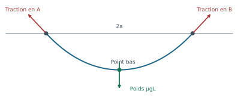

### Question P4 — Équation du profil

On a $T\sin\alpha=A\tan\alpha=Af'$. En dérivant suivant $x$ on obtient $Af''=\mu g\,ds/dx=\mu g\sqrt{1+f'^2}$. Donc $f''=k\sqrt{1+f'^2}$, avec $k=\mu g/A=2\tan\alpha_B/L>0$. Le profil est convexe.

### Question P5 — Équation de la chaînette

Le minimum est sur $x=0$, d'où $b=0$. Comme $f(a)=f(-a)=0$, la constante verticale est $c=-\cosh(ka)/k$. Ainsi $f(x)=[\cosh(kx)-\cosh(ka)]/k$.

### Question P6 — Paramètres dont dépend la forme

Les seules données dimensionnées du problème sont $a,L,\mu,g$. Ni $\mu$ (seule grandeur comportant une masse), ni $g$ (seule grandeur comportant un temps) ne peuvent entrer dans la relation adimensionnée $kL=K(a/L)$. Augmenter uniformément le poids multiplie toutes les tractions par le même facteur et laisse leur direction inchangée.

### Question P7 — Longueur imposée

La contrainte fournit $L=\int_{-a}^{a}\sqrt{1+\sinh^2(kx)}\,dx=2\sinh(ka)/k$. Pour $L>2a$, le rapport $\sinh(ka)/(ka)$ croît strictement de 1 à l'infini sur $k>0$, ce qui fixe la solution.

### Question P8 — Lecture graphique de la courbure

Pour $a=0{,}030\,\mathrm m$ et $L=0{,}20\,\mathrm m$, sa pente vaut $10/3$. L'intersection non nulle avec $\sinh K$ se lit vers $K=3$ puisque $\sinh 3\simeq10$. Donc $k=K/a\simeq 1{,}0\times10^2\,\mathrm{m^{-1}}$. L'intersection à zéro provient de la multiplication par $K$ et ne satisfait pas la contrainte de longueur ici.

## Énergie et film de savon

### Question P9 — Énergie disponible

La corde est inextensible et sans raideur de flexion. Une modification admissible de sa forme ne stocke aucune énergie d'étirement ou de flexion. Les deux réactions s'appliquent à des appuis fixes, de déplacement nul. La seule énergie qui varie entre configurations au repos est donc l'énergie potentielle de pesanteur.

### Question P10 — Énergie potentielle de la corde

Avec une constante de référence $E_0$, $E_p=E_0+\int \mu g f\,ds=E_0+\mu g\int_{-a}^a f(x)\sqrt{1+f'(x)^2}\,dx$. Les portions au-dessous des appuis ont une contribution négative si la référence est prise à leur altitude.

### Question P11 — Configurations admissibles

Les courbes de comparaison passent par les deux appuis et vérifient $\int_{-a}^a\sqrt{1+f'^2}\,dx=L$. Sans cette contrainte on pourrait abaisser indéfiniment le point le plus bas en augmentant la longueur disponible.

### Question P12 — Effet du multiplicateur

À une constante près, $\psi=E_p-\mu gc\int ds$. Le terme en $c$ représente le multiplicateur de la contrainte de longueur. Le problème en $u=f-c$ a pour intégrande $u\sqrt{1+u'^2}$. On retrouve une chaînette translatée verticalement de $c$. Les appuis fixent le décalage une fois $k$ déterminé par $L$.

### Question P13 — Énergie des deux faces

Une bande d'abscisse $x$ a la circonférence $2\pi r$ et la largeur $\sqrt{1+r'^2}\,dx$. Chaque face contribue $\gamma$ par unité d'aire. Ainsi $E_\gamma=4\pi\gamma\int_{-a}^a r\sqrt{1+r'^2}\,dx$.

### Question P14 — Objet de la minimisation

À un facteur constant près, on retrouve l'intégrande de la corde en remplaçant $f-c$ par $r$. Les anneaux imposent $r(\pm a)=R$. Le film ouvert échange de l'air avec l'extérieur et ni le volume intérieur ni la longueur de la méridienne ne sont prescrits. La minimisation de l'aire ne requiert donc aucun multiplicateur de longueur.

### Question P15 — Rayon du film

La forme trouvée pour la variable décalée $f-c$ s'applique à $r$. La symétrie impose $b=0$ et l'on pose $R_0=1/k$. On obtient $r(x)=R_0\cosh(x/R_0)$, où $R_0=r(0)$ est le rayon du col.

### Question P16 — Origine des rayons

L'origine $r=0$ est l'axe de révolution du film. Ajouter une constante change la circonférence de toutes les sections et leur énergie. De plus aucune longueur imposée ne fournit de terme proportionnel à $\int ds$. Le décalage vertical admissible dans la formule de la corde n'a donc pas d'équivalent ici.

### Question P17 — Deux cols possibles

Les conditions aux bords donnent $\cosh u=2u$, avec $u=a/R_0$. Les deux intersections sont proches de $0{,}59$ et $2{,}13$, soit $R_0\simeq1{,}7$ cm ou $0{,}47$ cm. En écartant progressivement des anneaux initialement confondus, le col part de $R$ et suit la branche large, de rayon $1{,}7$ cm. Elle a aussi l'énergie la plus basse des deux caténoïdes. La branche étroite est instable.

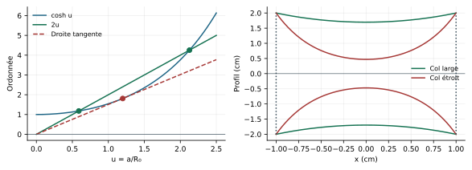

### Question P18 — Écartement critique

À la tangence $\cosh u_c=(R/a_c)u_c$ et $\sinh u_c=R/a_c$, d'où $u_c\tanh u_c=1$. On lit $u_c\simeq1{,}20$ puis $a_c=Ru_c/\cosh u_c\simeq1{,}33$ cm et $R_{0c}=R/\cosh u_c\simeq1{,}10$ cm. L'écartement total critique vaut $2a_c\simeq2{,}65$ cm.

## Ondes sur la corde pendante

### Question P19 — Petite perturbation transversale

La pente typique vérifie $|\partial h/\partial z|\sim a/\lambda\ll1$. Le déplacement transversal doit être petit devant l'étendue longitudinale de l'impulsion pour pouvoir confondre arc et projection à l'ordre un.

### Question P20 — Tension au repos

La portion de longueur $z$ est soumise à la traction supérieure et à son poids. L'extrémité inférieure est libre. Donc $T(z)=\mu gz$, nulle en bas et égale au poids total en haut.

### Question P21 — Dynamique transversale

Au premier ordre la composante transversale de la force du brin supérieur sur un tronçon est $T h_z$ à son extrémité haute, celle du brin inférieur est $-Th_z$ à son extrémité basse. Le poids n'a pas de composante transversale. Ainsi $\mu dz\,h_{tt}=\partial_z(Th_z)\,dz$, soit $\mu h_{tt}=Th_{zz}+T'h_z$.

### Question P22 — Variation locale de la tension

Sur une largeur $\lambda$, les deux termes ont les échelles $Ta/\lambda^2$ et $T'a/\lambda$. Leur rapport dans l'ordre second sur premier vaut $\lambda T'/T=\lambda/z$. On peut retenir $\mu h_{tt}\simeq Th_{zz}$ si $\lambda\ll z$. L'approximation se dégrade au pied de la corde.

### Question P23 — Changement de variable spatiale

Pour $Z=\sqrt{z/L}$, $\partial_z=(2LZ)^{-1}\partial_Z$ et $h_{zz}=H_{ZZ}/(4L^2Z^2)-H_Z/(4L^2Z^3)$. En partant de $h_{tt}=gz h_{zz}$, on obtient $H_{tt}=g[H_{ZZ}-H_Z/Z]/(4L)$.

### Question P24 — Passage à une équation d'onde

Si le profil varie sur une largeur $\Delta Z$, le rapport des deux termes spatiaux vaut en ordre de grandeur $\Delta Z/Z$. Il faut $\Delta Z\ll Z$. Localement, $\Delta Z\simeq\lambda/(2\sqrt{Lz})$ redonne $\lambda\ll z$. L'équation devient $H_{tt}=c_0^2H_{ZZ}$ avec $c_0=\tfrac12\sqrt{g/L}$.

### Question P25 — Valeur de la simili célérité

Pour $L=1\,\mathrm m$ et $g=10\,\mathrm{m\,s^{-2}}$, $c_0=\sqrt{10}/2\simeq1{,}58\,\mathrm{s^{-1}}$. La vitesse en mètres par seconde dépend, elle, de la position sur la corde.

### Question P26 — Largeur spatiale du signal

Le paquet a pour largeur en $Z$ la grandeur $c_0\tau\ll1$. Par l'échelle $z=LZ^2$, la longueur construite avec les trois paramètres demandés vaut $\lambda_*=L(c_0\tau)^2\ll L$ (convention $\Delta Z=\sqrt{\lambda_*/L}$). Pour la largeur physique mesurée autour d'une altitude donnée, il faut préciser cette altitude. De $Z_0$ à $Z_0+c_0\tau$, on trouve exactement $\Delta z=L[2Z_0 c_0\tau+(c_0\tau)^2]$. À distance du pied, la largeur locale est donc de l'ordre de $2\sqrt{Lz_0}\,c_0\tau$, elle aussi petite devant $L$.

### Question P27 — Impulsions montante et descendante

Les solutions en $Z$ sont des fonctions de $t\mp Z/c_0$. Pour l'onde sortante dans chacun des deux demi-domaines issus de $z_0$, avant réflexion, on obtient
$$h^{(\pm)}(z,t)=a\exp\!\left[-\frac{1}{\tau^2}\left(t\mp\frac{\sqrt{z/L}-\sqrt{z_0/L}}{c_0}\right)^2\right].$$
Le signe supérieur fait monter le maximum au cours du temps. Chacune retrouve le signal imposé à $z_0$.

### Question P28 — Trajectoires mesurées dans la corde

Les deux maxima partent de $z_0\simeq0{,}50$ m. Celui qui descend ralentit, celui qui monte accélère jusqu'au voisinage de $z=1$ m vers $0{,}20$ s, puis repart vers le bas après réflexion. Avant une réflexion, $z_m=L(Z_0\pm c_0t)^2$ et $|\dot z_m|=\sqrt{gz_m}$. Les écarts vers le pied sont attendus car l'échelle de variation de $T$ y devient petite.

### Question P29 — Trajectoires après transformation

Dans le repère $(t,Z)$, les trajets deviennent presque rectilignes, montants ou descendants, avec sensiblement la même pente absolue. La réflexion au point fixe inverse la pente au voisinage de $Z=1$. Les points proches de $Z=0$ quittent davantage les droites, là où l'hypothèse $\Delta Z\ll Z$ cesse d'être valable.

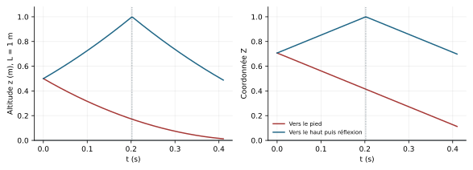

### Question P30 — Célérité déduite des points expérimentaux

Par exemple, sur le front descendant de la figure 8 on lit environ $(0{,}02\,\mathrm s,0{,}68)$ et $(0{,}34\,\mathrm s,0{,}21)$. La pente absolue vaut $0{,}47/0{,}32\simeq1{,}47\,\mathrm{s^{-1}}$. La branche réfléchie donne également près de $1{,}4\,\mathrm{s^{-1}}$. L'écart relatif à $1{,}58\,\mathrm{s^{-1}}$ est de l'ordre de 10 %, compte tenu de la lecture et des approximations locales.

## Ondes sur une corde en défilement

### Question P31 — Bilan sur le demi-tour inférieur

En un temps $dt$, une masse $\mu v\,dt$ entre en $B$ à vitesse $-v\vec u_z$ et la même masse sort en $C$ à $+v\vec u_z$. Le contenu commun du demi-cercle est en régime permanent. Le bilan vertical donne $T_B+T_C-\pi R\mu g=2\mu v^2$. Autour du centre, les moments cinétiques par unité de masse aux deux sections sont égaux (même sens de rotation et même bras $R$). Le poids a un moment total nul par symétrie et les deux tensions ont des moments opposés de modules $RT_B,RT_C$. Donc $T_B=T_C=\mu v^2+\pi R\mu g/2\simeq\mu v^2$ pour $Rg\ll v^2$.

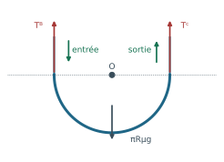

### Question P32 — Célérité relative et vitesse au laboratoire

Sur un brin droit la vitesse matérielle est constante, donc $T(z)=T_B+\mu gz\simeq\mu(v^2+gz)$. Les deux sens de propagation relatifs à la corde ont des vitesses signées $c_\pm=\pm\sqrt{v^2+gz}$. Dans un repère orienté **selon le défilement**, les vitesses au laboratoire valent $v+c_+$ et $v+c_-$, de signes opposés pour $z>0$. Leurs modules sont $c_{\rm rapide}=\sqrt{v^2+gz}+v$ et $c_{\rm lente}=\sqrt{v^2+gz}-v$. Pour $u=z/L$ et $gL/v^2=0{,}10$, $c_\pm/v=\pm\sqrt{1+0{,}10u}\simeq\pm(1+0{,}05u)$. Les modules au laboratoire passent respectivement de $2v$ à $2{,}049v$ et de 0 à $0{,}049v$. Sur AB le défilement est descendant, sur CD il est montant.

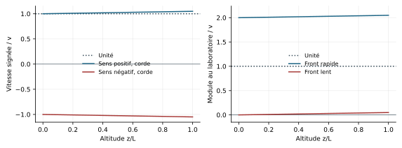

### Question P33 — Lecture de la chronophotographie

La tige impose au brin AB un déplacement puis un retour, séparés d'environ $0{,}1$ s. Chaque changement lance deux fronts. À l'altitude d'excitation, de l'ordre du quart de la hauteur, celui qui remonte AB contre le défilement avance lentement dans le laboratoire, à $\sqrt{v^2+gz}-v\simeq gz/(2v)$ (environ $0{,}12\,\mathrm{m\,s^{-1}}$). Il accélère en montant. Le front emporté vers B parcourt le demi-tour puis remonte CD à près de $2v=20\,\mathrm{m\,s^{-1}}$. Il peut atteindre la poulie supérieure en moins d'un intervalle photographique. Une réflexion en haut engendre sur CD un front qui descend contre le mouvement du brin et ralentit en s'approchant du bas. Ainsi les deux pointillés suivent des mouvements lents de sens opposés, sur des brins distincts. Leur croisement en projection est compatible avec la poursuite des deux déformations. La propagation rapide intermédiaire, qui parcourt environ deux mètres entre clichés, n'est pas résolue.

## Chimie. Réaction de Heck et cinétique

### Question C1 — Séquence du cycle de Heck

Le précurseur donne, par réduction et coordination des phosphines, le complexe actif de Pd(0). L'addition oxydante de R–X forme R–Pd(II)–X. Suivent la coordination de l'alcène par sa liaison π, l'insertion migratoire de l'alcène dans la liaison Pd–R, puis la β-élimination d'hydrure qui donne l'alcène substitué encore coordonné et un hydrure de Pd(II). L'alcène se dissocie. L'élimination réductrice de HX, capté en présence de base, régénère le Pd(0).

### Question C2 — Bilan du couplage

En notant Ph le phényle et Et l'éthyle, le bilan avec la base s'écrit $\mathrm{PhI+CH_2{=}CHCO_2CH_3+Et_3N\longrightarrow (E)\!{-}PhCH{=}CHCO_2CH_3+Et_3NH^++I^-}$. Le produit est le cinnamate de méthyle majoritairement trans. Dans le bilan formel sans base, le coproduit est HI.

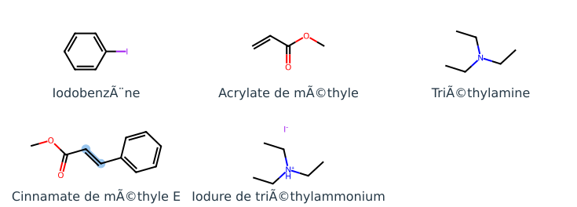

### Question C3 — Attribution du spectre du cinnamate

Les doublets à 7,69 et 6,44 ppm (1 H chacun, $J=16{,}1$ Hz) forment la paire vinylique trans. Le premier est Ph–CH=, le second =CH–CO₂Me. Les multiplets à 7,50–7,53 (2 H ortho) et 7,37–7,39 ppm (3 H méta et para) couvrent le phényle monosubstitué. Le singulet à 3,80 ppm (3 H) est le méthoxy de l'ester. En IR, 3028 et 2951 cm⁻¹ sont des élongations C–H respectivement sp² et sp³. La bande à 1719 cm⁻¹ correspond à C=O de l'ester conjugué (conjugaison abaissant sa fréquence), celle à 1638 cm⁻¹ à C=C conjugué. Les bandes à 1450 et 1434 cm⁻¹ entrent dans la zone des vibrations de squelette aromatique et des déformations de CH₃, qui peuvent se recouvrir. Les élongations C–O de l'ester contribuent à 1276 et 1203 cm⁻¹.

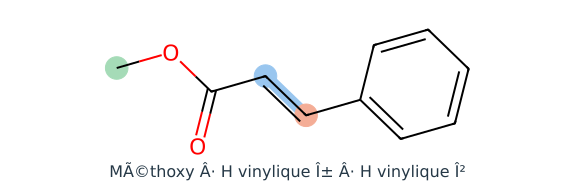

### Question C4 — Quantité de catalyseur pour le suivi

À 0,033 % molaire, la figure 13 présente de nombreux points entre environ 30 et 95 % de conversion pendant une durée exploitable. Avec les charges les plus fortes, la réaction est déjà très avancée après quelques prélèvements. Avec 0,002 %, elle plafonne vers 15 % dans la fenêtre observée. La teneur intermédiaire résout le passage du début à la fin de la réaction.

### Question C5 — Ordre apparent et constante de vitesse

Si $v=-dc_S/dt=kc_S$, on a $-\ln(c_S/c_{S,0})=kt$. Pour les deux répétitions, la figure 14 est compatible avec une droite passant par l'origine, de pente $k=0{,}0219\,\mathrm{min^{-1}}$ ($3{,}65\times10^{-4}\,\mathrm{s^{-1}}$, $R^2=0{,}98$). Cette loi est un premier ordre apparent pour la composition choisie.

## Bilan du réacteur et séparation par membrane

### Question C6 — Réacteur ouvert parfaitement agité

Une pompe alimente une cuve de volume liquide constant $V$ au débit $Q$ et à la concentration $c_{S,e}$. Un agitateur homogénéise la cuve dont la concentration $c_S$ est aussi celle du courant sortant, $c_{S,s}$. Le débit volumique de sortie est $Q$ pour le liquide incompressible considéré. Le temps de passage nominal est $V/Q$.

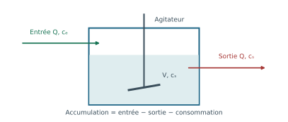

### Question C7 — Bilan de substrat

Le bilan molaire est $V\,dc_S/dt=Qc_{S,e}-Qc_{S,s}-Vv$. En régime permanent l'accumulation est nulle. Avec $\tau=V/Q$, $v=(c_{S,e}-c_{S,s})/\tau$ en quantité de matière par unité de volume et de temps.

### Question C8 — Conversion et temps de passage

L'agitation donne $v=kc_{S,s}$. Le bilan entraîne $c_{S,s}=c_{S,e}/(1+k\tau)$. La fraction convertie est donc $X=1-c_{S,s}/c_{S,e}=k\tau/(1+k\tau)$. Elle tend vers 1 pour un temps de passage élevé.

### Question C9 — Seuil pour un rendement de 90 %

En posant $X=0{,}90$, on trouve $k\tau=9$. Ainsi $\tau_{90}=9/0{,}0219\simeq411$ min, soit $6{,}85$ h ou environ 7 h. Pour dépasser 90 %, le temps de passage doit dépasser cette valeur.

### Question C10 — Interprétation du changement de débit

Avec $V=60$ mL, $Q=0{,}2$ mL/min donne $\tau=300$ min et $X=0{,}868$. À $Q=0{,}1$ mL/min, $\tau=600$ min et $X=0{,}929$. La figure 15 place le premier plateau vers 86–88 % et le second vers 94–96 %, avec une dispersion de quelques points. La réduction du débit à 75 h fait franchir le seuil de 90 % dans le sens prévu.

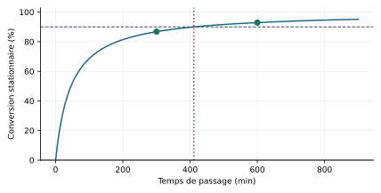

### Question C11 — Masses des solutés et exclusion

L'iodobenzène C₆H₅I pèse 204 g/mol, l'acrylate de méthyle C₄H₆O₂ 86 g/mol et le cinnamate C₁₀H₁₀O₂ 162 g/mol (triéthylamine, 101 g/mol). Dans la structure A dessinée, les quatre phényles et le pont –CH₂CH₂– donnent le ligand C₂₆H₂₄P₂. Avec Pd, $M_A=504$ g/mol. B contient en outre I et C₁₀H₁₁O₂, soit $M_B=504+127+163=794$ g/mol. À ces deux masses, l'exclusion mesurée est proche de 90–95 %. Les petites molécules sont toutes au-dessous du premier point mesuré (environ 240 g/mol, exclusion voisine de 50 %) et se situent du côté le plus perméable. La figure étaye une séparation préférentielle, sans chiffrer exactement le passage de chaque petite molécule. Une fuite résiduelle du métal est cohérente avec le dosage.

### Question C12 — Configuration électronique du palladium

Le palladium a 46 électrons. Selon l'ordre empirique de Klechkowski, 5s précède 4d et on attend $[\mathrm{Kr}]\,5s^2 4d^8$. La configuration fondamentale observée est $[\mathrm{Kr}]\,4d^{10}5s^0$. La proximité des énergies et les interactions entre électrons permettent cet écart à la règle de remplissage.

### Question C13 — Raies d'émission

Le plasma excite les atomes. La désexcitation $4d^95p\to4d^95s$ émet un photon d'énergie $hc/\lambda$. Il s'agit d'une transition électronique atomique $p\to s$, avec $\Delta l=-1$. Les deux longueurs d'onde, proches de 340 et 363 nm, appartiennent à l'ultraviolet proche.

### Question C14 — Nombre de rotations du catalyseur

Prenons une journée, une sélectivité unité et les conversions indiquées. En fermé, 3,43 charges indépendantes donnent $3{,}43\times0{,}6=2{,}06$ mol de produit pour $3{,}43\times0{,}0002$ mol de Pd, d'où $\mathrm{TON}=3000$. En ouvert le volume entrant par jour vaut $0{,}00167\times1440=2{,}405$ L et la production vaut $2{,}405\times0{,}6\times0{,}98=1{,}41$ mol en négligeant le transitoire. Le Pd neuf inclut l'inventaire initial et l'appoint, soit $0{,}0002+2{,}405\times0{,}00002=2{,}48\times10^{-4}$ mol. Le TON de la journée est donc environ $5{,}7\times10^3$. En marche longue, l'inventaire initial s'amortit et le rapport des débits de produit et d'appoint tend vers $0{,}6\times0{,}98/(2\times10^{-5})\simeq2{,}9\times10^4$.

### Question C15 — Productivité volumique

En fermé les heures de maintenance sont déjà comprises dans les 3,43 cycles quotidiens, d'où $2{,}058/(1\times24)=0{,}0858\,\mathrm{mol\,L^{-1}\,h^{-1}}$. En ouvert on obtient $1{,}414/(1\times24)=0{,}0589\,\mathrm{mol\,L^{-1}\,h^{-1}}$ en régime permanent.

### Question C16 — Comparaison des deux dispositifs

Pour les données choisies, le fermé fournit environ 1,46 fois plus de produit par litre et par heure, avec conversion voisine de 100 %, au prix de recharges et d'arrêts périodiques. L'ouvert produit en continu avec 98 % de conversion et réemploie le palladium retenu. Le gain de TON dépend de la durée de campagne. La membrane et l'appoint de palladium compensant sa fuite sont des contraintes supplémentaires.

## Transport vers une électrode tournante

### Question C17 — Oxydation du peroxyde

La demi-équation en milieu aqueux acide est $\mathrm{H_2O_2\longrightarrow O_2+2H^++2e^-}$. Chaque oxygène passe du degré $-\mathrm I$ à 0. Deux électrons sont échangés par peroxyde, donc $n=2$.

### Question C18 — Transport dans la membrane

Dans la membrane le flux diffusif est constant. Pour un coefficient $D_m$ uniforme, le bilan est $D_m\,d^2c_m/dz^2=0$ sur $-l<z<0$. Aucune convection n'y intervient.

### Question C19 — Profil en concentration

L'équation impose $c_m'(z)=a=c_m'(0^-)$. L'intégration entre $-l$ et $z$ donne $c_m(z)-c_m(-l)=a(z+l)$. Le changement éventuel de concentration à l'interface avec la solution reste compatible avec ce profil affine interne.

### Question C20 — Courant et résistances au transport

La pente affine donne $c_m'(-l)=c_m'(0^-)$. Posons $J=D_m c_m'>0$ vers le disque. Les relations des documents donnent $c_i(\infty)-c_i(0^+)=J\delta_i/D_i$, $c_m(0^-)-c_m(-l)=Jl/D_m$ et $c_m(0^-)=\alpha c_i(0^+)$. Leur combinaison puis la loi de Faraday conduisent à
$$I=2FAJ=2FA\frac{c_i(\infty)-c_m(-l)/\alpha}{\delta_i/D_i+l/(\alpha D_m)}.$$
Les deux termes du dénominateur sont de dimension temps par longueur.

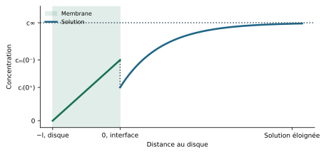

### Question C21 — Courant limite à potentiel élevé

Lorsque le potentiel favorise suffisamment l'oxydation, $c_m(-l)\simeq0$. On trouve $I_{\rm lim}^{-1}=I_d^{-1}+I_m^{-1}$ avec $I_d=2FAD_i c_i(\infty)/\delta_i$ et $I_m=2FA\alpha D_m c_i(\infty)/l$. Le premier incorpore la diffusivité et la couche hydrodynamique de solution. Le second dépend de la diffusion, du partage et de l'épaisseur du film, à aire et concentration de référence fixées.

### Question C22 — Courbes courant-potentiel

Le courant positif est anodique. À fort potentiel, au-delà du potentiel standard $0{,}44$ V/ECS du couple O₂/H₂O₂, il atteint un palier car le transport alimente l'électrode en peroxyde. Le palier croît de la courbe (a) à la courbe (e) lorsque la rotation passe de 100 à 1000 tr/min. Une convection plus forte réduit $\delta_i$, augmente $I_d$ et donc $I_{\rm lim}$, toujours inférieur à $I_m$.

### Question C23 — Droite de Koutecky–Levich

Avec $c_\infty=c_i(\infty)$ et $\delta_i=1{,}61D_i^{1/3}\nu^{1/6}\omega^{-1/2}$ on obtient
$$\frac1{I_{\rm lim}}=\frac1{I_m}+\frac{1{,}61\nu^{1/6}}{2FAc_\infty D_i^{2/3}}\frac1{\sqrt{\omega}}.$$
L'ordonnée à l'origine isole la membrane, même si l'unité choisie pour la vitesse de rotation modifie numériquement la pente.

### Question C24 — Courant limite de membrane

L'extrapolation des cinq points de la figure 20 jusqu'à $1/\sqrt{\omega}=0$ donne environ $0{,}037\,\mathrm{\mu A^{-1}}$ (lecture de l'ordre de $0{,}04$). Donc $I_m\simeq27\,\mathrm{\mu A}$, soit environ $3\times10^1\,\mathrm{\mu A}$. Cet ordre de grandeur excède bien le plus haut palier mesuré.

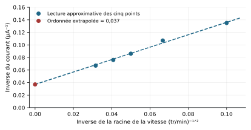

## Étalonnage et sélectivité du capteur

### Question C25 — Linéarité du capteur

À rotation imposée, $\delta_i$ est constante pour le même solvant. À température, aire et membrane fixes, $D_i,D_m,l,\alpha$ sont également constants. Sur le palier on a donc $I_{\rm lim}=Kc_\infty$, où $K=2FA/[\delta_i/D_i+l/(\alpha D_m)]$. Une droite d'étalonnage convertit le courant en concentration.

### Question C26 — Choix de la gamme d'étalonnage

Les 20 mL contiennent initialement $4{,}6\times10^{-7}$ mol. Chaque ajout apporte $50\times10^{-6}\times9{,}1\times10^{-3}=4{,}55\times10^{-7}$ mol, pratiquement la même quantité. L'incrément de concentration est voisin de $23\,\mathrm{\mu mol\,L^{-1}}$. Après huit ajouts, le volume n'a augmenté que de 2 % et la concentration atteint environ $201\,\mathrm{\mu mol\,L^{-1}}$ en tenant compte du volume total. La rotation maintenue à 600 tr/min fixe le transport et donne un signal mesurable. À 0,65 V/ECS la courbe (d) est dans sa zone de palier, ce qui permet de comparer les courants stationnaires de l'encart.

### Question C27 — Oxydation et fermeture du cycle de la dopamine

La dopamine, catéchol substitué, s'oxyde en dopamine-ortho-quinone selon $\mathrm{dopamine\longrightarrow quinone+2H^++2e^-}$ (même convention de protonation de l'amine des deux côtés). Sur la quinone, le doublet de l'amine libre attaque le carbone β de l'énone du côté permettant de fermer un cycle à cinq atomes. Les électrons π de C=C sont relayés vers C=O et le doublet π de C=O passe sur O. Cet intermédiaire comporte un ammonium et un énolate. Des échanges de protons avec l'eau et la réaromatisation des fonctions oxygénées conduisent à la 5,6-dihydroxyindoline montrée par le sujet (leucoaminochrome).

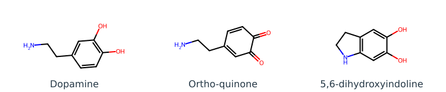

### Question C28 — Oxydation chimiosélective de la vitamine C

Les deux OH de l'énediol s'oxydent ensemble en deux carbonyles adjacents. La réaction formelle est $\mathrm{C_6H_8O_6\longrightarrow C_6H_6O_6+2H^++2e^-}$. L'oxydation du motif énediol conjugué est facilitée par la délocalisation du transfert électronique. La lactone et les alcools primaire et secondaire de la chaîne latérale subsistent dans la structure formelle de l'acide déhydroascorbique, avant hydratation éventuelle. La réaction est donc chimiosélective.

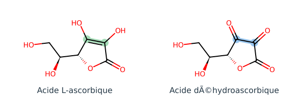

### Question C29 — Contrôle des interférences

Pour les deux interférents, la courbe (c), mélange sur Pt recouvert, reste très proche de (a), peroxyde seul sur Pt recouvert, dans la zone de mesure à 0,65 V/ECS. Sur Pt nu, la courbe (b) du mélange donne un courant nettement plus élevé dû aussi à l'oxydation de l'interférent. Une calibration au peroxyde seul surestimerait alors sa concentration. La membrane limite fortement la contribution de l'ascorbate et de la dopamine aux concentrations testées, tout en laissant parvenir le peroxyde au platine.

### Question C30 — Limite pratique pour une mesure in vivo

Les 600 tr/min nécessaires aux conditions d'étalonnage supposent qu'un disque entraîné mécaniquement puisse tourner dans un volume de liquide libre. Dans un tissu, cette rotation perturberait ou léserait le milieu, sans reproduire la couche hydrodynamique étalonnée. Le montage macroscopique et sa référence au calomel conviennent à une cellule de laboratoire.

### Question C31 — Adaptation du dispositif

On peut employer une ultramicroélectrode de Pt fixe, recouverte d'un film sélectif biocompatible. La diffusion radiale vers une petite surface permet d'atteindre un courant quasi stationnaire sans rotation. Il faut miniaturiser la contre-électrode, choisir une référence adaptée (par exemple Ag/AgCl avec jonction isolée), puis refaire l'étalonnage en milieu physiologique, à sa température et à son pH. Une autre solution est de prélever le liquide extracellulaire par microdialyse et de le mesurer dans une cellule externe à débit contrôlé, en étalonnant la récupération de la sonde.
