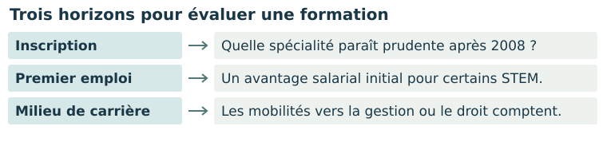
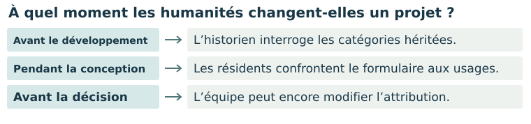

# X-ENS · MP-PC-PSI · Anglais 2020 — Corrigé guidé

*Corrigé rédigé par IA, non officiel. Signalez toute erreur.*

**Rédaction** · GPT-6.2 Astra Ultra · vitesse non renseignée

Le cahier XEULCR prévoit quatre heures pour les deux parties. Dictionnaires et outils de traduction interdits. La partie A demande une synthèse en anglais de 600 à 675 mots, précédée d’un titre, qui croise les documents 1 à 4 dans leur contexte géographique, sans commentaire personnel. La partie B demande un texte d’opinion en anglais de 500 à 600 mots en réaction au document de la seconde partie. Les décomptes portent sur le corps du texte, hors titre.

Le rapport invite à confronter données et arguments. Distinguer le nombre d’étudiants inscrits dans une spécialité, le revenu des diplômés à deux moments de leur carrière et le jugement des employeurs sur les compétences. Chacun de ces indicateurs répond à une question différente.

## A. Synthèse de documents

**Choisir deux comparaisons exploitables.** Chez Schmidt, les académies militaires constituent une comparaison instructive, car le débouché professionnel y est garanti. Elles ne représentent pas toutes les universités. Chez Deming, les chiffres initiaux concernent les diplômés en emploi à temps plein âgés de 23 à 25 ans. Éviter d’en faire le salaire assuré à quiconque choisit une discipline.

**Lire le graphique.** Pour l’esprit critique, 100 % des employeurs répondants jugent la compétence essentielle et 56,8 % estiment les diplômés compétents. L’écart atteint 43,2 points. Les barres mesurent des jugements d’employeurs et ne ventilent pas les résultats selon le diplôme.

**The Degree That Takes Longer to Pay**

When a Montreal brewing family endowed McGill's first research chair in 1857, English literature was a daring choice for a university with practical ambitions. Maggie Kilgour recalls that episode in the Montreal Gazette at a time when families associate the same subject with poor job prospects. Writing in the Atlantic, historian Benjamin Schmidt documents the retreat from American humanities majors. Economist David Deming in the New York Times and a survey of employers offer a different perspective on working life. Together they reveal how the value attributed to a subject changes with the time horizon and the people doing the judging.

The decline in American enrolments is real even if the warnings are old. Schmidt finds history majors down about 45 per cent from their 2007 peak. The decline has continued through economic recovery and across different types of institution. He attributes much of it to what young people feel they ought to study after the financial crisis. Military service academies offer an illuminating comparison. Where tuition and future employment are assured, the humanities have broadly held their ground. In Canada, Kilgour hears corresponding pressure from students' families and peers. Her students' determination to read literature despite that pressure suggests that a change of major need not indicate a loss of intellectual interest.

Families worried about earnings can point to a genuine initial difference. Deming reports that young American graduates working full time with degrees in computing or engineering earned about 37 per cent more in 2017 than counterparts in history or the social sciences. The comparison becomes less straightforward by midcareer. Some former humanities and social science students have moved into management, business or law, while technical specialists encounter skills that have changed since graduation. The rapid growth of machine learning courses at Stanford illustrates what younger competitors may bring to the workplace. A first salary therefore captures an advantage which cannot simply be projected across forty years.

Employers' responses help explain why the longer view matters. In the 2018 survey from the National Association of Colleges and Employers, every respondent considered critical thinking and problem solving essential, while only 56.8 per cent rated graduates proficient. The difference for digital technology was much smaller, at 68.8 and 66.3 per cent respectively. Such judgements do not establish which degree produces the best colleague. They do support Deming's contention that capacities developed through discussion, interpretation and revision can address an identifiable need. Kilgour's students value the same habits for understanding human rights or environmental questions, purposes extending well beyond their usefulness to a particular employer.

The history of what counts as practical education complicates the picture further. Kilgour recalls that English once gave women and less privileged students access to a curriculum dominated by classical languages. Schmidt observes that an established literary canon could itself become a barrier, conferring standing on those already familiar with it. Smaller fields such as ethnic, gender and cultural studies have proved comparatively resilient, as have humanities enrolments at historically Black institutions. Those exceptions suggest that students continue to seek intellectual resources for understanding their place in a culture, even as particular departments lose their former centrality.

The North American debate thus involves several distinct choices. An individual may rationally wish to secure a first job, an employer may need people able to adapt, and a university may sustain the freedom to inquire into matters whose returns cannot be forecast. The historical changes at McGill and the uneven pattern in the United States show that the humanities have themselves evolved in response to such expectations. Judging them by today's entry salary alone would miss both the careers their graduates eventually build and the public purposes for which students still choose them.

*618 mots hors titre.*

## B. Texte d’opinion

**Prendre Papazian au sérieux.** La présidente de l’université d’État de San José défend la culture générale depuis la Silicon Valley et invoque Léonard de Vinci. Choisir un point d’accord concret, puis examiner ce que deviendrait sa thèse si l’employabilité était l’unique condition du financement des arts. Le projet d’accessibilité proposé ci-dessous illustre un usage partagé de la lecture et de l’ingénierie.

**Give the Historian a Seat Before the Product Launch**

I agree with Mary Papazian that Silicon Valley needs the arts. My first question is where the arts graduate gets to sit. If the engineer decides what to build and the English graduate arrives afterwards to write the sales pitch, the company has hired both kinds of talent and learned only half the lesson. When Papazian invokes the Renaissance, I hear a more demanding invitation. Bring different kinds of judgement into the room while there is still time to change the design, or even to abandon it.

Consider a public university commissioning software to allocate accessible housing. Engineers can make a system process applications rapidly and reliably. A historian of disability might ask how the categories on the form came into being and whom they exclude. A student trained to read closely may notice that the phrase used for permanent impairment fits an administrator's calendar better than the experience of someone whose condition fluctuates. A resident can explain how far an apparently convenient room really is from the dining hall. The useful outcome here would be a different form and a fairer decision. An eloquent explanation of the original decision would be little consolation.

Papazian is persuasive about the habits a campus can develop. A theatre cast that loses a rehearsal space has to adapt together. A seminar in which two readers defend incompatible interpretations requires both to produce evidence and answer objections. Such work is demanding in ways the expression soft skills conceals. I would fund opportunities for engineering students to take those classes alongside students who know their disciplines well enough to challenge them. A quick workshop in communication cannot recreate the experience of spending weeks on a question one initially misunderstood.

Yet I would defend the same literature class if no technology company ever hired a single member. A community may need readers capable of discovering what an old city ordinance meant to tenants, or why one family remembers a strike very differently from the local newspaper. Nobody may be offering a salary for the investigation when it begins. A public university earns its name partly by keeping open inquiries that people with purchasing power have little reason to commission.

The obvious objection is cost. Students taking on debt are entitled to ask how they will make a living. I would have universities publish honest information about graduates' careers and make paid placements available beyond already well-connected families. I would also ask advocates of technical training how long a particular skill is likely to command its current premium. A promise of permanent security based on today's hiring advertisements deserves just as much scrutiny as a promise that reading poetry guarantees wisdom.

Leonardo offers Papazian an arresting ancestor, but a university need not wait for another solitary genius. It can introduce the historian, resident and engineer before the specifications are signed. It can pay the student who helps them test the result. And it can protect a seminar whose most important consequence nobody yet knows how to name. That is a practical programme for public education, ambitious enough to include both earning a living and deciding what is worth doing.

*522 mots hors titre.*

L’éditorial de Mary A. Papazian ouvre la partie B du cahier. Le rapport annuel confirme la nécessité de confronter l’enquête de la NACE aux trois articles dans la seule partie A.

[Sujet officiel](https://banques-ecoles.fr/cms/wp-content/uploads/2020/11/2020_MPPC_sujet_Ang.pdf) · [Rapport du jury](https://banques-ecoles.fr/cms/wp-content/uploads/2020/11/20_MP_PC_rap_eAng-1.pdf)
