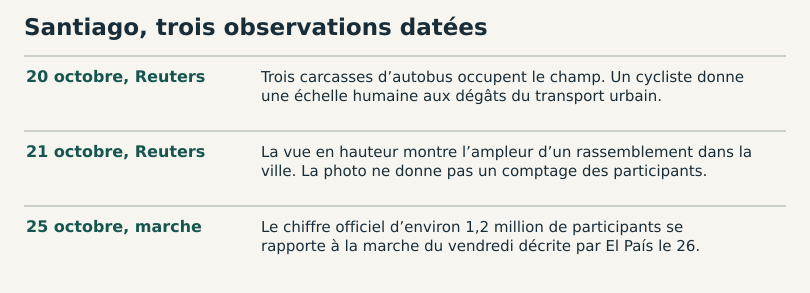

# X-ENS MP-PC-PSI — Espagnol 2020 · Corrigé guidé

*Corrigé rédigé par IA, non officiel. Signalez toute erreur.*

**Rédaction** · GPT-6.2 Astra Ultra · vitesse non renseignée

Le cahier XEULCR des filières MP, PC et PSI prévoit quatre heures et proscrit le dictionnaire et le traducteur. La partie A demande une synthèse en espagnol de 600 à 675 mots, précédée d’un titre. La partie B demande un texte d’opinion en espagnol de 500 à 600 mots, en réponse au document 5. Le rapport de l’écrit concerne les filières MP et PC. La garde indique le calendrier initial du 22 avril 2020. L’avis rectificatif pour les MP et PC et le calendrier modifié des ENS pour la PSI fixent l’épreuve commune de langue au mercredi 24 juin, de 14 h à 18 h.

## A. Synthèse de documents

> [!INDICATION]
> Quatre dates d’octobre empêchent de confondre les épisodes. Iván Alvarado photographie les restes d’autobus le 20 et la foule le 21. L’article de Rocío Montes du 26 rend compte de la marche du vendredi 25. L’analyse de BBC Mundo du 29 dispose de davantage de recul. Cherchez dans chaque source ce qui explique la poursuite de la mobilisation après le retrait de la hausse.

**Las dos caras del éxito chileno**

En octubre de 2019, treinta pesos más por un viaje en metro bastaron para poner en entredicho el éxito que tantos observadores atribuían a Chile. ¿Por qué continuó la protesta una vez retirada la subida? La cronología de Actualidad RT y las fotografías de Iván Alvarado para Reuters registran cómo cambió la vida en Santiago. La crónica de Rocío Montes en El País y el análisis económico de BBC Mundo permiten relacionar esas escenas con una experiencia de desigualdad que los indicadores de crecimiento apenas reflejaban.

Según Actualidad RT, la tarifa en hora punta pasó de ochocientos a ochocientos treinta pesos. Los estudiantes que entraron en el metro sin pagar dieron una primera expresión colectiva al rechazo. Después, el cierre de la red trastornó los desplazamientos de toda la capital. En la primera fotografía de Alvarado, del veinte de octubre, los frentes de autobuses quemados ocupan prácticamente todo el ancho de la calle. El ciclista situado a su lado da una medida de los destrozos en un servicio cotidiano. La toma elevada del día siguiente cambia radicalmente la escala. Allí donde antes se veían unos pocos vehículos inutilizados, aparecen ahora personas que llenan un amplio espacio de la ciudad. Una misma serie registra así la destrucción y la capacidad de convocatoria sin atribuir la primera a todos los asistentes.

La respuesta presidencial contribuyó a ampliar el conflicto. Sebastián Piñera había descrito el país como un oasis regional. Cuando declaró el estado de emergencia y habló de guerra, la presencia militar y los toques de queda evocaron para muchos la dictadura. Actualidad RT recoge tanto los saqueos como las acciones judiciales emprendidas por el Instituto Nacional de Derechos Humanos ante denuncias de excesos policiales. Días después, en la concentración del viernes que describe Montes, familias enteras rechazaban el lenguaje bélico con sus pancartas. Alrededor de un millón doscientas mil personas, según el recuento oficial citado, se reunieron pacíficamente en Santiago. Las guitarras que recuperaban canciones de Víctor Jara y los bailes colectivos acompañaron reivindicaciones muy precisas sobre las pensiones, la educación y la atención médica.

La explicación económica de BBC Mundo permite entender lo que reunía a generaciones tan distintas. Tras el golpe contra Salvador Allende, los economistas conocidos como los Chicago boys impulsaron la liberalización y las privatizaciones bajo Augusto Pinochet. Los gobiernos democráticos posteriores conservaron buena parte de ese modelo e introdujeron protecciones sociales. La reducción de la pobreza fue considerable, pero el acceso a los servicios siguió dependiendo en gran medida de la capacidad de pago. En los datos que recoge el artículo, el uno por ciento más rico acumulaba en 2017 más de la cuarta parte de la riqueza, mientras que a la mitad de hogares con menores ingresos le correspondía poco más del dos por ciento.

Esa distribución tiene un rostro en los testimonios recogidos por Montes. Un estudiante de pedagogía calcula cuánto le costará el crédito con el que financia su formación y una futura pensionista evita calcular cuánto le tocará cobrar. Una joven explica que salió a la calle por su madre, cuyo cáncer fue diagnosticado demasiado tarde. La gratuidad universitaria para numerosos alumnos, explica BBC Mundo, remedia mal las diferencias que se abren mucho antes entre colegios. De manera parecida, el incremento de la renta nacional dice poco sobre el coste de los medicamentos para quien vive de una pensión reducida.

El Gobierno acabó reconociendo problemas acumulados durante décadas, ofreció medidas sociales y modificó el gabinete. El paso de una disputa tarifaria a una impugnación de la clase política ayuda a explicar los límites de esa respuesta. Lo que se discutía en la calle era quién había participado en los beneficios del crecimiento y qué seguridad podía esperar cuando necesitara estudiar, curarse o jubilarse.

## B. Texte d’opinion

> [!INDICATION]
> Relevez deux propositions que Vargas Llosa fait tenir ensemble. Il défend les choix économiques confirmés après le retour à la démocratie et reconnaît l’insuffisance de la mobilité sociale. Testez leur compatibilité à l’aide d’un exemple et examinez la portée de sa comparaison avec les Gilets jaunes.

En «El enigma chileno», Mario Vargas Llosa atribuye buena parte del progreso del país a una decisión democrática compartida por gobiernos de distinto signo. Le parece comprensible que las clases medias exijan mejores servicios y sorprendente que ese malestar ponga en cuestión un modelo al que deben parte de su prosperidad. Encuentro acertado su rechazo de una explicación importada de Venezuela. Pero ¿hasta dónde puede llamarse impaciencia al descontento de quien ha cumplido las condiciones que le proponía la sociedad y descubre que aun así no puede jubilarse dignamente?

Conviene reconocer lo que el novelista ve en las ciudades que visitó. Una carretera que acerca una población a un hospital, por ejemplo, amplía las posibilidades de todas las familias que viven allí. También importa que durante décadas las elecciones permitieran cambiar de gobierno sin sacrificar la estabilidad económica. Sería injusto atribuir toda mejora al mercado bajo Pinochet y borrar la contribución de los ciudadanos que votaron contra la continuidad de la dictadura en 1988. Ahora bien, haber elegido a los gobiernos que conservaron buena parte de la política económica anterior tampoco equivale a haber aprobado por separado cada una de sus consecuencias.

Tomemos la educación. Vargas Llosa sostiene que una sociedad puede aceptar las diferencias si percibe que el esfuerzo permite ascender. Estoy de acuerdo, pero justamente por eso me parece insuficiente apelar a la percepción. Dos alumnos igualmente aplicados no empiezan la carrera universitaria en condiciones comparables si uno llega de un colegio bien dotado y al otro le faltaron profesores durante años. Tampoco salen de ella con la misma libertad si sólo uno debe elegir su primer empleo en función de la deuda contraída. La movilización de los escolares chilenos en 2006 ya había hecho visible esa preocupación. Trece años parecen un plazo considerable para seguir describiendo como impacientes a quienes piden resultados.

La comparación con los chalecos amarillos franceses ilumina un aspecto preciso. El transporte transforma una cuestión de precios en una cuestión de ciudadanía cuando ir a trabajar depende de un gasto difícil de reducir. Su utilidad disminuye si de ahí se concluye que en Chile nadie está excluido. Es posible participar en el mercado laboral y quedar prácticamente excluido de una atención médica oportuna. También es posible que el cierre de una estación perjudique más a quien vive lejos que a quien puede teletrabajar. Distinguir esos efectos permite condenar la destrucción de servicios públicos sin descalificar las razones de una marcha pacífica.

Vargas Llosa propone completar las reformas en educación, sanidad y pensiones sin deshacer el progreso conseguido. Para que esa fórmula sea algo más que una declaración de principios, habrá que decidir quién paga, qué prestaciones se garantizan y ante quién responde quien las administra. Si cambiar el reparto de riesgos exige modificar ciertas reglas de mercado, eso también forma parte de la libertad política que el escritor defiende. Una democracia puede reconocer las mejoras de treinta años y usar lo aprendido para revisar sus decisiones. La prueba de que su economía ofrece oportunidades llegará cuando una familia pueda afrontar una enfermedad o una vejez larga sin perder todo lo que ha ganado trabajando.

[Cahier du concours](https://banques-ecoles.fr/cms/wp-content/uploads/2020/11/2020_MPPC_sujet_Esp.pdf) · [Rapport de l’écrit](https://banques-ecoles.fr/cms/wp-content/uploads/2020/11/20_MP_PC_rap_eEsp-1.pdf) · [Calendrier modifié des ENS pour la PSI](https://banques-ecoles.fr/cms/wp-content/uploads/2020/05/Coeffs_ENS_BqSc_2020_PSI.pdf) · [Avis rectificatif pour les MP et PC](https://www.legifrance.gouv.fr/jorf/id/JORFTEXT000041939780)
