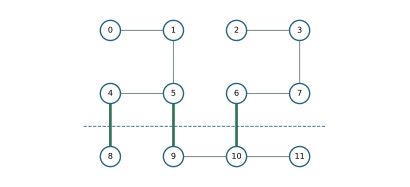
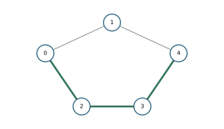
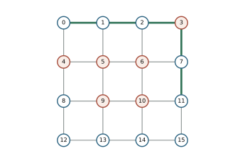

# X-ENS MP · Informatique A 2020 · Corrigé brut

*Corrigé rédigé par IA, non officiel. Signalez toute erreur.*

**Rédaction** · GPT-6.2 Astra Ultra · vitesse non renseignée · 24 novembre 2026

**Révision** · GPT-6.2 Astra Ultra · vitesse non renseignée · 26 novembre 2026

## Partie I · Construire des labyrinthes

### Question 1 · Mélange croissant de Knuth

```ocaml
let melange_knuth a =
  for i = 0 to Array.length a - 1 do
    let j = Random.int (i + 1) in
    let ancien = a.(i) in
    a.(i) <- a.(j);
    a.(j) <- ancien
  done
```
Le code travaille en place, en temps linéaire et avec un espace supplémentaire constant. Il ne fait aucun tirage sur un tableau vide. Le type inféré est polymorphe, ce qui permettra de mélanger aussi les paires d'extrémités en Q9.

### Question 2 · Uniformité

Avant l'étape $i$, le préfixe de longueur $i$ est une permutation uniforme de $0,\ldots,i-1$, et $a[p]=p$ pour $p\ge i$. Pour $i=0$, le préfixe vide a une seule permutation. À l'étape $i$, on place la valeur $i$ au rang $j$, uniforme sur $0,\ldots,i$. Pour toute permutation prescrite du nouveau préfixe, la place de $i$ détermine $j$ de façon unique. En annulant l'échange, on retrouve l'unique permutation précédente correspondante. Sa probabilité est $1/i!$, celle du choix de $j$ est $1/(i+1)$, indépendamment des tirages passés. Le nouveau préfixe est donc uniforme sur ses $(i+1)!$ permutations. Le suffixe reste inchangé.
À la fin, pour $n\ge1$ et $p,q<n$, exactement $(n-1)!$ permutations placent $q$ en $p$, donc $\Pr(x_p=q)=1/n$. Cette preuve établit également l'uniformité conjointe que ne suffiraient pas à démontrer des marginales uniformes.

### Question 3 · Parcours en profondeur aléatoire

```ocaml
let labyrinthe1 g =
  let h = graphe_vide g.n in
  let visite = Array.make g.n false in
  let rec explorer v =
    visite.(v) <- true;
    let voisins = Array.of_list g.adj.(v) in
    melange_knuth voisins;
    Array.iter (fun w ->
      if not visite.(w) then begin
        ajoute_arete h v w;
        explorer w
      end) voisins
  in
  if g.n > 0 then explorer 0;
  h
```
Le tableau temporaire permet de varier l'ordre des voisins sans changer les listes d'entrée. Le test de visite s'effectue au moment de traiter chaque voisin, car une visite récursive précédente peut entre-temps l'avoir atteint.

### Question 4 · L'arbre des découvertes

Initialement le sous-graphe des visités se réduit à la racine. À chaque découverte, un nouveau sommet est rattaché à cet arbre par une seule arête. Le sous-graphe des visités reste donc connexe et sans cycle. À la fin tous les sommets de $g$ sont visités. Sinon un chemin depuis la racine vers un sommet oublié comporterait une première arête d'un visité vers un non-visité, alors que tous ses voisins ont été examinés. L'arbre obtenu est couvrant et possède donc un unique chemin simple entre deux sommets.

### Question 5 · Suivre la chaîne des parents

```ocaml
let rec cd_trouve cd i =
  let parent = cd.lien.(i) in
  if parent = i then i else cd_trouve cd parent
```
Dans la représentation donnée, la chaîne se termine au représentant. L'appel est récursif terminal et n'écrit dans aucune case. En particulier, il préserve les hauteurs exactes utilisées ensuite comme rangs.

### Question 6 · Fusion par rang

```ocaml
let cd_union cd i j =
  let a = cd_trouve cd i and b = cd_trouve cd j in
  if a <> b then
    if cd.rang.(a) < cd.rang.(b) then
      cd.lien.(a) <- b
    else begin
      cd.lien.(b) <- a;
      if cd.rang.(a) = cd.rang.(b) then
        cd.rang.(a) <- cd.rang.(a) + 1
    end
```
En cas d'égalité, le programme conserve $a$ comme représentant et augmente son rang. Les anciennes classes disjointes ne sont reliées que par un lien entre racines.

### Question 7 · Taille minimale et hauteur exacte

Pour deux représentants identiques, les invariants sont conservés sans écriture. Sinon, supposons les rangs $p\le q$. Si $p<q$, après rattachement de la petite racine, ses chemins ont longueur au plus $p+1\le q$. L'autre arbre garde un chemin de longueur exactement $q$. Le rang reste $q$ et sa classe conserve au moins $2^q$ sommets. Si $p=q$, la hauteur maximale devient $q+1$ car on prolonge d'une arête un chemin de longueur $q$. Les deux classes étaient disjointes et possédaient au moins $2^q$ sommets chacune, soit au moins $2^{q+1}$ après fusion. Les autres classes sont intactes.

### Question 8 · Coût de recherche

À l'initialisation les singletons ont rang 0, hauteur 0 et taille $1=2^0$. Q7 conserve ces propriétés. Pour une racine de rang $k$, $2^k\le n$, donc $k\le\lfloor\log_2 n\rfloor$. Une recherche prend au plus $k+1$ consultations, soit $O(1+\log n)$ et $O(\log n)$ asymptotiquement.

### Question 9 · Forêt couvrante par ordre d'arêtes

```ocaml
let labyrinthe2 g =
  let h = graphe_vide g.n in
  let cd = cd_init g.n in
  let ordre = aretes g in
  melange_knuth ordre;
  Array.iter (fun (v, w) ->
    if cd_trouve cd v <> cd_trouve cd w then begin
      ajoute_arete h v w;
      cd_union cd v w
    end) ordre;
  h
```
L'algorithme accepte seulement les arêtes qui relient deux composantes distinctes. Une orientation rencontrée après l'acceptation de sa symétrique est automatiquement ignorée.

### Question 10 · Preuve du second générateur

Au départ les classes sont les singletons et chaque composante est un arbre réduit à un sommet. Refuser une arête interne ne change rien. Accepter une arête entre deux classes réunit exactement deux arbres disjoints par un seul pont, sans cycle, et l'union des classes enregistre cette nouvelle composante. Pour chaque classe $X$, $h[X]$ est donc un arbre couvrant de $g[X]$. À la fin, les extrémités de chaque arête de $g$ appartiennent à la même classe, qu'elle ait été acceptée ou refusée. Par connexité de $g$, il n'existe plus qu'une classe. Le labyrinthe final est parfait.

### Question 11 · La frontière dans l'algorithme d'Eller

Avant une nouvelle ligne, les arêtes choisies forment une forêt et chaque composante de la partie traitée rencontre la ligne courante. Les fusions horizontales autorisées relient deux composantes différentes. Chaque descente aboutit à un sommet encore isolé de la ligne suivante (une colonne possède un unique prédécesseur vertical), donc elle ne ferme pas de cycle. Comme chaque classe active reçoit au moins une descente, toutes les composantes traitées atteignent la ligne suivante, où peuvent aussi naître des singletons. À la dernière ligne, toutes les paires de voisins consécutifs finissent dans la même classe, puisque leur arête est considérée et, au besoin, acceptée. Toute la grille est alors connexe et la forêt est un arbre couvrant. Le même raisonnement s'applique à une seule ligne ou une seule colonne.

### Question 12 · Obtenir un arbre donné par Eller

Fixons un arbre couvrant $T$. Sur chaque ligne autre que la dernière, accepter précisément les arêtes horizontales de $T$ en tirant les décisions correspondantes. Leurs extrémités sont alors dans des classes différentes, car une connexion antérieure dans le sous-graphe déjà choisi de $T$ formerait un cycle avec cette arête. Pour les descentes, choisir exactement celles de $T$. Chaque composante du préfixe de lignes traitées doit avoir au moins une telle arête vers la suite, sinon elle serait isolée dans $T$. Ce choix vertical est donc admissible.
Dans la dernière ligne, choisir un ordre où les arêtes horizontales appartenant à $T$ passent en premier. Elles doivent être acceptées par acyclicité. Après ces arêtes, tout $T$ est construit et connexe, donc toutes les autres sont refusées. Les choix sont en nombre fini et chacun a une probabilité positive si le tirage des sous-ensembles admet tous les sous-ensembles autorisés. Cela prouve la possibilité d'obtenir $T$, sans affirmer une loi uniforme sur les arbres.



## Partie II · Résoudre un labyrinthe

### Question 13 · Insérer en tête de la file circulaire

```ocaml
let ajoute_debut f e =
  let capacite = Array.length f.contenu in
  f.debut <- (if f.debut = 0 then capacite - 1 else f.debut - 1);
  f.contenu.(f.debut) <- e;
  f.taille <- f.taille + 1
```
La précondition « non pleine » garantit une case libre et une capacité positive. La prise en compte de l'enroulement évite tout décalage des éléments existants.

### Question 14 · Retirer en tête

```ocaml
let retire_debut f =
  let valeur = f.contenu.(f.debut) in
  f.debut <- (f.debut + 1) mod Array.length f.contenu;
  f.taille <- f.taille - 1;
  valeur
```
La précondition est $\mathrm{taille}>0$, donc la capacité ne peut pas être nulle. Aucune case n'a besoin d'être effacée, puisque la taille et le début délimitent les éléments actifs.

### Question 15 · Distance par parcours en largeur

Initialement la source, de distance 0, est seule. Toute première découverte depuis un sommet de niveau $k$ enregistre une marche de longueur $k+1$, et la file FIFO traite le niveau $k$ avant le niveau $k+1$. Par récurrence, tout sommet de vraie distance $k+1$ possède un voisin de vraie distance $k$ sur un plus court chemin. Il sera donc découvert au plus tard lors du traitement de ce niveau, et ne pouvait l'être à un niveau inférieur sans fournir un chemin plus court. Le marquage à l'insertion rend chaque découverte unique. La connexité et la finitude garantissent que la destination sortira de la file. La valeur renvoyée est sa distance minimale, y compris zéro si source et destination coïncident.

### Question 16 · Compter le minimum de monstres

**Étape 3.** Initialiser la distance de la source et l’insérer dans la file vide.

```ocaml
distance.(src) <- ((if monstre.(src) then 1 else 0), 0);
ajoute_debut f src;
```

**Étape 4(c).** Dans le corps de la fonction passée à `List.iter`, traiter le voisin `w` de `v` lors de sa première découverte.

```ocaml
if distance.(w) = (-1, -1) then begin
  let m, longueur = distance.(v) in
  let cout = if monstre.(w) then 1 else 0 in
  distance.(w) <- (m + cout, longueur + 1);
  if monstre.(w) then ajoute_fin f w else ajoute_debut f w
end
```
Les sommets à coût de monstre inchangé sont traités avant la prochaine strate. L'entrée dans un même voisin ajoute le même nombre de monstres quel que soit le prédécesseur. Le couple enregistre aussi la longueur du chemin qui le découvre. La file de capacité $n$ suffit puisque chaque sommet y entre une fois.

### Question 17 · Contre-exemple pour la longueur

Prenons le cycle de longueur cinq d'arêtes $0$–$1$, $1$–$4$, $4$–$3$, $3$–$2$, $2$–$0$. Posons source $0$, destination $4$ et aucun monstre. Si les voisins de $0$ sont parcourus dans l'ordre $1,2$, la file contient $[2,1]$ après son traitement. Le sommet $2$ fait passer $3$ en tête, puis $3$ découvre $4$ par le chemin $0,2,3,4$. La réponse est $(0,3)$, alors que $0,1,4$ a coût $(0,2)$. L'ordre des voisins fait partie de l'exemple.



### Question 18 · Trace des trois files

Prenons les voisins par numéros croissants. La tête de chaque file se trouve à gauche. Chaque ligne donne son état complet **après** l'action. Les monstres du dessin sont $3,4,5,6,9,10$.

| Action | Nouvelles distances | File active | Sources courantes | Sources suivantes |
|---|---|---|---|---|
| Initialisation | 0 ← (0, 0) | 0 | ∅ | ∅ |
| Retrait 0 | 1 ← (0, 1), 4 ← (1, 1) | 1 | ∅ | 4 |
| Retrait 1 | 2 ← (0, 2), 5 ← (1, 2) | 2 | ∅ | 4,5 |
| Retrait 2 | 3 ← (1, 3), 6 ← (1, 3) | ∅ | ∅ | 4,5,3,6 |
| Promotion | — | 4 | 5,3,6 | ∅ |
| Retrait 4 | 8 ← (1, 2) | 5,8 | 3,6 | ∅ |
| Retrait 5 | 9 ← (2, 3) | 8,3,6 | ∅ | 9 |
| Retrait 8 | 12 ← (1, 3) | 3,6,12 | ∅ | 9 |
| Retrait 3 | 7 ← (1, 4) | 6,12,7 | ∅ | 9 |
| Retrait 6 | 10 ← (2, 4) | 12,7 | ∅ | 9,10 |
| Retrait 12 | 13 ← (1, 4) | 7,13 | ∅ | 9,10 |
| Retrait 7 | 11 ← (1, 5) | 13,11 | ∅ | 9,10 |
| Retrait 13 | 14 ← (1, 5) | 11,14 | ∅ | 9,10 |
| Retrait 11 et arrêt | — | 14 | ∅ | 9,10 |

Lors de la promotion, 2(a)i déplace d’abord $4,5,3,6$ dans les sources courantes, puis 2(a)ii met seulement $4$ dans la file active. Après le retrait de $4$, 2(d) transfère $5$ avant que 2(e) ajoute $8$. Après le retrait de $5$, 2(d) transfère $3,6$ derrière $8$, puis 2(e) place $9$ dans les sources suivantes.

La valeur rendue est $(1,5)$. Par exemple $0,1,2,3,7,11$ réalise ce coût. En retirant les monstres, la composante de $0$ ne contient pas $11$. En outre les coordonnées sur la grille imposent au moins cinq arêtes entre les deux cases.



### Question 19 · Correction du parcours lexicographique

On maintient les propriétés suivantes avant chaque retrait, après un éventuel transfert.

1. Les sommets découverts sont soit traités, soit dans exactement l'une des trois files. Chacun a reçu le coût d'un chemin l'atteignant. Tout sommet déjà traité a son coût minimal.
2. Pendant la strate $m$, les éléments de la file active ont ce même nombre de monstres, avec des longueurs croissantes au sens large. Si la tête a longueur $\ell$, la file active ne contient que des longueurs $\ell$ ou $\ell+1$. Les sources courantes, toutes de strate $m$, sont ordonnées par longueur. Celles qui y restent ont une longueur strictement supérieure à $\ell$. Les sources suivantes, de strate $m+1$, sont elles aussi ordonnées par longueur.
3. Le prochain sommet retiré a le coût minimal parmi les sommets découverts en attente. Les retraits sont ordonnés lexicographiquement. L’étape 2(d) transfère toutes les sources courantes de longueur $\ell+1$ avant l’ajout des nouveaux voisins. Quand $\ell+1$ arrive en tête, toutes les sources de cette longueur sont donc déjà actives. Si la file active est vide, l’étape 2(a) y transfère toutes les sources courantes de longueur minimale. La strate suivante est promue une fois la strate courante épuisée.

Initialement seule la source est en attente, de coût $(\mathbf1_{\rm monstre(src)},0)$. Depuis $(m,\ell)$, un voisin libre est placé à $(m,\ell+1)$ et un monstre à $(m+1,\ell+1)$. Cela conserve l'ordre spécifié. Pour justifier le **marquage dès la découverte** de $w$, observons que chaque arête entrante lui ajoute la même paire $(\mathbf1_{\rm monstre(w)},1)$. Un chemin strictement meilleur vers $w$ nécessiterait donc un prédécesseur de coût strictement inférieur à celui qui le découvre. Sur un tel chemin minimal, le premier sommet encore non traité aurait dû être découvert par son prédécesseur déjà traité et extrait plus tôt, par l'ordre de priorité. Cela contredit le choix courant. C'est la récurrence habituelle sur les retraits, renforcée ici par l'égalité des coûts entrants pour un même sommet. L'algorithme s'arrête à la destination, accessible par connexité, et y rend le coût minimal.

### Question 20 · Réduction à un plus court chemin pondéré

Pour chaque arête non orientée $v$–$w$, créer les deux arcs orientés correspondants. Donner à l'arc $v\to w$ le poids $1+n\mathbf1_{\rm monstre(w)}$. Un chemin depuis la source, de longueur $\ell$ et de $m$ monstres, extrémités comprises, a alors pour poids $n(m-\mathbf1_{\rm monstre(src)})+\ell$. Tous les poids sont strictement positifs, donc un plus court chemin est simple et satisfait $0\le\ell\le n-1$. Une différence d'un monstre domine donc strictement toute différence de longueur. Le poids scalaire trie les chemins simples dans l'ordre lexicographique demandé.
Exécuter Dijkstra depuis la source (ou Floyd–Warshall pour toutes les paires) et conserver les prédécesseurs pour reconstruire le chemin. Si $D$ est la distance pondérée, le coût demandé est $(\lfloor D/n\rfloor+\mathbf1_{\rm monstre(src)},D\bmod n)$, avec $n\ge1$. Pour $src=dst$, le chemin vide d'arêtes compte le monstre éventuel de son unique sommet.
