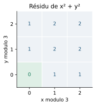
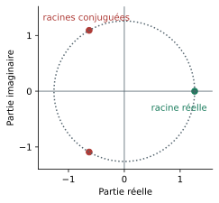
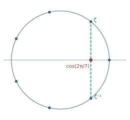
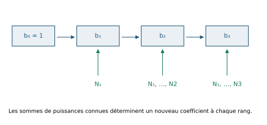
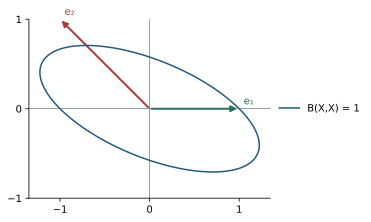
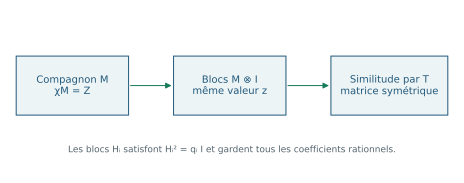

# X-ENS MP — Mathématiques A 2020 · Corrigé guidé

*Corrigé rédigé par IA, non officiel. Signalez toute erreur.*

**Rédaction** · modèle exact non renseigné (famille GPT-6) · effort non renseigné · vitesse non renseignée

**Révision** · modèle exact non renseigné (famille GPT-6) · effort non renseigné · vitesse non renseignée

**Révision (tour 2)** · GPT-6.2 Astra Ultra · vitesse non renseignée

**Révision (tour 3)** · GPT-6.2 Astra Ultra · vitesse non renseignée · 26 novembre 2026

## Présentation du sujet

L’épreuve de quatre heures caractérise les valeurs propres possibles des matrices symétriques à coefficients rationnels. En dimension arbitraire, ce sont exactement les nombres totalement réels. Les 18 numéros du sujet comprennent 30 questions et sous-questions. [Sujet officiel](https://www.polytechnique.edu/admission-cycle-ingenieur/sites/admission/files/content/2020%20MP%20SUJET%20ECRIT%20MATHEMATIQUES%20A%20%28XLCR%29.pdf)

> [!JURY]
> Le jury distingue la construction réelle par une matrice de changement de base et le dernier passage, où les blocs rationnels de la première partie permettent de produire effectivement une matrice symétrique rationnelle. [Rapport officiel](https://www.polytechnique.edu/admission-cycle-ingenieur/sites/admission/files/content/2020%20MP%20RAPPORT%20ECRIT%20MATHEMATIQUES%20A%20%28XLCR%29.pdf)

## I — Exemples de spectres

On teste quelques nombres réels, d’abord en taille deux puis en dimension arbitraire. Le doublement de taille construit aussi des racines carrées matricielles rationnelles.

### Question 1

> [!INDICATION]
> Essayer une matrice de trace nulle ayant deux valeurs propres opposées.

> [!INDICATION]
> Son déterminant doit valoir moins deux.

#### Solution

La matrice $M=\bigl(\begin{smallmatrix}1&1\\1&-1\end{smallmatrix}\bigr)$ est symétrique à coefficients entiers. Son polynôme caractéristique est $(X-1)(X+1)-1=X^2-2$, donc $\sqrt2$ est l’une de ses valeurs propres.

### Question 2a

> [!INDICATION]
> Écrire le polynôme caractéristique avec deux coefficients rationnels et y substituer la racine donnée.

> [!INDICATION]
> Séparer la partie rationnelle et le multiple rationnel de la racine irrationnelle.

#### Solution

Écrivons $\chi_M=X^2-sX+p$ avec $s,p\in\mathbb Q$. L’annulation en $\sqrt3$ donne $s\sqrt3=3+p$. Si $s\ne0$, cela rendrait $\sqrt3$ rationnel. Il faut donc $s=0$, puis $p=-3$, d’où $\chi_M=X^2-3$.

### Question 2b

> [!INDICATION]
> Réduire l’entier avant de calculer son carré.

> [!INDICATION]
> Les trois classes modulo trois sont représentées par −1, 0 et 1.

#### Solution

Un entier est congru à $0$, $1$ ou $-1$ modulo $3$. Son carré est donc congru à $0$ ou $1$, et le carré n’est congru à zéro que si l’entier lui-même est divisible par trois.

### Question 2c

> [!INDICATION]
> Réduire l’équation des trois carrés modulo trois.

> [!INDICATION]
> Après avoir montré que trois divise x et y, réexaminer le second membre modulo neuf.

#### Solution

L’équation impose $x^2+y^2\equiv0\pmod3$. Parmi les sommes de deux résidus de $\{0,1\}$, seule $0+0$ convient. Ainsi $3\mid x$ et $3\mid y$, donc $9\mid x^2+y^2=3z^2$. On en déduit $3\mid z^2$, donc $3\mid z$. Cela contredit la primitivité du triplet.

### Question 2d

> [!INDICATION]
> Utiliser la trace nulle pour écrire la matrice symétrique avec deux paramètres.

> [!INDICATION]
> La condition sur le déterminant conduit à la question précédente après mise au même dénominateur.

#### Solution

Puisque $\operatorname{Tr}M=0$, on peut écrire $M=\bigl(\begin{smallmatrix}a&b\\b&-a\end{smallmatrix}\bigr)$ avec $a,b\in\mathbb Q$. Son déterminant vaut $-a^2-b^2=-3$. En mettant les deux rationnels au même dénominateur et en simplifiant le triplet obtenu, on aurait des entiers premiers entre eux dans leur ensemble vérifiant $x^2+y^2=3z^2$. La question 2c exclut cette matrice. L’obstruction disparaît dès la dimension trois. Par exemple,
$$T=\begin{pmatrix}0&1&1\\1&1&0\\1&0&-1\end{pmatrix},\qquad
\det(XI_3-T)=X(X-1)(X+1)-(X+1)-(X-1)=X(X^2-3).$$
Sa symétrie et ses coefficients entiers donnent donc une réalisation de $\sqrt3$ et de $-\sqrt3$. La taille trois est minimale puisque toute matrice rationnelle de taille un a une valeur propre rationnelle et que la taille deux vient d’être exclue.

### Question 3a

> [!INDICATION]
> Pour produire le terme identité dans le carré, placer des blocs identités hors diagonale.

> [!INDICATION]
> Choisir les deux signes des blocs diagonaux afin que les blocs croisés disparaissent dans le carré.

#### Solution

Prenons $B=\bigl(\begin{smallmatrix}A&I_n\\I_n&-A\end{smallmatrix}\bigr)$. Elle est symétrique rationnelle et tous ses blocs commutent à $A$, ce qui donne la commutation à $\operatorname{diag}(A,A)$. Les blocs hors diagonale de $B^2$ sont $A-A=0$ ; ses blocs diagonaux sont $A^2+I_n=(q+1)I_n$.

### Question 3b

> [!INDICATION]
> Partir de la matrice de taille un égale à l’identité.

> [!INDICATION]
> Doubler la taille de toutes les anciennes matrices avant d’ajouter celle construite en 3a.

#### Solution

En taille un, $M_1=(1)$ convient. Si $M_1,\ldots,M_d$ existent en taille $n$, remplaçons chacune par $D_k=\operatorname{diag}(M_k,M_k)$ et ajoutons en taille $2n$ la matrice $B$ construite en 3a avec $A=M_d$. Alors $D_k^2=kI_{2n}$, $B^2=(d+1)I_{2n}$. Les $D_k$ commutent entre elles et commutent avec $B$ puisque $M_k$ commute avec $M_d$ et l’identité. Cela prouve la récurrence.

### Question 3c

> [!INDICATION]
> Comment écrire un rationnel positif comme quotient d’un entier par un carré entier ?

> [!INDICATION]
> Construire d’abord toute la famille de racines entières avec une taille commune.

#### Solution

Écrire $q_i=u_i/v_i$ avec $u_i,v_i$ entiers strictement positifs, et prendre $D=\max_i u_iv_i$. La question 3b fournit des matrices commutantes $A_k$ de même taille pour $1\le k\le D$, avec $A_k^2=kI$. Alors $M_i=A_{u_iv_i}/v_i$ est symétrique rationnelle et $M_i^2=(u_iv_i/v_i^2)I=q_i I$. Les commutations sont préservées.

### Question 4a

> [!INDICATION]
> Un polynôme cubique réductible sur un corps possède un facteur linéaire.

> [!INDICATION]
> Appliquer le critère des racines rationnelles au cubique de la question.

#### Solution

Le cubique $X^3-2$ n’a pas de racine rationnelle. En effet, une racine rationnelle d’un polynôme unitaire entier serait un entier divisant 2 ; aucun de $\pm1,\pm2$ ne convient. Un polynôme de degré trois réductible sur $\mathbb Q$ aurait un facteur linéaire. Il est donc irréductible et est le polynôme minimal de $\sqrt[3]2$. Il divise tout polynôme rationnel annulant ce nombre, en particulier $\chi_M$.

### Question 4b

> [!INDICATION]
> Outre sa racine réelle, quelles sont les autres racines du cubique ?

> [!INDICATION]
> Comparer ces deux racines à ce que permet le théorème spectral.

#### Solution

Le cubique possède les racines $\sqrt[3]2\,e^{2\pi i/3}$ et $\sqrt[3]2\,e^{4\pi i/3}$, toutes deux non réelles. La divisibilité obtenue les rendrait valeurs propres de $M$. Or une matrice réelle symétrique n’a que des valeurs propres réelles. Cette contradiction vaut en toute taille.

### Question 5

> [!INDICATION]
> Une permutation cyclique des coordonnées fait apparaître les racines de l’unité.

> [!INDICATION]
> Moyenner la permutation et son inverse pour obtenir la partie réelle de chaque valeur propre.

#### Solution

Posons $\zeta=e^{2\pi i/n}$ et soit $U$ la permutation cyclique des coordonnées $(x_1,\ldots,x_n)\mapsto(x_2,\ldots,x_n,x_1)$. Sa matrice est entière et orthogonale. Le vecteur $w=(1,\zeta,\ldots,\zeta^{n-1})^{\mathsf T}$ vérifie $Uw=\zeta w$ et $U^{\mathsf T}w=U^{-1}w=\zeta^{-1}w$. La matrice $M=(U+U^{\mathsf T})/2$ est symétrique rationnelle et admet donc $\tfrac12(\zeta+\zeta^{-1})=\cos(2\pi/n)$ pour valeur propre. Les cas $n=1,2$ sont inclus.

## II — Rationalité et sommes de puissances

Le polynôme réciproque part du coefficient constant un. Sa dérivée logarithmique permet de calculer les sommes de puissances des racines, puis de reconstruire ses coefficients.

### Question 6

> [!INDICATION]
> Remplacer X par son inverse aussi bien dans la forme développée que dans la factorisation.

> [!INDICATION]
> Distribuer une puissance de X par facteur.

#### Solution

La substitution $X\mapsto1/X$ suivie de la multiplication par $X^d$ inverse l’ordre des coefficients de $P$. En l’appliquant aussi à $P=\prod_i(X-\lambda_i)$, on trouve l’identité polynomiale
$$Q=1+a_{d-1}X+\cdots+a_0X^d=\prod_{i=1}^d(1-\lambda_iX).$$
Les calculs pour $X\ne0$ suffisent à établir l’identité partout.

### Question 7

> [!INDICATION]
> Dériver le produit des facteurs du polynôme réciproque, puis diviser par celui-ci.

> [!INDICATION]
> Développer chaque terme en série géométrique sur un rayon commun.

#### Solution

Avec $a_0\ne0$, toutes les racines sont non nulles. Posons $r=1/\max_i|\lambda_i|>0$. Sur $|x|<r$ aucun facteur de $Q$ ne s’annule. La dérivation du produit et la série géométrique donnent
$$\frac{Q'(x)}{Q(x)}=-\sum_{i=1}^d\frac{\lambda_i}{1-\lambda_i x}=-\sum_{k=0}^\infty\left(\sum_{i=1}^d\lambda_i^{k+1}\right)x^k=-\sum_{k=0}^\infty N_{k+1}x^k.$$
Les séries individuelles convergent absolument et il n’y en a qu’un nombre fini.

### Question 8a

> [!INDICATION]
> Multiplier la série obtenue en 7 par Q et comparer avec Q′.

> [!INDICATION]
> Le coefficient constant de Q permet d’isoler la dernière somme de puissances.

#### Solution

Écrivons $Q=\sum_{j=0}^d b_jX^j$ avec $b_0=1$ et $b_j=0$ pour $j>d$. En multipliant l’identité de 7 par $Q$ et en identifiant le coefficient de $X^{m-1}$, on obtient pour tout $m\ge1$
$$m b_m=-\sum_{j=0}^{m-1}b_j N_{m-j}.$$
Si les $a_i$ sont rationnels, les $b_j$ le sont. Le terme $j=0$ étant $N_m$, la formule détermine $N_m$ rationnel par récurrence à partir des sommes de rang inférieur.

### Question 8b

> [!INDICATION]
> Reprendre la même identité de coefficients en changeant l’inconnue.

> [!INDICATION]
> Le terme portant le coefficient d’ordre m de Q vient de sa dérivée.

#### Solution

Avec la même identité, $b_0=1$ et
$$b_m=-\frac1m\sum_{j=0}^{m-1}b_j N_{m-j}.$$
Si tous les $N_k$ sont rationnels, on obtient successivement $b_1,\ldots,b_d\in\mathbb Q$. Ce sont les coefficients de $P$ dans l’ordre inverse, à l’exception de son coefficient dominant déjà égal à un.

### Question 8c

> [!INDICATION]
> Pourquoi les questions précédentes supposent-elles le terme constant non nul ?

> [!INDICATION]
> Retirer les facteurs X : quelle contribution une racine nulle apporte-t-elle à une somme de puissances positives ?

#### Solution

Si zéro est racine de multiplicité $s$, écrire $P=X^sP_1$ avec $P_1(0)\ne0$, ou $P_1=1$ si toutes les racines sont nulles. La multiplication par $X^s$ ne modifie pas la rationalité des coefficients et l’ajout des zéros ne modifie aucune somme des puissances d’ordre $n\ge1$. Les questions 8a et 8b s’appliquent à $P_1$ ; pour $P_1=1$ les sommes sont nulles et la conclusion est immédiate.

### Question 9

> [!INDICATION]
> Passer par les sommes de puissances pour appliquer le critère précédent.

> [!INDICATION]
> Les puissances de produits factorisent et les puissances de sommes se développent au binôme.

#### Solution

Notons $A_k=\sum_i\alpha_i^k$ et $B_k=\sum_j\beta_j^k$, avec $A_0=n$, $B_0=m$. La question 8c les rend rationnels. Pour les produits, la somme des puissances d’ordre $k$ vaut $A_k B_k$. Pour les sommes, le binôme donne
$$\sum_{i,j}(\alpha_i+\beta_j)^k=\sum_{h=0}^k\binom kh A_h B_{k-h}.$$
Dans les deux cas toutes ces sommes sont rationnelles. La réciproque de 8c donne les coefficients rationnels des deux polynômes demandés, même si certaines racines se répètent ou sont nulles.

## III — Nombres totalement réels et totalement positifs

Un nombre est totalement réel s’il annule un polynôme rationnel non nul dont toutes les racines sont réelles. On dit totalement positif lorsque toutes sont positives ou nulles.

### Question 10

> [!INDICATION]
> Quel polynôme rationnel est disponible pour toute valeur propre de la matrice ?

> [!INDICATION]
> Appliquer le théorème spectral à l’ensemble du spectre.

#### Solution

Pour $M$ symétrique rationnelle, $\chi_M$ est unitaire à coefficients rationnels. Le théorème spectral réel assure que **toutes** ses racines sont réelles. Ce même polynôme certifie donc que chacune de ses racines est totalement réelle.

### Question 11a

> [!INDICATION]
> Les polynômes de la question 9 donnent la stabilité par deux opérations.

> [!INDICATION]
> Pour l’inverse, supprimer d’abord toutes les racines nulles d’un témoin.

#### Solution

L’ensemble des nombres totalement réels est contenu dans $\mathbb R$ et contient les rationnels, grâce à $X-q$. Soient deux tels nombres $x,y$ et deux polynômes témoins rendus unitaires, à racines réelles $\alpha_i,\beta_j$. Les deux polynômes de 9 témoignent pour $x+y$ et $xy$, car toutes leurs racines sont réelles. Si $P(x)=0$, le polynôme $P(-X)$ témoigne pour $-x$. Si $x\ne0$, supprimer d’abord les facteurs $X$ du polynôme témoin, puis prendre le réciproque : ses racines sont les inverses des racines non nulles et sont réelles. Il témoigne pour $1/x$. On a ainsi un sous-corps de $\mathbb R$.

### Question 11b

> [!INDICATION]
> Suivre le signe de chaque racine du témoin construit.

> [!INDICATION]
> L’inversion n’est demandée qu’après avoir exclu un nombre nul.

#### Solution

Un nombre totalement positif appartient à $\mathbb R_+$. Si les deux familles de racines témoins sont positives ou nulles, leurs sommes et leurs produits le restent. La question 9 redonne la rationalité des polynômes correspondants. Pour un nombre non nul, supprimer les racines nulles de son polynôme témoin puis prendre le réciproque conserve des racines strictement positives. L’inverse est donc totalement positif.

### Question 12

> [!INDICATION]
> Pour la première implication, chercher un polynôme dont les racines soient les carrés des anciennes racines.

> [!INDICATION]
> Pour la réciproque, substituer X² au lieu de X dans le polynôme témoin.

#### Solution

Si $x$ est totalement réel, choisir un polynôme témoin unitaire à racines réelles $\alpha_i$ dont $x$. Le polynôme $\prod_i(X-\alpha_i^2)$ a ses racines positives ou nulles ; ses sommes de puissances sont les sommes de puissances d’ordre pair des $\alpha_i$, donc rationnelles par 8c. Par la réciproque il est rationnel et témoigne pour $x^2$. Réciproquement, si $Q$ témoigne pour $x^2$, alors $Q(X^2)$, rationnel non nul, annule $x$. Toutes ses racines sont les deux racines carrées réelles (ou zéro) de racines de $Q$ appartenant à $\mathbb R_+$. Ainsi $x$ est totalement réel.

## IV — Construction d’une matrice symétrique rationnelle

On admet une forme linéaire rationnelle t sur les totalement réels qui prend des valeurs strictement positives sur tout nombre totalement positif non nul. Elle sert à construire un produit scalaire pour lequel la matrice compagnon du polynôme minimal est autoadjointe.

### Question 13a

> [!INDICATION]
> Former la combinaison rationnelle des puissances de z dont le carré apparaît dans la forme.

> [!INDICATION]
> La minimalité se rapporte aux degrés strictement inférieurs à d : factoriser z avant de l’utiliser.

#### Solution

On note $Z=X^d-\sum_{j=0}^{d-1}a_jX^j$ le polynôme minimal du totalement réel non nul $z$, et $S_{ij}=t(z^{i+j})$ pour $1\le i,j\le d$. On étudie $B(X,Y)=X^{\mathsf T}SY$.

Pour $X=(x_1,\ldots,x_d)\in\mathbb Q^d\setminus\{0\}$, posons $u=\sum_{i=1}^d x_i z^i$. Ce nombre appartient au corps des totalement réels par 11a. Comme $z\ne0$, l’égalité $u=0$ impliquerait $\sum_{i=1}^d x_i z^{i-1}=0$, en contradiction avec le degré minimal $d$ de $Z$ : un polynôme non nul de degré au plus $d-1$ peut être rendu unitaire. Ainsi $u^2$ est totalement positif et non nul par 12. La linéarité **rationnelle** de $t$ autorise le calcul $B(X,X)=\sum_{i,j}x_ix_j t(z^{i+j})=t(u^2)>0$.

### Question 13b

> [!INDICATION]
> Sur quel corps peut-on faire l’élimination de Gauss du système linéaire homogène ?

> [!INDICATION]
> Une matrice rationnelle singulière possède un vecteur de noyau rationnel non nul.

#### Solution

Si $S$ était singulière, son système homogène à coefficients rationnels admettrait une solution non nulle à coefficients rationnels, par élimination de Gauss sur $\mathbb Q$. Pour ce vecteur $X$, on aurait $B(X,X)=0$, en contradiction avec 13a. Donc $S$ est inversible.

### Question 14

> [!INDICATION]
> La densité donne d’abord une forme positive au sens large.

> [!INDICATION]
> Éliminer ensuite les valeurs propres nulles au moyen de la question 13b.

#### Solution

La matrice $S$ est symétrique, donc $B$ est bilinéaire symétrique. Pour $X\in\mathbb R^d$, approcher $X$ par des vecteurs rationnels ; la continuité de la forme quadratique et 13a donnent $B(X,X)\ge0$. C’est ici seulement une inégalité large. Par exemple, $(u-\sqrt2\,v)^2$ est strictement positif sur les couples rationnels non nuls, mais s’annule en $(\sqrt2,1)$. La densité seule ne suffit donc pas. Dans la question, la rationalité de $S$ a déjà permis d’exclure cette dégénérescence en 13b. Par le théorème spectral, les valeurs propres réelles de $S$ sont alors positives ou nulles ; son inversibilité en 13b élimine zéro. Dans une base orthonormée de diagonalisation, la forme est donc strictement positive sur tout vecteur non nul. C’est un produit scalaire réel.

### Question 15a

> [!INDICATION]
> Appliquer Gram–Schmidt pour B en choisissant une base rationnelle de départ.

> [!INDICATION]
> Se passer de la normalisation qui introduirait des racines carrées.

#### Solution

Appliquer le procédé d’orthogonalisation de Gram–Schmidt à la base canonique pour le produit scalaire $B$, **sans normaliser**. À l’étape $k$, soustraire à la $k$-ième colonne canonique $c_k$ les vecteurs $B(c_k,e_j)e_j/B(e_j,e_j)$ pour $j<k$. Les dénominateurs sont strictement positifs ; les coefficients sont rationnels par récurrence puisque $S$ et les vecteurs déjà construits sont rationnels. La transformation triangulaire à diagonale un conserve l’indépendance. On obtient la base $B$-orthogonale rationnelle annoncée.

### Question 15b

> [!INDICATION]
> Écrire la matrice dans la base orthogonale de la question précédente.

> [!INDICATION]
> La matrice recherchée est l’inverse de la matrice des vecteurs de cette base.

#### Solution

Soit $U$ la matrice de colonnes $e_i$ et $q_i=B(e_i,e_i)\in\mathbb Q_{>0}$. Alors $U^{\mathsf T}SU=\operatorname{diag}(q_i)$. Prendre $P=U^{-1}\in\mathrm{GL}_d(\mathbb Q)$ fournit $S=P^{\mathsf T}\operatorname{diag}(q_i)P$.

### Question 16

> [!INDICATION]
> Reconnaître la matrice compagnon d’un polynôme unitaire.

> [!INDICATION]
> Dans le quotient par Z, appliquer un polynôme de la multiplication par X à la classe de 1.

#### Solution

La matrice donnée est celle de la multiplication par $X$ dans $\mathbb Q[X]/(Z)$, pour la base des classes de $1,X,\ldots,X^{d-1}$. En effet $X^d=\sum_{j=0}^{d-1}a_jX^j$ dans le quotient. Le polynôme minimal de cet endomorphisme est $Z$ : un polynôme annulateur appliqué à la classe de $1$ est divisible par $Z$, et $Z$ annule bien tout le quotient. Comme le polynôme caractéristique unitaire de degré $d$ est un multiple du minimal de même degré par Cayley–Hamilton, $\chi_M=Z$.

### Question 17a

> [!INDICATION]
> Dans chacune des colonnes de rang strictement inférieur à d, repérer le 1 qui décale l’indice. Examiner ensuite la dernière colonne séparément.

> [!INDICATION]
> Dans la dernière, remplacer la combinaison des puissances de z par la puissance donnée par Z(z)=0.

#### Solution

Pour $j<d$, la $j$-ième colonne de $M$ est la $(j+1)$-ième colonne canonique et $(SM)_{ij}=t(z^{i+j+1})$. Pour $j=d$, l’entrée vaut $\sum_{k=1}^da_{k-1}t(z^{i+k})=t(z^{i+1}\sum_{h=0}^{d-1}a_h z^h)=t(z^{i+d+1})$ puisque $Z(z)=0$. Ainsi la formule $t(z^{i+j+1})$ vaut partout et est symétrique en $i,j$.

### Question 17b

> [!INDICATION]
> Réécrire la symétrie du produit SM au moyen des transposées.

> [!INDICATION]
> La décomposition de S donne S égale à la transposée de R multipliée par R.

#### Solution

On a $S=R^{\mathsf T}R$, où $R=\operatorname{diag}(\sqrt{q_i})P$ est réelle inversible. La question 17a donne $M^{\mathsf T}S=SM$. En multipliant par $(R^{-1})^{\mathsf T}$ à gauche et par $R^{-1}$ à droite, on obtient $(RMR^{-1})^{\mathsf T}=RMR^{-1}$.

### Question 18

> [!INDICATION]
> Remplacer les racines carrées irrationnelles par des blocs symétriques rationnels de même carré.

> [!INDICATION]
> Agrandir en même temps la matrice compagnon par blocs scalaires ; refaire le calcul de symétrie sur cette matrice agrandie.

#### Solution

Pour obtenir des coefficients **rationnels**, la question 3c fournit des matrices symétriques rationnelles $H_i$ de même taille $N$ avec $H_i^2=q_i I_N$. Elles sont inversibles puisque $q_i>0$. Pour une matrice rationnelle $K=(k_{ij})$, notons $K\otimes I_N$ la matrice des blocs $k_{ij}I_N$. Posons
$$\widehat M=M\otimes I_N,\quad D=\operatorname{diag}(H_1,\ldots,H_d),\quad T=D(P\otimes I_N).$$
Le produit par blocs donne $T^{\mathsf T}T=S\otimes I_N$. D’après 17a, $(T^{\mathsf T}T)\widehat M=(SM)\otimes I_N$ est symétrique. Le calcul de 17b appliqué à $T$ et $\widehat M$ montre que $A=T\widehat M T^{-1}$ est symétrique. Toutes ses matrices constitutives, y compris les inverses utilisés, sont rationnelles. Enfin $M$ admet $z$ pour valeur propre par 16 ; pour $v\in\mathbb R^d\setminus\{0\}$ vérifiant $Mv=zv$ et $w\in\mathbb Q^N\setminus\{0\}$, le vecteur non nul de blocs $v_iw$ est un vecteur propre de $\widehat M$ de valeur $z$. Par similitude, $z$ est valeur propre de $A$. On peut contrôler tout le spectre de cette construction. Pour chacun des $N$ vecteurs $w$ de la base canonique, les blocs $v_iw$ décrivent une copie stable de l’espace de départ sur laquelle $\widehat M$ agit par $M$. Ces copies sont en somme directe et épuisent la dimension $dN$. Ainsi $\chi_A=\chi_{\widehat M}=Z^N$ et chaque racine de $Z$ est conservée avec sa multiplicité multipliée par $N$. Le cas $z=0$, écarté en début de partie, se réalise par la matrice nulle de taille un.

## Bilan

Un polynôme minimal comportant une racine non réelle exclut toute réalisation symétrique réelle, quelle que soit la taille. Réciproquement, la positivité du produit scalaire construit à partir des conjugués permet de symétriser la matrice compagnon. Des blocs rationnels de plus grande dimension réalisent cette opération sur le corps des rationnels.
