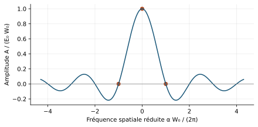
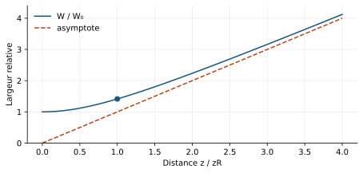
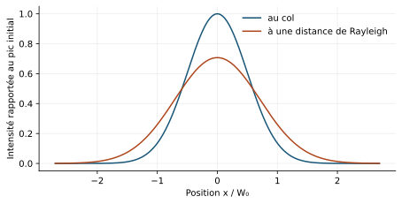

# X-ENS MP 2020 — Physique · Corrigé guidé

*Corrigé rédigé par IA, non officiel. Signalez toute erreur.*

**Lecture du rapport du jury** · GPT-6.2 Astra Ultra · vitesse non renseignée

**Rédaction** · GPT-6.2 Astra Ultra · vitesse non renseignée

## Faisceaux gaussiens et pinces optiques

## I — Décomposition en ondes planes

### Question 1 — Équation du spectre angulaire

**Indication.** Garder $\alpha$ sous l’intégrale jusqu’à l’application de l’unicité de la transformée.

Posons $k=\omega/c$ et écrivons $E(x,z)=\int\widetilde E(\alpha,z)e^{i\alpha x}\,d\alpha/(2\pi)$. Dans $(\partial_x^2+\partial_z^2+k^2)E=0$, la dérivée seconde en $x$ multiplie chaque terme par $-\alpha^2$, et celle en $z$ agit sur $\widetilde E$. L’intégrale de $[\partial_z^2\widetilde E+(k^2-\alpha^2)\widetilde E]e^{i\alpha x}$ s’annule pour tout $x$. L’unicité de Fourier impose donc pour chaque $\alpha$ l’équation $\partial_z^2\widetilde E+\gamma^2\widetilde E=0$, où $\gamma^2=k^2-\alpha^2$.

### Question 2 — Trois régimes du nombre d’onde longitudinal

**Indication.** Étudier le signe de $k^2-\alpha^2$ avant de résoudre l’équation caractéristique.

Pour $|\alpha|<k$, $\gamma=\sqrt{k^2-\alpha^2}>0$ et $\widetilde E=C_+(\alpha)e^{i\gamma z}+C_-(\alpha)e^{-i\gamma z}$. Pour $|\alpha|>k$, $\gamma=i\delta$, $\delta=\sqrt{\alpha^2-k^2}>0$, et $\widetilde E=C_1(\alpha)e^{-\delta z}+C_2(\alpha)e^{\delta z}$. Les coefficients sont complexes. À la limite $|\alpha|=k$, l’équation devient $\partial_z^2\widetilde E=0$ et la solution générale est affine en $z$.

### Question 3 — Sens physique de la décomposition

**Indication.** Repérer séparément la direction du champ électrique et la normale à un plan d’égale phase.

Chaque terme $e^{i(\alpha x+\gamma z-\omega t)}$ est une onde plane progressive de pulsation $\omega$, polarisée suivant $y$. Son vecteur d’onde $\vec k=\alpha\vec e_x+\gamma\vec e_z$ est normal aux plans de phase et a pour norme $\omega/c$. Le coefficient complexe $A(\alpha)\,d\alpha/(2\pi)$ porte l’amplitude et la phase des composantes provenant de cet intervalle de directions. Leur addition cohérente construit le champ.

### Question 4 — Composante évanescente

**Indication.** Séparer le facteur d’atténuation réel du facteur de phase.

Pour $\gamma=i\delta$ la solution retenue dans $z>0$ est proportionnelle à $e^{-\delta z}e^{i(\alpha x-\omega t)}$. La phase se déplace suivant $x$. Le champ décroît sur la longueur $1/\delta$ suivant $z$, sans progression de phase dans cette direction. C’est une onde évanescente.

### Question 5 — Champ dans le plan d’entrée

**Indication.** Fixer $z=0$ avant d’identifier la convention des signes et des facteurs $2\pi$.

À $z=0$, $E(x,0)=\int A(\alpha)e^{i\alpha x}\,d\alpha/(2\pi)$. Le membre de droite est la transformation inverse du formulaire. La transformation directe associée est donc $A(\alpha)=\int_{-\infty}^{+\infty}E(x,0)e^{-i\alpha x}\,dx$.

## II — Diffraction d’une fente

### Question 6 — Critère de l’optique géométrique

**Indication.** Comparer la longueur d’onde à la petite dimension de l’ouverture.

Il faut que la longueur d’onde soit très inférieure aux dimensions transversales pertinentes, ici $\lambda/W_0\ll1$, pour pouvoir négliger l’étalement par diffraction à la précision visée. Avec $0{,}6\,\mu\mathrm m$ et une ouverture de quelques micromètres, le rapport est de l’ordre de $10^{-1}$. L’angle diffracté est décelable et une simple projection géométrique de la fente ne rend pas compte du profil.

### Question 7 — Amplitude diffractée

**Indication.** La transformée d’un créneau réel centré est réelle et paire. Utiliser cette vérification lors de l’intégration.

Dans la fente $E(x,0)=E_0$ et le champ est nul ailleurs. L’intégration de $E_0 e^{-i\alpha x}$ de $-W_0/2$ à $W_0/2$ donne
$$
A(\alpha)=E_0 W_0\,\frac{\sin u}{u},\qquad u=\frac{\alpha W_0}{2}.
$$
Le prolongement en zéro vaut $E_0W_0$. Pour une phase de référence rendant $E_0$ réel positif, l’amplitude est paire et ses lobes alternent de signe, avec une enveloppe décroissant comme $1/|\alpha|$.

### Question 8 — Directions remarquables

**Indication.** Associer la composante transverse du vecteur d’onde à l’angle de propagation. Ne pas compter $u=0$ comme un zéro.

Puisque $\alpha=k\sin\theta$, le maximum global se trouve dans l’axe $\theta=0$. Les zéros sont donnés par $u=p\pi$, entier $p$ non nul tel que $|p\lambda/W_0|\leq1$. Le premier est à $|\sin\theta|=\lambda/W_0$. Hors de l’origine, la dérivation de $\sin u/u$ donne pour les extrema secondaires $u\cos u-\sin u=0$, soit $\tan u=u$, et leur direction se déduit de $\sin\theta=u\lambda/(\pi W_0)$.

### Question 9 — Observation dans le plan focal

**Indication.** Identifier l’endroit où un rayon passant par le centre optique rencontre le plan focal.

Un faisceau de rayons parallèles à l’axe converge au foyer image. Des rayons parallèles inclinés de $\theta$ convergent au même point focal secondaire, de coordonnée $x'=f'\tan\theta$. La lentille convertit donc la distribution angulaire en distribution de position. Le capteur mesure une intensité proportionnelle à $|A(k\sin\theta)|^2$, avec une large tache centrale et des franges latérales parallèles à la fente.

### Question 10 — Largeur de la tache centrale

**Indication.** Le premier zéro fournit une demi-largeur. Compter les deux côtés pour le diamètre de la tache.

Dans les petits angles, le premier zéro se trouve à $\Delta x=f'\lambda/W_0$. La largeur entre les deux premiers zéros est $2\Delta x=2f'\lambda/W_0$. Elle s’accroît lorsque l’ouverture rétrécit. Avec $f'=0{,}20\,\mathrm m$, $\lambda=6\times10^{-7}\,\mathrm m$ et $W_0=10^{-5}\,\mathrm m$, le calcul donne $0{,}024\,\mathrm m$, soit $2\,\mathrm{cm}$ à un chiffre significatif.

## III — Nappe laser gaussienne

### Question 11 — Spectre gaussien

**Indication.** Déterminer le spectre dans le plan du col, puis multiplier chaque composante par son propre facteur de propagation.

La transformation de Fourier du profil au col donne $A(\alpha)=E_0\sqrt\pi W_0\exp(-W_0^2\alpha^2/4)$. La propagation vers $+z$ s’écrit, avec $\gamma(\alpha)=\sqrt{k^2-\alpha^2}$ pour les ondes propagatives,
$$
E_L(x,z)=\int_{-\infty}^{+\infty}E_0\sqrt\pi W_0 e^{-W_0^2\alpha^2/4}
 e^{i[\alpha x+\gamma(\alpha)z]}\frac{d\alpha}{2\pi}.
$$
Les directions de poids appréciable vérifient $|\alpha|\sim1/W_0\ll k$. Le prolongement des bornes néglige donc une queue gaussienne très faible.

### Question 12 — Divergence

**Indication.** Lire l’angle sur la pente de l’asymptote de $W(z)$ et préciser s’il s’agit d’un angle total ou d’un demi-angle.

La largeur $W=W_0\sqrt{1+(z/z_R)^2}$ vaut près du col $W_0[1+z^2/(2z_R^2)]$ au premier ordre correctif. Loin du col, $W\simeq W_0z/z_R$. Le demi-angle des asymptotes vérifie $\tan\theta=W_0/z_R$, soit dans l’approximation paraxiale $\theta\simeq\lambda/(\pi W_0)$. Un faisceau plus étroit diverge davantage, comme la lumière diffractée par une fente.

### Question 13 — Profils d’intensité de la nappe

**Indication.** Mettre au carré le module de $K(z)$ en tenant compte de sa racine carrée complexe.

Le module carré supprime la phase de courbure. En notant $I_c$ l’intensité centrale à $z=0$, on trouve pour la nappe invariante en $y$
$$
I_L(x,z)=I_c\,\frac{W_0}{W(z)}\exp[-2x^2/W(z)^2].
$$
À $z=0$ c’est $I_c e^{-2x^2/W_0^2}$. À $z=z_R$ on obtient $(I_c/\sqrt2)e^{-x^2/W_0^2}$, une gaussienne $\sqrt2$ fois plus large, dont le maximum est divisé par $\sqrt2$. L’intégrale en $x$ reste constante.

### Question 14 — Courbure des fronts et longueur de Rayleigh

**Indication.** Développer la distance géométrique au point d’observation et la comparer à la longueur qui multiplie $k$ dans la phase.

Pour $z\gg z_R$, $R(z)\simeq z$. Avec $|x|\ll z$, la distance $r=\sqrt{z^2+x^2}\simeq z+x^2/(2z)$ donne $e^{ikz}e^{ikx^2/(2R)}\simeq e^{ikr}$ à l’ordre paraxial. Dans la coupe, les fronts sont des arcs de rayon voisin de $z$. L’invariance en $y$ en fait des fronts cylindriques. Pour $z\ll z_R$, $R\simeq z_R^2/z$ devient très grand et les fronts sont presque plans. Avec $\lambda=600\,\mathrm{nm}$, $z_R=\pi W_0^2/\lambda$ vaut environ $5\times10^{-2}\,\mathrm m$ puis $5\,\mathrm m$ pour $W_0=100\,\mu\mathrm m$ puis $1\,\mathrm{mm}$.

## IV — De l’atome à la sphère diélectrique

### Question 15 — Rappel dans l’atome de Thomson

**Indication.** Utiliser la charge intérieure à la surface de Gauss et distinguer le rayon du diamètre annoncé.

À l’intérieur de la sphère uniformément chargée, une surface de Gauss de rayon $r_e$ enferme $e(r_e/R_0)^3$. La symétrie sphérique et le théorème de Gauss donnent $\vec E_+=e\vec r_e/(4\pi\varepsilon_0 R_0^3)$. L’électron porte $-e$, donc
$$
\vec F_{\rm el}=-m_e\omega_0^2\vec r_e,\qquad k_{\rm el}=m_e\omega_0^2=\frac{e^2}{4\pi\varepsilon_0R_0^3}.
$$
Le rayon est $R_0=5\times10^{-11}\,\mathrm m$. Ainsi $\omega_0=\sqrt{k_{\rm el}/m_e}\simeq4\times10^{16}\,\mathrm{rad\,s^{-1}}$ à un chiffre significatif.

### Question 16 — Champ uniforme à l’échelle atomique

**Indication.** Une phase relative se mesure en comparant des longueurs, ou en évaluant $kd$.

À travers l’atome de diamètre $d=0{,}1\,\mathrm{nm}$, le déphasage maximal vaut $kd=2\pi d/\lambda\sim10^{-3}$ pour le visible. Les parties de l’atome subissent donc pratiquement la même excitation à un instant donné. L’enveloppe est elle aussi uniforme à cette échelle dans le modèle.

### Question 17 — Mouvement de la charge positive

**Indication.** Comparer les accélérations après avoir comparé les forces et les masses.

Les charges totales $+e$ et $-e$ subissent de la part du champ uniforme des forces électriques de mêmes normes. Leurs forces d’interaction mutuelle sont également opposées. Comme la masse positive est beaucoup plus grande que $m_e$, son accélération et son déplacement aux échelles de temps étudiées sont bien plus petits.

### Question 18 — Terme magnétique

**Indication.** Comparer des forces de mêmes dimensions en utilisant la relation d’onde plane.

La norme de la force magnétique ne dépasse pas $evB$ alors que la force électrique a pour norme $eE$. Pour une onde plane du vide $B=E/c$, donc le rapport est au plus $v/c\ll1$ dans le régime non relativiste posé. On peut omettre le terme magnétique dans l’équation de l’électron.

### Question 19 — Oscillateur forcé amorti

**Indication.** Réunir force de rappel, amortissement et forçage électrique avant de diviser l’équation entière par la masse.

Dans le référentiel du centre positif, le bilan des forces est $m_e\ddot{\vec r}_e=-m_e\omega_0^2\vec r_e-m_e\Gamma\dot{\vec r}_e-e\vec E(t)$. On obtient $\ddot{\vec r}_e+\Gamma\dot{\vec r}_e+\omega_0^2\vec r_e=-(e/m_e)\vec E(t)$. Tous les termes ont la dimension d’une accélération.

### Question 20 — Moment dipolaire oscillant

**Indication.** Une dérivée temporelle multiplie l’amplitude par $-i\omega$. Le second signe négatif vient de la charge qui porte le dipôle.

Avec la convention $e^{-i\omega t}$, posons $H(\omega)=\omega_0^2-\omega^2-i\Gamma\omega$. Les amplitudes complexes vérifient $\vec r_{e,0}=-(e/m_e)\vec E_0/H$. Le moment dipolaire est donc
$$
\vec d_{\rm at}(t)=\operatorname{Re}\!\left[\frac{e^2}{m_e H(\omega)}\,\vec E_0 e^{-i\omega t}\right].
$$
La quantité entre crochets est sa représentation complexe. À fréquence nulle, le dipôle est dans le sens du champ.

### Question 21 — Polarisation et indice

**Indication.** Vérifier si $N$ désigne un nombre total ou une densité avant de calculer le moment par unité de volume.

Dans un petit volume $\Delta V$, $N\Delta V$ atomes portent le même moment. Ainsi $\vec P(\vec r,t)=N\vec d_{\rm at}(t)$ pour l’excitation locale considérée. Par identification de l’amplitude avec $\varepsilon_0(n^2-1)\vec E$,
$$
n^2=1+\frac{Ne^2}{\varepsilon_0m_e(\omega_0^2-\omega^2-i\Gamma\omega)} .
$$
Le rapport qui s’ajoute à un est sans dimension.

### Question 22 — Faible dispersion dans le visible

**Indication.** Identifier la distance à la résonance de l’atome avant de supprimer un terme dans le dénominateur.

Dans l’intervalle indiqué $\omega/\omega_0$ est de l’ordre de $0{,}04$ à $0{,}1$. Ainsi $\omega^2/\omega_0^2$ est de l’ordre du centième au plus, et $\Gamma\omega/\omega_0^2=(\Gamma/\omega_0)(\omega/\omega_0)\ll1$. Au premier ordre dominant, $n^2\simeq1+Ne^2/(\varepsilon_0m_e\omega_0^2)$. Le modèle prédit ici une faible dépendance en fréquence.

### Question 23 — Champ dans une bille diélectrique

**Indication.** La polarisation recherchée apparaît elle-même dans le champ intérieur. Résoudre cette équation linéaire.

La polarisabilité de l’atome vaut $\alpha_{\rm at}=e^2/(m_e H)=\varepsilon_0(n^2-1)/N$. Avec le champ intérieur du sujet,
$$
\vec d_{\rm at}=\alpha_{\rm at}\left(\vec E_0-\frac{\vec P}{3\varepsilon_0}\right).
$$
Multiplions par $N$, puis rassemblons les termes en $\vec P$ à gauche. Il vient $\vec P=3\varepsilon_0(n^2-1)\vec E_0/(n^2+2)$.

### Question 24 — Moment total

**Indication.** Passer d’une densité volumique de moment à une grandeur totale par intégration.

La polarisation est uniforme dans la petite sphère. Son intégrale sur $V=4\pi a^3/3$ vaut
$$
\vec D=4\pi\varepsilon_0a^3\frac{n^2-1}{n^2+2}\vec E_0 .
$$
L’effet disparaît pour $n=1$, quand la sphère et son environnement ont la même réponse électrique.

## V.A — Forces optiques

### Question 25 — Photons diffusés

**Indication.** Diviser une énergie totale par une énergie par photon.

La puissance moyenne $P$ correspond à une énergie $d\mathcal E=P\,dt$ sur l’intervalle considéré, en moyenne sur l’oscillation lumineuse. Chaque photon transporte $\hbar\omega$, donc le nombre moyen diffusé est $dN=P\,dt/(\hbar\omega)$.

### Question 26 — Recul et pression de radiation

**Indication.** Soustraire l’impulsion lumineuse sortante de l’impulsion entrante. La symétrie concerne la première.

La somme des impulsions sortantes est nulle par symétrie. La bille reçoit donc l’impulsion des photons retirés de l’onde incidente, $d\vec p=\hbar\vec k\,dN$. En utilisant $k=n_s\omega/c$,
$$
\vec F_d=\frac{d\vec p}{dt}=\frac{n_sP}{c}\,\vec e_z .
$$
Cette force pousse la bille dans le sens de propagation. Prise isolément elle l’entraîne vers l’aval.

### Question 27 — Somme des forces de Lorentz

**Indication.** Suivre simultanément le signe de la charge mobile et celui de sa vitesse.

Écrivons $\vec E_\pm=\vec E(\vec r_\pm,t)$, de même pour $\vec B_\pm$. La charge positive est fixe et $\vec v_-=-\dot{\vec\delta}$. La somme exacte est $q(\vec E_+-\vec E_-)+q\dot{\vec\delta}\times\vec B_-$. En développant $\vec E_-$ autour de $\vec r_0$ on obtient $q(\vec\delta\cdot\nabla)\vec E$. Le terme contenant à la fois $\dot{\vec\delta}$ et le gradient de $\vec B$ est du second ordre en amplitude du déplacement. Ainsi à l’ordre retenu
$$
\vec F_{\rm Lor}=(\vec D_b\cdot\nabla)\vec E+\dot{\vec D}_b\times\vec B ,
$$
les champs étant pris en $\vec r_0$.

### Question 28 — Réécriture du terme de force

**Indication.** Utiliser Faraday avant de reconnaître la dérivée d’un produit vectoriel.

Substituons $\vec D_b=A\vec E$. L’identité du sujet donne $(\vec E\cdot\nabla)\vec E=\tfrac12\nabla E^2-\vec E\times(\nabla\times\vec E)$. La loi de Faraday transforme le second terme en $+\vec E\times\partial_t\vec B$. On lui ajoute $(\partial_t\vec E)\times\vec B$, d’où
$$
\vec F_{\rm Lor}=\frac A2\nabla E^2+A\,\partial_t(\vec E\times\vec B).
$$

### Question 29 — Moyenne sur une période

**Indication.** Appliquer le théorème fondamental de l’intégration à la grandeur périodique tout entière.

L’intégrale d’une dérivée temporelle sur $T$ vaut la différence aux deux bornes. Or $\vec E\times\vec B$ est périodique de période $T$ (et peut avoir une période plus courte). Sa dérivée a donc une moyenne nulle. La moyenne commute ici avec le gradient spatial et $\vec F_g=(A/2)\nabla\langle E^2\rangle_T$.

## V.B — Confinement d’une bille diélectrique

### Question 30 — Forces en fonction de l’intensité

**Indication.** Distinguer la valeur crête $E_0^2$ de la moyenne $\langle E^2\rangle_T$, puis vérifier le nombre de puissances de $n_s$.

Posons $b=(m^2-1)/(m^2+2)$, de sorte que $A=4\pi\varepsilon_0n_s^2a^3 b$. La moyenne $\langle E^2\rangle_T=I/(n_s\varepsilon_0c)$ donne directement
$$
\vec F_g=\frac{2\pi n_s a^3 b}{c}\nabla I .
$$
Pour la diffusion, l’amplitude au carré du dipôle est $D_{b,0}^2=A^2 E_0^2=2A^2 I/(n_s\varepsilon_0c)$. En l’insérant dans $P=4\pi^3cn_sD_{b,0}^2/(3\varepsilon_0\lambda^4)$ puis dans $\vec F_d=n_sP\vec e_z/c$, on trouve
$$
\vec F_d=\frac{128\pi^5n_s^5a^6 b^2}{3c\lambda^4}I\,\vec e_z .
$$
Dans cette formule $\lambda$ est la longueur d’onde dans le vide. La diffusion reste dans le sens de propagation quel que soit le signe de $b$.

### Question 31 — Conditions de stabilité

**Indication.** En chaque direction, examiner la force après un petit déplacement. Vérifier aussi la force totale au maximum d’intensité.

Au centre l’intensité a un maximum strict. Si $m>1$ alors $A>0$, et $U_g=-AI/(2n_s\varepsilon_0c)$ y présente un minimum. Une petite déviation produit une force de gradient de rappel. Pour $m<1$ le centre repousse la bille et pour $m=1$ le contraste disparaît. La diffusion, dirigée vers $+z$, reste non nulle au maximum. Avec cette force, l’équilibre est légèrement en aval si le rappel axial peut la compenser et si la pente de la force totale en ce point est négative. Le centre géométrique est l’équilibre du modèle où la diffusion est négligeable.

### Question 32 — Rôle de la focalisation

**Indication.** Le confinement transversal seul laisse libre le mouvement suivant l’axe du faisceau.

Pour un même petit déplacement, les formules fournies donnent $|F_{g,z}|/|F_{g,x}|\sim(\lambda/(\pi W_0))^2$ lorsque l’on compare un déplacement axial à un déplacement transversal égal. Un faisceau large offre très peu de rappel le long de la direction où agit la diffusion. Focaliser réduit $W_0$ et $z_R$, augmente le gradient et permet, pour un contraste positif et une diffusion assez faible, un confinement dans les trois directions.

### Question 33 — Échelle du foyer

**Indication.** Comparer directement les longueurs d’extension transversale et axiale.

En posant $W_0\sim\lambda/\pi$, on trouve $z_R=\pi W_0^2/\lambda\sim\lambda/\pi\sim W_0$. Le facteur axial $[1+(z/z_R)^2]^{-2}$ décroît sur cette distance de part et d’autre du foyer. Les gradients pour des déplacements égaux dans les trois directions ont alors le même ordre de grandeur. Il s’agit d’une estimation d’échelle, à la limite de la description paraxiale.

### Question 34 — Ordre de grandeur des forces

**Indication.** Intégrer l’intensité sur le plan transverse et convertir les mètres carrés en centimètres carrés.

Au foyer le profil cylindrique est $I(r)=I_0e^{-2r^2/W_0^2}$. La puissance totale vaut $2\pi\int_0^\infty I(r)r\,dr=\pi W_0^2I_0/2$. Avec $W_0\sim600\,\mathrm{nm}/\pi$, la puissance indiquée donne $I_0\sim7\times10^{11}\,\mathrm{W\,m^{-2}}=7\times10^7\,\mathrm{W\,cm^{-2}}$. Le contraste de la silice dans l’eau est positif. À $50\,\mathrm{nm}$, le rappel annoncé de $1\,\mathrm{pN}$ dépasse la poussée de $0{,}2\,\mathrm{pN}$. Un équilibre stable proche du foyer est compatible avec ces valeurs.

### Question 35 — Raideur du piège

**Indication.** La raideur est une pente de force par longueur. Une poussée constante décale le centre de rappel.

Les trois composantes de $\nabla I$ sont linéaires et de signe opposé au déplacement près du foyer. Comme $A>0$, l’approximation locale est donc celle d’un ressort, $F_{g,x}\simeq-\kappa_x x$, et de même sur les autres axes avec leurs raideurs. L’ordre de grandeur fourni donne $\kappa\simeq10^{-12}/(50\times10^{-9})=2\times10^{-5}\,\mathrm{N\,m^{-1}}$. L’équilibre axial est décalé d’environ $F_d/\kappa\sim10\,\mathrm{nm}$ en aval.

### Question 36 — Rayon, indice et longueur d’onde

**Indication.** Modifier un paramètre à la fois, puis distinguer le facteur de diffusion explicite d’un changement de taille du foyer.

À éclairement et gradient fixés $F_g\propto a^3b$ et $F_d\propto a^6b^2/\lambda^4$. Pour la silice de rayon doublé les facteurs sont $8$ et $64$. Les valeurs extrapolées sont $8\,\mathrm{pN}$ et environ $1\times10^1\,\mathrm{pN}$. Pour le polystyrène à rayon inchangé, $b$ est multiplié par $7$ et $b^2$ par $49$, d’où $7\,\mathrm{pN}$ et environ $1\times10^1\,\mathrm{pN}$. La diffusion concurrence plus fortement le rappel. Une longueur d’onde plus grande atténue la diffusion relativement au gradient à profil donné et améliore l’approximation de petite particule. Si le foyer suit $W_0\propto\lambda$, il faut aussi tenir compte de son élargissement. Pour $a=200\,\mathrm{nm}$ et $\lambda=600\,\mathrm{nm}$, la petitesse de $a/\lambda$ est moins bonne et les chiffres restent indicatifs.

### Question 37 — Fluctuations thermiques

**Indication.** Attribuer $k_BT/2$ au terme quadratique d’une seule coordonnée et prendre la racine carrée de la variance.

Pour le ressort suivant $x$, l’équipartition donne $\kappa_x\langle x_b^2\rangle/2=k_BT/2$. La moyenne étant nulle,
$$
\sigma_x=\sqrt{k_BT/\kappa_x}\simeq\sqrt{\frac{1{,}4\times10^{-23}\times300}{2\times10^{-5}}}
\simeq1\times10^{-8}\,\mathrm m .
$$
Avant arrondi on trouve environ $14\,\mathrm{nm}$, inférieur au rayon de la bille ($100\,\mathrm{nm}$) et à la zone de confinement ($W_0\simeq190\,\mathrm{nm}$). Le mouvement brownien prévu reste généralement dans la région où le rappel est approximativement linéaire, ce qui rend le confinement satisfaisant à cette température dans le modèle.
