# X-ENS — PC, Chimie A 2020 · Corrigé brut

*Corrigé rédigé par IA, non officiel.*

**Rédaction** · GPT-6.2 Astra Ultra · vitesse non renseignée

Les 58 questions des parties A et B sont traitées. Les constantes lues sur les figures 5 et 6 sont des estimations. À la question 56, la structure de 13 est présentée comme une proposition déduite du mécanisme concurrent.

## A. Orbitales du complexe plan carré

### Question 1 — Les électrons de valence du platine

Le platine, de numéro atomique 78, a pour configuration fondamentale $[\mathrm{Xe}]\,4f^{14}5d^96s^1$. L’ionisation enlève l’électron $6s$ puis un électron $5d$. Le centre Pt(II) est donc $[\mathrm{Xe}]\,4f^{14}5d^8$, avec huit électrons $d$.

### Question 2 — Énergies des combinaisons du carré

Dans $\chi_1$ les quatre orbitales 1s ont même phase. Tous les recouvrements entre voisins sont liants. Dans $\chi_4$ les signes alternent. Tous ces recouvrements sont antiliants. Les deux autres combinaisons portent des phases opposées aux deux extrémités d’une diagonale et s’annulent sur l’autre. Un quart de tour échange ces deux diagonales sans changer le système. Ainsi $E_1<E_2=E_3<E_4$.

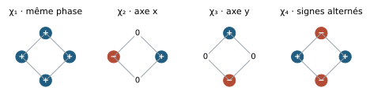

### Question 3 — Recouvrements des orbitales d

Dans le plan $xy$, les quatre lobes de $d_{x^2-y^2}$ pointent selon les axes avec des signes opposés sur $x$ et $y$. Ils recouvrent $\chi_4$. Le tore équatorial de $d_{z^2}$ a le même signe aux quatre sommets et recouvre $\chi_1$ ; ses deux lobes axiaux ont le signe contraire au tore. Les lobes de $d_{xy}$ sont entre les axes, ceux de $d_{xz}$ et $d_{yz}$ entre les axes des plans verticaux respectifs. Chacune de ces trois orbitales s’annule sur les quatre directions métal–H. Enfin, $\chi_2$ et $\chi_3$ changent de signe par inversion au centre du carré alors que chacune des cinq orbitales $d$ est paire. Leurs intégrales de recouvrement sont nulles.

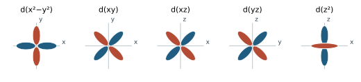

### Question 4 — Recouvrements des orbitales p et s

La diagonale de $\chi_2$ est l’axe $x$ du repère fourni. Son recouvrement est autorisé avec $p_x$. L’autre diagonale, celle de $\chi_3$, est l’axe $y$, d’où le couplage à $p_y$. Dans chaque cas l’autre orbitale équatoriale est nulle sur la diagonale occupée. Le plan $xy$ est nodal pour $p_z$. Pour $s$, les deux contributions des sommets opposés se compensent, car cette orbitale est paire. Elle peut en revanche recouvrir $\chi_1$.

## La cystéine en solution

### Question 5 — Première dissociation des deux ligands

Dans les deux cas il s’agit de $\mathrm{CO_2H/CO_2^-}$. Pour la cystéine, le couple est $\mathrm{HSCH_2CH(NH_3^+)CO_2H/HSCH_2CH(NH_3^+)CO_2^-}$, de $pK_a=1{,}9$. Après acétylation, l’azote porte $\mathrm{NHCOCH_3}$ dans les deux membres du couple et le $pK_a$ vaut 3,2. Le thiol reste protoné dans ces écritures.

### Question 6 — Comparaison avec les acides carboxyliques

L’annexe donne 3 à 5 pour un acide carboxylique usuel. La cystéine acétylée se situe près de la borne acide de cet intervalle. La première dissociation de la cystéine libre, à 1,9, est plus favorable. Les valeurs typiques des ammoniums et des thiols sont bien plus élevées.

### Question 7 — Effet de l’acétylation

Le groupe ammonium voisin attire le carboxylate et exerce un effet inductif attracteur. La base conjuguée de la forme libre est ainsi stabilisée. L’amide neutre de la forme acétylée ne procure pas la même stabilisation électrostatique. La constante de première acidité est environ $10^{3,2-1,9}\simeq20$ fois plus grande pour la cystéine libre.

### Question 8 — Espèce majoritaire à pH 4

La forme dominante est le zwitterion $\mathrm{^+H_3N{-}CH(CH_2SH){-}CO_2^-}$. Le rapport carboxylate/acide est voisin de $10^{4-1,9}=126$, tandis que la dissociation suivante, de $pK_a=9{,}1$, est encore négligeable.

### Question 9 — Les trois acidités au cours du titrage

On titre $0{,}200\ \mathrm{mmol}$ de cystéinium. Chaque proton représente $2{,}00\ \mathrm{mL}$ de soude à $0{,}100\ \mathrm{mol\,L^{-1}}$. Les volumes stœchiométriques successifs sont donc 2, 4 et 6 mL. Le saut à 2 mL isole la neutralisation $\mathrm{H_3L^++OH^-\to H_2L+H_2O}$ ; à ce volume l’ampholyte donne approximativement $(1{,}9+9{,}1)/2=5{,}5$. La première acidité est assez forte pour être déjà sensiblement dissociée dans la solution initiale. Le pH initial lu est supérieur à 2, valeur qu’aurait un monoacide fort à cette concentration, et la demi-équivalence ne fournit pas une lecture simple de 1,9. Les deux acidités suivantes, séparées de 1,2 unité seulement, se titrent ensemble. Les formes anioniques $\mathrm{HL^-}$ puis $\mathrm{L^{2-}}$ se développent sur une large zone tampon. Ni 4 ni 6 mL ne donnent un saut étroit comparable au premier. Au-delà de 6 mL, l’excès croissant de soude gouverne le pH.

### Question 10 — Allure conductimétrique

La conductivité vaut $\sigma=\sum_i\lambda_i[i]$. Le chlorure est présent dès le départ, et chaque ajout de soude apporte du sodium. Avant 2 mL, une part appréciable de l’acidité initiale se trouve sous forme $\mathrm{H_3O^+}$, très mobile. Sa consommation et celle du cystéinium, avec formation du zwitterion neutre, entraînent une baisse. Ensuite $\mathrm{Na^+}$ et les anions du ligand s’accumulent. La conductivité remonte. Les deux dernières dissociations proches se chevauchent et la région autour de 4 mL est arrondie. Au-delà de 6 mL, chaque nouvel ajout apporte aussi $\mathrm{OH^-}$ libre, très mobile. La remontée devient plus rapide. Ces segments décrivent de préférence la conductivité corrigée de dilution, $\sigma(V)(V_0+V)/V_0$ ; sur la mesure brute, le nombre de chlorures est constant mais leur concentration diminue.

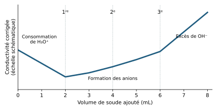

### Question 11 — Ce que mesurent les deux titrages

Le minimum de conductivité et le saut de pH repèrent la première équivalence, vers 2 mL. L’excès de soude change nettement la pente conductimétrique vers 6 mL, alors que le passage est très étalé sur la courbe de pH. Le détail vers 4 mL reste mal séparé dans les deux approches. Les volumes stœchiométriques découlent du même bilan de matière.

## Aquation et stœchiométrie du complexe

### Question 12 — Précipitation et aquation

Deux molécules d’eau remplacent les chlorures de B dans la sphère de coordination. L’argent piège le chlorure libéré selon $\mathrm{Ag^++Cl^-\to AgCl(s)}$, avec $K=10^{9,8}$. La baisse d’activité du chlorure déplace l’équilibre de substitution vers le diaquacomplexe C. L’argent est consommé à raison de deux ions par complexe.

### Question 13 — Charge du perchlorate

Les 32 électrons de valence forment 16 doublets. Une écriture de Lewis courante place Cl au centre, trois liaisons $\mathrm{Cl{=}O}$ et une liaison $\mathrm{Cl{-}O^-}$. Chaque oxygène doublement lié porte deux doublets libres, l’oxygène simplement lié en porte trois. Les quatre choix de ce dernier sont équivalents. La charge négative répartie sur quatre oxygènes et la faible basicité associée font du perchlorate un ligand peu coordinant.

### Question 14 — Pourquoi 2,1 équivalents de sel d’argent

Le faible $pK_s=-0{,}8$ du perchlorate d’argent permet d’introduire les ions argent en solution, alors que le chlorure d’argent précipite. Le contre-ion perchlorate concurrence peu l’eau pour la coordination. Les deux ligands chlorure nécessitent deux équivalents d’argent ; le léger excès à 2,1 équivalents déplace davantage la substitution vers C.

### Question 15 — Branche pauvre en complexe C

La cystéine est en large excès ; avec une grande constante de formation, $[D]\simeq[C]_0=x c_{\rm tot}$. À 266 nm seul D contribue significativement, d’où $A_g=\varepsilon_D\ell c_{\rm tot}x$.

### Question 16 — Branche pauvre en cystéine

Pour $x$ proche de 1 le ligand est limitant et $[D]\simeq[L]_0/n=(1-x)c_{\rm tot}/n$. La branche droite vaut donc $A_d=\varepsilon_D\ell c_{\rm tot}(1-x)/n$.

### Question 17 — Abscisse de l’intersection

Après simplification par $\varepsilon_D\ell c_{\rm tot}$, l’égalité donne $x^*=(1-x^*)/n$, soit $(n+1)x^*=1$ et $x^*=1/(n+1)$. À cette composition, les quantités initiales de ligand et de C sont dans le rapport $n:1$.

### Question 18 — Choix des fractions molaires

Les valeurs 0,25, 0,33 et 0,50 testent des proportions de ligand par métal voisines de 3, 2 et 1. Les valeurs 0,67 et 0,75 testent les rapports inverses et documentent l’autre versant du maximum. Des mélanges plus proches de 0 et de 1 permettraient de mieux tracer les droites limites. Des mesures de part et d’autre de 0,50 resserreraient la localisation du sommet.

### Question 19 — Maximum de la courbe de Job

Les absorbances 0,202 et 0,209 aux fractions extrêmes encadrent des points plus élevés à 0,33 et 0,67 ; le maximum mesuré vaut 0,257 à $x=0{,}50$. La courbe est pratiquement symétrique autour de cette composition. Avec $n=1/x^*-1$, on trouve $n=1$, en accord avec un seul résidu cystéine dans la formule brute.

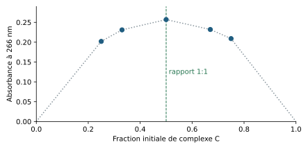

### Question 20 — Arrondi du maximum

Quand $\beta$ augmente, la concentration en D se rapproche de la quantité maximale imposée par le réactif limitant. Les deux branches tendent vers un triangle au sommet anguleux. Pour $\beta$ finie, il reste du C et du ligand libres, particulièrement près de la stœchiométrie. Le sommet est abaissé et arrondi. Pour ce modèle 1:1 à somme constante, sa position reste $x=1/2$.

### Question 21 — Deux orientations des chélates

Le ligand auxiliaire du complexe C conserve les donneurs $N_{\rm im}$ du benzimidazole et $N_{\rm am}$ de l’aminométhyle en positions cis. La cystéine remplace les deux eaux avec $S^-$ et un oxygène de $\mathrm{CO_2^-}$ ; son $\mathrm{NH_3^+}$ reste libre. Cette attribution permet aussi la chélation du dérivé N-acétylé. La charge de la cystéine liée vaut $-1$ et celle de D vaut $+1$. Les deux répartitions dans le plan carré placent S en trans soit de $N_{\rm im}$, soit de $N_{\rm am}$ ; O prend la position restante. Ces deux arrangements sont des isomères géométriques, donc des diastéréoisomères, en conservant la configuration de la L-cystéine.

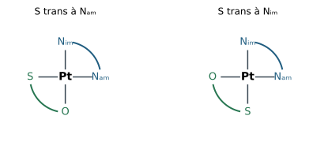

### Question 22 — Perte de dégénérescence

Dans A les quatre chlorures sont équivalents ; un quart de tour échange $x$ et $y$. Les deux combinaisons correspondantes et leurs interactions avec $p_x,p_y$ sont équivalentes. Dans D cette rotation échange des donneurs différents. Elle n’est plus une symétrie et les énergies correspondantes peuvent se séparer.

## Cinétique des substitutions

### Question 23 — Approximation de stock de ligand

Il y a dix fois plus de ligand que de C. Même si les $1{,}50\,10^{-4}\ \mathrm{mol\,L^{-1}}$ de C sont totalement consommés, le ligand libre passe au plus de 1,50 à 1,35 mmol par litre. Sa variation relative est au plus 10 %. On peut prendre $[L]\simeq[L]_0$ pour l’analyse cinétique.

### Question 24 — Test d’une seule étape

Pour un acte élémentaire $C+L\to D$, l’excès de ligand donnerait $[C]=c_0e^{-k[L]_0t}$ et $[D]=c_0-[C]$. Avec les coefficients à 240 nm, $A_\infty-A=\ell(\varepsilon'_D-\varepsilon'_C)[C]$. Le logarithme devrait donc être affine sur toute la mesure. La pente est au contraire beaucoup plus négative au début qu’après 60 min. Une seule substitution élémentaire ne décrit pas la courbe.

### Question 25 — Signature optique d’un intermédiaire

Une première évolution rapide peut enrichir le milieu en I ; une conversion plus lente de I en D explique ensuite la queue quasi exponentielle. Au départ le remplacement de C par I accroît l’absorbance ; à long terme le remplacement de I par D l’accroît encore. Dans ce modèle successif, cela conduit à $\varepsilon'_C<\varepsilon'_I<\varepsilon'_D$. La courbure du tracé logarithmique traduit la superposition des cinétiques.

### Question 26 — Constante de la première conversion observable

Supposons l’association réversible rapide devant les deux transformations suivantes et $[L]$ presque constante. Posons $u=[C]_{\rm libre}+[I_1]$ et $b=K[L]/c^\circ$ avec une constante thermodynamique sans dimension. Comme $[I_1]=b[C]_{\rm libre}$, on a $[I_1]=bu/(1+b)$. La disparition du stock vérifie $-du/dt=k_1[I_1]=k_{\rm obs}u$, avec $k_{\rm obs}=k_1b/(1+b)$. Si K est exprimée en $\mathrm{L\,mol^{-1}}$, on écrit directement $b=K[L]$. La saturation à fort excès donne $k_{\rm obs}\to k_1$. Dans le schéma macroscopique, C désigne ce stock.

### Question 27 — Disparition du premier stock

Avec $c_0$ la concentration initiale totale en platine et $u(0)=c_0$, $u(t)=c_0\exp(-k_{\rm obs}t)$. La fraction réellement libre après établissement du prééquilibre vaut $u(t)/(1+b)$, si l’on souhaite distinguer C libre de $I_1$.

### Question 28 — Accumulation puis disparition de I₂

Notons $p=k_{\rm obs}$ et $q=k_2$. L’équation est $d[I_2]/dt+q[I_2]=p c_0e^{-pt}$, avec $[I_2](0)=0$. Après multiplication par $e^{qt}$ et intégration de 0 à $t$, on trouve $[I_2]=p c_0(e^{-qt}-e^{-pt})/(p-q)$ pour $p\ne q$. Les deux exponentielles se compensent à l’origine ; à long terme l’intermédiaire disparaît. Pour $p=q$, la limite est $p c_0t e^{-pt}$.

### Question 29 — Formation du produit final

Le bilan $c_0=u+[I_2]+[D]$ donne $[D]=c_0\{1-(p e^{-qt}-q e^{-pt})/(p-q)\}$. Cette concentration part de zéro avec une tangente horizontale puisque $[I_2](0)=0$, puis tend vers $c_0$. Pour $p=q$, l’expression devient $c_0[1-(1+pt)e^{-pt}]$.

### Question 30 — Pente de la composante lente

Pour $k_2<k_{\rm obs}$, le logarithme tend vers $\ln a_2-k_2t$. La droite pointillée donne environ $-0{,}25$ à 60 min et $-0{,}315$ à 90 min. Ainsi $k_2\simeq0{,}065/30\simeq2{,}2\,10^{-3}\ \mathrm{min^{-1}}$. La valeur est une lecture graphique.

### Question 31 — Pente de la composante rapide

Avec $\Delta=a_1e^{-k_{\rm obs}t}$, la pente de son logarithme est $-k_{\rm obs}$. Entre environ 1 et 5 min, le logarithme passe de −1,48 à −2,00. On obtient $k_{\rm obs}\simeq0{,}52/4=0{,}13\ \mathrm{min^{-1}}$, nettement supérieur à $k_2$.

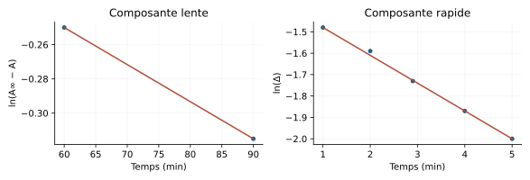

### Question 32 — Loi d’Arrhenius

On écrit $k=A\exp[-E_a/(RT)]$, où $T$ est en kelvins, $E_a$ l’énergie d’activation en joules par mole et $R=8{,}314\ \mathrm{J\,mol^{-1}\,K^{-1}}$. Le facteur préexponentiel $A$ a la même unité que $k$ (ici $\mathrm{s^{-1}}$ pour $k_1,k_2$). Sur un domaine où $A,E_a$ sont quasi constants, la pente de $\ln k$ selon $1/T$ vaut $-E_a/R$.

### Question 33 — Entropie et facteur préexponentiel

La formule d’Eyring donne $k=(k_BT/h)\exp(\Delta S^\ddagger/R)\exp[-\Delta H^\ddagger/(RT)]$. Le terme exponentiel $\exp(\Delta S^\ddagger/R)$ est indépendant de T dans l’approximation du sujet. À un facteur de fréquence $k_BT/h$ près, il mesure la restriction des configurations aptes à franchir la barrière. Plus l’entropie d’activation est négative, plus cette fraction est faible. Si l’on définit $E_a$ par la pente locale d’Arrhenius, $E_a=RT^2\,d(\ln k)/dT=\Delta H^\ddagger+RT$, d’où $A=e(k_BT/h)\exp(\Delta S^\ddagger/R)$. L’identification simplifiée $E_a\simeq\Delta H^\ddagger$ omet ce facteur $e$.

### Question 34 — Extraction des paramètres d’activation

Pour chaque température absolue et pour chacune des deux séries $k_1,k_2$, tracer $\ln(k_i/T)$ en fonction de $1/T$. La pente est $-\Delta H_i^\ddagger/R$ et l’ordonnée à l’origine $\ln(k_B/h)+\Delta S_i^\ddagger/R$, avec des unités cohérentes. Deux ajustements linéaires donnent les deux couples de paramètres. On utilise les constantes d’étape du tableau, car $k_{\rm obs}$ dépend aussi du prééquilibre.

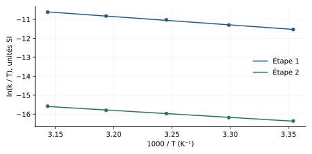

### Question 35 — Fermeture du cycle chélaté

Dans $I_2$, le soufre est déjà fixé et il reste une molécule d’eau coordonnée. La prise du second site par un oxygène carboxylate de la même cystéine remplace cette eau et ferme le cycle chélaté. Il s’agit d’une substitution intramoléculaire à la sphère de coordination du métal.

### Question 36 — Interprétation de la seconde entropie d’activation

La valeur $\Delta S_2^\ddagger=-232{,}19\ \mathrm{J\,mol^{-1}\,K^{-1}}$ est compatible avec une configuration de transition très ordonnée. La chaîne portant le carboxylate doit se replier et s’orienter vers le site de l’eau. Dans un mécanisme d’interchange à caractère associatif, l’interaction Pt–O du carboxylate se développe pendant que Pt–eau se rompt. Un seul état de transition suffit entre deux complexes isolables tétracoordonnés ; aucune espèce stable de coordinence différente n’est nécessaire. Le signe de l’entropie soutient cette proposition sans en constituer à lui seul une preuve.

## B. Construction du squelette spirocyclique

### Question 37 — Installer le fragment à deux carbones

Utiliser le glyoxylate d’éthyle $\mathrm{O{=}CH{-}CO_2Et}$, réactif à quatre carbones. Une condensation de type aldolique entre son aldéhyde et le méthylène en α de la cétone 1 donne $\mathrm{C_\alpha H{-}CH(OH)CO_2Et}$. On peut former l’énolate de 1 avec NaH dans le THF sec, ajouter le glyoxylate à froid puis protoner en milieu aqueux. Une déshydratation ménagée du β-hydroxycarbonyle (chauffage avec un acide dilué non nucléophile et retrait de l’eau) installe $\mathrm{C_\alpha{=}CHCO_2Et}$ et fournit le mélange 2/2′. L’ester éthylique et le carbamate de 1 sont conservés.

### Question 38 — Relation entre les deux alcènes

Ce sont des diastéréoisomères géométriques. Dans 2, N et $\mathrm{CO_2Et}$ sont du même côté, ce qui donne Z (sur le carbone du cycle, N est prioritaire devant C). Dans 2′ ils sont opposés, d’où E. La conjugaison permet d’écrire $\mathrm{{:}N{-}C{=}CH{-}CO_2Et\leftrightarrow N^+{=}C{-}C^-H{-}CO_2Et}$, puis la forme énolate avec $\mathrm{O^-}$ sur le carbonyle de l’ester. Dans ces écritures la liaison entre les deux carbones de l’alcène porte moins de caractère double ; la barrière à la rotation est abaissée. Les formes mésomères décrivent chaque isomère, tandis que la rotation effective permet l’interconversion des configurations.

### Question 39 — Fraction réactive et rendement

La consommation de 2 déplace l’équilibre et 2′ régénère 2. Une fraction initiale $\alpha<1$ ne plafonne donc pas le rendement à $\alpha$ ; en l’absence de pertes la totalité du réservoir peut finir sous forme de 3. La proportion de 2 influe sur la vitesse apparente et donc sur la conversion à durée imposée. Pour un prééquilibre rapide, la vitesse est proportionnelle à $\alpha([2]+[2'])$ à concentration de diène fixée.

### Question 40 — Cycloaddition et état de transition

C’est une cycloaddition thermique de Diels–Alder. Appelons $u{=}v(\mathrm{OTIPS}){-}w{=}x$ le diène en conformation s-cis. Dans le diénophile 2, A est le carbone du cycle, B le carbone portant $\mathrm{CO_2Et}$. Dans l’orientation retenue, le cycle produit est A–B–u–v=w–x–A. Le substituant OTIPS se trouve ainsi éloigné de la région encombrée du futur centre spiro A. Trois déplacements de doublets décrivent l’acte concerté : $\pi(A,B)\to(A,x)$, $\pi(w,x)\to(v,w)$, $\pi(u,v)\to(u,B)$. Les deux nouvelles liaisons sont partielles dans l’état de transition à six électrons. L’approche est suprafaciale sur chaque partenaire. La liaison A–N et l’ester sur B restent du même côté ; dans l’énantiomère de référence, on les dessine tous deux en arrière. Une approche par l’autre face donne le miroir.

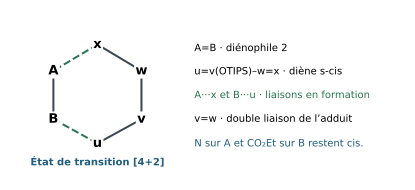

### Question 41 — Nombre de produits stéréoisomères

Le régioisomère retenu comporte deux nouveaux centres stéréogènes, A et B. La configuration relative de ces centres est imposée par le diénophile Z et l’addition suprafaciale. Les deux faces équivalentes de 2 en milieu achiral donnent une seule paire d’énantiomères, soit deux stéréoisomères équiprobables, réunis dans $3^{\pm}$.

### Question 42 — Du silylénol à la cétone

Le fluorure attaque le silicium ; la liaison O–Si se rompt avec départ de l’énolate. Après protonation et tautomérie, v porte une cétone et w est saturé. C’est la cyclohexanone 4, qui possède aussi la cétone initiale de l’indolinone. Le bilan avec l’eau comme source de proton s’écrit $\mathrm{éther\ d’énol{-}OTIPS+F^-+H_2O\to 4+TIPS{-}F+OH^-}$. La formation de Si–F (610 kJ par mole) en remplacement de Si–O (398 kJ par mole) fournit une contribution d’environ 212 kJ par mole en faveur de cette coupure ; ces seules énergies ne constituent pas le bilan thermodynamique entier.

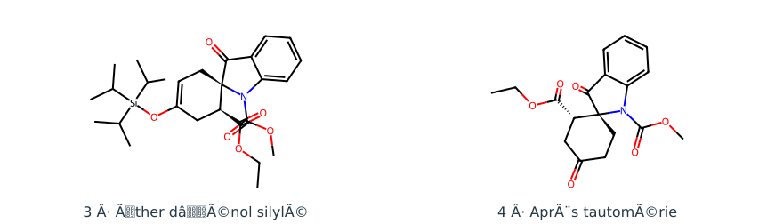

## Contrôle des fonctions et des faces

### Question 43 — Protection sélective et addition allylique

Le diol transforme la cétone cyclohexanique de 4 en un cétal cyclique $\mathrm{C(OCH_2CH_2O)}$ à cinq chaînons, sous catalyse acide. Dans 5 subsistent la cétone indolinonique, le carbamate et l’ester. Pour 5 vers 6, un doublet de l’oxygène carbonylé coordonne Mg ; la liaison C–Mg du groupe allyle fournit une liaison C–C au carbone carbonylé et le doublet π du carbonyle va sur O. On obtient l’alcoolate $\mathrm{R_2C(O^-){-}CH_2CH{=}CH_2}$ associé à $\mathrm{MgBr^+}$. Un proton de $\mathrm{NH_4^+}$ est transféré à l’alcoolate au traitement aqueux, avec formation de l’alcool tertiaire et de $\mathrm{NH_3}$. L’oxygène a deux doublets avant l’addition, trois dans la forme alcoolate libre et deux après protonation.

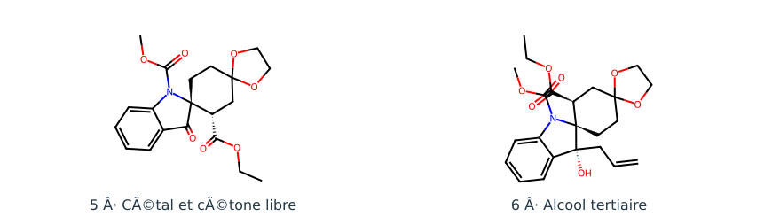

### Question 44 — Solvant de l’organomagnésien

Il faut un milieu anhydre, aprotique, sans fonction électrophile réagissant avec le magnésien. Un éther tel que le THF solvate et coordonne le magnésium par l’oxygène et dissout le réactif. L’eau ou un alcool protonnerait le groupe allyle avant l’addition. L’hydrolyse n’intervient qu’après la formation de la liaison C–C.

### Question 45 — Attributions du spectre de 5

A est le $\mathrm{CH_3}$ du groupe éthyle (3 H, triplet, $J=7{,}2$ Hz). D, à 3,61–3,72 ppm, est compatible avec ses deux protons $\mathrm{OCH_2}$, rendus non équivalents dans l’environnement chiral. F est le $\mathrm{OCH_3}$ du carbamate (3 H, singulet) et H correspond aux quatre H aromatiques. Une attribution cohérente des multiplets restants donne E au proton méthinique du cycle portant $\mathrm{CO_2Et}$ (1 H) et G aux quatre H des deux méthylènes oxygénés du cétal. Les fourchettes et intégrations seules ne constituent pas une corrélation bidimensionnelle.

### Question 46 — Chimiosélectivité du magnésien

La cétone non protégée est le site carbonylé le plus réactif envers l’organomagnésien. La cétone cyclohexanique est masquée en cétal, stable en milieu basique. L’ester et le carbamate sont désactivés par donation mésomère ; la basse température et le temps de contact limitent leur réaction. Le produit décrit montre un seul nouvel allyle au carbone de la cétone à cinq chaînons.

### Question 47 — Face d’addition au carbonyle

Dans la chaise de gauche de la figure 8, $R^1$ et $R^2$ sont les deux oxygènes reliés par $\mathrm{-CH_2CH_2-}$ du cétal. $R^3=\mathrm{CO_2Et}$ est équatorial, $R^4=\mathrm H$ axial et $R^5=\mathrm{CO_2Me}$. Les deux faces de la cétone indolinonique sont diastéréotopiques. L’addition du carbone nucléophile de l’allyle sur la face la moins encombrée par la chaise, avec déplacement de la liaison π vers O, donne l’alcoolate majoritaire. Après protonation, dans le repère de 6 de la figure 7, OH est en coin plein et l’allyle en coin hachuré ; A–N et la liaison du cycle vers l’ester sur B sont hachurées. Tous les coins sont inversés pour le partenaire miroir.

### Question 48 — Conservation du racémate

Un énantiomère de 5 favorise une des deux faces de son carbonyle. Son miroir favorise la face miroir avec la même constante de vitesse, puisque réactif et milieu sont achiraux. Les deux molécules de 6 ainsi formées sont énantiomères et apparaissent en quantités égales. Une sélectivité entre deux issues diastéréoisomères pour un substrat individuel est compatible avec un mélange final racémique.

### Question 49 — Lewis du borane perfluoroarylé

Le bore est trigonal plan, lié par trois liaisons simples aux carbones ipso de trois groupes pentafluorophényle. Il porte six électrons et une orbitale $p$ vacante perpendiculaire au plan. Chaque cycle porte trois liaisons π dans une écriture de Kekulé ; chacun de ses cinq F porte trois doublets libres. L’espèce neutre est un acide de Lewis susceptible de fixer un donneur de doublet. L’effet inductif attracteur des F renforce le caractère électron-déficient du bore.

### Question 50 — Remplacement du groupe hydroxyle

Dans $\mathrm{Me_3Si{-}C{\equiv}N}$ la liaison est polarisée $\mathrm{Si^{\delta+}{-}C^{\delta-}}$ ; une rupture hétérolytique avec le doublet sur C correspond à un transfert formel de $\mathrm{{:}C{\equiv}N^-}$ par son carbone. Un doublet de l’oxygène alcoolique de 6 se lie au bore portant une lacune. Cette activation facilite la coupure C–O et stabilise le fragment oxygéné partant. Au centre tertiaire benzylique, un caractère carbocationique et une paire d’ions restent compatibles avec l’attaque préférentielle sur la face opposée au groupe partant. La liaison C–C du nitrile se forme et le bras allyle subsiste. Dans le repère de la planche, 7 porte CN en arrière et l’allyle en avant, soit une inversion géométrique par rapport à 6. Le produit ne suffit pas à établir une substitution bimoléculaire concertée sur ce carbone tertiaire.

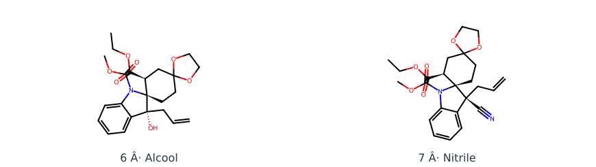

### Question 51 — Clivage oxydant du groupe terminal

Dans 7, $\mathrm{R{-}CH_2{-}CH{=}CH_2}$ donne $\mathrm{R{-}CH_2{-}CHO}$ dans 8 et du méthanal provenant de l’extrémité. Le tétroxyde d’osmium effectue l’addition syn d’oxygène à l’alcène ; le periodate assure la coupure du diol vicinal et la réoxydation des espèces d’osmium. La 2,6-lutidine est une base encombrée qui limite l’acidification du milieu et protège ainsi le cétal. Le mélange dioxane/eau à température ambiante assure la compatibilité des espèces organiques et ioniques, puis le thiosulfate réduit les oxydants résiduels. Le nitrile, les esters et le cétal figurent toujours dans 8.

### Question 52 — Réduction sélective de l’aldéhyde

Le borohydrure transfère un hydrure au carbone de l’aldéhyde ; l’alcoolate est protoné lors du traitement aqueux. Le bras $\mathrm{R{-}CH_2{-}CHO}$ devient $\mathrm{R{-}CH_2{-}CH_2OH}$ dans 9. Dans ces conditions douces, le nitrile, l’ester éthylique, le carbamate et le cétal sont conservés.

### Question 53 — Restitution de la cyclohexanone

En milieu aqueux acide, les deux liaisons C–O du cétal sont hydrolysées en sens inverse de sa formation. Le sommet v du cyclohexane redevient $\mathrm{C{=}O}$, avec libération d’éthylène glycol. Dans 10, la chaîne $\mathrm{-CH_2CH_2OH}$, CN, $\mathrm{CO_2Et}$ et le carbamate restent aux positions de 9.

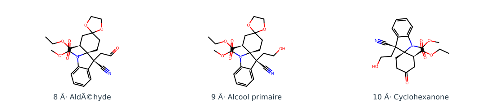

### Question 54 — Ordre des opérations

La protection de la cyclohexanone évite une addition parasite du magnésien à l’étape 5 vers 6. Le cétal supporte ensuite la coupure de l’alcène en milieu contrôlé et reste nécessaire pendant la réduction de l’aldéhyde, car le borohydrure pourrait aussi réduire une cyclohexanone libre. Le remplacement du premier OH est effectué avant de créer un second alcool par réduction du bras allyle. On libère donc la cétone seulement après cette réduction, par hydrolyse acide du cétal.

## Fermeture du pont et dédoublement

### Question 55 — Former le pont azoté de 12

Convertir les deux alcools de 11 en mésylates au moyen du chlorure de méthanesulfonyle et d’une amine tertiaire qui neutralise HCl. Une base peu nucléophile, par exemple le carbonate de césium, permet ensuite l’alkylation intramoléculaire du N du lactame. Le doublet de l’amidate attaque le $\mathrm{CH_2}$ primaire terminal du bras $\mathrm{-CH_2CH_2OMs}$ avec départ de mésylate. La nouvelle liaison N–C ferme le pont à huit chaînons de 12. Le mésylate secondaire voisin du carbonyle du lactame et l’ester éthylique subsistent.

### Question 56 — Compétition de l’alkylation en α de l’ester

Une autre déprotonation peut former l’énolate de l’ester, au carbone B porteur de $\mathrm{CO_2Et}$. Sa forme à carbone nucléophile peut déplacer intramoléculairement le mésylate primaire. On propose pour 13 un cycle à cinq chaînons dont le contour est B–A–carbone portant CN–$\mathrm{CH_2}$–$\mathrm{CH_2}$–B. Le nouveau lien remplace le H initial de B. Le NH du lactame et le mésylate secondaire sont conservés. Cette proposition concurrence la fermeture à huit chaînons entre N et le même carbone primaire ; elle n’exige pas d’aziridinone fortement contrainte.

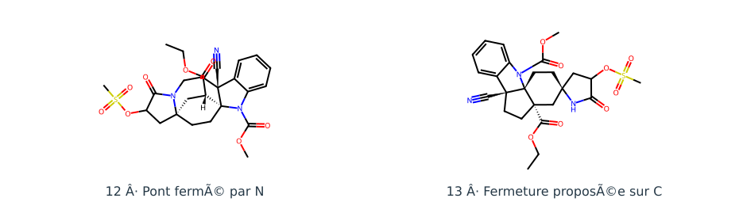

### Question 57 — Lactame insaturé et deux esters méthyliques

Faire partir le mésylate secondaire par une β-élimination en prélevant un H sur le méthylène voisin du cycle lactame. La liaison $\mathrm{C_\alpha{=}C_\beta}$ qui apparaît est conjuguée au carbonyle ; une substitution suivie d’une élimination de sélénoxyde constitue aussi une voie vers cette double liaison lorsque la géométrie contrarie l’élimination directe. Utiliser ensuite l’« hydrolyse nitrile » du sujet pour convertir $\mathrm{R{-}CN}$ en $\mathrm{R{-}CO_2H}$. Une estérification dans le méthanol, puis la transestérification $\mathrm{CO_2Et\to CO_2Me}$ en excès de méthanol, fournissent les deux esters méthyliques de 15. Le lactame, le carbamate $\mathrm{N{-}CO_2Me}$ et les centres quaternaires restent en place.

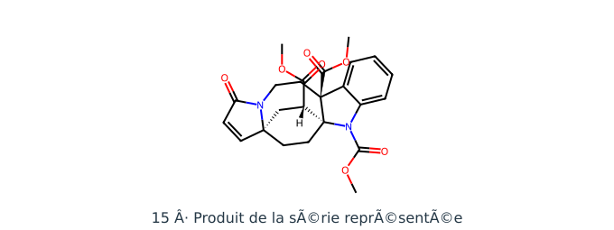

### Question 58 — Moment choisi pour dédoubler la série

Une colonne chirale peut séparer les énantiomères dès 11. Un dédoublement chimique est aussi possible en dérivant réversiblement l’alcool primaire de 11 avec un acide énantiopur. Les esters diastéréoisomères sont séparés, puis hydrolysés en préservant les stéréocentres du squelette. Il faut contrôler la sélectivité et tenir compte des épimères éventuels au carbone dont OH est représenté par un lien ondulé. Choisir le squelette de la série désirée dès 11 économise les réactifs des étapes suivantes. Une alternative tardive utilise l’acide issu du nitrile, qui donne deux sels diastéréoisomères avec une amine énantiopure. Une résolution simple d’un racémate donne au plus 50 % de la série choisie sans recyclage.

Les structures de la partie B peuvent également être rapprochées du travail de C. Wang et collaborateurs sur la grandilodine B. La numérotation des composés dans cet article diffère de celle du sujet. [Données complémentaires de la publication](https://doi.org/10.1021/acs.orglett.7b00591.s001)
