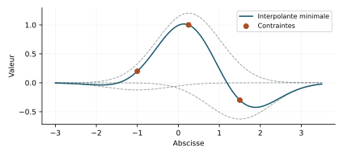

# X-ESPCI-ENS · PC · Mathématiques 2020 · Corrigé brut

*Corrigé rédigé par IA, non officiel. Signalez toute erreur.*

**Rédaction** · GPT-6.2 Astra Ultra · vitesse non renseignée

**Révision** · GPT-6.2 Astra Ultra · vitesse non renseignée

Les cinq parties construisent le noyau gaussien, l’espace de ses translatées et une interpolante d’énergie minimale. [Sujet officiel](https://banques-ecoles.fr/cms/wp-content/uploads/2020/11/2020_PC_sujet_Math.pdf) · [Rapport du jury](https://banques-ecoles.fr/cms/wp-content/uploads/2020/11/20_PC_rap_eMath.pdf)

## I. Produit de Schur

### Question 1

La matrice $aA+bB$ est symétrique par linéarité de la transposition. Pour tout $u$, $u^\top(aA+bB)u=a(u^\top Au)+b(u^\top Bu)\ge0$ lorsque $a,b\ge0$. Cela prouve l’appartenance au cône $\mathrm{Sym}^+(p)$.

### Question 2

La matrice $vv^\top$ est symétrique et $u^\top vv^\top u=(v^\top u)^2\ge0$ pour tout $u\in\mathbb R^p$. Elle est donc positive, y compris lorsque $v=0$.

### Question 3a

Le coefficient de gauche est $(u_iu_j)(v_iv_j)=(u_iv_i)(u_jv_j)$. Or $u_iv_i$ est la coordonnée $i$ de $u\odot v$, donc c’est bien le coefficient de $(u\odot v)(u\odot v)^\top$.

### Question 3b

On a $\lambda_k=u_k^\top A u_k\ge0$. Pour tout $x$, écrivons $x=\sum_k(u_k^\top x)u_k$. En appliquant $A$, on obtient $Ax=\sum_k\lambda_k u_k(u_k^\top x)$, donc $A=\sum_k\lambda_k u_ku_k^\top$.

### Question 3c

Décomposons $A=\sum_i\lambda_i u_i u_i^\top$ et $B=\sum_j\mu_j v_jv_j^\top$ avec valeurs propres positives ou nulles. Par 3a,
$$A\odot B=\sum_{i,j}\lambda_i\mu_j(u_i\odot v_j)(u_i\odot v_j)^\top.$$
Les coefficients sont positifs ou nuls et chaque matrice est positive par 2. La stabilité par somme de 1 conclut.

## II. Noyau gaussien positif

### Question 4a

Par la récurrence de définition, $A^{(k)}_{ij}=(A_{ij})^k$ pour $k\ge1$ et $A^{(0)}_{ij}=1$. Ainsi $P[A]_{ij}=\sum_{k=0}^n a_k A^{(k)}_{ij}$ pour tous $i,j$.

### Question 4b

Si $\mathbf1$ est le vecteur de uns, $A^{(0)}=\mathbf1\mathbf1^\top$ est positive par 2. Par 3c, $A^{(k)}\odot A=A^{(k+1)}$ est positive dès que $A^{(k)}$ l’est. La somme en 4a à coefficients $a_k\ge0$ est donc positive.

### Question 5a

Pour tous $i,j$, $P_n[A]_{ij}=\sum_{k=0}^n(A_{ij})^k/k!\to e^{A_{ij}}$, la série exponentielle étant convergente sur toute la droite.

### Question 5b

La symétrie de $A$ donne celle de $\exp[A]$. Pour tout $u$, $u^\top\exp[A]u=\lim_n u^\top P_n[A]u$, car il s’agit d’une somme finie de coefficients convergents. Le membre de droite est une limite de nombres positifs ou nuls par 4b. D’où $\exp[A]\in\mathrm{Sym}^+(p)$.

Ici l’exponentielle agit sur chaque coefficient. Par exemple, pour la matrice nulle, $\exp[0]$ est la matrice remplie de uns, positive de rang un pour $p\ge1$. Cet exemple vérifie le rôle du terme constant $A^{(0)}$ dans le passage à la limite.

### Question 5c

Les questions 5b et 2 rendent positives les matrices $\exp[A]$ et $uu^\top$. Leur produit terme à terme est positif par 3c.

### Question 6a

Les produits scalaires rendent $A$ symétrique et, pour $v\in\mathbb R^p$, $v^\top Av=\|\sum_i v_i x_i\|^2\ge0$. Ainsi toute matrice de Gram de ces vecteurs est positive.

### Question 6b

Le coefficient vaut $\exp(\langle x_i,x_j\rangle-\|x_i\|^2/2-\|x_j\|^2/2)=\exp(-\|x_i-x_j\|^2/2)$ par la formule de polarisation.

### Question 6c

Appliquons 6a, 5c et 6b aux points $x_i/\sqrt\lambda$. La matrice obtenue est exactement $K_{ij}=\exp(-\|x_i-x_j\|^2/(2\lambda))$, donc elle est symétrique positive. À ce stade les points peuvent coïncider.

## III. Convolution gaussienne

### Question 7

Si $|f(y)|\le A e^{-y^2/a}$ et $|g(y)|\le B e^{-y^2/b}$, leur produit continu vérifie $|f(y)g(y)|\le AB e^{-(1/a+1/b)y^2}$, intégrable sur $\mathbb R$. L’intégrale du produit est donc absolument convergente.

### Question 8a

L’intégrale de $f^2$ est positive ou nulle, et vaut zéro si $f=0$. Si $f(y_0)\ne0$, il existe un intervalle de longueur positive autour de $y_0$ sur lequel $|f|\ge|f(y_0)|/2$. Son intégrale carrée y est strictement positive. Ainsi $(f\mid f)=0$ équivaut à $f=0$.

### Question 8b

Pour $x$ fixé, $(y-x)^2\ge y^2/2-x^2$ car la différence des deux membres est $(y-2x)^2/2$. Donc $|\tau_x\gamma_\lambda(y)|\le e^{x^2/\lambda}e^{-y^2/(2\lambda)}$. La fonction est continue et satisfait la définition de $E$ avec $a=2\lambda$.

### Question 9a

L’identité de l’indication s’obtient en développant
$$\frac{(y-x)^2}{\lambda}+\frac{y^2}{a}
=\frac{a+\lambda}{a\lambda}\left(y-\frac{ax}{a+\lambda}\right)^2+\frac{x^2}{a+\lambda}.$$
Après translation puis changement d’échelle, l’intégrale vaut $c e^{-x^2/(a+\lambda)}$, avec $c=\sqrt{\pi a\lambda/(a+\lambda)}>0$. Les intégrales sont absolument convergentes.

### Question 9b

Si $|g(y)|\le A e^{-y^2/a}$, la question 9a donne $|C(g)(x)|\le Ac e^{-x^2/(a+\lambda)}$. Pour $x_n\to x$, les intégrandes $e^{-(y-x_n)^2/\lambda}g(y)$ tendent ponctuellement vers l’intégrande en $x$. Elles sont majorées en valeur absolue par $|g(y)|\le Ae^{-y^2/a}$, intégrable indépendamment de $n$. La convergence dominée donne la continuité de $C(g)$ et ainsi $C(g)\in E$.

### Question 9c

Pour $g,h\in E$ et $a,b\in\mathbb R$, $C(ag+bh)(x)=aC(g)(x)+bC(h)(x)$ par linéarité de l’intégrale convergente. La question 9b assure que l’image est dans $E$. Il s’agit donc d’un endomorphisme de $E$.

## IV. Produit scalaire reproduisant les évaluations

### Question 10

Chaque translatée appartient à $E$ par 8b. L’ensemble $G$ contient la fonction nulle (un coefficient nul), et les sommes ou multiples de combinaisons finies sont encore de cette forme. Il contient chaque translatée (un coefficient égal à un). Tout autre sous-espace les contenant contient toutes leurs combinaisons finies, donc contient $G$.

### Question 11a

On a $(y-x)^2+(y-x')^2=2(y-(x+x')/2)^2+(x-x')^2/2$. En divisant par $\lambda$ dans l’exposant et en intégrant la gaussienne translatée, on obtient $(\tau_x\gamma_\lambda\mid\tau_{x'}\gamma_\lambda)=c_\lambda\gamma_{2\lambda}(x-x')$ où $c_\lambda=\int_\mathbb R e^{-2z^2/\lambda}dz=\sqrt{\pi\lambda/2}>0$.

Prendre $x=x'$ permet de contrôler la constante de normalisation. Le membre de gauche vaut $\int e^{-2(y-x)^2/\lambda}\,dy=\sqrt{\pi\lambda/2}$ et le facteur $\gamma_{2\lambda}(0)$ de droite vaut $1$.

### Question 11b

Pour tout $y$, $C(\tau_x\gamma_\lambda)(y)=(\tau_y\gamma_\lambda\mid\tau_x\gamma_\lambda)=c_\lambda\gamma_{2\lambda}(y-x)$. L’image du sous-espace engendré est engendrée par les images des générateurs, et le facteur $c_\lambda\ne0$ s’absorbe dans les coefficients. Donc $H$ est l’ensemble des combinaisons linéaires finies des $\tau_x\gamma_{2\lambda}$.

### Question 12a

Réordonnons $x_1<\cdots<x_n$. Si la combinaison est nulle, multiplions sa valeur en $y$ par $e^{y^2/(2\lambda)}$ : on trouve $\sum_i b_i e^{x_i y/\lambda}=0$ avec $b_i=\alpha_i e^{-x_i^2/(2\lambda)}$. Divisons par $e^{x_n y/\lambda}$ et faisons $y\to+\infty$. Seul $b_n$ subsiste, donc $b_n=0$. Répétons jusqu’à $b_1=0$, donc tous les $\alpha_i$ sont nuls. La réciproque est immédiate.

### Question 12b

Écrivons $g\in G$ comme somme de translatées de centres distincts, après regroupement. Si $C(g)=0$, 11b donne une somme nulle de translatées de $\gamma_{2\lambda}$ dont les coefficients sont ceux de $g$ multipliés par $c_\lambda$. Par 12a ils sont nuls, donc $g=0$. La restriction $C|_G:G\to H$ est surjective par définition et injective. Son inverse linéaire $D$ est l’unique application satisfaisant les deux identités.

### Question 12c

Par 12b, $h=C(Dh)$. La définition de $C$ donne donc $h(x)=(\tau_x\gamma_\lambda\mid Dh)$ pour tout réel $x$.

### Question 13a

Le produit intégral est bilinéaire et symétrique par 7 et les propriétés de l’intégrale, et défini positif par 8a. Comme $D$ est linéaire injective et $c_\lambda>0$, $c_\lambda(Dh_1\mid Dh_2)$ est bilinéaire symétrique et ne donne zéro sur la diagonale que pour $h_1=h_2=0$. C’est donc un produit scalaire sur $H$.

### Question 13b

Par 11b, $D(\tau_x\gamma_{2\lambda})=c_\lambda^{-1}\tau_x\gamma_\lambda$. Ainsi $(\tau_x\gamma_{2\lambda}\mid h)_H=(\tau_x\gamma_\lambda\mid Dh)=h(x)$ d’après 12c.

### Question 13c

En appliquant 13b à $h=\tau_x\gamma_{2\lambda}$, on trouve $\|\tau_x\gamma_{2\lambda}\|_H^2=\gamma_{2\lambda}(0)=1$. Par Cauchy-Schwarz, $|h(x)|=|(\tau_x\gamma_{2\lambda}\mid h)_H|\le\|h\|_H$. Prendre le supremum en $x$ donne la borne.

## V. Interpolation de norme minimale

### Question 14

Si $h,k\in S^*$, leur milieu est encore dans $S$ par linéarité des évaluations. Le parallélogramme donne
$$J((h+k)/2)=\tfrac12(J(h)+J(k))-\tfrac18\|h-k\|_H^2.$$
Le membre de gauche est au moins $J^*$ et les deux énergies de droite valent $J^*$. Donc $h=k$, ce qui établit l’unicité conditionnelle.

### Question 15

Si $h_0\in H_0$, la fonction $\tilde h+th_0$ satisfait toutes les contraintes pour tout $t\in\mathbb R$. Son énergie est $J(\tilde h)+t(\tilde h\mid h_0)_H+t^2\|h_0\|_H^2/2$, minimale en $t=0$. Sa dérivée y est nulle, donc $(\tilde h\mid h_0)_H=0$.

### Question 16a

La question 15 donne $S^*\subset S\cap H_0^\perp$. Si $h\in S\cap H_0^\perp$ et $k\in S$, alors $k-h\in H_0$. Par orthogonalité, $J(k)=J(h)+\|k-h\|_H^2/2\ge J(h)$. Donc $h$ atteint l’infimum et $S^*=S\cap H_0^\perp$.

### Question 16b

Si $h_0\in H_0$, alors $(\tau_{x_i}\gamma_{2\lambda}\mid h_0)_H=h_0(x_i)=0$ pour chaque $i$. L’orthogonal étant un sous-espace vectoriel, il contient toutes les combinaisons de ces translatées.

### Question 17a

On a $h_\alpha(x_i)=\sum_j\alpha_j\exp(-(x_i-x_j)^2/(2\lambda))=(K\alpha)_i$. Les $p$ contraintes sont donc exactement l’équation $K\alpha=a$.

### Question 17b

Par 13b les produits scalaires des translatées aux centres $x_i,x_j$ sont les $K_{ij}$. Ainsi $\alpha^\top K\alpha=\|h_\alpha\|_H^2$. Si $\alpha\ne0$, les centres distincts et 12a imposent $h_\alpha\ne0$. La norme est strictement positive. La matrice de Gram est donc définie positive et inversible.

### Question 18

La solution du système est $\alpha^*=K^{-1}a$. La fonction $h_{\alpha^*}$ appartient à $S$ par 17a et à $H_0^\perp$ par 16b. La question 16a prouve qu’elle minimise l’énergie, et 14 qu’elle est l’unique minimiseur. Enfin
$$J^*=\tfrac12(\alpha^*)^\top K\alpha^*=\tfrac12 a^\top K^{-1}a,$$
où l’on a utilisé la symétrie de $K^{-1}$.

Par exemple, avec deux centres distincts, posons $r=\exp(-(x_1-x_2)^2/(2\lambda))\in(0,1)$. La matrice $K$ a diagonale $1$ et hors-diagonale $r$. On retrouve $J^*=(a_1^2-2ra_1a_2+a_2^2)/(2(1-r^2))$. Le dénominateur est strictement positif grâce à la distinction des centres, utilisée aussi dans la preuve générale.

