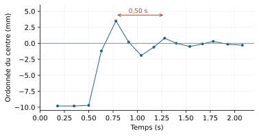
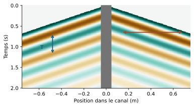
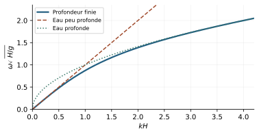
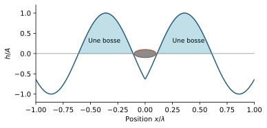
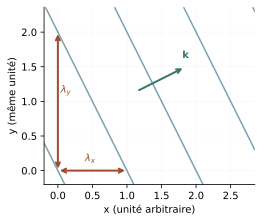
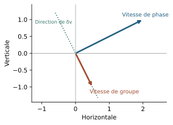
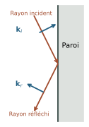
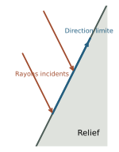

# X, ESPCI et ENS PC 2020 — Physique B · Corrigé brut

*Corrigé rédigé par IA, non officiel. Signalez toute erreur.*

**Lecture du rapport du jury** · GPT-6.2 Astra Ultra · vitesse non renseignée

**Rédaction** · GPT-6.2 Astra Ultra · vitesse non renseignée

## Ondes de gravité dans un fluide

## Flottabilité et oscillations libres

### Question 1 — Densité du cylindre

Le volume total est $V=\pi D^2L/4$. À l’équilibre, le poids $\rho_cVg$ égale la poussée d’Archimède $\rho gV_{\rm im}$. Une immersion à moitié donne $V_{\rm im}=V/2$, donc $\rho_c=\rho/2\simeq5,0\times10^2\,\mathrm{kg\,m^{-3}}$ pour de l’eau de masse volumique $10^3\,\mathrm{kg\,m^{-3}}$. Le centre est alors au niveau de l’interface.

### Question 2 — Pulsation par analyse dimensionnelle

Le rappel provient de la gravité. Dans la limite considérée, le fond n’intervient pas. Le mouvement est identique sur toute la longueur en géométrie bidimensionnelle. La masse et la variation de poussée sont toutes deux proportionnelles à $L$, facteur qui s’élimine. Les densités ne peuvent former qu’un rapport, ici fixé à $1/2$. À petites oscillations, l’amplitude n’intervient plus dans la pulsation. Il reste donc $g$ et $D$. Dans $\omega_0^2=Cg^aD^b$, les dimensions temporelle et spatiale imposent $a=1$ puis $a+b=0$. Ainsi $\omega_0^2=Cg/D$ avec $C$ sans dimension.

### Question 3 — Volume déplacé lors d’une translation

À l’équilibre la section du cylindre dans le plan de flottaison est un rectangle de dimensions $D$ et $L$. Un déplacement vers le haut de $u>0$ retire une tranche immergée de volume $DLu$ au premier ordre. D’où $\delta V_{\rm im}=-DLu$. La largeur de la corde à l’altitude relative $u$ est $2\sqrt{R^2-u^2}=D[1+O(u^2/R^2)]$, ce qui justifie la linéarisation pour les deux signes de $u$.

### Question 4 — Force de rappel hydrostatique

En retranchant l’équilibre au bilan vertical, $m\ddot u=\rho g\,\delta V_{\rm im}=-\rho gDLu$. La masse vaut $m=(\rho/2)\pi D^2L/4$. Ainsi $\ddot u+\omega_0^2u=0$ avec $\omega_0^2=8g/(\pi D)$. La raideur $K=\rho gDL$ est positive et la force est orientée vers l’équilibre.

### Question 5 — Fréquence propre

Avec $D=0,15\,\mathrm m$, $\omega_0=\sqrt{8\times9,81/(\pi\times0,15)}\simeq12,9\,\mathrm{rad\,s^{-1}}$. La fréquence cyclique vaut $f_0=\omega_0/(2\pi)\simeq2,05\,\mathrm{Hz}$ et la période environ $0,49\,\mathrm s$.

## Mesure de l’amortissement et traînée

### Question 6 — Fréquence et qualité mesurées

Sur la figure 2 le flotteur est relâché vers $0,50\,\mathrm s$ depuis $Y\simeq-9,8\,\mathrm{mm}$. Le niveau final est voisin de zéro, donc $u_0\simeq-10\,\mathrm{mm}$ et l’amplitude initiale est d’environ $10\,\mathrm{mm}$. Deux sommets vers $0,78$ et $1,28\,\mathrm s$ donnent $T_{\rm exp}\simeq0,50\,\mathrm s$, soit $f_{\rm exp}\simeq2,0\,\mathrm{Hz}$. Avec une enveloppe exponentielle et les creux proches de $0,50$ et $1,04\,\mathrm s$, le décrément sur un cycle vaut approximativement $\delta=\ln(9,8/1,9)\simeq1,6$. Dans un modèle d’oscillateur amorti, $Q=\sqrt{1/4+(\pi/\delta)^2}\simeq2$. L’incertitude de lecture et l’origine de l’amortissement invitent à garder cet ordre de grandeur.

### Question 7 — Comparaison des deux fréquences

Les valeurs $2,0$ et $2,05\,\mathrm{Hz}$ concordent à quelques pour cent. La poussée hydrostatique explique donc bien l’échelle de fréquence. Dans le modèle à amortissement linéaire, $f_{\rm exp}/f_0=\sqrt{1-1/(4Q^2)}\simeq0,97$ pour $Q\simeq2$. Une petite baisse par rapport à $f_0$ est ainsi compatible avec une enveloppe qui décroît vite.

### Question 8 — Nombre de Reynolds au début des oscillations

L’écoulement contourne le cylindre transversalement sur une dimension $D$. Prenons comme vitesse caractéristique $V_\star=\omega_{\rm exp}|u_0|\simeq2\pi(2,0)(0,010)\simeq0,13\,\mathrm{m\,s^{-1}}$. Avec $\nu=10^{-6}\,\mathrm{m^2\,s^{-1}}$, $\mathrm{Re}=V_\star D/\nu\simeq2\times10^4$. Cette estimation initiale est élevée devant un. Les forces d’inertie de l’eau jouent un rôle important et la traînée de Stokes ne convient pas à cette échelle.

### Question 9 — Traînée transversale

Pour un cylindre totalement immergé à grand Reynolds, on modélise la force par $\mathbf F_T=-\tfrac12\rho C_D(DL)|V|V\,\mathbf u_y$. Le facteur $DL$ est l’aire projetée perpendiculairement à la vitesse et $C_D$ un coefficient de traînée d’ordre unité dans cette estimation. Le facteur $|V|$ garantit l’opposition au mouvement lors des deux demi-oscillations.

### Question 10 — Comparaison de deux forces caractéristiques

Pour une amplitude $B$ et une vitesse caractéristique $V_\star=\omega B$, les normes typiques sont $F_{T,\star}=\rho C_DDL\,\omega^2B^2/2$ et $F_{R,\star}=\rho gDLB$. Leur rapport est $K_{\rm TR}=C_D\omega^2B/(2g)$. En prenant $\omega\simeq\omega_0$, on obtient $K_{\rm TR}\simeq(4C_D/\pi)(B/D)$. Il s’agit d’un rapport d’échelles, les deux maxima interviennent à des phases différentes.

### Question 11 — Poids relatif de la traînée

Avec $C_D\sim1$ et $B\simeq0,010\,\mathrm m$ au départ, $K_{\rm TR}\simeq(4/\pi)0,01/0,15\simeq0,08$. La traînée intervient mais reste faible devant le rappel, et le rapport diminue encore avec l’amplitude. À elle seule, cette estimation rend difficile d’expliquer la forte perte observée en une période. Il faut examiner l’énergie qui quitte le flotteur avec les vagues.

## Lecture de la chronophotographie et dispersion

### Question 12 — Lecture d’un diagramme espace-temps

L’horizontale de la photographie inférieure de la figure 3 est la position dans le canal. La verticale, orientée vers le bas, est le temps. Chaque ligne oblique suit un même motif lumineux du passage de l’onde à la hauteur d’observation. À mesure que le temps augmente, le motif s’écarte du cylindre, à droite et à gauche. Les lignes centrales verticales localisent le flotteur. Des lignes obliques de même phase séparées régulièrement signalent l’émission successive d’ondes par ses oscillations.

### Question 13 — Période de l’onde émise

À abscisse fixe près du flotteur, coupons plusieurs bandes de même aspect. Leur espacement vertical est environ un sixième de la hauteur de la chronophotographie, qui représente $3\,\mathrm s$ ou $750$ images. Une période correspond ainsi à environ $125$ images, soit $T'\simeq125/250\simeq0,50\,\mathrm s$. On retrouve $f'_{\rm exp}\simeq2\,\mathrm{Hz}$. Les dernières traces affaiblies fournissent une lecture moins précise.

### Question 14 — Échelle horizontale et longueur d’onde

Le diamètre du flotteur au niveau de sa plus grande largeur donne l’étalon horizontal $D=0,15\,\mathrm m$. À temps fixé, du même côté du cylindre, deux bandes de même phase se séparent d’environ $3,5$ à $4$ diamètres sur les traces centrales lisibles. La longueur d’onde est donc de l’ordre de $0,5$ à $0,6\,\mathrm m$. Une autre lecture consiste à suivre une même bande sur une période verticale et à mesurer son déplacement horizontal.

### Question 15 — Célérité mesurée

En divisant la distance de répétition du motif par sa période, $c_{\rm exp}=\lambda_{\rm exp}f'_{\rm exp}\simeq1,0$ à $1,2\,\mathrm{m\,s^{-1}}$. La pente des traits donne aussi $|\Delta x/\Delta t|$ après conversion séparée des deux axes. Les bandes larges rendent une précision au centième illusoire.

### Question 16 — Dispersion à profondeur finie

La branche positive est $\omega=\sqrt{gk\tanh(kH)}$. Pour $kH\ll1$, $\omega=\sqrt{gH}\,k[1-(kH)^2/6+O((kH)^4)]$. La courbe part donc de zéro, tangente à la droite de pente $\sqrt{gH}$, puis légèrement en dessous d’elle. Pour $kH\gg1$, $\tanh(kH)=1-2e^{-2kH}+\cdots$, donc $\omega\simeq\sqrt{gk}(1-e^{-2kH})$. La croissance se poursuit avec une pente décroissante. La courbe approche par-dessous le graphe de l’eau profonde.

### Question 17 — Limite non dispersive

Quand $kH\ll1$ pour l’ensemble des composantes de l’onde, $\omega\simeq\sqrt{gH}\,k$. Les vitesses de phase $\omega/k$ et de groupe $d\omega/dk$ coïncident et ne dépendent plus du nombre d’onde à cet ordre. La profondeur doit ainsi être petite devant $\lambda/(2\pi)$.

### Question 18 — Vitesse suivie par les bandes

La lecture $\lambda_{\rm exp}/T_{\rm exp}$ suit la répétition d’un motif de phase déterminée. Elle mesure donc la vitesse de phase $c_\phi=\omega/k$. Pour mesurer la vitesse de groupe, on suivrait l’enveloppe d’un paquet dont plusieurs composantes ont des nombres d’onde voisins.

### Question 19 — Célérité en eau peu profonde

La loi linéaire de Q16 donne $c=\sqrt{gH}$. Avec $H=0,20\,\mathrm m$, $c\simeq\sqrt{1,96}\simeq1,4\,\mathrm{m\,s^{-1}}$. L’ordre de grandeur est celui de la mesure, la limite peu profonde donnant une valeur supérieure à $c_{\rm exp}$. Ici $2\pi H/\lambda_{\rm exp}\sim2$, donc l’hypothèse $kH\ll1$ est quantitativement imparfaite. Pour $kH>0$, le rapport exact $c_\phi/\sqrt{gH}=\sqrt{\tanh(kH)/(kH)}$ est inférieur à un, dans le sens de l’écart observé.

## Énergie rayonnée par le flotteur

### Question 20 — Énergie potentielle d’une longueur d’onde

À l’abscisse $x$, la différence d’énergie par rapport à la tranche de surface plane est $dE_p=\rho gL\,dx\int_0^{h(x,t)}y\,dy=\tfrac12\rho gLh^2dx$. Le résultat est positif aussi dans un creux, où on a retiré de la masse à altitude négative. Comme $h=A\sin(\Omega_0t\pm kx)$, son carré moyen sur une période spatiale vaut $A^2/2$. Ainsi $E_p=\rho gLA^2\lambda/4$.

### Question 21 — Flux d’énergie potentielle

Dans le régime non dispersif retenu, une longueur d’onde passe devant une section en $T=\lambda/c$. La puissance potentielle moyenne transmise dans un sens est donc $\Phi_p=E_p/T=\rho gLA^2c/4$. Son unité est le watt. L’onde de l’autre côté du cylindre transporte le même flux en sens opposé.

### Question 22 — Deux bosses et une demi-oscillation

Sur une demi-longueur d’onde, le volume d’une bosse vaut $V_b=L\int_0^{\lambda/2}A\sin(kx)dx=2LA/k=LA\lambda/\pi$. Le flotteur descend de $2B$ entre ses deux positions extrêmes et déplace approximativement $2BDL$ d’eau. Cette eau remplit deux bosses, une de chaque côté. De $2LA\lambda/\pi=2BDL$, on tire $A=\pi BD/\lambda$.

### Question 23 — Amortissement par émission des ondes

Aux points de rebroussement, l’énergie du flotteur est $E_f=KB^2/2$ avec $K=\rho gDL$. En utilisant le flux potentiel demandé à la question 21 et en comptant les deux côtés, $\dot E_f=KB\dot B=-2\Phi_p=-\rho gL cA^2/2$. Avec Q22, $\dot B=-(\pi^2Dc/(2\lambda^2))B$. L’amplitude décroît donc comme $e^{-t/\tau}$ avec $\tau=2\lambda^2/(\pi^2Dc)$. Ce bilan utilise le seul flux potentiel indiqué dans l’énoncé. Dans un bilan mécanique complet d’ondes longues linéaires, l’énergie cinétique moyenne de l’onde égale son énergie potentielle, ce qui doublerait la puissance sortante et diviserait ce temps par deux.

### Question 24 — Qualité prédite par le modèle

L’enveloppe d’un oscillateur de facteur $Q$ évolue comme $e^{-\omega_0t/(2Q)}$. On identifie $Q=\omega_0\tau/2$. En assimilant à cette précision $T$ à la période propre, $\omega_0\simeq2\pi/T$, et en employant $\lambda=cT$, il vient $Q\simeq\pi\tau/T=2cT/(\pi D)$. Le quotient $cT/D$ compare la longueur d’onde au diamètre.

### Question 25 — Confrontation à l’expérience

Avec $c\simeq1,4\,\mathrm{m\,s^{-1}}$, $T\simeq0,50\,\mathrm s$ et $D=0,15\,\mathrm m$, on obtient $Q\simeq3$. Avec la vitesse de phase lue sur la chronophotographie, on obtiendrait $Q\simeq2$ à $2,5$. Le décrément de Q6 donnait environ $2$. Le rayonnement des vagues rend donc compte d’un amortissement de la bonne importance. Le modèle suppose des ondes longues, un partage géométrique du volume et une amplitude presque constante pendant un cycle. Cette dernière hypothèse n’est que marginale pour ces faibles valeurs de $Q$.

## Oscillations dans une eau stratifiée

### Question 26 — Flottabilité dans une stratification affine

Soit $V$ le volume du cylindre. La somme des poussées élémentaires vaut $g\int_V\rho_0(y)dV$. La masse volumique est affine en $y$ et la moyenne de $y$ sur ce cylindre homogène est la cote $Y$ de son centre. La poussée est donc exactement $gV\rho_0(Y)$. À l’équilibre $\rho_0(0)-\bar\rho Y_0/\ell=\rho_c$. Pour $Y=Y_0+u$, la différence avec le poids donne $\rho_c V\ddot u=-gV\bar\rho u/\ell$. D’où $\ddot u+\Omega_0^2u=0$ avec $\Omega_0=\sqrt{g\bar\rho/(\rho_c\ell)}$. Une ascension rencontre de l’eau plus légère, d’où le rappel.

### Question 27 — Immersion à mi-hauteur

Pour un profil affine, la moyenne verticale sur $[0,H]$ vaut $\bar\rho=H^{-1}\int_0^H\rho_0(y)dy=\rho_0(H/2)$. Avec $Y_0=H/2$, la condition d’équilibre fixe donc $\rho_c=\bar\rho$. On en déduit $\Omega_0^2=g/\ell$.

### Question 28 — Période d’oscillation interne

Avec $\ell\sim10^7\,\mathrm m$ et $g\simeq10\,\mathrm{m\,s^{-2}}$, $\Omega_0\simeq10^{-3}\,\mathrm{rad\,s^{-1}}$. La période vaut $T_0=2\pi\sqrt{\ell/g}\simeq6,3\times10^3\,\mathrm s$, soit environ $1\,\mathrm h\,45\,\mathrm{min}$. Un faible gradient salin ou thermique donne un rappel bien plus lent que celui de la surface libre.

## Propagation des ondes internes

### Question 29 — Normale aux fronts et périodes spatiales

À temps fixé, les fronts d’égale phase sont les droites $k_xx+k_yy=\mathrm{constante}$, de pente $-k_x/k_y=-2$. La normale orientée de propagation de phase est $\mathbf u=\mathbf k/|\mathbf k|=(2\mathbf u_x+\mathbf u_y)/\sqrt5$. En suivant l’axe horizontal à $y$ fixé, une reprise de phase de $2\pi$ a lieu après $\lambda_x=2\pi/k_x$. Verticalement, $\lambda_y=2\pi/k_y=2\lambda_x$. Ce sont les espacements entre intersections de deux fronts successifs avec les deux axes.

### Question 30 — Sens des quatre équations

La première impose l’incompressibilité, $\nabla\cdot\delta\mathbf v=0$. La deuxième exprime le transport de la masse volumique d’une parcelle sans diffusion. Linéariser $D\rho/Dt=0$ donne $\partial_t\delta\rho+\delta v_y\rho'_0=0$. Les deux dernières sont les projections horizontale et verticale de l’équation d’Euler linéarisée après soustraction de l’équilibre hydrostatique. La densité moyenne est utilisée dans l’inertie tandis que la variation de poids $-g\delta\rho$ subsiste en direction verticale.

### Question 31 — Système pour les amplitudes

Notons $(U,V,P,S)$ les amplitudes de $(\delta v_x,\delta v_y,\delta P,\delta\rho)$. Pour la phase donnée, les dérivées temporelle, horizontale et verticale deviennent $i\omega$, $-ik_x$ et $-ik_y$. En utilisant $\rho_0'=-\bar\rho/\ell$, le système est
$$
 k_xU+k_yV=0,\qquad i\omega S-\bar\rho V/\ell=0,
$$
$$
 i\bar\rho\omega U=ik_xP,\qquad i\bar\rho\omega V=ik_yP-gS .
$$
La pression est donc liée au gradient spatial, tandis que la perturbation de densité est déphasée relativement à la vitesse verticale.

### Question 32 — Élimination de la pression

Multiplions l’équation verticale par $k_x$ et soustrayons l’horizontale multipliée par $k_y$. On obtient $i\bar\rho\omega(k_xV-k_yU)=-gk_xS$. L’incompressibilité donne $k_xU=-k_yV$ et le transport $i\omega S=\bar\rho V/\ell$. Après multiplication par $i\omega k_x$, une onde interne non triviale satisfait $\omega^2(k_x^2+k_y^2)=(g/\ell)k_x^2$. La constante cherchée est $\alpha=\sqrt{g/\ell}$, en $\mathrm{rad\,s^{-1}}$. La branche de fréquence nulle s’atteint pour un vecteur d’onde vertical.

### Question 33 — Direction et fréquence

Si $\theta$ est l’angle orienté de $\mathbf k$ avec l’horizontale, $\cos\theta=k_x/k$, avec $k=\sqrt{k_x^2+k_y^2}>0$. La relation devient $\omega^2=\alpha^2\cos^2\theta$, soit $\omega=\alpha|\cos\theta|$ puisque la pulsation est choisie positive ou nulle.

### Question 34 — Ce que fixe la source

Pour une fréquence $0<\omega<\alpha$, l’excitation impose $|\cos\theta|=\omega/\alpha$. Dans le plan, quatre orientations du vecteur d’onde sont possibles par symétrie. Sa norme et donc la longueur d’onde restent libres à ce stade. Quand $\omega=\alpha$, $\mathbf k$ est horizontal. Au seuil inférieur $\omega=0$, il est vertical. Pour $\omega>\alpha$, aucune propagation de ce type avec un vecteur d’onde réel n’est possible. Le milieu est anisotrope.

### Question 35 — Vitesse des plans de phase

Pour un point suivant normalement un front, $d(\omega t-\mathbf k\cdot\mathbf r)/dt=0$ impose $\mathbf k\cdot\mathbf V_\phi=\omega$. La composante normale est $\mathbf V_\phi=(\omega/k^2)\mathbf k$. En remplaçant la fréquence, $\mathbf V_\phi=\alpha|k_x|(k_x\mathbf u_x+k_y\mathbf u_y)/k^3$. L’expression a bien la dimension d’une vitesse.

### Question 36 — Vitesse du paquet

Pour $k_x\ne0$, posons $s=\operatorname{sgn}(k_x)$. En dérivant $\omega=\alpha|k_x|/k$, on trouve $\partial_{k_x}\omega=\alpha s\,k_y^2/k^3$ et $\partial_{k_y}\omega=-\alpha |k_x|k_y/k^3$. Le vecteur de groupe est donc $\mathbf V_g=(\alpha s/k^3)(k_y^2\mathbf u_x-k_xk_y\mathbf u_y)$. Il fixe le sens de transport de l’énergie. La branche à pulsation positive a une pointe en $k_x=0$, où son gradient n’est pas défini par cette formule.

### Question 37 — Orthogonalités

Le produit $\mathbf k\cdot\mathbf V_g$ est proportionnel à $k_xk_y^2-k_yk_xk_y=0$. Comme $\mathbf V_\phi$ est colinéaire à $\mathbf k$, les deux vitesses sont orthogonales. Pour $k_xk_y\ne0$, le signe de $V_{\phi,x}$ comme celui de $V_{g,x}$ est celui de $k_x$. Si $k_y=0$, le groupe est nul. Enfin $k_xU+k_yV=0$ implique, en revenant au champ réel, $\mathbf k\cdot\delta\mathbf v=0$ à tout instant. La vitesse des parcelles oscille selon une droite parallèle à la direction du groupe.

### Question 38 — Cas de deux composantes positives

Pour $k_x=2k_y>0$, $\mathbf V_\phi$ est orientée suivant $(2,1)$, vers la droite et le haut. La formule de Q36 oriente $\mathbf V_g$ suivant $(1,-2)$, vers la droite et le bas. Son module est la moitié de celui de $\mathbf V_\phi$ dans ce cas, car $|\mathbf V_g|/|\mathbf V_\phi|=|k_y/k_x|$. Le mouvement local $\delta\mathbf v$ peut pointer dans les deux sens le long de la droite de pente $-2$ suivant la phase.

## Mesure des faisceaux et réflexion sur un relief

### Question 39 — Quatre faisceaux autour du cylindre

La carte instantanée de $\partial_y\delta\rho$ montre autour du cylindre une croix à quatre bras inclinés. De part et d’autre de chaque bras, le signal présente des zones de signes opposés. Les zones de perturbation intense restent concentrées dans les faisceaux issus de la source. Une seule onde plane aurait des fronts parallèles d’amplitude uniforme le long de chaque front. La dérivée verticale d’une telle onde garde cette propriété. La localisation et les deux orientations des bras requièrent donc une superposition de composantes. L’axe des bras indique la direction de transport de l’énergie.

### Question 40 — Pulsation déduite de la pente des bras

Sur la figure 5, en suivant l’axe d’un bras, le déplacement vertical vaut environ la moitié du déplacement horizontal. L’angle du groupe à l’horizontale a donc pour module $\beta\simeq25^\circ$ à $28^\circ$. Puisque $\mathbf V_g\perp\mathbf k$, $|\cos\theta|=\sin\beta$. Avec $\ell=12\,\mathrm m$, on obtient $\alpha=\sqrt{9,81/12}\simeq0,90\,\mathrm{rad\,s^{-1}}$, puis $\omega=\alpha\sin\beta\simeq0,4\,\mathrm{rad\,s^{-1}}$. Prendre l’angle par rapport à la mauvaise direction donnerait presque le double.

### Question 41 — Paroi verticale

Écrivons $\mathbf k_i=(2a,a)$ avec $a>0$. L’égalité des phases à tout instant et tout le long d’une paroi $x=\mathrm{constante}$ garde $\omega$ et $k_y=a$. La dispersion garde alors $|k_x|=2a$. Le groupe réfléchi doit repartir vers l’eau, donc $k_{x,r}=-2a$. Ainsi $\mathbf k_r=(-2a,a)$, avec $\mathbf V_{g,r}$ suivant $(-1,-2)$. Le groupe incident suivait $(1,-2)$. Les deux groupes ont la même composante verticale et des composantes horizontales opposées, comme les deux vecteurs d’onde pris séparément.

### Question 42 — Réflexion critique sur un talus

Les deux rayons incidents, de pente $-2$, atteignent la paroi $y-2x=\mathrm{constante}$ en deux points distincts. À fréquence fixée, les directions possibles pour l’énergie ont des pentes $\pm2$. La famille réfléchie de pente $+2$ est exactement parallèle à la paroi. Les deux rayons réfléchis limites sont donc portés par la même droite. La largeur transverse du faisceau tend vers zéro et la densité d’énergie augmente fortement au voisinage du talus si le flux entrant doit être conservé.

Le caractère singulier se vérifie par l’accord des phases. Pour un talus de pente $m$ proche de $2$, la tangente a pour direction $(1,m)$. Avec $\mathbf k_i=a(2,1)$ et $\mathbf k_r=b(2,-1)$, la conservation tangentielle donne $b(2-m)=a(2+m)$. Ainsi $|b|\to\infty$ quand $m\to2$, la longueur d’onde réfléchie tend vers zéro et $|\mathbf V_{g,r}|$ tend vers zéro. Le schéma représente la limite prise par des pentes légèrement inférieures à $2$, qui oriente la flèche vers le haut du talus. À la pente critique exacte, le modèle ne donne pas d’onde réfléchie régulière de nombre d’onde fini. En pratique la viscosité, la largeur finie des faisceaux ou la non-linéarité limitent la concentration.

